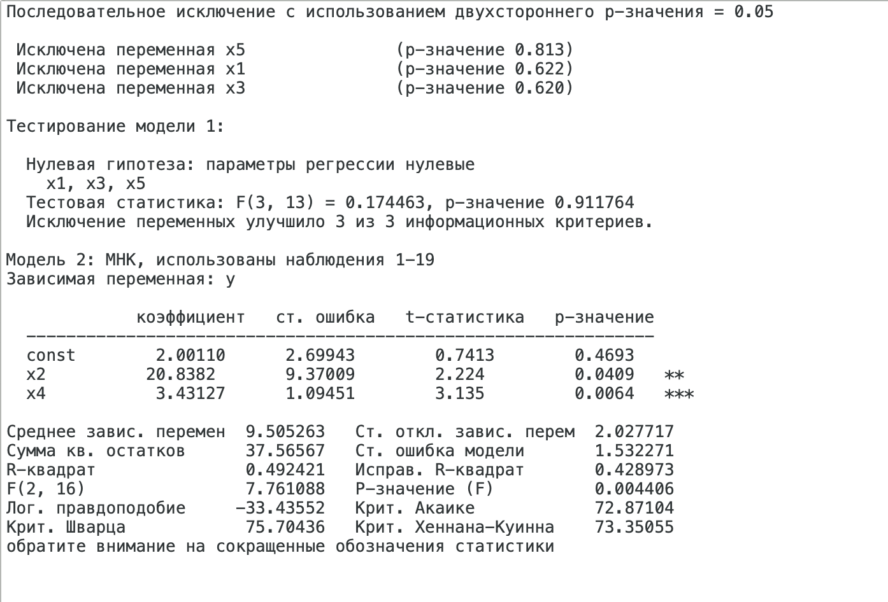
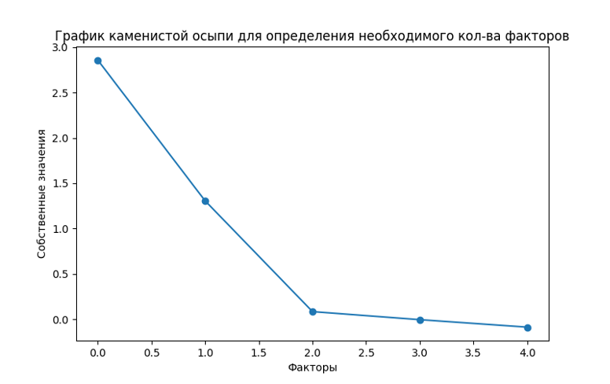
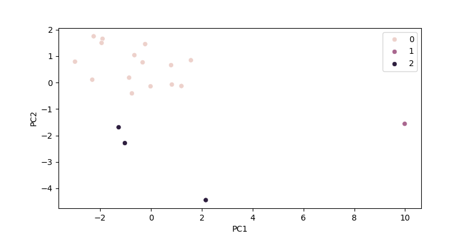
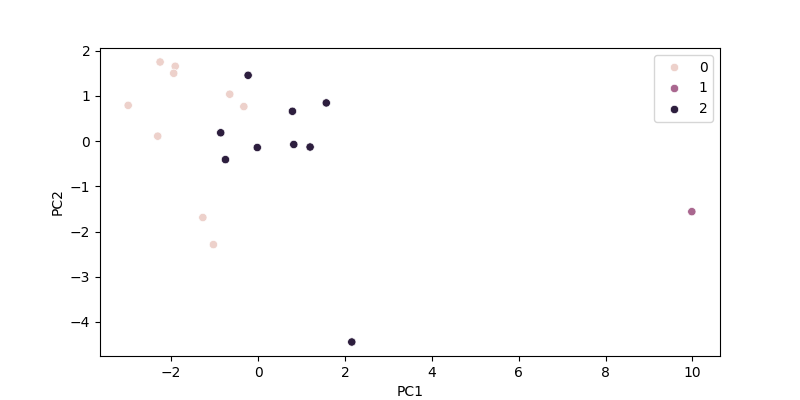

Кейс по предмету МСМ

Константинов Иван УСБО-01-21

Вариант № 4

Для многомерного статистического анализа мы взяли данные по урожайности,
где:

- Y -- урожайность зерновых культур (ц/га);

- X1 -- число колесных тракторов на 100 га (шт);

- X2 -- число зерноуборочных комбайнов на 100 га (шт);

- X3 -- число орудий поверхностной обработки почвы на 100 га (шт);

- X4 -- количество удобрений, расходуемых на гектар (т/га);

- X5 -- количество химических средств защиты растений, расходуемых на
  гектар (ц/га).

Также перед началом анализа мы вычеркнули 4 строку из нашего набора
данных.

# Часть 1. Корреляционный-регрессионный анализ

Мы построили матрицу парных коэффициентов корреляции. Видим, что
наибольшая взаимосвязь у результативного признака наблюдается с фактором
«количество удобрений, расходуемых на гектар». Также у нас есть сильная
взаимосвязь между отдельными факторными показателями, а точнее между X1,
X2, X3 и между X4, X5. Все это может указывать на наличие
мультиколлинеарности в наших данных (таб. 1).

Прежде чем переходить к проверке на мультиколлинеарность необходимо
проверить наши коэффициенты корреляции на значимость (таб. 2). Видим,
что все коэффициенты корреляции внутри группы X1, X2, X3 значимы, также
значимы коэффициенты внутри группы X4, X5, позже нам это пригодится для
факторного анализа. Из коэффициентов корреляции между факторными
признаками и результативным признаком значим только коэффициент
корреляции между X4 и Y.

Таблица 1 -- Матрица парных коэффициентов корреляции

  ---------------------------------------------------------
            x1      x2      x3      x4      x5      y
  --------- ------- ------- ------- ------- ------- -------
     x1     1,000   0,870   0,978   0,124   0,233   0,438

     x2     0,870   1,000   0,879   0,051   0,320   0,425

     x3     0,978   0,879   1,000   0,042   0,138   0,417

     x4     0,124   0,051   0,042   1,000   0,619   0,579

     x5     0,233   0,320   0,138   0,619   1,000   0,396

      y     0,438   0,425   0,417   0,579   0,396   1,000
  ---------------------------------------------------------

Таблица 2 -- Проверка на значимость парных коэффициентов корреляции, где
1 -- коэффициент значим, а 0 -- незначим

  ---------------------------------------------------------
            x1      x2      x3      x4      x5      y
  --------- ------- ------- ------- ------- ------- -------
  x1        \-      1       1       0       0       0

  x2        1       \-      1       0       0       0

  x3        1       1       \-      0       0       0

  x4        0       0       0       \-      1       1

  x5        0       0       0       1       \-      0

  y         0       0       0       1       0       \-
  ---------------------------------------------------------

Для проверки данных на мультиколлинеарность мы посчитали показатель VIF
для каждого факторного признака (рис. 1). Считается, что если показатель
VIF больше 10, то это указывает на то, что показатель создает
мультиколлинеарность в данных. В нашем случае показатель VIF больше 10 у
X1 и X3, при построении регрессии нам следует их исключить.

Рис. 1 -- Показатель VIF для факторных переменных

При построении множественной регрессии со всеми факторами нормированный
R-квадрат получается 0,324, стандартная ошибка 1,667, значимость F 0,07,
при этом значимым у нас оказался только один коэффициент X4. С
экономической точки зрения это легко обосновать. Количество удобрений
влияет куда сильнее, чем техническая обеспеченность. Теперь будем
оставлять по очереди факторы из первой группы, которые отвечают за
техническую оснащенность. Если оставить второй фактор, то нормированный
R-квадрат получается 0,404, стандартная ошибка 1,565, значимость F
0,013, при этом значимыми у нас оказалось два коэффициента X2, X4. Если
оставить третий фактор, то нормированный R-квадрат получается 0,387,
стандартная ошибка 1,587, значимость F 0,016, при этом значимым у нас
оказался только один коэффициент X4. Если оставить первый фактор, то
нормированный R-квадрат получается 0,367, стандартная ошибка 1,614,
значимость F 0,020, при этом значимым у нас оказался только один
коэффициент X4.

С помощью Gretl мы провели последовательное исключение переменных с
использование двухстороннего p-значение = 0,05 и получили, что нам
следует оставить только факторы X2, X4. Нормированный R-квадрат
получается 0,423, стандартная ошибка 1,532, значимость F 0,004, при этом
значимыми у нас все коэффициенты (рис. 2).

{width="6.496527777777778in"
height="4.354861111111111in"}

Рисунок 2 -- Метод последовательного исключения переменных с
использованием двухстороннего p-значения = 0,05 в среде Gretl

Коэффициент эластичности для переменной X2 получился равным 0,253, то
есть, когда X2 отклоняется на 1% от среднего Y отклоняется от среднего
на 0,253%. Для X4 аналогичный коэффициент получился равным 1,853.

# Часть 2 -- Факторный анализ

Для применения факторного анализа мы решили применять метод главных
компонент. Перед его применением необходимо стандартизировать данные, а
также проверить данные на пригодность для факторного анализа. P-значения
для критерия сферичности Бартлетта получилось значительно меньше 0,05, а
мера адекватности КМО получилась равной 0,60. Все это свидетельствует
нам о том, что проведение факторного анализа возможно.

После проведения факторного анализа и применения метода varimax мы
получаем график каменистой осыпи, на котором видим, что наиболее
правильным будет взять первые два фактора (рис. 3).

{width="5.402668416447944in"
height="3.366842738407699in"}

Рисунок 3 -- График каменистой осыпи

После применения метода главных компонент, метода varimax и анализа
графика каменистой осыпи мы получаем матрицу факторных нагрузок для
первых двух компонент (таб. 3). Видим, что в первую компоненту в
основном попали факторы, отвечающих за техническую оснащенность, а во
вторую факторы об обработке почв и растений.

Таблица 3 -- Матрица факторных нагрузок

  --------------------------
       PC1        PC2
  ---- ---------- ----------
  X1   0,997      -0,020

  X2   0,970      -0,128

  X3   0,877      -0,168

  X4   0,128      -0,999

  X5   0,011      -0,607
  --------------------------

Построим регрессию по двум компонентам. Нормированный R-квадрат
получается 0,302, стандартная ошибка 0,835, значимость F 0,022, при этом
значимой у нас оказалась только одна компонента PC2. Построив регрессию
только по ней, получаем, что нормированный R-квадрат равен 0,282,
стандартная ошибка 0,847, значимость F 0,011.

# Часть 3 -- Кластерный анализ

При применении иерархического метода кластеризации методом Уорда мы
получаем 3 кластера, при этом во 2-м кластере будет всего 1 наблюдение,
в 3-м кластере 3 наблюдения, все остальные в 1-м кластере (рис. 4). При
рассмотрении профилей кластеров мы можем заметить, что у нас есть две
группы: где техническая оснащенность большая, но при этом химическая
обработка мала; где техническая оснащённость малая, но при этом
химическая обработка на высоком уровне (рис. 5).

{width="6.496527777777778in"
height="3.220138888888889in"}

Рисунок 4 -- Диаграмма рассеивания с отметками кластеров, полученных с
помощью иерархической кластеризации методом Уорда

Рисунок 5 -- Профили кластеров, полученных с помощью иерархической
кластеризации методом Уорда

При применении метода K-средних мы получаем 3 кластера, при этом во 2-м
кластере будет всего 1 наблюдение, в 3-м кластере 9 наблюдения, все
остальные в 1-м кластере (рис. 6). При рассмотрении профилей кластеров
мы можем заметить, что у нас есть две группы, такие же по экономическому
смыслу, как и при предыдущей кластеризации (рис. 7).

{width="6.496527777777778in"
height="3.1666666666666665in"}

Рисунок 6 -- Диаграмма рассеивания с отметками кластеров, полученных с
помощью кластеризации методом K-средних

Рисунок 7 -- Профили кластеров, полученных с помощью иерархической
кластеризации методом Уорда
