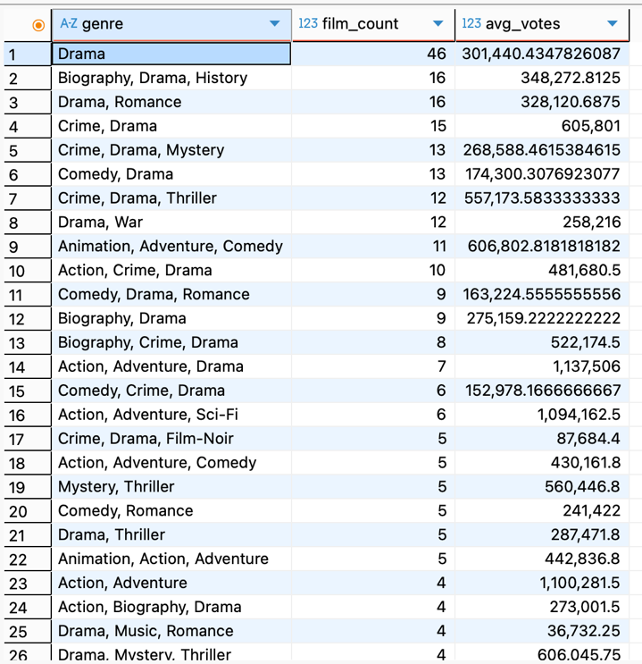
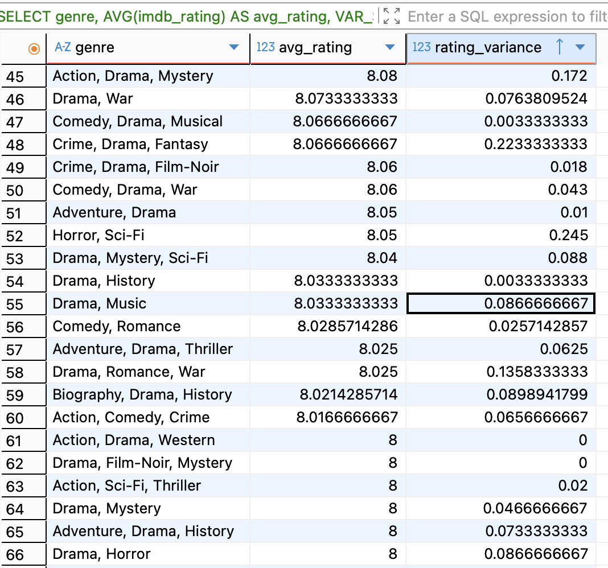
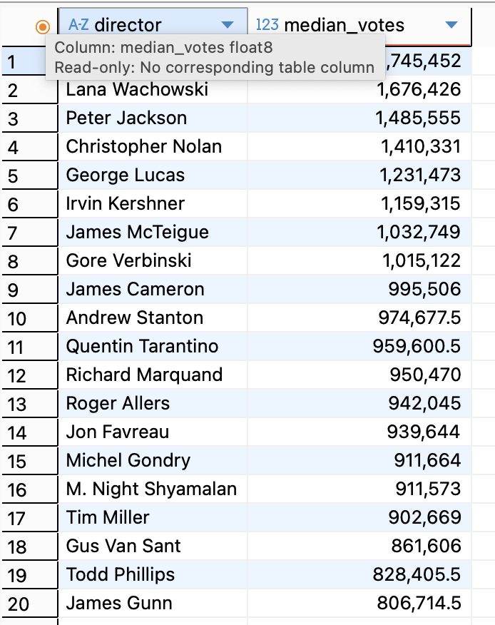
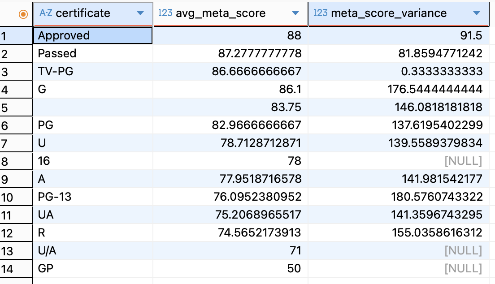

## Запрос № 1

```sql
SELECT
    genre,
    COUNT(*) AS film_count,
    AVG(no_of_votes) AS avg_votes
FROM
    csv_imdb
WHERE 
    imdb_rating >= 8.0
    AND genre IS NOT NULL
GROUP BY 
    genre
ORDER BY 
    film_count DESC;
```

Первый наш запрос посвящен группировке фильмов по жанру, подсчету кол-ва фильмов в этом жанре и расчету среднего кол-ва оценок на этот фильм.



## Запрос № 2

```sql
SELECT
    genre,
    AVG(imdb_rating) AS avg_rating,
    VAR_SAMP(imdb_rating) AS rating_variance
FROM 
    csv_imdb
WHERE 
    genre IS NOT NULL
GROUP BY 
    genre
ORDER BY
    avg_rating DESC;
```

Следующий наш запрос также посвящен группировке по жанру, но в этот раз мы рассчитываем среднее значение для рейтинга на сайте imdb, но среднее считаем для всех фильмов в этом жанре. Также мы считаем отклонение от средней оценки на сайте для этого жанра.



## Запрос № 3

```sql
SELECT
    director,
    PERCENTILE_CONT(0.5) WITHIN GROUP (ORDER BY no_of_votes) AS median_votes
FROM 
    csv_imdb
WHERE 
    director IS NOT NULL
GROUP BY 
    director
ORDER BY 
    median_votes DESC
LIMIT 20;
```

Третий запрос агрегирует фильмы по режиссерам и считает медиану количества оценок у режиссера. Выводим первые 20 топовых режиссеров.



## Запрос № 4

```sql
SELECT
    certificate,
    AVG(meta_score) AS avg_meta_score,
    VAR_SAMP(meta_score) AS meta_score_variance
FROM 
    csv_imdb
WHERE 
    certificate IS NOT NULL
    AND meta_score IS NOT NULL
GROUP BY 
    certificate
ORDER BY 
    avg_meta_score DESC;
```

Здесь мы проводим группировку по сертификатам, которые получают фильмы для проката. Мы считаем среднюю оценку фильмов с данным сертификатом, а также среднее отклонение.



## Запрос № 5

SELECT

(CAST(released_year AS INTEGER) / 10) \* 10 AS decade,

COUNT(\*) AS film_count,

ROUND(AVG(imdb_rating), 2) AS avg_rating

FROM csv_imdb

WHERE released_year ~ '^\d{4}$'

GROUP BY decade

ORDER BY decade;

В этом запросе мы групируем фильмы по декадам. Для каждой декады считается количество фильмов, которые вышли в это время, а также средний рейтинг.


Рисунок 5 – Группировка фильмов по декаде их выхода

# Запрос № 6

SELECT

director,

COUNT(\*) AS film_count,

MAX(imdb_rating) AS max_rating,

MIN(imdb_rating) AS min_rating,

MAX(imdb_rating) - MIN(imdb_rating) AS rating_spread

FROM csv_imdb

WHERE director IS NOT NULL

GROUP BY director

HAVING COUNT(\*) >= 3

ORDER BY rating_spread DESC;

В данном запросе мы аггрегируем данные по режиссеру, а затем считаем кол-во фильмов у него, максимальный и минимальный рейтинг, а также дельту рейтинга.


Рисунок 6 – Группировка фильмов по режиссерам