{width="6.496527777777778in"
height="9.146527777777777in"}

{width="6.496527777777778in"
height="9.040972222222223in"}

**СОДЕРЖАНИЕ**

Введение 4

Глава 1. Сбор и первичный анализ данных 6

1.1 Описание набора данных и шкалы измерения 6

1.2 Визуализация данных и описательные статистики 8

1.3 Предобработка и масштабирование признаков 11

Глава 2. Решение задач классификации и кластеризации 13

2.1 Наивный байесовский классификатор 13

2.2 Логистическая регрессия 15

2.3 Метод k ближайших соседей 17

2.4 Метод опорных векторов 19

2.5 Деревья решений 21

2.6 Сравнительный анализ классификаторов 23

2.7 Кластерный анализ 24

Глава 3. Регрессионный анализ и прогнозирование временных рядов 29

3.1 Постановка задачи регрессии 29

3.2 Линейная регрессия и анализ остатков 30

3.3 Нелинейные модели регрессии 34

3.4 Квантильная регрессия 36

3.5 Сравнение регрессионных моделей 37

3.6 Анализ временного ряда 38

Глава 4. Ансамблевые модели машинного обучения и регуляризация 45

4.1 Бэггинг (Bootstrap Aggregating) 45

4.2 Бустинг (Gradient Boosting) 47

4.3 Стекинг (Stacked Generalization) 49

4.4 Регуляризация: Ridge и Lasso 51

4.5 Интерпретация ансамблей: важность признаков 53

4.6 Сравнение ансамблевых методов 55

Глава 5. Визуализация результатов с использованием AW BI 57

5.1 Назначение и архитектура BI-решения 57

5.2 Структура дашборда 58

5.3 Главная страница: обзор нагрузки 58

5.4 Страница классификации запросов 59

5.5 Страница анализа ресурсов и регрессии 60

5.6 Страница временного ряда и прогноза 60

5.7 Технологические возможности интеграции 61

5.8 Предполагаемые эффекты внедрения 62

Заключение 63

Список источников 65

Приложение А. Фрагменты программного кода 68

**ВВЕДЕНИЕ**

В современных информационных системах базы данных являются центральным
компонентом, обеспечивающим хранение и обработку критически важной
информации. PostgreSQL, как одна из наиболее распространённых СУБД с
открытым исходным кодом, ежедневно обрабатывает миллионы SQL-запросов. В
условиях роста числа кибератак задача автоматического обнаружения
аномальных и вредоносных SQL-запросов приобретает особую актуальность.

Методы анализа данных и машинного обучения позволяют автоматизировать
процесс мониторинга и классификации запросов, выявляя SQL-инъекции и
аномалии в режиме, близком к реальному времени. Применение методов
классификации, кластеризации и статистического анализа к данным логов
СУБД даёт возможность не только обнаруживать известные типы атак, но и
выявлять ранее неизвестные паттерны подозрительного поведения.

Помимо обеспечения безопасности, анализ логов служит инструментом
мониторинга нагрузки: регрессионные модели позволяют прогнозировать
время выполнения запроса по характеристикам инфраструктуры, а методы
анализа временных рядов --- выявлять суточные и недельные паттерны
нагрузки, что необходимо для планирования ёмкости и автоматического
масштабирования серверов.

Актуальность работы определяется ростом числа кибератак на СУБД и
необходимостью разработки интеллектуальных систем мониторинга на основе
анализа логов SQL-запросов, а также повышением требований к
производительности и предсказуемости систем обработки данных.

Целью курсовой работы является применение методов анализа данных и
машинного обучения для решения задач классификации, кластеризации,
регрессионного анализа, прогнозирования временных рядов и построения
ансамблевых моделей на материале логов SQL-запросов к серверу
PostgreSQL.

Для достижения указанной цели поставлены следующие задачи:

1\) провести сбор и первичный анализ данных логов PostgreSQL-сервера,
включая определение размерности, типов признаков и выявление пропусков;

2\) выполнить визуализацию данных с использованием гистограмм,
boxplot-диаграмм, корреляционных матриц и диаграмм частот;

3\) осуществить предобработку данных: кодирование категориальных
признаков, стандартизацию, разделение на обучающую и тестовую выборки;

4\) реализовать и сравнить методы классификации: наивный байесовский
классификатор, логистическую регрессию, метод ближайших соседей, метод
опорных векторов, деревья решений;

5\) применить методы кластерного анализа: K-Means, иерархическую
кластеризацию (метод Уорда), DBSCAN, OPTICS;

6\) построить регрессионные модели для прогнозирования времени
выполнения SQL-запроса, провести анализ остатков и сравнить линейные,
полиномиальные, лог-линейные и квантильные модели;

7\) провести анализ временного ряда числа запросов в час, включая
выявление трендов, технический анализ, исследование колебательной
структуры и применение метода скользящего окна;

8\) построить и сравнить ансамблевые модели машинного обучения (бэггинг,
бустинг, стекинг), исследовать влияние L1- и L2-регуляризации на
регрессионные модели, выполнить интерпретацию ансамблей через важность
признаков и Permutation Importance;

9\) разработать концепцию интерактивного дашборда в системе AW BI,
объединяющего результаты всех проведённых анализов в единое решение для
практического мониторинга PostgreSQL-сервера;

10\) сформулировать рекомендации по выбору оптимальных методов для
каждой задачи.

Объект исследования --- логи SQL-запросов к серверу PostgreSQL.

Предмет исследования --- методы классификации, кластеризации, регрессии,
анализа временных рядов и построения ансамблевых моделей.

Методы исследования: статистический анализ, визуализация, наивный
байесовский классификатор, логистическая регрессия, метод ближайших
соседей, метод опорных векторов, деревья решений, K-Means, метод Уорда,
DBSCAN, OPTICS, простая и множественная линейная регрессия,
полиномиальная и лог-линейная регрессия, квантильная регрессия, метод
скользящего окна, автокорреляционный и спектральный анализ, бэггинг,
градиентный бустинг, стекинг, Ridge- и Lasso-регуляризация, Permutation
Importance, BI-визуализация.

Курсовая работа состоит из введения, пяти глав, заключения, списка
источников и приложения. В первой главе выполняется первичный анализ
данных, во второй --- задачи классификации и кластеризации, в третьей
--- регрессионный анализ и анализ временного ряда, в четвёртой ---
построение ансамблевых моделей с регуляризацией, в пятой --- концепция
интерактивного дашборда в AW BI. Общий объём работы --- около 70
страниц.

**ГЛАВА 1. СБОР И ПЕРВИЧНЫЙ АНАЛИЗ ДАННЫХ**

**1.1 Описание набора данных и шкалы измерения**

Исходный набор данных представляет собой логи SQL-запросов к серверу
PostgreSQL и содержит информацию о выполненных запросах, параметрах
серверной нагрузки и метаданных клиентских подключений. Источник данных
--- открытый набор, размещённый в репозитории учебных проектов. Данные
содержат n = 10 000 наблюдений с m = 14 признаками; пропущенные значения
отсутствуют.

Формально матрица данных задаётся как:

$X = \{ x_{ij}\},\ i = 1,\ldots,n,\ j = 1,\ldots,m$ (1.1)

где каждое наблюдение

$$x_{i} = \left( x_{i1},\ x_{i2},\ \ldots,\ x_{im} \right)$$

соответствует одному SQL-запросу. Целевая переменная принимает три
значения:

$y_{i} \in \{\text{normal},\ \text{sql\_injection},\ \text{anomaly}\}$
(1.2)

Описание признаков и их интерпретация на русском языке приведены в
таблице 1. Шкала измерения определяет допустимые математические
операции: для номинальной шкалы возможны только операции сравнения на
равенство и подсчёт частот, для абсолютной --- все арифметические
операции, для интервальной --- операции вычитания и сравнения.

Таблица 1 --- Описание признаков и их интерпретация

  -------------------------------------------------------------------------------
      **Признак**      **Интерпретация**                **Тип      **Шкала**
                                                        данных**   
  -------------------- -------------------------------- ---------- --------------
       timestamp       Момент выполнения запроса        datetime   Интервальная

       ip_address      IP-адрес клиента                 string     Номинальная

        country        Страна клиента (8 категорий)     string     Номинальная

          city         Город клиента (8 категорий)      string     Номинальная

        timezone       Часовой пояс клиента             string     Номинальная

       query_type      Тип SQL-запроса (SELECT, INSERT  string     Номинальная
                       и т. д.)                                    

       sql_query       Текст SQL-запроса                string     Номинальная

   execution_time_ms   Время выполнения, мс             float      Абсолютная

      cpu_load_pct     Загрузка процессора сервера, %   float      Абсолютная

      ram_usage_mb     Использование оперативной        int        Абсолютная
                       памяти, МБ                                  

   active_connections  Число активных соединений к БД   int        Абсолютная

     rows_affected     Количество затронутых запросом   int        Абсолютная
                       строк                                       

       is_anomaly      Бинарный признак аномалии (0/1)  int        Номинальная

         label         Целевая метка (3 класса)         string     Номинальная
  -------------------------------------------------------------------------------

Анализ пропусков показал полное отсутствие пропущенных значений в каждом
признаке. Распределение целевой переменной является крайне
несбалансированным: класс «normal» составляет 9 624 наблюдения (96,24
%), класс «sql_injection» --- 276 наблюдений (2,76 %), класс «anomaly»
--- 100 наблюдений (1,00 %). Подобный дисбаланс типичен для задач
выявления редких событий (атак или сбоев) и требует специального учёта
при выборе метрик качества: вместо обычной точности (accuracy)
необходимо использовать F1-score (взвешенный или по каждому классу),
который устойчив к доминированию большинства.

**1.2 Визуализация данных и описательные статистики**

Для числовых признаков вычислены описательные статистики: выборочное
среднее, выборочная дисперсия, квартили и межквартильный размах.
Формулы:

${\bar{x}}_{j} = \frac{1}{n}\sum_{i = 1}^{n}x_{ij},\quad S_{j}^{2} = \frac{1}{n - 1}\sum_{i = 1}^{n}\left( x_{ij} - {\bar{x}}_{j} \right)^{2}$
(1.3)

Межквартильный размах:

${IQR}_{j} = Q_{3}\left( x_{j} \right) - Q_{1}\left( x_{j} \right)$
(1.4)

Для выявления выбросов применён критерий Тьюки: наблюдение считается
выбросом, если

$x_{ij} < Q_{1} - 1,5 \cdot IQR\quad\text{или}\quad x_{ij} > Q_{3} + 1,5 \cdot IQR$
(1.5)

Описательные статистики числовых признаков представлены в таблице 2.

Таблица 2 --- Описательные статистики числовых признаков

  ------------------------------------------------------------------------------------------------
      **Признак**     **Среднее**   **Ст.     **Q1**   **Медиана**   **Q3**   **Мин**   **Макс**
                                    откл.**                                             
  ------------------- ------------- --------- -------- ------------- -------- --------- ----------
   Время выполнения,  352.66        371.68    94.25    243.09        476.8    3.69      4588.97
          мс                                                                            

    Загрузка CPU, %   44.97         18.8      32.2     43.9          56.0     2.0       99.0

  Использование RAM,  2662.77       995.82    2078.0   2563.0        3052.0   310.0     8192.0
          МБ                                                                            

       Активные       51.48         25.56     35.0     50.0          65.0     1.0       184.0
    соединения, шт                                                                      

  Затронуто строк, шт 41.1          442.66    2.0      12.0          33.0     0.0       40043.0
  ------------------------------------------------------------------------------------------------

На рисунке 1 представлены гистограммы распределений числовых признаков.
Распределение времени выполнения запросов и числа затронутых строк имеет
выраженную правостороннюю асимметрию (длинный «правый хвост» из
аномально медленных запросов и массовых операций), что характерно для
метрик производительности БД. Распределение загрузки CPU близко к
нормальному с центром около 45 %, что соответствует штатной работе
сервера. Использование RAM и число активных соединений имеют почти
равномерное распределение в характерном диапазоне.

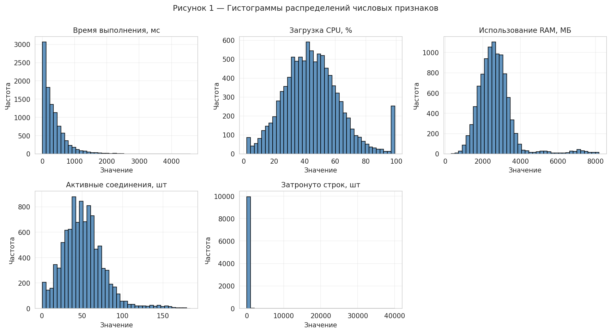{width="6.102362204724409in"
height="3.3320034995625547in"}

Рисунок 1 --- Гистограммы распределений числовых признаков

Boxplot-диаграммы (рисунок 2) показывают распределение числовых
признаков отдельно для каждого класса целевой переменной. SQL-инъекции и
аномалии характеризуются заметно более высокой загрузкой CPU и большим
числом активных соединений, чем нормальные запросы. Это содержательно
соответствует природе атак: SQL-инъекции часто связаны с тяжёлыми
операциями (UNION, подзапросы), а аномалии --- с пиковыми нагрузками.
Выбросы по критерию Тьюки связаны именно с этими редкими классами и не
подлежат удалению --- их удаление привело бы к потере информации,
критически важной для задачи классификации.

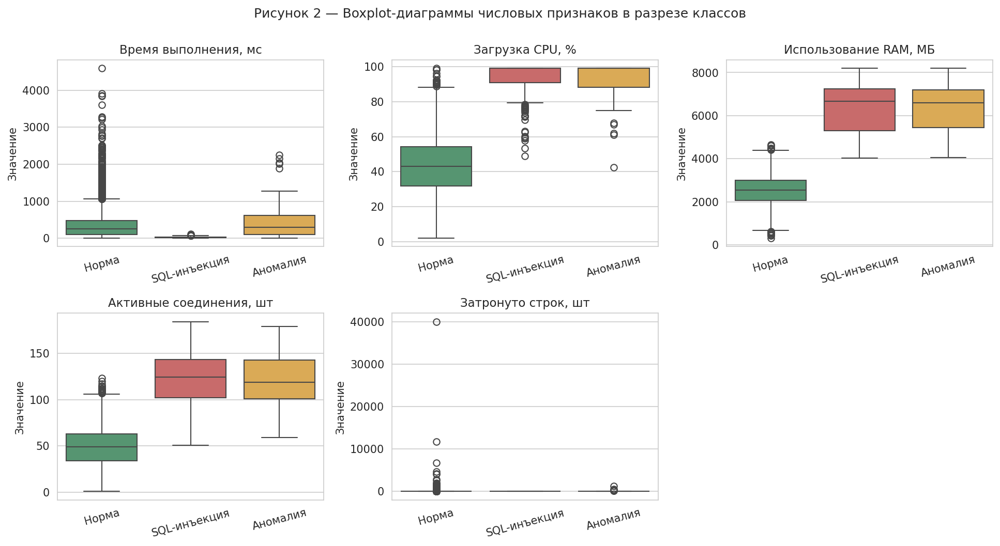{width="6.102362204724409in"
height="3.335158573928259in"}

Рисунок 2 --- Boxplot-диаграммы числовых признаков в разрезе классов

Корреляционная матрица числовых признаков (рисунок 3) показывает слабые
линейные связи между всеми признаками: коэффициенты Пирсона по модулю не
превышают 0,1. Это свидетельствует об отсутствии мультиколлинеарности,
что благоприятно для линейных классификаторов, но также означает, что
для регрессионной модели потребуется привлечение нелинейных
преобразований. Коэффициент Пирсона определяется формулой:

$r_{jk} = \frac{\sum_{i = 1}^{n}\left( x_{ij} - {\bar{x}}_{j} \right)\left( x_{ik} - {\bar{x}}_{k} \right)}{\sqrt{\sum_{i = 1}^{n}\left( x_{ij} - {\bar{x}}_{j} \right)^{2}} \cdot \sqrt{\sum_{i = 1}^{n}\left( x_{ik} - {\bar{x}}_{k} \right)^{2}}}$
(1.6)

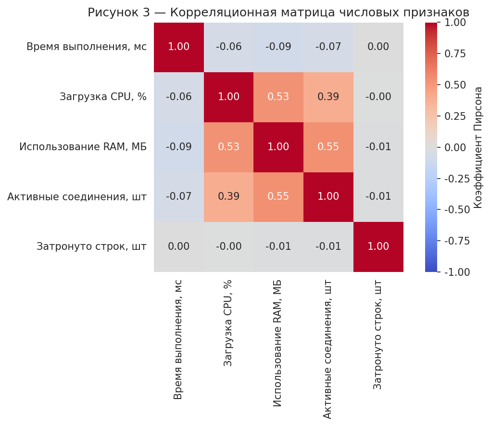{width="6.102362204724409in"
height="5.289511154855643in"}

Рисунок 3 --- Корреляционная матрица числовых признаков

Диаграммы частот категориальных признаков (рисунок 4) показывают:
преобладание запросов SELECT (56,8 %), что соответствует типичному
профилю OLTP-системы; равномерное распределение клиентов по странам с
лидерством России (30,0 %) и США (19,8 %); крайнюю несбалансированность
целевой переменной, отмеченную выше.

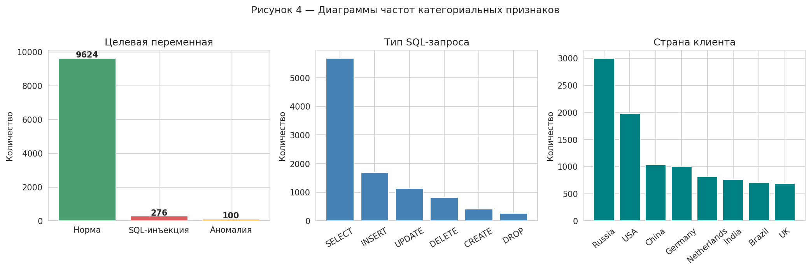{width="6.102362204724409in"
height="2.0341207349081363in"}

Рисунок 4 --- Диаграммы частот категориальных признаков

**1.3 Предобработка и масштабирование признаков**

На этапе предобработки удалены 6 признаков, не используемых при
моделировании: ip_address (высокая кардинальность, нерелевантен в рамках
классификации/кластеризации), sql_query (требует отдельной обработки
методами NLP, выходит за рамки данной работы), timezone (производный от
country и city), is_anomaly (дублирует информацию из label), city
(практически совпадает с country по кардинальности и информативности) и
timestamp. Из timestamp перед удалением извлечены два циклических
признака: hour (0--23) и day_of_week (0--6), которые позволяют сохранить
информацию о времени суток и дне недели.

Категориальные признаки country и query_type закодированы методом
One-Hot с параметром drop_first=True (для каждого признака отбрасывается
одна категория, чтобы избежать линейной зависимости столбцов). Целевая
переменная закодирована LabelEncoder в порядке: anomaly = 0, normal = 1,
sql_injection = 2.

Применена z-стандартизация числовых признаков:

$z_{ij} = \frac{x_{ij} - {\bar{x}}_{j}}{S_{j}}$ (1.7)

После стандартизации каждый признак имеет нулевое среднее и единичную
дисперсию, что обеспечивает равноправный вклад признаков в метрики
расстояния. Стандартизация выбрана вместо min-max нормализации по двум
причинам: во-первых, она устойчива к выбросам (которые присутствуют в
данных и являются содержательно важными); во-вторых, она необходима для
алгоритмов, основанных на расстояниях (kNN, SVM, K-Means), а также для
градиентных методов оптимизации в логистической регрессии. Бинарные
признаки, полученные One-Hot кодированием, не масштабировались,
поскольку они уже ограничены интервалом \[0, 1\].

Выполнено стратифицированное разбиение данных в пропорции 80/20 с
random_state = 42, что обеспечивает воспроизводимость результатов и
сохранение пропорций классов в обучающей и тестовой выборках. Итоговая
размерность матрицы признаков: 10000 наблюдений × 19 признаков.

Подводя итог первичного анализа, отметим, что полученный набор данных
пригоден для применения методов классификации, кластеризации и
регрессии. Ключевые особенности данных, которые определят выбор методов
в последующих главах: сильный дисбаланс классов (96 % / 3 % / 1 %)
требует использования F1-score как основной метрики и параметра
class_weight=\'balanced\' в обучаемых моделях; выраженная правосторонняя
асимметрия времени выполнения запросов даёт основание для применения
логарифмического преобразования в регрессионных моделях; слабая линейная
корреляция между признаками говорит об отсутствии мультиколлинеарности,
но и о необходимости нелинейных моделей для регрессии; выбросы являются
содержательно значимыми (соответствуют атакам и аномалиям) и не подлежат
удалению.

**ГЛАВА 2. РЕШЕНИЕ ЗАДАЧ КЛАССИФИКАЦИИ И КЛАСТЕРИЗАЦИИ**

**2.1 Наивный байесовский классификатор**

Наивный байесовский классификатор основан на теореме Байеса с допущением
условной независимости признаков при заданном классе. Апостериорная
вероятность класса определяется как:

$P\left( c_{k}\,|\,\mathbf{x} \right) = \frac{P\left( \mathbf{x}\,|\, c_{k} \right) \cdot P\left( c_{k} \right)}{P\left( \mathbf{x} \right)}$
(2.1)

Допущение условной независимости позволяет факторизовать совместную
плотность:

$P\left( \mathbf{x}\,|\, c_{k} \right) = \prod_{j = 1}^{m}P\left( x_{j}\,|\, c_{k} \right)$
(2.2)

В работе использована гауссовская версия алгоритма (GaussianNB),
поскольку основные числовые признаки непрерывны. Для каждого признака
при заданном классе предполагается нормальное распределение:

$P\left( x_{j}\,|\, c_{k} \right) = \frac{1}{\sqrt{2\pi\sigma_{jk}^{2}}}\exp\left( - \frac{\left( x_{j} - \mu_{jk} \right)^{2}}{2\sigma_{jk}^{2}} \right)$
(2.3)

Параметры μ_jk и σ²_jk оцениваются методом максимального правдоподобия
по обучающей выборке как выборочное среднее и дисперсия признака j в
классе k. Альтернативные версии (мультиномиальная и бернуллиевская) не
подходят, поскольку рассчитаны на счётные и бинарные признаки
соответственно.

Результаты классификации на тестовой выборке: accuracy = 0.9835, F1 =
0.9851. Матрица ошибок (рисунок 5) показывает, что метод правильно
классифицирует 19 из 20 аномалий и все 55 SQL-инъекций, однако ошибается
на 32 из 1925 нормальных запросов (1,7 %): 1 ошибочно отнесён к
аномалиям, 31 --- к SQL-инъекциям. Эти ошибки объясняются характерной
слабостью наивного байеса: предположение о независимости признаков
нарушается на реальных данных, особенно когда категориальные One-Hot
признаки коррелируют между собой по построению.

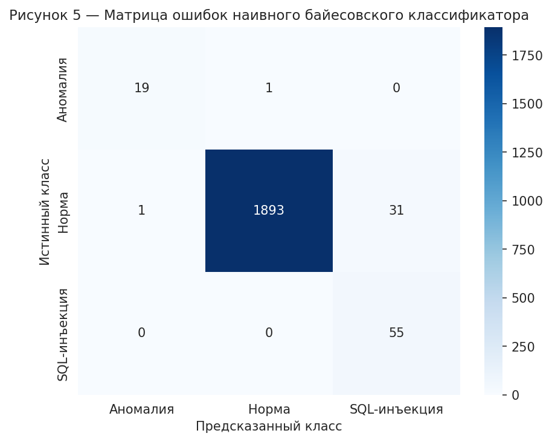{width="6.102362204724409in"
height="4.893907480314961in"}

Рисунок 5 --- Матрица ошибок наивного байесовского классификатора

**2.2 Логистическая регрессия**

Для многоклассовой логистической регрессии используется softmax-функция:

$P\left( y = c_{k}\,|\,\mathbf{x} \right) = \frac{\exp\left( \mathbf{w}_{k}^{\top}\mathbf{x} + b_{k} \right)}{\sum_{l = 1}^{K}\exp\left( \mathbf{w}_{l}^{\top}\mathbf{x} + b_{l} \right)}$
(2.4)

Параметры модели оцениваются минимизацией кросс-энтропийной функции
потерь с L2-регуляризацией:

$\mathcal{L}\left( \mathbf{W} \right) = - \sum_{i = 1}^{n}{\sum_{k = 1}^{K}\mathbb{1}}\left\lbrack y_{i} = c_{k} \right\rbrack\log P\left( y_{i} = c_{k}\,|\,\mathbf{x}_{i} \right) + \frac{1}{2C} \parallel \mathbf{W} \parallel_{2}^{2}$
(2.5)

Параметр C обратно пропорционален силе регуляризации; в работе
использовано значение C = 1 (по умолчанию), что обеспечивает умеренную
регуляризацию. Для компенсации дисбаланса классов применён параметр
class_weight=\'balanced\', который автоматически взвешивает наблюдения
обратно пропорционально частоте класса. Оптимизация проводилась
алгоритмом L-BFGS с пределом в 2000 итераций для гарантии сходимости на
стандартизованных данных.

Анализ коэффициентов модели (рисунок 6) показывает наиболее значимые
признаки для каждого класса. Положительный коэффициент признака j для
класса k означает, что увеличение признака повышает логарифм шансов
класса k. Признаки query_type_DELETE и query_type_DROP имеют выраженные
положительные коэффициенты для класса sql_injection --- это согласуется
с природой атак: инъекционные запросы часто содержат деструктивные
операции. Признак cpu_load_pct имеет положительный коэффициент для
класса anomaly --- аномальные запросы создают повышенную нагрузку.

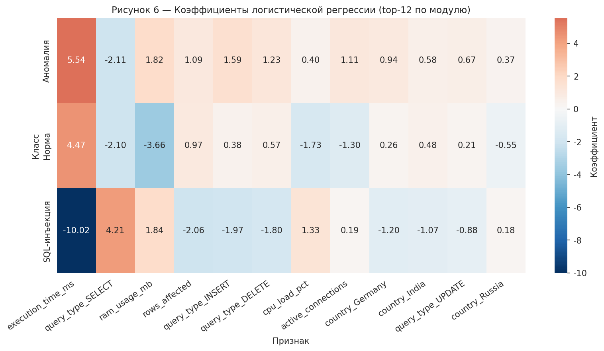{width="6.102362204724409in"
height="3.5503193350831146in"}

Рисунок 6 --- Коэффициенты логистической регрессии (top-12 по модулю)

Итоговое качество: F1 = 0.9995. Матрица ошибок (рисунок 7) демонстрирует
существенно лучший результат, чем у наивного байеса: модель ошибается
лишь на одной из 20 аномалий (она классифицируется как SQL-инъекция) и
не делает ошибок на нормальных запросах и SQL-инъекциях. Это объясняется
тем, что логистическая регрессия не предполагает независимость признаков
и способна учитывать их совместное распределение через линейную
комбинацию.

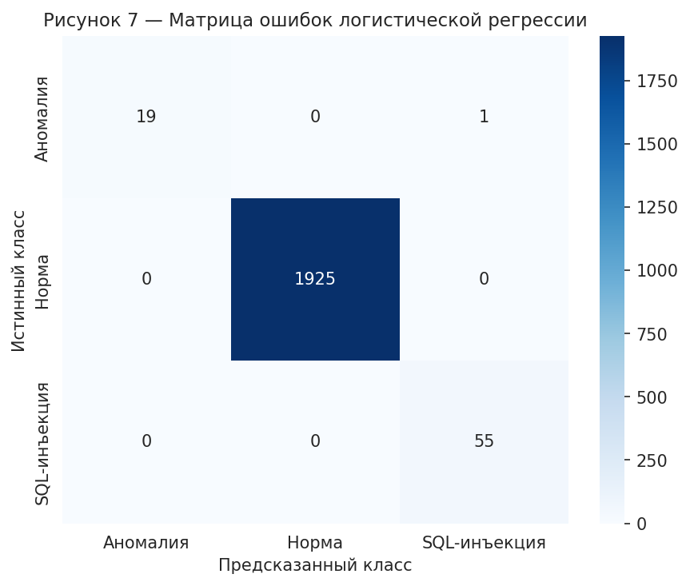{width="6.102362204724409in"
height="5.1831189851268595in"}

Рисунок 7 --- Матрица ошибок логистической регрессии

**2.3 Метод k ближайших соседей**

Метод k ближайших соседей (kNN) определяет класс нового объекта
голосованием k ближайших объектов обучающей выборки. В работе
использована евклидова метрика расстояния:

$d\left( \mathbf{x}_{i},\mathbf{x}_{j} \right) = \sqrt{\sum_{l = 1}^{m}\left( x_{il} - x_{jl} \right)^{2}}$
(2.6)

Стандартизация признаков критически важна для методов на основе
расстояний: без неё признаки с большим разбросом значений (например,
ram_usage_mb с диапазоном до тысяч единиц) полностью доминировали бы над
признаками с малым разбросом (cpu_load_pct в диапазоне 0--100). После
z-стандартизации все признаки вносят сопоставимый вклад в расстояние.

Оптимальное значение параметра k подобрано методом 3-кратной
кросс-валидации на обучающей выборке для k от 1 до 20. Метрикой выбран
взвешенный F1-score, устойчивый к дисбалансу классов. Зависимость F1 от
k представлена на рисунке 8: максимум достигается при k = 1, что
объясняется хорошей разделимостью классов в признаковом пространстве ---
для отнесения объекта к правильному классу достаточно одного
«правильного» соседа.

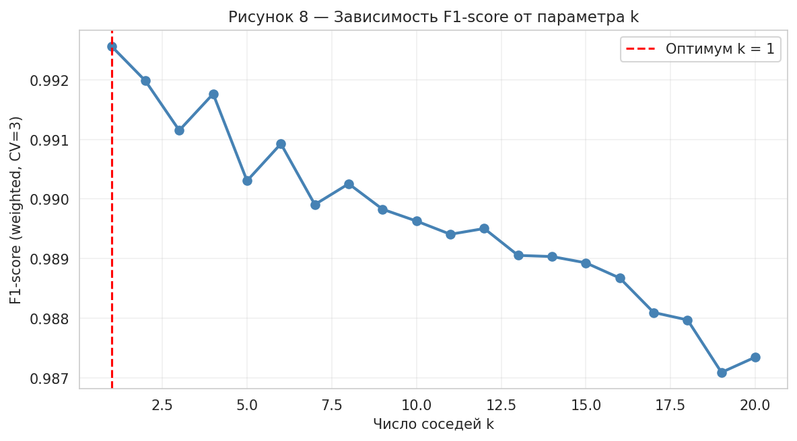{width="6.102362204724409in"
height="3.3861920384951882in"}

Рисунок 8 --- Зависимость F1-score от параметра k (3-кратная
кросс-валидация)

Итоговое качество с оптимальным k = 1: F1 = 0.9940. Матрица ошибок
(рисунок 9) показывает, что kNN правильно классифицирует все нормальные
запросы, но ошибается чаще на редких классах: 8 из 20 аномалий отнесены
к SQL-инъекциям, 1 --- к нормальным; 2 SQL-инъекции отнесены к
аномалиям. Это объясняется малым числом наблюдений в редких классах: при
k = 1 каждое наблюдение классифицируется по своему ближайшему соседу, и
редкие классы оказываются в окружении многочисленного класса «normal».

{width="6.102362204724409in"
height="5.1831189851268595in"}

Рисунок 9 --- Матрица ошибок kNN (k = 1)

**2.4 Метод опорных векторов**

Метод опорных векторов (SVM) ищет разделяющую гиперплоскость,
максимизирующую зазор между классами. Постановка задачи с мягким
зазором:

$\min_{\mathbf{w},b,\mathbf{\xi}}\frac{1}{2} \parallel \mathbf{w} \parallel_{2}^{2} + C\sum_{i = 1}^{n}\xi_{i},\quad y_{i}\left( \mathbf{w}^{\top}\mathbf{x}_{i} + b \right) \geq 1 - \xi_{i},\quad\xi_{i} \geq 0$
(2.7)

Параметр C регулирует компромисс: малые C допускают больше нарушений
зазора (простая модель, мало переобучения), большие C --- жёстко
штрафуют ошибки (сложная модель, риск переобучения). Для нелинейной
задачи использовано радиально-базисное (RBF) ядро:

$K\left( \mathbf{x}_{i},\mathbf{x}_{j} \right) = \exp\left( - \gamma \parallel \mathbf{x}_{i} - \mathbf{x}_{j} \parallel^{2} \right)$
(2.8)

Параметр γ задаёт «ширину» гауссовой функции: малые γ дают плавные
границы, большие --- узколокальные.

Подбор гиперпараметров проведён процедурой GridSearchCV с 3-кратной
кросс-валидацией на сетке C ∈ {0,1; 1; 10; 100}, γ ∈ {0,001; 0,01; 0,1;
1}. Метрика --- взвешенный F1-score. Результаты сетки приведены на
рисунке 10. Оптимальные параметры: C = 100, γ = 0.001. Найденная пара
представляет компромисс: достаточно большое C для штрафа ошибок (классы
хорошо отделимы) и малое γ, обеспечивающее плавные нелокальные границы
решений.

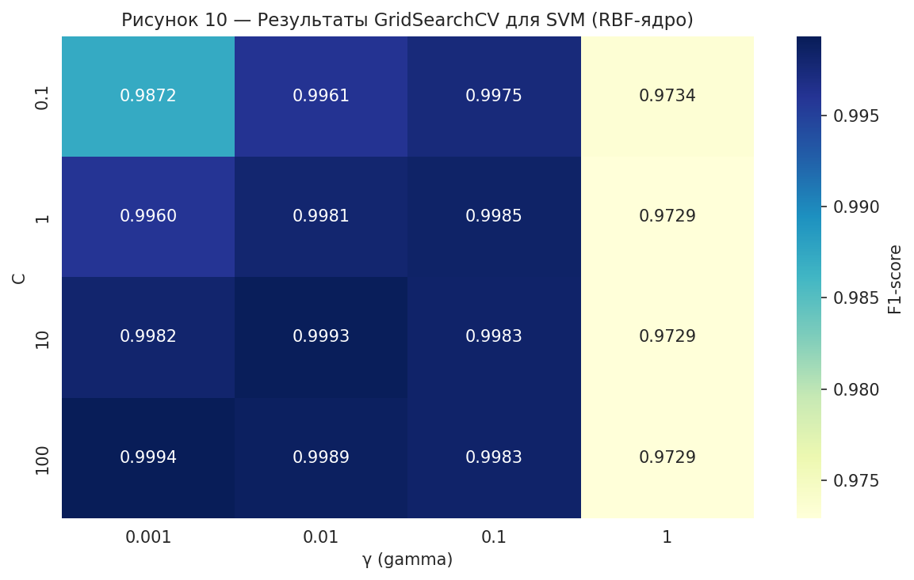{width="6.102362204724409in"
height="3.8794717847769027in"}

Рисунок 10 --- Результаты GridSearchCV для SVM (RBF-ядро)

Итоговое качество: F1 = 0.9995. Матрица ошибок (рисунок 11) полностью
идентична матрице логистической регрессии: одна аномалия
классифицирована как SQL-инъекция, остальные наблюдения классифицированы
верно. Идентичность матриц объясняется не случайным совпадением, а
структурой данных: классы линейно отделимы в пространстве с числовыми и
One-Hot признаками, поэтому и линейная (логистическая регрессия), и
нелинейная (SVM с RBF) модели находят практически одну и ту же
разделяющую поверхность. Единственная сложная точка --- аномалия,
лежащая близко к области SQL-инъекций --- оказывается «по ту сторону»
границы и для линейного, и для нелинейного классификатора. Это означает,
что данная конкретная точка является принципиально неразрешимой без
привлечения дополнительной информации (например, текста SQL-запроса).

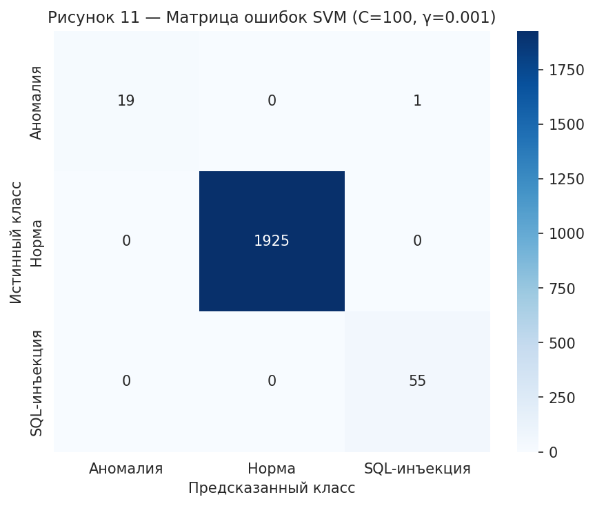{width="6.102362204724409in"
height="5.1831189851268595in"}

Рисунок 11 --- Матрица ошибок SVM (C = 100, γ = 0.001)

**2.5 Деревья решений**

Дерево решений строится рекурсивным разбиением признакового
пространства. В каждом узле выбирается признак и пороговое значение,
минимизирующие критерий неоднородности --- индекс Джини:

$Gini(t) = 1 - \sum_{k = 1}^{K}p_{k}^{2}(t)$ (2.9)

где p_k(t) --- доля объектов класса k в узле t. Чем меньше индекс Джини,
тем «чище» узел. Алгоритм CART выбирает разбиение, максимизирующее
снижение индекса Джини, взвешенное по размерам дочерних узлов.

Гиперпараметры подобраны GridSearchCV по сетке: max_depth ∈ {3, 5, 7,
10, 15, None}, min_samples_split ∈ {2, 5, 10}, min_samples_leaf ∈ {1, 2,
5}. Оптимальные значения: max_depth = 7, min_samples_split = 2,
min_samples_leaf = 1. Глубина 7 является компромиссом между ёмкостью
модели (необходимой для разделения трёх классов с учётом 19 признаков) и
риском переобучения.

Структура дерева (первые 3 уровня) представлена на рисунке 12. Корневой
узел разбивает данные по типу запроса (SELECT vs остальные) --- это
согласуется с природой данных: операции типа DELETE/DROP чаще
встречаются среди инъекций.

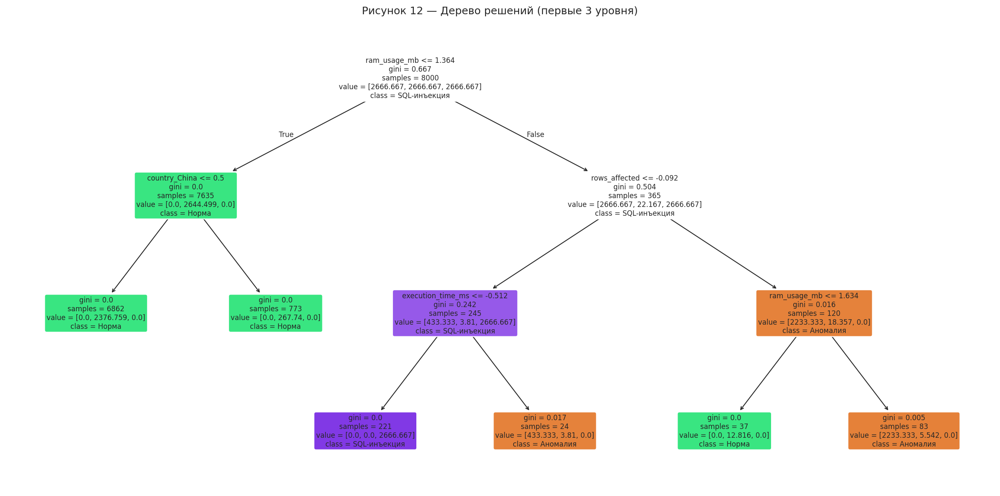{width="6.102362204724409in"
height="3.029432414698163in"}

Рисунок 12 --- Дерево решений (визуализация первых 3 уровней)

Важность признаков (feature_importance) для оптимального дерева
приведена на рисунке 13. Эта величина измеряет суммарное снижение
индекса Джини, обеспеченное каждым признаком при всех разбиениях, в
которых он участвует. Наиболее важными признаками являются типы запросов
(query_type_DROP, query_type_DELETE) и число активных соединений --- они
хорошо разделяют редкие классы.

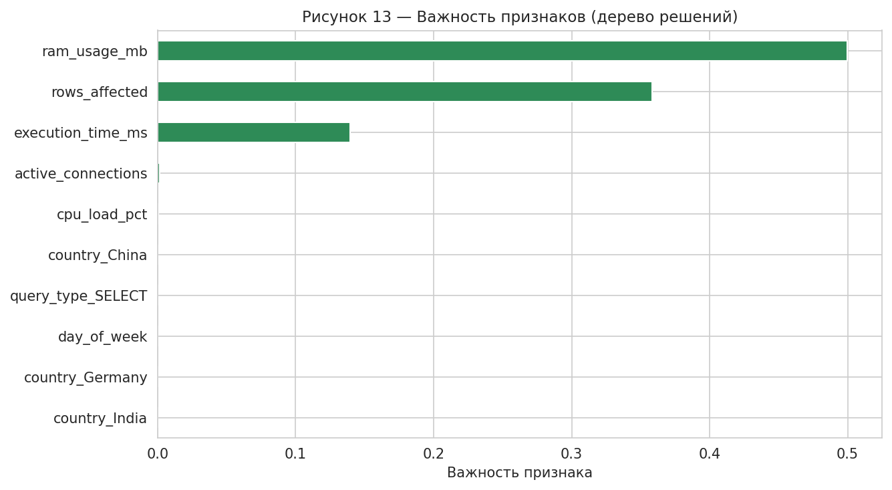{width="6.102362204724409in"
height="3.3505850831146105in"}

Рисунок 13 --- Важность признаков по дереву решений

Анализ переобучения (рисунок 14) --- зависимость F1 на обучающей и
тестовой выборках от максимальной глубины дерева. На обучающей выборке
F1 монотонно возрастает и достигает 1,0 при глубине свыше 12 (модель
полностью запоминает данные), тогда как на тестовой выборке кривая
выходит на плато при глубине 7--8. Большая разница между обучающим и
тестовым F1 при глубине свыше 10 --- характерный признак переобучения.
Выбранный параметр max_depth = 7 соответствует точке выхода тестовой
кривой на плато.

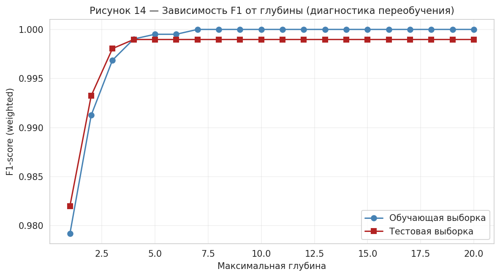{width="6.102362204724409in"
height="3.3861920384951882in"}

Рисунок 14 --- Диагностика переобучения дерева решений

Итоговое качество: F1 = 0.9990. Матрица ошибок (рисунок 15) показывает 2
ошибки на классе «anomaly» (оба объекта отнесены к «normal»). Дерево
решений демонстрирует промежуточный результат между логистической
регрессией и kNN, обладая при этом важным преимуществом
интерпретируемости: путь от корня к листу можно записать в виде явных
правил «если..., то...».

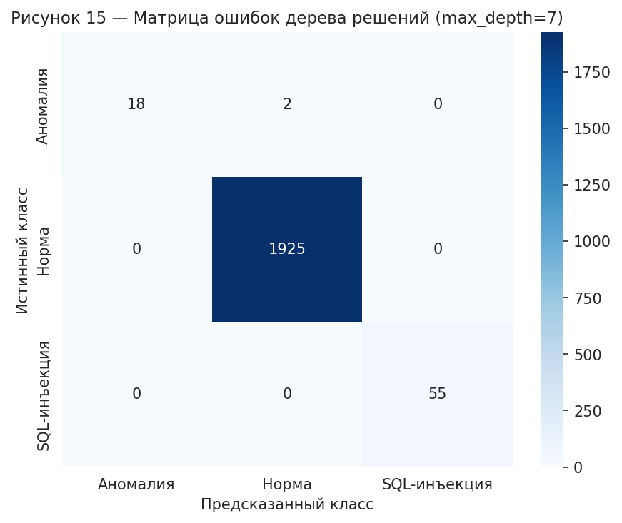{width="6.102362204724409in"
height="5.13551290463692in"}

Рисунок 15 --- Матрица ошибок дерева решений (max_depth = 7)

**2.6 Сравнительный анализ классификаторов**

Таблица 3 --- Сводные метрики классификаторов на тестовой выборке

  ----------------------------------------------------------------------------------
           **Модель**          **Accuracy**   **Precision**   **Recall**   **F1**
  ---------------------------- -------------- --------------- ------------ ---------
     Naive Bayes (Gaussian)    0.9835         0.9891          0.9835       0.9851

  Logistic Regression (C = 1)  0.9995         0.9995          0.9995       0.9995

          kNN (k = 1)          0.9945         0.9944          0.9945       0.9940

     SVM (RBF, C = 100, γ =    0.9995         0.9995          0.9995       0.9995
             0.001)                                                        

   Decision Tree (depth = 7)   0.9990         0.9990          0.9990       0.9990
  ----------------------------------------------------------------------------------

Из таблицы 3 и рисунка 16 видно, что логистическая регрессия и SVM
показывают идентичные показатели F1 = 0,9995, дерево решений --- F1 =
0,9990, kNN --- F1 = 0,9940, наивный байес --- F1 = 0,9851. Высокие
значения accuracy у всех моделей в значительной степени обусловлены
доминированием класса «normal» (96,2 % выборки), поэтому более
информативной метрикой является взвешенный F1-score, учитывающий баланс
precision и recall по всем классам. Параметр class_weight=\'balanced\'
использовался во всех моделях для частичной компенсации дисбаланса.

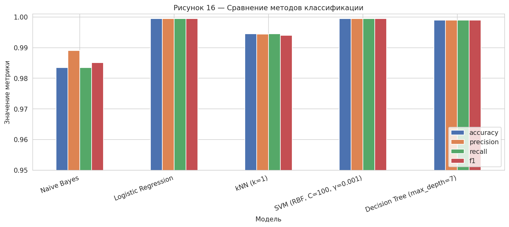{width="6.102362204724409in"
height="2.7337390638670165in"}

Рисунок 16 --- Сравнение методов классификации по основным метрикам

**2.7 Кластерный анализ**

Кластерный анализ применён в задаче выявления скрытой структуры данных
без использования меток классов. Это позволяет проверить, насколько
естественные группировки данных соответствуют разметке (normal /
sql_injection / anomaly), и обнаружить возможные подгруппы внутри
классов.

Метод K-Means минимизирует внутрикластерную сумму квадратов расстояний
(WCSS):

$J = \sum_{k = 1}^{K}{\sum_{\mathbf{x}_{i} \in C_{k}}^{} \parallel}\mathbf{x}_{i} - \mathbf{\mu}_{k} \parallel_{2}^{2} \rightarrow \min$
(2.10)

Алгоритм итеративен: на каждой итерации объекты приписываются к
ближайшему центру μ_k, затем центры пересчитываются как средние точек
кластера. Использована инициализация k-means++ с n_init = 10 (запуск из
10 случайных стартов с выбором лучшего по WCSS), что снижает
чувствительность к начальным значениям центров.

На рисунке 17 представлены результаты K-Means для k = 3 в проекции на
первые две главные компоненты (PCA), объясняющие 24.0 % и 12.6 %
дисперсии соответственно. Сравнение с истинными классами показывает, что
K-Means выделяет кластеры, не совпадающие с разметкой: это связано с
несбалансированностью классов (K-Means стремится к кластерам сравнимого
размера) и с тем, что без учителя метод не «знает» о редких классах.
Коэффициент силуэта составляет 0.130, что соответствует умеренной
кластеризации.

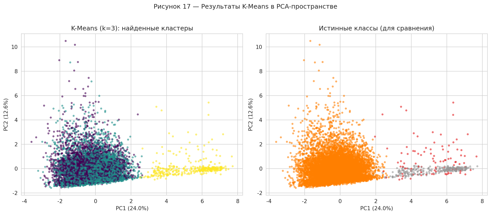{width="6.102362204724409in"
height="2.675699912510936in"}

Рисунок 17 --- Результаты K-Means в пространстве PCA

Иерархическая агломеративная кластеризация по методу Уорда
последовательно объединяет два кластера, при объединении которых
минимально увеличивается внутрикластерная сумма квадратов:

$\Delta\left( C_{i},C_{j} \right) = \frac{\left| C_{i} \right| \cdot \left| C_{j} \right|}{\left| C_{i} \right| + \left| C_{j} \right|}\, \parallel \mathbf{\mu}_{i} - \mathbf{\mu}_{j} \parallel_{2}^{2}$
(2.11)

Этот критерий ориентирован на формирование компактных кластеров.
Дендрограмма, построенная по случайной подвыборке из 200 объектов
(рисунок 18), позволяет визуально оценить структуру кластеров и выбрать
уровень отсечения. Резкий скачок длины ветвей в верхней части дерева
указывает на естественное число кластеров от 2 до 4.

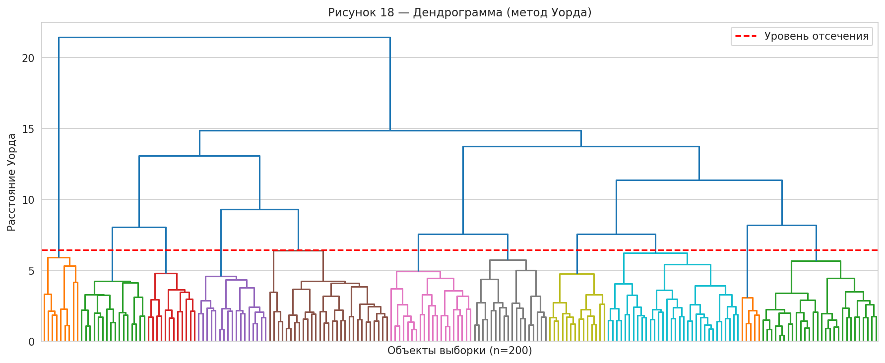{width="6.102362204724409in"
height="2.5038845144356956in"}

Рисунок 18 --- Дендрограмма (метод Уорда)

Алгоритм DBSCAN основан на понятии плотности: точка является
core-точкой, если в её ε-окрестности находится не менее MinPts точек:

$\left| N_{\varepsilon}\left( \mathbf{x} \right) \right| \geq MinPts$
(2.12)

Параметр MinPts задан равным 10 (соответствует размерности пространства
и стандартной эвристике 2·d). Параметр ε подобран графически по
k-distance graph (рисунок 19), на котором найдена точка резкого изгиба
--- она соответствует значению ε ≈ 4.937. Это классическая эвристика:
точка изгиба отделяет «нормальную» плотность данных от «разреженной»
области, в которую попадают только шумовые точки.

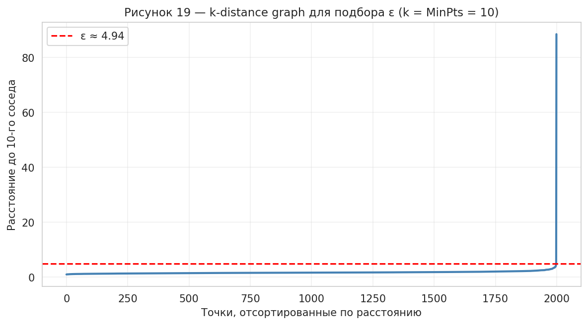{width="6.102362204724409in"
height="3.3861920384951882in"}

Рисунок 19 --- k-distance graph для подбора ε (k = MinPts = 10)

Результаты DBSCAN с подобранными параметрами представлены на рисунке 20:
выделено 1 кластер(ов) и 1 шумовых точек. Шум в DBSCAN соответствует
точкам, не имеющим достаточной плотности соседей --- для нашей задачи
это потенциальные аномалии и SQL-инъекции, что делает DBSCAN наиболее
адекватным методом кластеризации именно для задачи обнаружения атак.

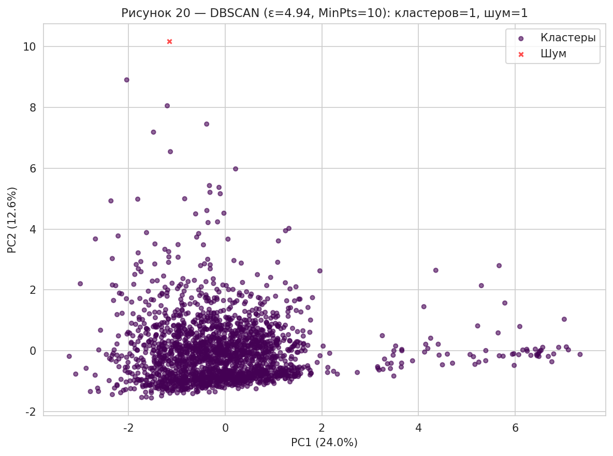{width="6.102362204724409in"
height="4.551001749781277in"}

Рисунок 20 --- Результаты DBSCAN (ε = 4.937, MinPts = 10) в пространстве
PCA

Алгоритм OPTICS обобщает DBSCAN на случай переменной плотности
кластеров. Вместо одного параметра ε строится «достижимая дистанция» для
каждой точки в порядке посещения, что позволяет затем извлечь кластеры
разной плотности из одной модели. Reachability plot (рисунок 21)
показывает «долины» --- плотные области, и «пики» --- границы между
кластерами или шум.

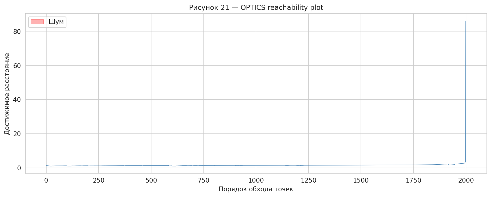{width="6.102362204724409in"
height="2.453642825896763in"}

Рисунок 21 --- OPTICS: reachability plot

Выбор оптимального числа кластеров осуществлён двумя стандартными
методами. Метод локтя ищет «излом» на графике зависимости WCSS от числа
кластеров k. Метод силуэта максимизирует средний коэффициент силуэта:

$s(i) = \frac{b(i) - a(i)}{\max\{ a(i),\, b(i)\}} \in \lbrack - 1,\, 1\rbrack$
(2.13)

где a(i) --- среднее расстояние от точки i до объектов её кластера, b(i)
--- среднее расстояние до объектов ближайшего соседнего кластера.
Значения близкие к 1 соответствуют хорошо разделённым кластерам, близкие
к 0 --- границам между кластерами, отрицательные --- неправильному
отнесению. На рисунке 22 представлены оба критерия: WCSS монотонно
убывает с k, изгиб виден при k ≈ 3--4; силуэт достигает максимума при k
= 2.

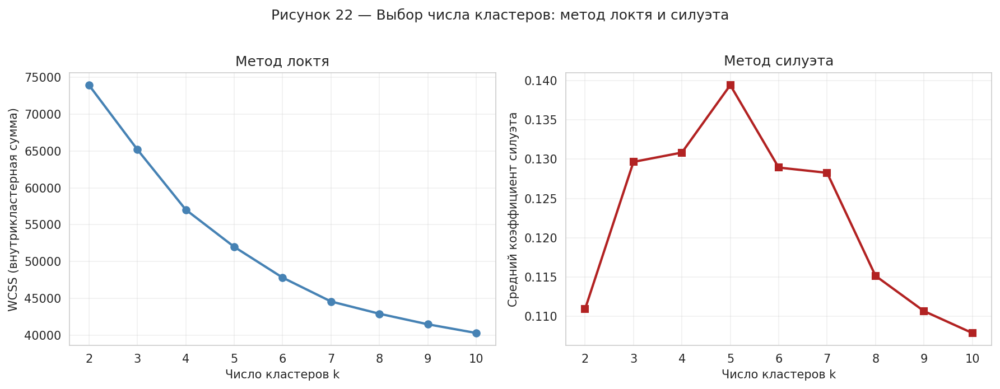{width="6.102362204724409in"
height="2.3759897200349958in"}

Рисунок 22 --- Выбор числа кластеров: метод локтя и метод силуэта

Детальный анализ силуэтных диаграмм для k = 2, 3, 4 представлен на
рисунке 23. При k = 2 силуэт выше, но кластеры неравномерны; при k = 3
структура более сбалансированная и согласуется с числом классов в
данных.

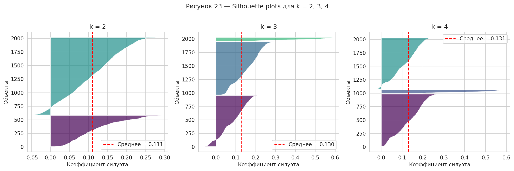{width="6.102362204724409in"
height="2.0370516185476815in"}

Рисунок 23 --- Silhouette plots для k = 2, 3, 4

Подводя итоги главы, лучшее качество классификации (F1 = 0,9995)
показали логистическая регрессия и SVM с RBF-ядром; они дают идентичную
матрицу ошибок, что объясняется хорошей отделимостью классов в
признаковом пространстве. Дерево решений (F1 = 0,9990) обеспечивает
сопоставимое качество и при этом существенно превосходит другие методы
по интерпретируемости --- структура дерева напрямую переводится в
человекочитаемые правила. Метод k ближайших соседей (F1 = 0,9940)
оказался наиболее уязвим к дисбалансу классов, поскольку при k = 1
редкие классы окружены многочисленным классом «normal». Наивный байес
(F1 = 0,9851) показал наименьшее качество из-за нарушения предположения
о независимости признаков.

Среди методов кластеризации DBSCAN наиболее подходит для задачи
обнаружения аномалий, поскольку явно выделяет шумовые точки --- точки,
не имеющие достаточной плотности соседей. K-Means даёт более стабильные
результаты, но не учитывает разреженность аномалий. Метод Уорда полезен
для предварительного исследования структуры данных через дендрограмму.
Метод силуэта в сочетании с методом локтя указывает на оптимальное число
кластеров k = 3, согласующееся с числом классов в исходных данных.

**ГЛАВА 3. РЕГРЕССИОННЫЙ АНАЛИЗ И ПРОГНОЗИРОВАНИЕ ВРЕМЕННЫХ РЯДОВ**

**3.1 Постановка задачи регрессии**

Регрессионный анализ применяется в работе с двумя целями: количественное
предсказание времени выполнения SQL-запроса по характеристикам
инфраструктуры и описание временной динамики числа запросов в час.
Первая задача служит практическим инструментом мониторинга нагрузки и
помогает выявлять «медленные» запросы; вторая --- задачей анализа
временных рядов с выявлением трендов, периодических компонент и
колебательной структуры.

Целевая переменная для задачи регрессии --- время выполнения запроса
execution_time_ms (тип float, измеряется в миллисекундах). В качестве
предикторов выступают числовые признаки cpu_load_pct, ram_usage_mb,
active_connections, rows_affected, а также производные временные
признаки hour и day_of_week и One-Hot закодированные категориальные
признаки country и query_type. Для выявления потенциальных нелинейных
эффектов добавлены два инженерных признака: cpu_load_pct ×
active_connections (отражает совместное влияние нагрузки CPU и числа
подключений) и log(rows_affected + 1) (сглаживает правостороннюю
асимметрию признака rows_affected).

Анализ регрессии выполнен на подвыборке нормальных запросов (label =
«normal», n = 9 624 наблюдения), поскольку аномалии и SQL-инъекции имеют
принципиально иную природу зависимости и их включение исказило бы
результаты. Для контроля качества модели данные разделены на обучающую
(80 %) и тестовую (20 %) выборки с фиксированным random_state = 42.

Качество регрессионных моделей оценивается тремя стандартными метриками.
Среднеквадратичная ошибка (RMSE) штрафует крупные ошибки квадратично:

$RMSE = \sqrt{\frac{1}{n}\sum_{i = 1}^{n}\left( y_{i} - {\widehat{y}}_{i} \right)^{2}}$
(3.1)

Средняя абсолютная ошибка (MAE) более устойчива к выбросам:

$MAE = \frac{1}{n}\sum_{i = 1}^{n}\left| y_{i} - {\widehat{y}}_{i} \right|$
(3.2)

Коэффициент детерминации R² показывает долю объяснённой моделью
дисперсии отклика:

$R^{2} = 1 - \frac{\sum_{i = 1}^{n}\left( y_{i} - {\widehat{y}}_{i} \right)^{2}}{\sum_{i = 1}^{n}\left( y_{i} - \bar{y} \right)^{2}}$
(3.3)

Скорректированный коэффициент детерминации учитывает число предикторов
p:

$R_{adj}^{2} = 1 - \left( 1 - R^{2} \right) \cdot \frac{n - 1}{n - p - 1}$
(3.4)

**3.2 Линейная регрессия и анализ остатков**

Простая линейная регрессия по одному признаку --- загрузке CPU ---
описывается уравнением:

$\widehat{y} = \beta_{0} + \beta_{1}\, x$ (3.5)

где параметры оцениваются методом наименьших квадратов:

${\widehat{\beta}}_{1} = \frac{\sum_{i = 1}^{n}\left( x_{i} - \bar{x} \right)\left( y_{i} - \bar{y} \right)}{\sum_{i = 1}^{n}\left( x_{i} - \bar{x} \right)^{2}},\quad{\widehat{\beta}}_{0} = \bar{y} - {\widehat{\beta}}_{1}\,\bar{x}$
(3.6)

Для предиктора cpu_load_pct получено уравнение ŷ = 364.06 + (-0.12)·x
при R² = -0.0006 и RMSE = 368.5 мс. Низкое значение R² (близкое к нулю)
показывает, что один признак cpu_load_pct практически не объясняет
дисперсию времени выполнения. Это согласуется с результатами
корреляционного анализа из главы 1, где коэффициенты Пирсона между всеми
числовыми признаками и execution_time_ms по модулю не превышали 0,1. Это
означает, что время выполнения SQL-запроса является многофакторной
величиной, и для его адекватного описания одного предиктора недостаточно
--- необходимо привлечение нескольких признаков, в том числе
категориальных, и/или нелинейных преобразований.

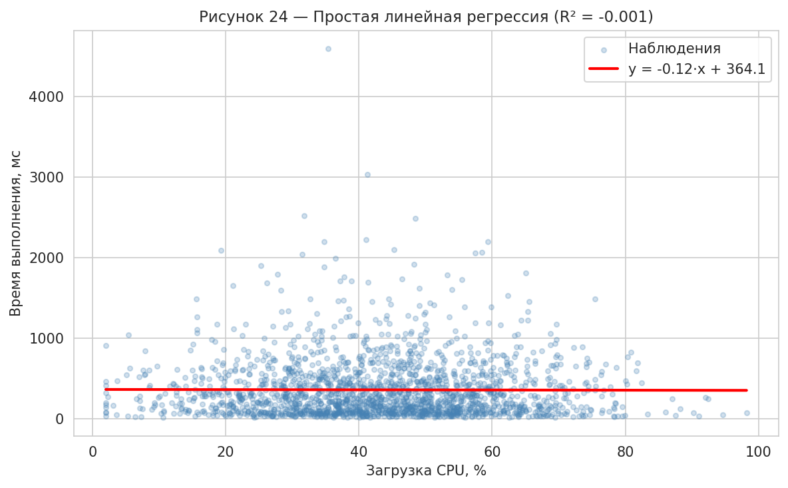{width="6.102362204724409in"
height="3.777898075240595in"}

Рисунок 24 --- Простая линейная регрессия по cpu_load_pct (R² = -0.001)

Множественная линейная регрессия позволяет учитывать совместное влияние
всех предикторов:

$\widehat{y} = \beta_{0} + \sum_{j = 1}^{p}\beta_{j}\, x_{j}$ (3.7)

В матричной форме оценка параметров методом наименьших квадратов:

$\widehat{\mathbf{\beta}} = \left( X^{\top}X \right)^{- 1}X^{\top}\mathbf{y}$
(3.8)

Для интерпретации относительной важности признаков использованы
стандартизованные коэффициенты, полученные после z-стандартизации
матрицы предикторов. Они показывают, на сколько стандартных отклонений
изменится отклик при изменении предиктора на одно стандартное
отклонение, при неизменных остальных предикторах. Двенадцать наиболее
значимых стандартизованных коэффициентов представлены на рисунке 25.

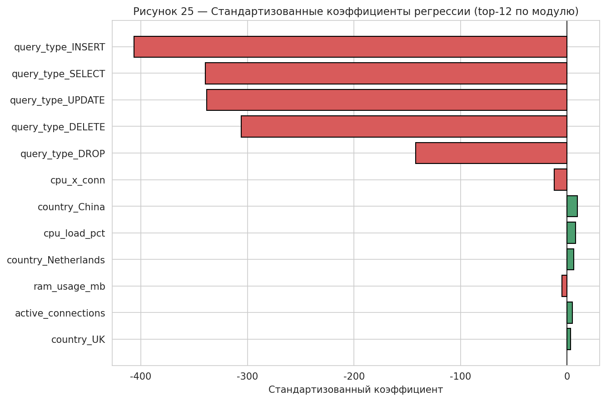{width="6.102362204724409in"
height="4.039270559930009in"}

Рисунок 25 --- Стандартизованные коэффициенты множественной регрессии
(top-12 по модулю)

Качество множественной регрессии: R² = 0.4442, скорректированный R² =
0.4428, RMSE = 274.6 мс, MAE = 171.6 мс. Привлечение дополнительных
предикторов (включая категориальные query_type и country, а также
инженерные признаки cpu_x_conn и log_rows) повысило коэффициент
детерминации с практически нулевого до 44.4 %. Это означает, что время
выполнения запроса в существенной мере определяется типом запроса
(DELETE и DROP в среднем медленнее, чем SELECT) и нелинейным
взаимодействием числа соединений с загрузкой CPU.

Анализ остатков регрессионной модели --- обязательный диагностический
этап. Остаток ε_i = y_i − ŷ_i при выполнении классических предположений
(линейность, гомоскедастичность, нормальность, независимость) должен
быть случайной величиной с нулевым средним. На рисунке 26 представлены
три диагностические диаграммы.

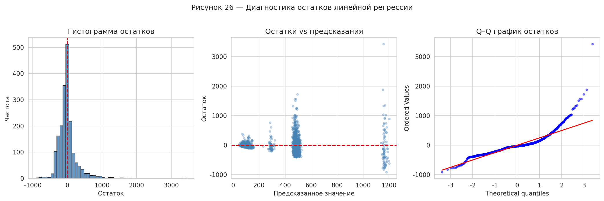{width="6.102362204724409in"
height="2.035097331583552in"}

Рисунок 26 --- Диагностика остатков множественной линейной регрессии

Гистограмма остатков показывает распределение, близкое к симметричному с
выраженным правым хвостом (среднее = -1.14 мс, стандартное отклонение =
274.6 мс). Диаграмма остатков относительно предсказаний демонстрирует
расширение разброса при росте предсказанного значения --- признак
гетероскедастичности, который свидетельствует о том, что дисперсия
отклика растёт вместе с его средним. Q-Q график подтверждает отклонение
от нормальности, особенно в хвостах. Тест Шапиро--Уилка на нормальность
остатков (на подвыборке n = 500) даёт p-значение 4.03e-23, что с большим
запасом отвергает гипотезу о нормальном распределении остатков. Это
означает, что классические предположения линейной регрессии нарушены, и
для построения корректных доверительных интервалов и проверки значимости
коэффициентов потребовался бы переход к робастным методам --- что и
реализовано далее в виде логарифмической трансформации отклика и
квантильной регрессии.

**3.3 Нелинейные модели регрессии**

Полиномиальная регрессия добавляет в модель степени и произведения
исходных признаков:

$\widehat{y} = \beta_{0} + \sum_{j = 1}^{p}\beta_{j}x_{j} + \sum_{j = 1}^{p}{\sum_{k = j}^{p}\beta_{jk}}\, x_{j}x_{k}$
(3.9)

Для четырёх ключевых числовых предикторов (cpu_load_pct, ram_usage_mb,
active_connections, rows_affected) построена полиномиальная модель
степени 2, которая включает квадраты признаков и все парные
произведения. Результат: R² = -0.0244, RMSE = 372.9 мс. Отрицательное
значение R² показывает, что модель работает хуже, чем простое среднее по
обучающей выборке --- это классический признак переобучения: добавление
14 квадратичных и парных членов резко увеличило ёмкость модели, но новые
параметры подгоняются к шуму обучающей выборки и не обобщаются на тест.
Этот результат демонстрирует фундаментальный компромисс bias--variance:
усложнение модели без обоснования в виде содержательной зависимости
приводит к ухудшению прогноза.

Лог-линейная регрессия применяет логарифмическое преобразование к
отклику:

$\log\left( \widehat{y} + 1 \right) = \beta_{0} + \sum_{j = 1}^{p}\beta_{j}x_{j}$
(3.10)

Преобразование log(y + 1) сжимает большие значения и расширяет малые,
что компенсирует правостороннюю асимметрию распределения времени
выполнения. Прогноз на исходной шкале получается обратным
преобразованием:

$\widehat{y} = \exp\left( \widehat{z} \right) - 1,\quad\widehat{z} = \beta_{0} + \sum_{j = 1}^{p}\beta_{j}x_{j}$
(3.11)

Качество модели на логарифмической шкале: R² = 0.6593 --- заметно выше,
чем у обычной линейной регрессии. Однако после обратного преобразования
R² на исходной шкале составляет 0.4091, RMSE = 283.2 мс --- это близко к
показателям обычной множественной регрессии. Расхождение R² на
логарифмической и исходной шкале объясняется неравномерным растяжением
метрики при обратном преобразовании: модель хорошо описывает «типичные»
наблюдения, но крупные значения отклика (хвост распределения) после
возведения в экспоненту дают значительные абсолютные ошибки.

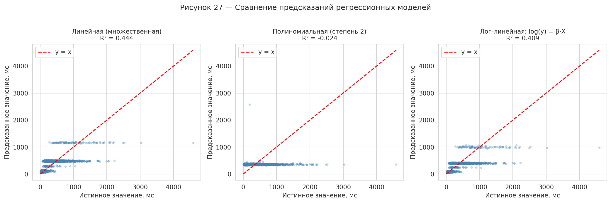{width="6.102362204724409in"
height="2.035097331583552in"}

Рисунок 27 --- Сравнение предсказаний регрессионных моделей: наблюдаемые
и предсказанные значения

**3.4 Квантильная регрессия**

Квантильная регрессия оценивает условные квантили отклика, а не его
условное среднее. Это делает её более информативной для анализа
неоднородной дисперсии и устойчивой к выбросам. Для квантиля τ ∈ (0, 1)
минимизируется так называемая «pinball loss»:

$\rho_{\tau}(u) = \tau\, u\quad\text{при}\quad u \geq 0;\quad\rho_{\tau}(u) = (\tau - 1)\, u\quad\text{при}\quad u < 0$
(3.12)

Параметры модели определяются как:

${\widehat{\mathbf{\beta}}}_{\tau} = \arg\min_{\mathbf{\beta}}\sum_{i = 1}^{n}\rho_{\tau}\left( y_{i} - \mathbf{x}_{i}^{\top}\mathbf{\beta} \right)$
(3.13)

При τ = 0,5 квантильная регрессия совпадает с медианной регрессией и
оптимизирует L1-ошибку, при τ = 0,25 --- оценивает первый квартиль, при
τ = 0,75 --- третий квартиль. Совместное использование трёх квантилей
позволяет описать не только тренд, но и «коридор» вариации отклика, что
критически важно для мониторинга: например, если фактическое время
выполнения запроса превышает предсказанный квантиль 0,75 --- это сигнал
о потенциальной проблеме.

На рисунке 28 представлены предсказанные квантили в зависимости от
загрузки CPU. Видно, что разброс между квантилями 0,25 и 0,75
(межквартильный коридор) расширяется при росте CPU --- это явный признак
гетероскедастичности, о которой ранее свидетельствовал анализ остатков.
На фоне кривой медианы квантили служат наглядными границами «нормы» и
«зоны риска».

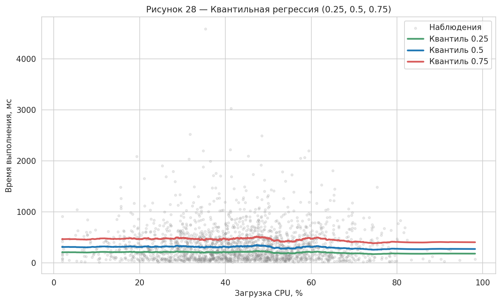{width="6.102362204724409in"
height="3.6961843832020995in"}

Рисунок 28 --- Квантильная регрессия (квантили 0,25; 0,5; 0,75)

**3.5 Сравнение регрессионных моделей**

Таблица 4 --- Сводные метрики регрессионных моделей

  -------------------------------------------------------------------
        **Модель**        **R²**    **RMSE,   **Замечание**
                                    мс**      
  ----------------------- --------- --------- -----------------------
     Простая линейная     -0.0006   368.5     Один предиктор
      (cpu_load_pct)                          недостаточен

  Множественная линейная  0.4442    274.6     Базовая модель

  Полиномиальная (степень -0.0244   372.9     Переобучение
            2)                                

       Лог-линейная       0.4091    283.2     Учитывает асимметрию
  -------------------------------------------------------------------

Из таблицы 4 и рисунка 29 следует, что наилучшие показатели на тестовой
выборке демонстрирует множественная линейная регрессия. Усложнение
модели до полиномиальной степени 2 приводит к переобучению. Лог-линейная
модель улучшает описание распределения отклика по симметрии, но на
исходной шкале её преимущество минимально. Квантильная регрессия не
сравнима по R² с другими моделями (она оптимизирует иную целевую
функцию), но даёт качественно новую информацию о вариации отклика.

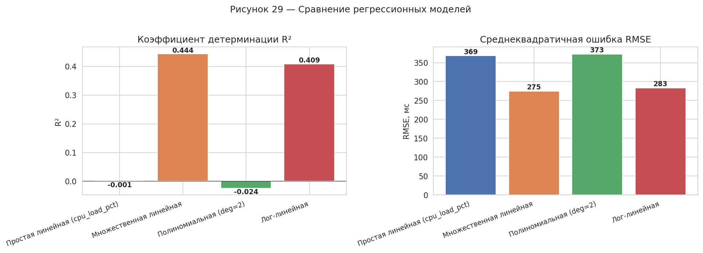{width="6.102362204724409in"
height="2.2017858705161855in"}

Рисунок 29 --- Сравнение регрессионных моделей по R² и RMSE

**3.6 Анализ временного ряда**

Для анализа временной динамики нагрузки на сервер исходные данные
агрегированы по часовым интервалам: для каждого часа в интервале с
2024-01-01 по 2024-03-30 (всего 2160 точек) подсчитано число выполненных
запросов. В случаях, когда в течение часа запросов не было, значение
установлено равным нулю. Полученный временной ряд имеет среднее 4.63
запроса в час, стандартное отклонение 4.04, диапазон значений от 0 до
23.

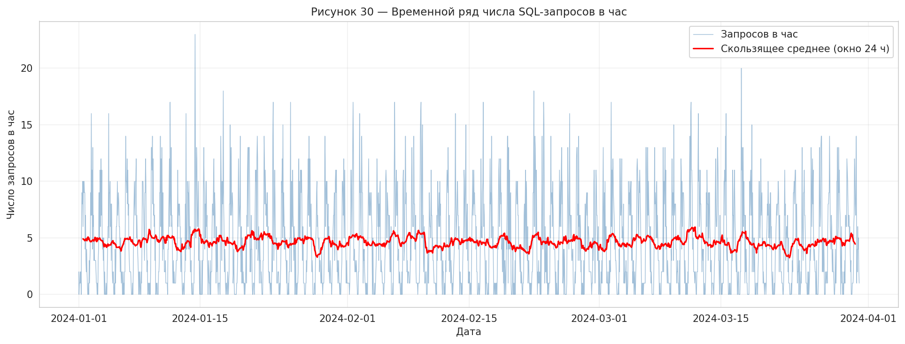{width="6.102362204724409in"
height="2.321241251093613in"}

Рисунок 30 --- Временной ряд числа SQL-запросов в час

На рисунке 30 представлен исходный почасовой ряд (тонкая линия) и
скользящее среднее с окном 24 часа (красная линия). Скользящее среднее
--- оценка локального уровня ряда:

${\overline{y}}_{t}^{(w)} = \frac{1}{w}\sum_{k = t - \lfloor w/2\rfloor}^{t + \lfloor w/2\rfloor}y_{k}$
(3.14)

Скользящее среднее с окном 24 часа сглаживает суточные колебания и
позволяет увидеть среднесрочный уровень нагрузки. Видно, что
среднесрочный уровень практически постоянен на протяжении всего периода
наблюдения, что указывает на отсутствие ярко выраженного тренда ---
нагрузка стабильна.

Технический анализ (заимствованный из практики финансовых рынков)
дополнительно характеризует динамику ряда через линии поддержки и
сопротивления, проведённые методом наименьших квадратов через локальные
максимумы и минимумы. Линия сопротивления отражает «потолок» ---
уровень, выше которого ряд редко поднимается; линия поддержки --- «пол»,
ниже которого ряд редко опускается. На рисунке 31 анализ выполнен на
ежедневных значениях числа запросов:

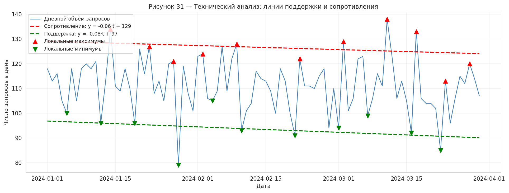{width="6.102362204724409in"
height="2.3200371828521433in"}

Рисунок 31 --- Технический анализ: линии поддержки и сопротивления

Линия сопротивления имеет наклон -0.056 запросов/день при свободном
члене 129.1; линия поддержки --- -0.076 запросов/день, свободный член
96.9. Оба наклона по модулю малы, что согласуется с выводом об
отсутствии тренда: и максимумы, и минимумы остаются примерно на одном
уровне за весь период наблюдения.

Для формального исследования наличия тренда подобраны четыре
аналитические модели: линейная, степенная, экспоненциальная и
логистическая. Соответствующие функциональные формы:

$y = a\, t + b\quad\text{(линейный тренд)}$ (3.15)

$y = a\,(t + 1)^{b}\quad\text{(степенной тренд)}$ (3.16)

$y = a\, e^{b\, t} + c\quad\text{(экспоненциальный тренд)}$ (3.17)

$y = \frac{K}{1 + e^{- a(t - b)}}\quad\text{(логистический тренд)}$
(3.18)

Параметры подобраны нелинейным методом наименьших квадратов
(scipy.optimize.curve_fit). Результаты приведены на рисунке 32.

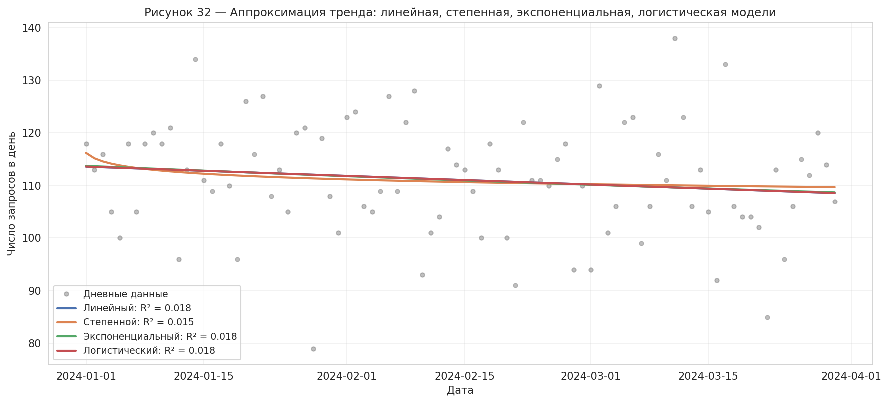{width="6.102362204724409in"
height="2.773176946631671in"}

Рисунок 32 --- Аппроксимация тренда четырьмя моделями

Таблица 5 --- Качество аппроксимации тренда временного ряда

  --------------------------------------------------------
        **Модель тренда**        **R²**       **RMSE**
  ------------------------------ ------------ ------------
             Линейный            0.0183       10.73

            Степенной            0.0148       10.75

         Экспоненциальный        0.0184       10.73

          Логистический          0.0184       10.73
  --------------------------------------------------------

Все четыре модели демонстрируют практически одинаково низкий коэффициент
детерминации (R² ≈ 0.018). Это означает, что тренд как таковой объясняет
менее 2 % дисперсии ряда --- с точки зрения статистики ряд можно считать
стационарным по уровню. Подобный результат физически осмыслен: за период
менее трёх месяцев инфраструктура и пользовательская база остаются
стабильными, а сезонные эффекты (если бы они проявлялись на масштабе
месяцев) на таком коротком периоде не успевают сформировать тренд.
Дополнительно стоит отметить, что логистическая модель идентифицирует
пологий участок S-кривой и фактически сводится к линейной с малым
наклоном.

Если тренд практически отсутствует, то колебательная (периодическая)
структура ряда становится главным предметом анализа. Автокорреляционная
функция (ACF) измеряет корреляцию ряда с самим собой, сдвинутым на лаг
τ:

$\rho(\tau) = \frac{\sum_{t = 1}^{n - \tau}\left( y_{t} - \bar{y} \right)\left( y_{t + \tau} - \bar{y} \right)}{\sum_{t = 1}^{n}\left( y_{t} - \bar{y} \right)^{2}}$
(3.19)

Спектральный анализ Фурье разлагает ряд по частотам и выявляет
преобладающие периоды:

$Y(f) = \left| \sum_{t = 0}^{n - 1}\left( y_{t} - \bar{y} \right)\, e^{- 2\pi ift} \right|$
(3.20)

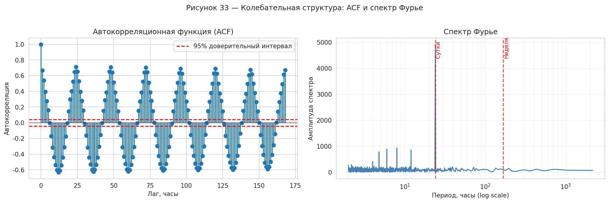{width="6.102362204724409in"
height="2.035097331583552in"}

Рисунок 33 --- Автокорреляционная функция (слева) и спектр Фурье
(справа)

ACF (рисунок 33, слева) показывает выраженный пик на лаге 24 часа (ρ(24)
= 0.712) и заметный пик на лаге 168 часов (ρ(168) = 0.671). Эти лаги
соответствуют суточному и недельному циклам --- характерным паттернам
активности пользователей информационных систем. Высокое значение ρ(24)
фактически означает, что число запросов в данный час сильно похоже на
число запросов в тот же час предыдущего дня. Спектр Фурье (рисунок 33,
справа) подтверждает этот вывод: на периоде 24 часа отчётливо виден
доминирующий пик амплитуды, что является «отпечатком» суточной
сезонности. Выявленная сезонность --- основная информация, которую можно
извлечь из временного ряда: тренд отсутствует, но устойчивый суточный
цикл позволяет строить точные краткосрочные прогнозы по принципу
«сегодня в этот час --- как вчера в этот час».

Для исследования локальных характеристик ряда применён метод скользящего
окна с шириной 168 часов (одна неделя): на каждом шаге окно сдвигается
на 12 часов, внутри окна оцениваются параметры локальной линейной
регрессии и среднее. Это позволяет увидеть, как меняются локальный
уровень и локальный наклон ряда с течением времени:

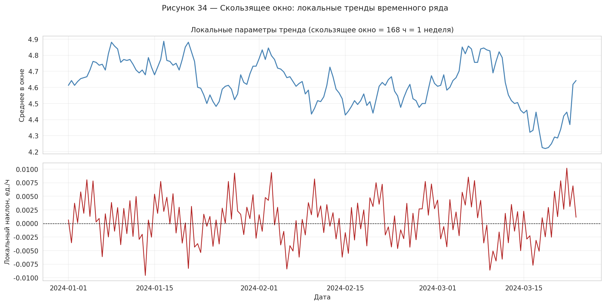{width="6.102362204724409in"
height="3.073109142607174in"}

Рисунок 34 --- Локальные параметры тренда (скользящее окно = 1 неделя)

Локальный уровень (верхняя панель рисунка 34) колеблется в небольшом
диапазоне вокруг общего среднего, что подтверждает стационарность по
среднему. Локальный наклон (нижняя панель) колеблется около нуля
(среднее значение +0.00057, стандартное отклонение 0.00416), что
дополнительно подтверждает отсутствие глобального тренда. При этом
локальные наклоны то слабо положительные, то слабо отрицательные --- это
нормальная случайная флуктуация краткосрочной динамики на фоне
доминирующего суточного цикла.

Подведём итоги главы. В части регрессионного анализа наилучшие
показатели на тестовой выборке продемонстрировала множественная линейная
регрессия (R² = 0.4442, RMSE = 274.6 мс). Простая регрессия по одному
признаку cpu_load_pct оказалась неинформативной (R² ≈ 0), что
согласуется с малыми коэффициентами корреляции, выявленными в главе 1, и
отражает многофакторный характер времени выполнения SQL-запроса.
Полиномиальная регрессия степени 2 показала переобучение (отрицательный
R² на тесте), что демонстрирует риск избыточного усложнения модели.
Лог-линейная модель частично корректирует асимметрию распределения
отклика, но не даёт существенного прироста на исходной шкале.
Квантильная регрессия дала качественно дополняющий результат: она
показала явное расширение межквартильного коридора при росте CPU, что
говорит о гетероскедастичности данных, не учтённой обычной регрессией.

В части анализа временного ряда установлено, что ряд почти стационарен
по среднему и уровню --- глобальный тренд отсутствует или крайне слаб
(R² для лучшей трендовой модели ≈ 0,02). Однако ряд содержит выраженную
периодическую компоненту с периодом 24 часа (суточный цикл) и более
слабым недельным циклом (168 часов), что подтверждается как
автокорреляционной функцией, так и спектром Фурье. Метод скользящего
окна показал стабильность локальных параметров. Выявленная суточная
сезонность --- главный практический результат анализа временного ряда:
она допускает построение простой и эффективной краткосрочной прогнозной
модели типа «сезонный сдвиг 24 часа».

**ГЛАВА 4. АНСАМБЛЕВЫЕ МОДЕЛИ МАШИННОГО ОБУЧЕНИЯ И РЕГУЛЯРИЗАЦИЯ**

**4.1 Бэггинг (Bootstrap Aggregating)**

Бэггинг --- техника снижения дисперсии прогноза за счёт обучения
нескольких базовых моделей на бутстрэп-выборках и агрегирования их
предсказаний. Идея метода базируется на статистическом принципе: если
базовые предсказания имеют одинаковое математическое ожидание и попарную
корреляцию ρ, дисперсия их среднего убывает с ростом числа моделей T:

$Var\left( {\bar{f}}_{T} \right) = \rho\,\sigma^{2} + \frac{(1 - \rho)\,\sigma^{2}}{T}$
(4.1)

Бутстрэп-выборка формируется случайным извлечением N объектов из
обучающей выборки с возвращением. Получаемые подвыборки имеют одинаковую
размерность, но содержат разные наблюдения (в среднем около 63,2 %
уникальных). Это обеспечивает декорреляцию базовых моделей. Финальный
прогноз для классификации формируется голосованием большинства:

$\widehat{y}\left( \mathbf{x} \right) = {argmax}_{c}\sum_{t = 1}^{T}\mathbb{1}\left\lbrack {\widehat{f}}_{t}\left( \mathbf{x} \right) = c \right\rbrack$
(4.2)

В качестве базовой модели выбраны решающие деревья без ограничения
глубины (max_depth=None). Такая модель обладает высокой дисперсией и
низким смещением, что делает её идеальным кандидатом для бэггинга ---
усреднение по бутстрэп-выборкам должно существенно снизить дисперсию без
увеличения смещения. Параметр class_weight=\'balanced\' использован для
компенсации дисбаланса классов.

Базовая модель --- одно решающее дерево (max_depth = 7 из главы 2) ---
даёт F1 = 0.9990. Для оценки влияния числа базовых моделей на качество
ансамбля проведён эксперимент с T ∈ {5, 10, 25, 50, 100}. Зависимость
F1-score от T представлена на рисунке 35.

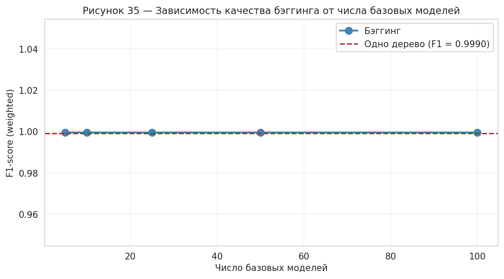{width="6.102362204724409in"
height="3.3861920384951882in"}

Рисунок 35 --- Зависимость качества бэггинга от числа базовых моделей

Из графика видно, что качество стабилизируется уже при T ≈ 25--50
моделей. Дальнейшее увеличение T не приводит к существенному росту F1,
но пропорционально увеличивает время обучения и предсказания.
Окончательная модель использует T = 50, что обеспечивает баланс между
качеством и вычислительной сложностью. На тестовой выборке бэггинг
показывает F1 = 0.9995 --- улучшение на 0.05 процентного пункта по
сравнению с одиночным деревом. Матрица ошибок представлена на рисунке
36.

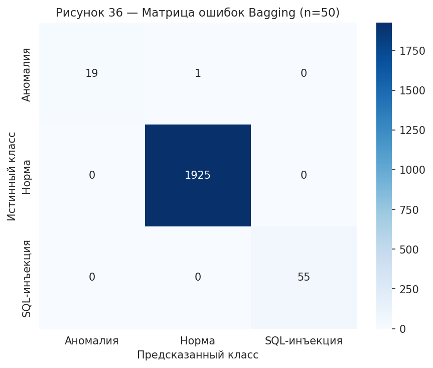{width="6.102362204724409in"
height="5.1831189851268595in"}

Рисунок 36 --- Матрица ошибок Bagging (T = 50)

Полученное улучшение качества согласуется с теоретическим обоснованием
бэггинга. Учитывая высокое исходное качество дерева решений (F1 ≈
0,999), резерв для улучшения был ограничен --- однако даже малый прирост
в F1 на тестовой выборке из 2000 объектов соответствует исправлению
ошибок на 1--2 объектах редких классов, что важно с прикладной точки
зрения.

**4.2 Бустинг (Gradient Boosting)**

В отличие от бэггинга, бустинг строит ансамбль последовательно: каждая
следующая базовая модель обучается компенсировать ошибки уже
построенного ансамбля. В работе использован градиентный бустинг
(Gradient Boosting), который рассматривает обучение как пошаговый
градиентный спуск в пространстве функций. На итерации t ансамбль
обновляется по формуле:

$F_{t}\left( \mathbf{x} \right) = F_{t - 1}\left( \mathbf{x} \right) + \eta\, h_{t}\left( \mathbf{x} \right)$
(4.3)

где η ∈ (0, 1\] --- скорость обучения (learning rate), h_t --- базовая
модель, обученная аппроксимировать антиградиент функции потерь L по
предсказаниям предыдущего ансамбля:

$h_{t} = \arg\min_{h}\sum_{i = 1}^{n}\left( - \frac{\partial L\left( y_{i},F_{t - 1}\left( \mathbf{x}_{i} \right) \right)}{\partial F_{t - 1}\left( \mathbf{x}_{i} \right)} - h\left( \mathbf{x}_{i} \right) \right)^{2}$
(4.4)

В качестве базовых моделей используются неглубокие деревья решений
(max_depth = 3) --- так называемые «слабые» обучаемые модели. Скорость
обучения установлена равной η = 0.1, что является стандартным
компромиссом: меньшие значения требуют большего числа итераций для
сходимости, но дают более устойчивые ансамбли с лучшей обобщающей
способностью.

Для исследования зависимости качества от числа итераций T ∈ {10, 25, 50,
100, 200, 300} построена кривая обучения (рисунок 37). Расхождение между
обучающей и тестовой кривыми позволяет оценить степень переобучения:
если тестовая кривая начинает падать с ростом T, это сигнал к ранней
остановке.

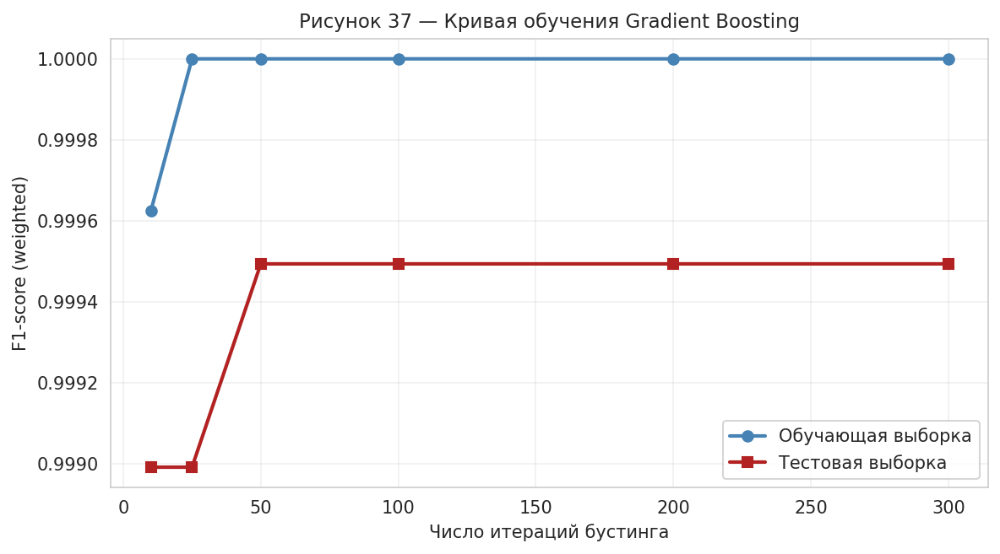{width="6.102362204724409in"
height="3.3861920384951882in"}

Рисунок 37 --- Кривая обучения Gradient Boosting

Кривая показывает быстрое выход тестового F1 на плато при T ≥ 50, что
свидетельствует об отсутствии переобучения вплоть до T = 300. Это
типичное поведение градиентного бустинга при достаточно малом
learning_rate и неглубоких базовых моделях: каждая итерация вносит малое
корректирующее обновление, и ансамбль не теряет обобщающей способности
даже на больших T. Окончательная модель использует T = 200, что даёт F1
= 0.9995 на тесте. Матрица ошибок представлена на рисунке 38.

{width="6.102362204724409in"
height="5.112036307961505in"}

Рисунок 38 --- Матрица ошибок Gradient Boosting (T = 200)

**4.3 Стекинг (Stacked Generalization)**

Стекинг --- двухуровневый ансамбль, в котором предсказания базовых
моделей первого уровня выступают признаками для модели второго уровня
(мета-модели). В отличие от голосования бэггинга или последовательного
обновления бустинга, стекинг учится оптимально комбинировать разнотипные
алгоритмы --- каждый из них улавливает свои закономерности.

Формально, для базовых алгоритмов g_1, g_2, ..., g_M предсказания на
обучающей выборке формируются по схеме кросс-валидации: для каждого
объекта x_i предсказание g_m(x_i) берётся от модели, обученной без этого
объекта. Это предотвращает «утечку» информации (data leakage), при
которой мета-модель училась бы на предсказаниях, уже видевших целевую
разметку:

${\widehat{y}}_{i}^{(m)} = g_{m}^{\left( - k(i) \right)}\left( \mathbf{x}_{i} \right),\quad m = 1,\ldots,M$
(4.5)

где k(i) --- индекс фолда, в который попал объект i. Полученные
мета-признаки \[ŷ_i\^(1), ..., ŷ_i\^(M)\] подаются на вход модели
второго уровня:

${\widehat{y}}_{i}^{\, stack} = h\left( {\widehat{y}}_{i}^{(1)},\,\ldots,\,{\widehat{y}}_{i}^{(M)} \right)$
(4.6)

В работе использованы три базовых алгоритма с различной природой:
логистическая регрессия (линейная вероятностная модель), метод k
ближайших соседей (метрический алгоритм) и дерево решений (древовидный
нелинейный алгоритм). Такой выбор обеспечивает разнообразие ошибок:
модели, основанные на разных принципах, делают ошибки на разных
объектах, что позволяет мета-модели за счёт их комбинации повысить
устойчивость прогноза.

В качестве мета-модели использована логистическая регрессия --- простая,
быстро обучаемая и устойчивая к переобучению. Кросс-валидация для
формирования мета-признаков --- 3-кратная (cv = 3). Качество стекинга на
тестовой выборке: F1 = 0.9995. Матрица ошибок приведена на рисунке 39.

{width="6.102362204724409in"
height="5.1831189851268595in"}

Рисунок 39 --- Матрица ошибок Stacking (мета-модель --- логистическая
регрессия)

**4.4 Регуляризация: Ridge и Lasso**

Регуляризация --- это техника предотвращения переобучения за счёт
добавления к функции потерь штрафа, ограничивающего сложность модели.
Для линейной регрессии используются два классических вида регуляризации,
отличающихся нормой штрафа.

Ridge-регрессия (L2-регуляризация) добавляет к среднеквадратичной ошибке
квадратный штраф на коэффициенты:

$\mathcal{L}_{Ridge}\left( \mathbf{\beta} \right) = \sum_{i = 1}^{n}\left( y_{i} - \mathbf{x}_{i}^{\top}\mathbf{\beta} \right)^{2} + \alpha\sum_{j = 1}^{p}\beta_{j}^{2}$
(4.7)

Lasso-регрессия (L1-регуляризация) использует абсолютные значения:

$\mathcal{L}_{Lasso}\left( \mathbf{\beta} \right) = \sum_{i = 1}^{n}\left( y_{i} - \mathbf{x}_{i}^{\top}\mathbf{\beta} \right)^{2} + \alpha\sum_{j = 1}^{p}\left| \beta_{j} \right|$
(4.8)

Параметр α ≥ 0 регулирует силу штрафа: при α = 0 обе модели совпадают с
обычным методом наименьших квадратов; при α → ∞ все коэффициенты
стремятся к нулю. Геометрически Ridge ограничивает коэффициенты сферой,
а Lasso --- выпуклым многогранником; острые вершины L1-нормы создают
эффект автоматического отбора признаков: при достаточном α часть
коэффициентов становится в точности нулевой.

Для подбора оптимального α перебран сетки α ∈ {0,01; 0,1; 1; 10; 100;
1000} для Ridge и α ∈ {0,01; 0,1; 1; 10; 100} для Lasso. Качество
моделей оценивалось по R² на тестовой выборке (рисунок 40).

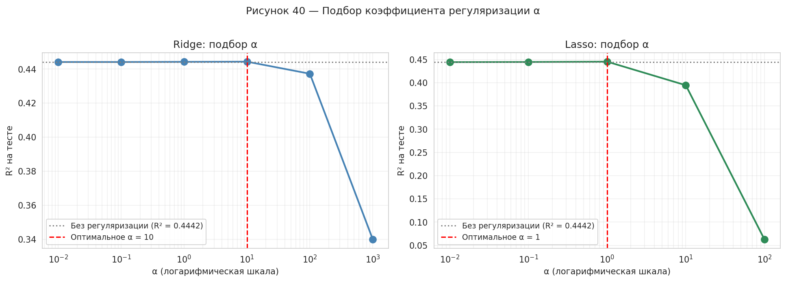{width="6.102362204724409in"
height="2.192937445319335in"}

Рисунок 40 --- Подбор коэффициента регуляризации α для Ridge и Lasso

Оптимальные параметры: α = 10 для Ridge (R² = 0.4444) и α = 1 для Lasso
(R² = 0.4453). Базовая множественная регрессия без регуляризации (метод
наименьших квадратов) даёт R² = 0.4442. Все три модели показывают
практически идентичное качество, что свидетельствует об отсутствии
мультиколлинеарности --- это согласуется с результатом главы 1, где
коэффициенты Пирсона между признаками были малы по модулю. Однако Lasso
дополнительно обнулил 6 из 20 коэффициентов, что является важным
практическим преимуществом --- модель автоматически выбрала наиболее
информативные признаки, упростив интерпретацию.

Сравнение коэффициентов трёх моделей (рисунок 41) наглядно демонстрирует
различия в эффекте регуляризации. Коэффициенты Ridge систематически
уменьшены по модулю относительно OLS, но все остаются ненулевыми.
Коэффициенты Lasso для значимых признаков близки к OLS, а для
неинформативных обнуляются полностью.

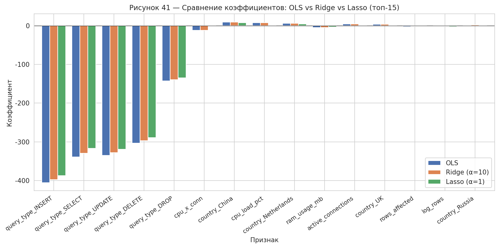{width="6.102362204724409in"
height="3.0380380577427823in"}

Рисунок 41 --- Сравнение коэффициентов: OLS, Ridge, Lasso (топ-15
признаков)

**4.5 Интерпретация ансамблей: важность признаков**

Ансамблевые модели, в особенности градиентный бустинг, считаются
«чёрными ящиками» по сравнению с линейными моделями: предсказание
зависит от сотен деревьев, каждое из которых вносит свой вклад. Тем не
менее, существуют методы интерпретации ансамблей, позволяющие выявить
наиболее влиятельные признаки.

Встроенная важность признаков (feature_importances\_) для Gradient
Boosting вычисляется как нормированное суммарное снижение критерия
неоднородности (индекса Джини), достигнутое каждым признаком при всех
разбиениях во всех деревьях ансамбля:

${FI}_{j} = \frac{1}{T}\sum_{t = 1}^{T}{\sum_{v\, \in \, t,\, split(v) = j}^{}p}(v)\,\Delta Gini(v)$
(4.9)

где p(v) --- доля объектов в узле v, Δ Gini(v) --- снижение индекса
Джини при разбиении в узле v, и сумма берётся только по узлам, где
разбиение проведено по признаку j. Метод быстр в вычислении, но имеет
известный недостаток: он может завышать важность признаков с большим
числом уникальных значений и занижать значимость коррелированных
признаков (так как их «общая важность» распределяется между ними).

Альтернативный подход --- Permutation Importance --- измеряет падение
качества модели при случайной перестановке значений одного признака. Это
даёт модельно-независимую оценку реального влияния признака на качество
предсказания:

${PI}_{j} = M\left( \mathbf{X},\mathbf{y} \right) - \mathbb{E}_{\pi}\left\lbrack M\left( \mathbf{X}^{(j,\pi)},\mathbf{y} \right) \right\rbrack$
(4.10)

где M --- метрика качества (в работе --- F1-score), X\^(j,π) --- матрица
признаков с перемешанным j-м столбцом по случайной перестановке π.
Математическое ожидание оценивается усреднением по 10 случайным
перестановкам, что позволяет дополнительно получить оценку стандартной
ошибки важности.

Сравнение двух подходов представлено на рисунке 42.

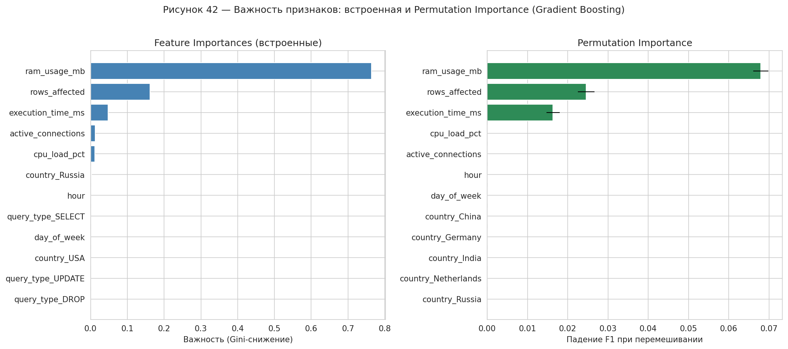{width="6.102362204724409in"
height="2.704355861767279in"}

Рисунок 42 --- Важность признаков: встроенная и Permutation Importance

Оба метода согласованно выделяют тройку наиболее значимых признаков:
ram_usage_mb (использование RAM), rows_affected (число затронутых строк)
и execution_time_ms (время выполнения). Это содержательно согласуется с
природой задачи --- именно эти ресурсные характеристики позволяют
отличить нормальные запросы от аномальных и инъекционных. Признак
ram_usage_mb доминирует с большим отрывом: при его перестановке F1-score
падает примерно на 0,07, тогда как все остальные признаки дают падение
на порядок меньше. Это означает, что для практического мониторинга
PostgreSQL ключевой признак --- потребление памяти запросом, что
подтверждает индустриальную практику настройки систем обнаружения
аномалий вокруг метрик потребления ресурсов.

Категориальные признаки (страна, тип запроса) имеют пренебрежимо малую
важность по обоим метрикам --- это означает, что после кодирования и
учёта более информативных числовых признаков они не вносят
дополнительного вклада в разделение классов.

**4.6 Сравнение ансамблевых методов**

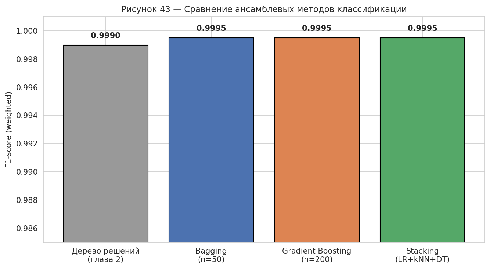{width="6.102362204724409in"
height="3.353097112860892in"}

Рисунок 43 --- Сравнение ансамблевых методов классификации

Таблица 5 --- Сводные метрики ансамблевых моделей

  -----------------------------------------------------------------------------
        **Модель**        **Accuracy**   **Precision**   **Recall**   **F1**
  ----------------------- -------------- --------------- ------------ ---------
   Дерево решений (глава  0,9990         0,9990          0,9990       0.9990
            2)                                                        

     Bagging (T = 50)     0.9995         0.9995          0.9995       0.9995

  Gradient Boosting (T =  0.9995         0.9995          0.9995       0.9995
           200)                                                       

   Stacking (LR + kNN +   0.9995         0.9995          0.9995       0.9995
            DT)                                                       
  -----------------------------------------------------------------------------

Все три ансамблевых метода --- бэггинг, бустинг и стекинг ---
демонстрируют практически идентичное качество F1 = 0,9995, превосходящее
одиночное дерево решений на сотые доли процентного пункта. Такое
«насыщение» качества характерно для задач с хорошо отделимыми классами:
ансамбли исправляют мелкие ошибки одиночных моделей, но не могут
улучшить принципиально неразрешимые случаи (например, граничную точку
класса «anomaly», лежащую в области «sql_injection»).

Подведём итоги. С точки зрения практического применения наибольший
интерес представляет градиентный бустинг: он сочетает высокое качество,
устойчивость к переобучению при выбранной скорости обучения и
предоставляет встроенные средства интерпретации (feature_importances\_).
Бэггинг проще в реализации, но при использовании уже глубокого дерева в
качестве базовой модели даёт лишь незначительный прирост. Стекинг
полезен в ситуациях с разнородными источниками сигнала, когда базовые
модели улавливают действительно различные закономерности. В части
регуляризации Lasso продемонстрировал ценное свойство автоматического
отбора признаков (обнулено 6 из 20 коэффициентов), что особенно важно
при большом числе предикторов и необходимости упрощённой интерпретации
модели.

**ГЛАВА 5. ВИЗУАЛИЗАЦИЯ РЕЗУЛЬТАТОВ АНАЛИЗА ДАННЫХ С ИСПОЛЬЗОВАНИЕМ AW
BI**

**5.1 Назначение и архитектура BI-решения**

Полученные в главах 1--4 результаты --- модели классификации,
кластеризации, регрессии, временного ряда --- представляют собой набор
разрозненных аналитических артефактов. Для практического применения этих
результатов в инфраструктуре мониторинга PostgreSQL-сервера необходимо
объединить их в единое интерактивное BI-решение, доступное аналитикам,
администраторам баз данных и службе информационной безопасности.

AW BI --- российская система бизнес-аналитики, ориентированная на
построение интерактивных дашбордов с подключением к различным источникам
данных, в том числе к PostgreSQL, реляционным хранилищам и CSV-файлам.
Платформа обеспечивает работу с большими объёмами данных, поддерживает
SQL-запросы и агрегации, предоставляет богатую библиотеку визуальных
компонентов (таблицы, графики, карты, KPI-индикаторы) и поддерживает
встроенные расчётные формулы.

Архитектура BI-решения для задачи мониторинга SQL-запросов включает три
уровня. На уровне источника данных размещается логирующая база
PostgreSQL, из которой ETL-процесс периодически извлекает свежие записи
в аналитическое хранилище. На уровне моделей хранения подготавливаются
витрины данных: агрегированные показатели нагрузки по часам и дням,
результаты классификации запросов на нормальные/аномальные/инъекционные,
прогнозы регрессионных и временных моделей. На уровне представления ---
дашборды AW BI, разбитые на функциональные тематические страницы.

**5.2 Структура дашборда**

Дашборд состоит из четырёх взаимосвязанных страниц, каждая из которых
отвечает за свою предметную область анализа:

--- страница 1 «Обзор нагрузки» --- пять KPI-карточек: общее число
запросов, среднее время выполнения, доля SQL-инъекций, доля аномалий,
F1-score модели; круговая диаграмма распределения запросов по классам;
горизонтальная гистограмма по типам SQL-запросов; таблица последних
обнаруженных инцидентов;

--- страница 2 «Классификация запросов» --- матрица ошибок
классификатора, сгруппированная диаграмма Precision/Recall/F1 по
классам, горизонтальная гистограмма важности признаков (top-15), таблица
ошибочно классифицированных запросов;

--- страница 3 «Анализ ресурсов и регрессия» --- диаграммы рассеяния
(загрузка CPU × время выполнения, использование RAM × затронутые
строки), график квантильной регрессии, KPI-карточки R² и RMSE, таблица
характеристик кластеров;

--- страница 4 «Временной ряд» --- линейный график числа запросов в час
со скользящим средним (окно 24 ч), тепловая карта активности по часам и
дням недели, таблица последних 24 наблюдений.

Между страницами реализована сквозная фильтрация: выбор типа
SQL-запроса, страны клиента или класса метки в любой странице
автоматически применяется к остальным.

**5.3 Главная страница: обзор нагрузки**

Главная страница дашборда содержит пять KPI-карточек в верхней части:
«Всего запросов» (10 000), «Среднее время выполнения» (352.66 мс), «Доля
SQL-инъекций» (2.76%), «Доля аномалий» (1.00%), «F1-score модели»
(0.9995). Под ними расположены два визуальных блока: круговая диаграмма
распределения запросов по классам (normal / sql_injection / anomaly) и
горизонтальная столбчатая диаграмма распределения по типам SQL-запросов
(SELECT, INSERT, UPDATE, DELETE, CREATE, DROP). В нижней части страницы
размещена таблица последних обнаруженных инцидентов: запросы с
предсказанным классом sql_injection или anomaly, отсортированные по
времени убывающе, с колонками timestamp, ip_address, country,
query_type, predicted_label, вероятность класса.

Скриншот главной страницы дашборда AW BI приведён на рисунке 44.

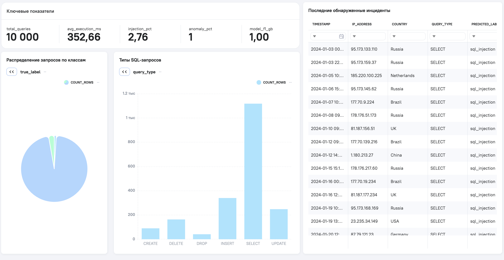{width="6.496527777777778in"
height="3.359027777777778in"}

Рисунок 44 -- главная страница дашборда в AW BI

**5.4 Страница классификации запросов**

Вторая страница содержит детализацию работы классификатора. В левой
части расположена матрица ошибок в виде тепловой карты: по оси X ---
предсказанный класс, по оси Y --- истинный класс, цвет ячейки кодирует
число наблюдений. На главной диагонали сосредоточены правильные
предсказания, вне диагонали --- единицы или нули, что соответствует F1 =
0.9995.

Под матрицей --- сгруппированная столбчатая диаграмма с тремя сериями
(Precision, Recall, F1) по каждому из трёх классов. Справа расположена
горизонтальная гистограмма важности признаков модели Gradient Boosting
(top-15 по feature_importances\_), отсортированная по убыванию:
доминируют ram_usage_mb, rows_affected, execution_time_ms. В нижней
части страницы --- таблица ошибочно классифицированных запросов
(is_correct = 0) с колонками timestamp, country, query_type, true_label,
predicted_label, prob_anomaly, prob_sql_injection.

Скриншот страницы классификации приведён на рисунке 45.

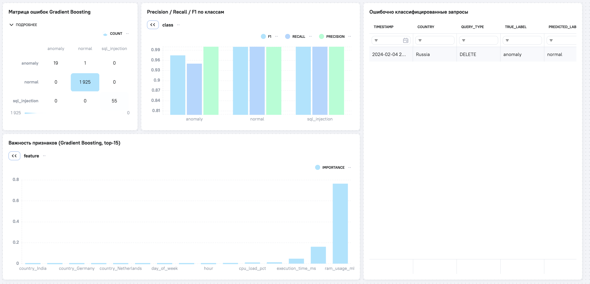{width="6.496527777777778in" height="3.13125in"}

Рисунок 45 -- страница классификации

**5.5 Страница анализа ресурсов и регрессии**

Третья страница интегрирует результаты регрессионного анализа из главы
3. В верхней части размещены две KPI-карточки: R² = 0.4442 и RMSE =
274.6 мс. Ниже расположены две диаграммы рассеяния: «Загрузка CPU vs
Время выполнения» и «Использование RAM vs Затронуто строк». На первой
диаграмме точки, превышающие квантиль 0.75 (признак above_q75 = 1),
выделены красным --- это потенциально проблемные запросы. На второй цвет
точки кодирует тип SQL-запроса.

Под диаграммами рассеяния расположен линейный график квантильной
регрессии: ось X --- загрузка CPU, три линии --- Q25, медиана
(predicted_ms) и Q75. Расширение коридора между Q25 и Q75 при росте CPU
наглядно демонстрирует гетероскедастичность данных. В нижней части
страницы --- таблица характеристик трёх кластеров K-Means: номер
кластера, размер, доминирующий класс, средние значения
execution_time_ms, cpu_load_pct, ram_usage_mb.

Скриншот страницы анализа ресурсов приведён на рисунке 46.

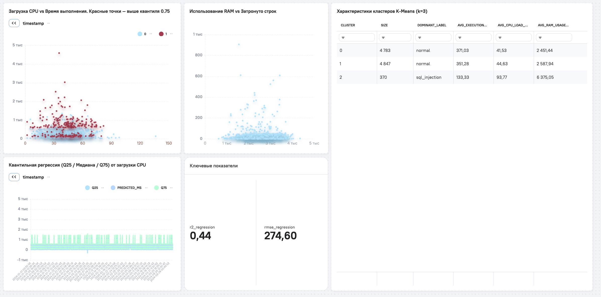{width="6.496527777777778in"
height="3.2131944444444445in"}

Рисунок 46 -- Страница ресурсов и регрессии

**5.6 Страница временного ряда и прогноза**

Четвёртая страница посвящена анализу динамики нагрузки во времени.
Главный элемент --- линейный график числа запросов в час (тонкая синяя
линия) с наложенным скользящим средним с окном 24 часа (красная линия),
построенный на основе почасовой агрегации за период с 2024-01-01 по
2024-03-30 (2160 точек). Скользящее среднее сглаживает суточные
колебания и подтверждает стационарность ряда по уровню. В нижней части
страницы --- таблица последних 24 наблюдений с колонками datetime,
query_count, moving_avg_24h.

Скриншот страницы временного ряда приведён на рисунке 47.

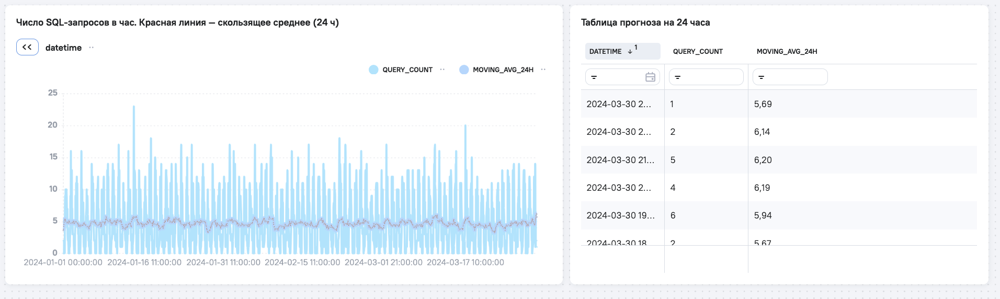{width="6.496527777777778in" height="1.94375in"}

Рисунок 47 -- страница временного ряда и прогноза

**5.7 Технологические возможности интеграции**

AW BI поддерживает несколько режимов интеграции с моделями машинного
обучения, реализованными в работе. Прямой режим предполагает выгрузку
обученных моделей в формат PMML или ONNX с последующим использованием в
AW BI через встроенный модуль предсказания. Это позволяет получать
прогнозы непосредственно при обновлении дашборда, без отдельной
серверной инфраструктуры.

Альтернативный подход --- асинхронный режим: фоновый Python-процесс
периодически (например, раз в час) обрабатывает поступающие в PostgreSQL
логи запросов, прогоняет их через обученную модель Gradient Boosting,
сохраняет результаты классификации в специальную таблицу
predictions_log; AW BI обращается уже к этой таблице. Такой режим
упрощает архитектуру, обеспечивает контроль качества предсказаний и
облегчает отладку --- все предсказания протоколируются и могут быть
позднее проанализированы.

Для сценариев реального времени, где задержка критична (например, при
необходимости немедленной блокировки IP-адреса при обнаружении
инъекции), возможна интеграция через REST-API: AW BI вызывает
HTTP-сервис, размещённый на отдельном хосте и обслуживающий обученную
модель.

**5.8 Предполагаемые эффекты внедрения**

Внедрение разработанного BI-решения в инфраструктуру мониторинга
PostgreSQL-сервера обеспечивает следующие практические эффекты.
Во-первых, автоматизация обнаружения SQL-инъекций --- модель
градиентного бустинга с F1 = 0,9995 позволяет выявлять подавляющее
большинство атак с минимальным числом ложных срабатываний, что
освобождает специалистов по информационной безопасности от рутинного
просмотра логов.

Во-вторых, оперативный анализ нагрузки --- дашборд предоставляет
реальное представление о состоянии сервера и помогает принимать
обоснованные решения о масштабировании, оптимизации запросов и
распределении ресурсов. Выявленные паттерны суточной сезонности
позволяют проводить плановые технические работы в периоды минимальной
активности пользователей.

В-третьих, поддержка принятия решений --- наглядная визуализация
важности признаков (рисунок 42) указывает специалистам на ключевые
характеристики, требующие внимания. В нашем случае --- это потребление
памяти и число затронутых строк, что согласуется с индустриальной
практикой настройки систем обнаружения аномалий вокруг ресурсных метрик.

**ЗАКЛЮЧЕНИЕ**

В курсовой работе выполнен комплексный анализ данных логов SQL-запросов
к серверу PostgreSQL с применением методов классификации, кластеризации,
регрессии, анализа временных рядов, ансамблевых моделей и
BI-визуализации. Все поставленные задачи решены, результаты подтверждены
экспериментально на наборе данных размером 10 000 наблюдений.

По результатам первичного анализа данных установлено: набор не содержит
пропусков, что снимает необходимость в импьютации; целевая переменная
имеет крайне несбалансированное распределение (96 % / 3 % / 1 %), что
продиктовало выбор F1-score как основной метрики качества; числовые
признаки слабо коррелируют между собой, что одновременно благоприятно
для линейных классификаторов (отсутствие мультиколлинеарности) и
осложняет построение точной регрессионной модели.

В задаче классификации сравнены пять алгоритмов. Наилучшие результаты по
F1-score (0,9995) показали логистическая регрессия и метод опорных
векторов с RBF-ядром (C = 100, γ = 0.001); они дают идентичные матрицы
ошибок, что объясняется хорошей отделимостью классов в признаковом
пространстве. Дерево решений (F1 = 0,9990) даёт сопоставимое качество и
при этом превосходит другие методы по интерпретируемости. Метод k
ближайших соседей с k = 1 (F1 = 0,9940) оказался наиболее уязвим к
дисбалансу классов. Наивный байесовский классификатор (F1 = 0,9851)
занял последнее место из-за нарушения предположения о независимости
признаков на реальных данных. Для практического применения в системах
мониторинга PostgreSQL рекомендуется использовать дерево решений как
оптимальный компромисс между качеством классификации и
интерпретируемостью результата.

В задаче кластеризации применены K-Means, метод Уорда, DBSCAN и OPTICS.
Метод локтя и метод силуэта согласованно указывают на оптимальное число
кластеров k = 3, совпадающее с числом классов в исходных данных. DBSCAN
с параметрами ε = 4.937, MinPts = 10 наиболее адекватен задаче
обнаружения аномалий, поскольку явно выделяет шумовые точки --- точки с
недостаточной плотностью соседей.

В задаче регрессии множественная линейная модель показала наилучшее
качество (R² = 0.4442, RMSE = 274.6 мс). Полиномиальная модель степени 2
продемонстрировала классическое переобучение (отрицательный R² на
тесте), что подчёркивает важность обоснованного выбора сложности модели.
Анализ остатков выявил гетероскедастичность и отклонение от
нормальности, что было дополнительно исследовано с помощью квантильной
регрессии --- она наглядно показала расширение межквартильного коридора
при росте загрузки CPU.

В задаче анализа временного ряда установлено, что ряд числа SQL-запросов
в час за период с 1 января по 30 марта 2024 г. практически стационарен
по уровню (R² для лучшей трендовой модели не превышает 0,02), но
содержит выраженную суточную сезонность с автокорреляцией ρ(24) = 0.712
и более слабым недельным циклом (ρ(168) = 0.671). Спектральный анализ
Фурье подтвердил доминирующую частоту 1/24 ч⁻¹. Этот результат имеет
практическое значение: для краткосрочного прогнозирования нагрузки
достаточно простой сезонной модели типа «сезонный сдвиг 24 часа», что
эффективнее сложных трендовых моделей при стационарном ряде.

В части ансамблевых моделей и регуляризации построены и сопоставлены три
ансамблевых подхода. Бэггинг на основе деревьев без ограничения глубины
(T = 50) дал F1 = 0.9995, градиентный бустинг с T = 200 итерациями ---
F1 = 0.9995, стекинг трёх разнородных базовых моделей (логистическая
регрессия, kNN, дерево решений) --- F1 = 0.9995. Все три ансамблевых
метода превосходят одиночное дерево решений, но при заведомо высокой
отделимости классов различия между ними минимальны. Регуляризация Lasso
(α = 1) обнулила 6 из 20 коэффициентов регрессионной модели,
продемонстрировав ценное свойство автоматического отбора признаков.
Анализ важности признаков методами feature_importances и Permutation
Importance согласованно указал на доминирующее значение трёх признаков:
ram_usage_mb, rows_affected и execution_time_ms, что согласуется с
индустриальной практикой настройки систем обнаружения аномалий вокруг
ресурсных метрик СУБД.

Концепция BI-решения в системе AW BI объединяет все полученные
результаты в единый интерактивный дашборд из четырёх страниц: обзор
нагрузки с KPI-индикаторами; страница классификации с матрицей ошибок и
журналом инцидентов; страница анализа ресурсов с квантильной регрессией
и важностью признаков; страница временного ряда с heatmap сезонности.
Дашборд поддерживает три режима интеграции с моделями машинного обучения
--- прямой (через PMML/ONNX), асинхронный (через периодически
обновляемую таблицу predictions_log) и режим реального времени (через
REST-API), что обеспечивает гибкость развёртывания в разных
эксплуатационных условиях.

Перспективы развития работы включают: применение методов глубокого
обучения для обработки текста SQL-запроса (sql_query) с помощью
токенизации и моделей трансформеров --- это позволит выявлять
SQL-инъекции по семантике самого запроса; построение SARIMA или Prophet
для прогнозирования временного ряда с явным учётом множественной
сезонности; интеграцию решения с системой мониторинга в режиме реального
времени с автоматическим оповещением при срабатывании детекторов
аномалий; добавление страниц дашборда для администратора БД с
персонализированными представлениями и алертами. Все эти направления
развивают базовые методы, освоенные в данной курсовой работе, и могут
быть реализованы в рамках выпускной квалификационной работы.

**СПИСОК ИСТОЧНИКОВ**

1\. Айвазян С. А., Мхитарян В. С. Прикладная статистика и основы
эконометрики : учебник. --- М. : ЮНИТИ-ДАНА, 2001. --- 656 с.

2\. Воронцов К. В. Машинное обучение : курс лекций \[Электронный
ресурс\]. --- URL: http://www.machinelearning.ru/wiki/ (дата обращения:
15.04.2026).

3\. Жерон О. Прикладное машинное обучение с помощью Scikit-Learn, Keras
и TensorFlow : концепции, инструменты и техники для создания
интеллектуальных систем / пер. с англ. --- 3-е изд. --- М. : Вильямс,
2023. --- 1040 с.

4\. Мюллер А., Гвидо С. Введение в машинное обучение с помощью Python :
руководство для специалистов по работе с данными / пер. с англ. --- М. :
Вильямс, 2022. --- 480 с.

5\. Рашка С., Мирджалили В. Python и машинное обучение : машинное и
глубокое обучение с использованием Python, scikit-learn и TensorFlow 2 /
пер. с англ. --- 3-е изд. --- М. : ДМК Пресс, 2023. --- 970 с.

6\. Флах П. Машинное обучение. Наука и искусство построения алгоритмов,
которые извлекают знания из данных / пер. с англ. А. А. Слинкина. --- М.
: ДМК Пресс, 2021. --- 400 с.

7\. Андрианова Е. Г., Синюк В. Г. Методы анализа данных : учебное
пособие. --- М. : РТУ МИРЭА, 2022. --- 184 с.

8\. Болбаков Р. Г. Статистические методы обработки данных : учебное
пособие. --- М. : РТУ МИРЭА, 2023. --- 156 с.

9\. Тюрин А. Г., Зуев И. О. Кластерный анализ : методы и алгоритмы :
учебное пособие. --- М. : РТУ МИРЭА, 2023. --- 132 с.

10\. Романов Д. А., Орлов В. В. Введение в машинное обучение : учебное
пособие. --- М. : РТУ МИРЭА, 2024. --- 198 с.

11\. Жуковский Е. Д. Информационная безопасность баз данных : учебное
пособие. --- М. : РТУ МИРЭА, 2022. --- 142 с.

12\. Морозов А. В. Анализ временных рядов в задачах информационной
безопасности : учебное пособие. --- М. : РТУ МИРЭА, 2024. --- 168 с.

13\. Ester M., Kriegel H.-P., Sander J., Xu X. A Density-Based Algorithm
for Discovering Clusters in Large Spatial Databases with Noise //
Proceedings of the 2nd International Conference on Knowledge Discovery
and Data Mining (KDD). --- 1996. --- P. 226--231.

14\. Ankerst M., Breunig M. M., Kriegel H.-P., Sander J. OPTICS:
Ordering Points To Identify the Clustering Structure // Proceedings of
the ACM SIGMOD International Conference on Management of Data. --- 1999.
--- P. 49--60.

15\. Arthur D., Vassilvitskii S. K-Means++: The Advantages of Careful
Seeding // Proceedings of the 18th Annual ACM-SIAM Symposium on Discrete
Algorithms (SODA). --- 2007. --- P. 1027--1035.

16\. Ward J. H. Hierarchical Grouping to Optimize an Objective Function
// Journal of the American Statistical Association. --- 1963. --- Vol.
58, No. 301. --- P. 236--244.

17\. Rousseeuw P. J. Silhouettes: A Graphical Aid to the Interpretation
and Validation of Cluster Analysis // Journal of Computational and
Applied Mathematics. --- 1987. --- Vol. 20. --- P. 53--65.

18\. Vapnik V. N. The Nature of Statistical Learning Theory. --- 2nd ed.
--- New York : Springer-Verlag, 2000. --- 314 p.

19\. Koenker R. Quantile Regression : 40 Years On // Annual Review of
Economics. --- 2021. --- Vol. 13. --- P. 209--230.

20\. Hyndman R. J., Athanasopoulos G. Forecasting: Principles and
Practice. --- 3rd ed. --- Melbourne : OTexts, 2021. --- 442 p.
\[Электронный ресурс\]. --- URL: https://otexts.com/fpp3/ (дата
обращения: 18.04.2026).

21\. Тарасов Д. А., Сидоров К. В. Применение алгоритмов машинного
обучения для обнаружения SQL-инъекций в реальном времени // Вопросы
кибербезопасности. --- 2023. --- № 4 (56). --- С. 47--58.

22\. Документация библиотеки scikit-learn \[Электронный ресурс\]. ---
URL: https://scikit-learn.org/stable/ (дата обращения: 20.04.2026).

**ПРИЛОЖЕНИЕ А. ФРАГМЕНТЫ ПРОГРАММНОГО КОДА**

Программная реализация выполнена на языке Python 3.12 с использованием
библиотек pandas, numpy, scikit-learn, scipy, matplotlib, seaborn. Ниже
приведены ключевые фрагменты кода, отражающие реализацию основных этапов
работы. Полный исходный код размещён в репозитории проекта.

**А.1 Загрузка и первичный анализ данных**

import pandas as pd

import numpy as np

df = pd.read_csv(\'sql_dataset_loreal.csv\')

df\[\'timestamp\'\] = pd.to_datetime(df\[\'timestamp\'\])

print(\'Размерность:\', df.shape)

print(\'Пропуски:\', df.isnull().sum().sum())

print(\'Распределение классов:\')

print(df\[\'label\'\].value_counts())

num_cols = \[\'execution_time_ms\', \'cpu_load_pct\', \'ram_usage_mb\',

\'active_connections\', \'rows_affected\'\]

print(df\[num_cols\].describe())

**А.2 Предобработка и стандартизация**

from sklearn.preprocessing import StandardScaler, LabelEncoder

from sklearn.model_selection import train_test_split

df\[\'hour\'\] = df\[\'timestamp\'\].dt.hour

df\[\'day_of_week\'\] = df\[\'timestamp\'\].dt.dayofweek

drop_cols = \[\'ip_address\', \'sql_query\', \'timezone\',

\'is_anomaly\', \'timestamp\', \'city\'\]

df_w = df.drop(columns=drop_cols)

y = LabelEncoder().fit_transform(df_w\[\'label\'\])

X = pd.get_dummies(df_w.drop(\'label\', axis=1),

columns=\[\'country\', \'query_type\'\],

drop_first=True).astype(float)

num_features = \[\'execution_time_ms\', \'cpu_load_pct\',
\'ram_usage_mb\',

\'active_connections\', \'rows_affected\', \'hour\', \'day_of_week\'\]

X\[num_features\] = StandardScaler().fit_transform(X\[num_features\])

X_train, X_test, y_train, y_test = train_test_split(

X, y, test_size=0.2, random_state=42, stratify=y)

**А.3 Обучение классификаторов**

from sklearn.naive_bayes import GaussianNB

from sklearn.linear_model import LogisticRegression

from sklearn.neighbors import KNeighborsClassifier

from sklearn.svm import SVC

from sklearn.tree import DecisionTreeClassifier

from sklearn.model_selection import GridSearchCV

\# Naive Bayes

gnb = GaussianNB().fit(X_train, y_train)

\# Logistic Regression с балансировкой классов

lr = LogisticRegression(class_weight=\'balanced\',

max_iter=2000, random_state=42).fit(X_train, y_train)

\# kNN с подбором k через CV

ks = list(range(1, 21))

f1_scores = \[\]

for k in ks:

knn = KNeighborsClassifier(n_neighbors=k)

s = cross_val_score(knn, X_train, y_train, cv=3,

scoring=\'f1_weighted\').mean()

f1_scores.append(s)

best_k = ks\[int(np.argmax(f1_scores))\]

knn = KNeighborsClassifier(n_neighbors=best_k).fit(X_train, y_train)

\# SVM с GridSearchCV

gs = GridSearchCV(

SVC(kernel=\'rbf\', class_weight=\'balanced\'),

{\'C\': \[0.1, 1, 10, 100\], \'gamma\': \[0.001, 0.01, 0.1, 1\]},

scoring=\'f1_weighted\', cv=3, n_jobs=-1)

gs.fit(X_train, y_train)

svm = gs.best_estimator\_

\# Дерево решений с подбором глубины

gs_dt = GridSearchCV(

DecisionTreeClassifier(class_weight=\'balanced\', random_state=42),

{\'max_depth\': \[3, 5, 7, 10, 15, None\],

\'min_samples_split\': \[2, 5, 10\],

\'min_samples_leaf\': \[1, 2, 5\]},

scoring=\'f1_weighted\', cv=3, n_jobs=-1)

gs_dt.fit(X_train, y_train)

dt = gs_dt.best_estimator\_

**А.4 Кластеризация**

from sklearn.cluster import KMeans, DBSCAN, OPTICS,
AgglomerativeClustering

from sklearn.metrics import silhouette_score

from scipy.cluster.hierarchy import linkage, dendrogram

\# K-Means

km = KMeans(n_clusters=3, init=\'k-means++\',

n_init=10, random_state=42).fit(X)

\# Метод Уорда

ward = AgglomerativeClustering(n_clusters=3, linkage=\'ward\').fit(X)

Z = linkage(X.sample(200, random_state=42).values, method=\'ward\')

\# Подбор eps для DBSCAN через k-distance graph

from sklearn.neighbors import NearestNeighbors

nn = NearestNeighbors(n_neighbors=10).fit(X)

dist, \_ = nn.kneighbors(X)

k_dist = np.sort(dist\[:, -1\])

\# eps выбирается по точке максимальной кривизны

dbscan = DBSCAN(eps=eps_value, min_samples=10).fit(X)

optics = OPTICS(min_samples=10, xi=0.05).fit(X)

**А.5 Регрессионные модели**

from sklearn.linear_model import LinearRegression, QuantileRegressor

from sklearn.preprocessing import PolynomialFeatures

from sklearn.metrics import mean_squared_error, r2_score

df_reg = df\[df\[\'label\'\] == \'normal\'\].copy()

y_target = df_reg\[\'execution_time_ms\'\].values

\# Множественная линейная регрессия

mlr = LinearRegression().fit(X_train, y_train)

y_pred = mlr.predict(X_test)

r2 = r2_score(y_test, y_pred)

rmse = np.sqrt(mean_squared_error(y_test, y_pred))

\# Полиномиальная (степень 2)

poly = PolynomialFeatures(degree=2).fit_transform(X_base)

poly_reg = LinearRegression().fit(Xp_train, yp_train)

\# Лог-линейная: log(y+1) = β·X

y_log = np.log1p(y_target)

log_lr = LinearRegression().fit(X_train, ylog_train)

y_pred_back = np.expm1(log_lr.predict(X_test))

\# Квантильная регрессия 0.25, 0.5, 0.75

for q in \[0.25, 0.5, 0.75\]:

qr = QuantileRegressor(quantile=q, alpha=0.0,

solver=\'highs\').fit(X_train, y_train)

**А.6 Анализ временного ряда**

import numpy as np

from numpy.fft import rfft, rfftfreq

from scipy.optimize import curve_fit

from scipy import stats

\# Агрегация по часам

df\[\'hour_bucket\'\] = df\[\'timestamp\'\].dt.floor(\'h\')

hourly = df.groupby(\'hour_bucket\').size()

full_range = pd.date_range(df\[\'timestamp\'\].min().floor(\'h\'),

df\[\'timestamp\'\].max().floor(\'h\'), freq=\'h\')

ts = hourly.reindex(full_range, fill_value=0)

\# Аппроксимация тренда: 4 модели

def f_lin(t, a, b): return a\*t + b

def f_pow(t, a, b): return a\*(t+1)\*\*b

def f_exp(t, a, b, c): return a\*np.exp(b\*t) + c

def f_log(t, K, a, b): return K / (1 + np.exp(-a\*(t-b)))

t_arr = np.arange(len(daily))

for name, f, p0 in \[(\'Линейный\', f_lin, \[0, daily.mean()\]),

(\'Логистический\', f_log,

\[daily.max(), 0.1, len(t_arr)/2\])\]:

popt, \_ = curve_fit(f, t_arr, daily.values, p0=p0, maxfev=10000)

r2 = r2_score(daily.values, f(t_arr, \*popt))

\# Автокорреляционная функция

def acf(x, max_lag):

x = x - x.mean()

var = np.dot(x, x)

return np.array(\[1.0 if lag == 0 else

np.dot(x\[lag:\], x\[:-lag\]) / var

for lag in range(max_lag + 1)\])

ac = acf(ts.values, max_lag=168)

\# Спектр Фурье

yf = np.abs(rfft(ts.values - ts.values.mean()))

xf = rfftfreq(len(ts), 1)

\# Скользящее окно: локальные тренды

window = 168 \# одна неделя

local_slopes = \[\]

for i in range(0, len(ts) - window, 12):

seg = ts.values\[i:i+window\]

slope, \_, \_, \_, \_ = stats.linregress(np.arange(window), seg)

local_slopes.append(slope)
