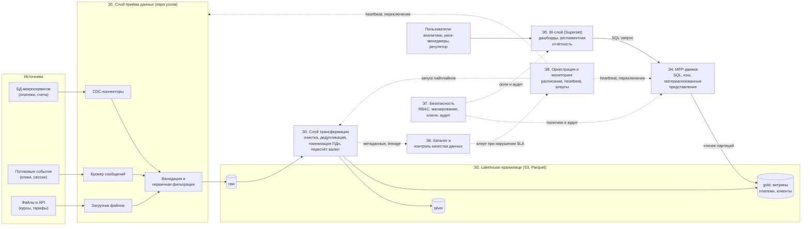

# Практическая работа №2. Проектирование архитектуры платформы данных методом ADD

**Цель работы:** познакомиться с методом Attribute-Driven Design (ADD) и применить его к системе из практики №1 — платформе данных финтех-компании.

Первая итерация ADD раскладывает платформу на 8 элементов; главные драйверы — доступность 99,999% и защита персональных данных.

---

## 1. Определение требований

Система из практики №1 — платформа данных финтех-компании в закрытом контуре (частное облако). Она заменяет прямые обращения аналитиков к продуктивным базам единым аналитическим слоем с одной версией бизнес-метрик.

### Функциональные требования

| № | Требование | Подсистема в ПР №1 |
| --- | --- | --- |
| ФТ-1 | Платформа принимает данные из источников: репликация изменений из БД микросервисов (CDC), потоковые события через брокер, пакетные файлы (курсы валют, тарифы); входящие данные валидируются и фильтруются | Приём данных |
| ФТ-2 | Платформа хранит данные по слоям raw → silver → gold и строит витрины «платежи» и «клиенты» с дедупликацией и пересчётом сумм по курсам валют | Хранение, трансформация |
| ФТ-3 | Пользователь строит дашборды и получает регламентную отчётность (в том числе для регулятора) с ролевыми представлениями данных | BI и отчётность |

### Сценарии атрибутов качества

Требование «доступность 99,999%» в практике №1 не содержит стимула и меры реакции, поэтому оно записано как сценарий. Цифры, которых нет в практике №1, помечены «допущение» — их нужно согласовать с заказчиком (CDO).

| Элемент | КА-1. Доступность | КА-2. Безопасность | КА-3. Производительность |
| --- | --- | --- | --- |
| Источник стимула | Сбой узла в кластере платформы | Аналитик без допуска к персональным данным (ПДн) | Аналитик или регламентный отчёт |
| Стимул | Отказ узла в рабочее время или ночью | Запрос к таблице, где есть ПДн | Запрос к витрине платежей через дашборд |
| Артефакт | Слой приёма, хранилище, MPP-движок | Слои silver и gold, MPP-движок | MPP-движок, витрины gold |
| Окружение | Штатная работа, потоковая и пакетная загрузка идут | Штатная работа | Штатная нагрузка |
| Реакция | Резервный узел принимает нагрузку автоматически, принятые события не теряются | Поля ПДн возвращаются замаскированными, обращение записывается в аудит | Запрос выполняется с использованием материализованных представлений и кэша |
| Мера реакции | Доступность 99,999% (простой не более 5,26 мин в год); переключение до 30 с (допущение) | 100% обращений к чувствительным данным попадают в аудит; 0 незамаскированных ПДн для ролей без допуска | 95% запросов к витринам быстрее 5 с (допущение) |

### Ограничения

| № | Ограничение | Источник |
| --- | --- | --- |
| ОГР-1 | Развёртывание в закрытом контуре компании (частное облако) | ПР №1, рамки системы |
| ОГР-2 | Хранение в S3-совместимом объектном хранилище в формате Parquet; слои по схеме Medallion | ПР №1, идеи по решению |
| ОГР-3 | Только готовые open-source компоненты; MVP за 4 месяца силами 5 человек, бюджет 1 665 500 руб. | ПР №1, раздел 4 |
| ОГР-4 | BI-слой на Apache Superset | ПР №1, идеи по решению |
| ОГР-5 | Работа с ПДн по федеральным законам, принцип минимальных доступов | ПР №1, требования безопасности |

---

## 2. Итерация ADD, шаги 1–3

### Шаг 1. Достаточность требований

Информации хватает, чтобы начать проектирование: требования приоритизированы, сценарии качества записаны в форме «стимул — реакция». Два пробела не блокируют первую итерацию.

| Проверка | Результат |
| --- | --- |
| Требования приоритизированы заинтересованными сторонами | Да: приоритеты проставлены в таблице драйверов ниже; их нужно подтвердить у CDO |
| Сценарии КА содержат источник, стимул, артефакт, окружение, реакцию, меру | Да, для КА-1…КА-3 |
| Пробел: время переключения (30 с) и время ответа запроса (5 с) | В практике №1 нет; приняты как допущения |
| Пробел: объёмы данных и число пользователей | В практике №1 не указаны; влияют на размер кластера, но не на выбор паттернов |

### Шаг 2. Выбор элемента для декомпозиции

Это первая итерация «с нуля», поэтому раскладывается вся система — «Платформа данных». К ней относятся все требования из раздела 1.

### Шаг 3. Архитектурные драйверы

Каждое требование оценено парой (важность для заинтересованных сторон, влияние на архитектуру). В драйверы первой итерации вошли шесть требований.

| № | Требование | Оценка | Драйвер? |
| --- | --- | --- | --- |
| 1 | КА-1. Доступность 99,999% | (H, H) | Да |
| 2 | КА-2. Защита ПДн, минимальные доступы | (H, H) | Да |
| 3 | ФТ-1. Приём данных: CDC, поток, пакеты | (H, H) | Да |
| 4 | ОГР-2. Объектное хранилище, Parquet, слои Medallion | (H, M) | Да |
| 5 | ФТ-2. Слои и витрины «платежи», «клиенты» | (H, M) | Да |
| 6 | КА-3. Время ответа запросов | (M, M) | Да |
| 7 | ФТ-3. Дашборды и регламентная отчётность | (M, M) | Нет: Superset задан ограничением ОГР-4, влияние на структуру мало |
| 8 | ОГР-1, ОГР-3, ОГР-4 | (H, M) | Нет: действуют как рамки при выборе компонентов |

---

## 3. Шаг 4. Выбор паттернов и тактик

Для каждого драйвера выделены проблемы проектирования, для каждой — альтернативы; выбор сделан по различающему параметру (время восстановления, нагрузка на сеть, сложность для команды из пяти человек).

| Проблема проектирования | Драйвер | Альтернативы | Выбор | Почему |
| --- | --- | --- | --- | --- |
| Обнаружение сбоев | КА-1 | Heartbeat; Ping/Echo; обнаружение клиентом | Heartbeat | Вдвое меньше сообщений, чем Ping/Echo; клиентам не нужно знать о сбоях |
| Восстановление после сбоя | КА-1 | Cold restart; Warm standby; Active redundancy (горячий резерв) | Active redundancy для критичного пути | Холодный перезапуск занимает минуты и один раз съедает весь годовой бюджет простоя 5,26 мин |
| Сохранность принятых событий | КА-1, ФТ-1 | Запись сразу в хранилище; файловый буфер; брокер с репликацией | Publish/Subscribe через брокер с репликацией | Событие хранится в журнале на нескольких узлах и перечитывается после сбоя потребителя |
| Способ загрузки | ФТ-1 | Lambda (два контура); Kappa (всё как поток); единый слой raw | Единый слой raw: CDC и поток через брокер, пакеты — загрузчиком | Lambda удваивает код, а в команде два дата-инженера; единый raw даёт один формат и одну проверку |
| Организация хранения | ОГР-2, ФТ-2 | Плоское хранилище; Layers (Medallion); классическое DWH | Layers: raw → silver → gold на объектном хранилище в Parquet | Слои разделяют сырые данные и витрины и дают разные сроки хранения (1 год и 5 лет) |
| Контроль доступа | КА-2 | Прямой доступ к файлам; единая точка доступа (Secure Gateway) | Единая точка доступа через MPP-движок с ролями (RBAC) | Роли, маскирование и аудит применяются в одном месте; прямой доступ к хранилищу только у сервисных учётных записей |
| Защита ПДн | КА-2 | Маскирование при выдаче; токенизация при записи; оба | Токенизация при переходе raw → silver и динамическое маскирование в MPP | Дальше raw ПДн не уходят; raw доступен узкой роли |
| Аудит обращений | КА-2 | Логи отдельных сервисов; единый журнал аудита | Единый неизменяемый журнал аудита | 100% обращений в одном месте, доступ только у службы безопасности |
| Время ответа | КА-3 | Масштабирование MPP; материализованные представления; кэш; партиционирование | Все четыре тактики | Они заложены в ФТ практики №1 и дополняют друг друга |
| Запуск пайплайнов | ФТ-2, КА-1 | Скрипты по cron; оркестратор с графами задач (DAG) | Оркестратор с повторными запусками и алертами | Автоматический повтор после сбоя работает на доступность |

**Итог шага:** слоистая lakehouse-платформа с единой точкой доступа к данным и событийным приёмом. Компоненты-кандидаты (Kafka, Debezium, Apache Iceberg, Trino, Airflow, Superset) уточняются в задаче 1.4 практики №1.

### Оценка доступности

Годовой бюджет простоя при 99,999%: 525 600 мин × 0,001% ≈ 5,26 мин. На критичном пути шесть звеньев (CDC-коннектор, брокер, хранилище, оркестратор, MPP-движок, BI). Допущение: каждое звено доступно на 99,9%, отказы независимы.

```
A_цепочки = (1 − (1 − a)^n)^6,  a = 0,999
```

| Вариант | n (узлов в звене) | Доступность звена | Доступность цепочки | Простой в год |
| --- | --- | --- | --- | --- |
| Без резерва | 1 | 99,9% | 99,40% | около 52 ч |
| Пара узлов (горячий резерв) | 2 | 99,9999% | 99,9994% | около 3,2 мин |

Один узел на звено не даёт даже трёх девяток, поэтому резервирование обязательно. С парой узлов расчёт укладывается в бюджет, но модель не учитывает время переключения (при 30 с на переключение в бюджет 5,26 мин помещается около 10 переключений в год) и отказы по общей причине (питание, сеть, ошибка конфигурации).

---

## 4. Шаг 5. Элементы и распределение обязанностей

| № | Элемент | Обязанности | Паттерн или тактика | Драйверы |
| --- | --- | --- | --- | --- |
| Э1 | Слой приёма данных | CDC-коннекторы к БД микросервисов; брокер сообщений для событий; загрузчик пакетных файлов; валидация и первичная фильтрация; запись в raw | Publish/Subscribe, Active redundancy, Heartbeat | ФТ-1, КА-1 |
| Э2 | Lakehouse-хранилище | Слои raw, silver, gold в Parquet; табличный формат с транзакциями и эволюцией схем; партиционирование; сроки хранения (raw — от 1 года, витрины — от 5 лет); репликация данных | Layers (Medallion), Active redundancy | ОГР-2, ФТ-2, КА-1 |
| Э3 | Слой трансформации | raw → silver: очистка, дедупликация, токенизация ПДн; silver → gold: витрины «платежи» и «клиенты», пересчёт сумм по курсам валют | Layers, Pipes and Filters | ФТ-2, КА-2 |
| Э4 | MPP-движок | Аналитические SQL-запросы; материализованные представления; кэш результатов; применение политик доступа и динамического маскирования; горизонтальное масштабирование | Единая точка доступа, масштабирование, кэш | КА-3, КА-2, КА-1 |
| Э5 | BI-слой (Superset) | Дашборды self-service; регламентная отчётность для подразделений и регулятора; экспорт в Excel и PDF; ролевые представления; доступ к данным только через Э4 | Единая точка доступа | ФТ-3, КА-2 |
| Э6 | Каталог и контроль качества данных | Каталог таблиц и витрин с владельцами; происхождение данных (lineage); автоматические проверки качества; оповещение при нарушении SLA | Метаданные отдельно от данных | ФТ-2, КА-2 |
| Э7 | Подсистема безопасности | Аутентификация; ролевая модель (RBAC); политики маскирования; управление ключами шифрования; неизменяемый журнал аудита | RBAC, шифрование, Audit trail | КА-2, ОГР-5 |
| Э8 | Оркестрация и мониторинг | Запуск пайплайнов по расписанию и событию; повтор при сбое; приём heartbeat от всех элементов; алерты при сбоях и нарушении SLA | Оркестратор (DAG), Heartbeat | КА-1, ФТ-2 |

Проверка полноты: каждое функциональное требование представлено цепочкой обязанностей дочерних элементов.

1. ФТ-1: Э1 принимает и проверяет данные, Э2 сохраняет их в raw.
2. ФТ-2: Э8 запускает пайплайн, Э3 читает raw и пишет silver и gold в Э2, Э6 проверяет качество.
3. ФТ-3: Э5 отправляет запрос в Э4, Э4 читает gold из Э2 и возвращает данные с учётом политик Э7.

---

## 5. Шаг 6. Интерфейсы элементов

| № | От → к | Предоставляет | Требует | Ограничение по КА |
| --- | --- | --- | --- | --- |
| И1 | Источники → Э1 | Приём изменений из журналов БД, событий в топики брокера, файлов курсов и тарифов | Схема сообщений, идентификатор источника | Подтверждённое событие не теряется (КА-1) |
| И2 | Э1 → Э2 | Запись Parquet-партиций в слой raw | Валидные записи, зарегистрированная схема | Данные видны в raw только после подтверждения записи |
| И3 | Э8 → Э3 | Запуск пайплайна по расписанию или событию | Параметры: слой и партиция по дате | Повторный запуск не создаёт дублей (КА-1) |
| И4 | Э3 ↔ Э2 | Чтение raw и silver, запись silver и gold | Сервисная учётная запись с правами на нужные слои | В silver и gold ПДн только в виде токенов (КА-2) |
| И5 | Э5 → Э4 | SQL-запрос от имени пользователя по JDBC или HTTP; результат с учётом маскирования | Токен пользователя с ролью | 95% запросов к витринам быстрее 5 с (КА-3) |
| И6 | Э4 → Э2 | Чтение Parquet-партиций и метаданных таблиц | Права сервисной учётной записи | Чтение только нужных партиций (КА-3) |
| И7 | Э4, Э5, Э6 → Э7 | Проверка прав и политик маскирования; запись события в аудит | Идентификатор пользователя, объект, действие | 100% обращений к чувствительным данным попадают в аудит (КА-2) |
| И8 | Все элементы → Э8 | Heartbeat; в ответ — команда на переключение на резерв | Идентификатор элемента и роль (основной или резервный) | Переключение до 30 с (КА-1, допущение) |
| И9 | Э3, Э2 → Э6 | Метаданные таблиц и происхождение данных; результаты проверок качества | Владелец набора данных | Алерт при нарушении SLA качества уходит в Э8 |

### Пример полного описания: И5 (BI → MPP-движок)

- **Синтаксис:** запрос на SQL, параметры подключения, идентификатор пользователя.
- **Семантика:** предусловие — у пользователя есть роль с доступом к витрине; постусловие — результат содержит только разрешённые строки и столбцы, поля ПДн замаскированы, в аудит записана запись об обращении.
- **Обмен информацией:** SQL-текст, набор строк, код ошибки при отказе в доступе.
- **Атрибуты качества:** время ответа (КА-3), обязательный аудит (КА-2); недоступность основного узла не меняет интерфейс — клиент подключается к адресу, за которым стоит пара узлов (КА-1).

---

## 6. Шаги 7–8. Проверка и результат итерации

### Шаг 7. Соответствие требованиям и ограничениям

| Требование | Чем обеспечено | Оценка |
| --- | --- | --- |
| КА-1. Доступность 99,999% | Пары узлов в Э1, Э2, Э4; heartbeat и переключение через Э8; в модели 99,9994% | Выполнено в модели; проверить время переключения и отказы по общей причине |
| КА-2. Защита ПДн | Единая точка доступа Э4 + Э7; токенизация в silver; динамическое маскирование; журнал аудита | Выполнено на уровне структуры; политики маскирования — на итерации Э7 |
| КА-3. Время ответа | Партиции, материализованные представления, кэш, масштабирование MPP | Подтвердится нагрузочным тестом (задача 8.2 практики №1) |
| ФТ-1, ФТ-2, ФТ-3 | Цепочки обязанностей Э1 → Э2, Э8 → Э3 → Э2, Э5 → Э4 → Э2 полные | Выполнено |
| ОГР-1, ОГР-2, ОГР-4, ОГР-5 | Закрытый контур, Parquet и слои, Superset, роли и аудит | Выполнено |
| ОГР-3. Бюджет и срок | Только open-source компоненты, но горячий резерв удваивает ресурсы критичного пути | Риск: в практике №1 на инфраструктуру и лицензии заложено 200 000 руб. |

Главные риски и вопросы к заказчику:

1. **Бюджет.** Горячий резерв повышает затраты на инфраструктуру; нужно уточнить у CDO, относится ли 99,999% ко всей платформе или только к приёму и хранению. Для BI и каталога может хватить более низкого уровня.
2. **Допущения.** Время переключения 30 с и время ответа 5 с в практике №1 не заданы и требуют подтверждения.
3. **Нагрузка на команду.** Два дата-инженера и один DevOps-инженер должны за 4 месяца развернуть и поддерживать кластеры с резервом.
4. **Единые точки отказа.** Подсистемы безопасности и оркестрации тоже должны быть резервированы; при недоступности Э7 разумно закрывать доступ (fail-closed) — решение уточняется на итерации безопасности.

### Шаг 8. Результат и следующие итерации

Результат итерации — разложение системы на 8 элементов; у каждого есть обязанности, интерфейсы, функциональные требования, сценарии качества и ограничения, унаследованные от родителя.

| Итерация | Элемент | Почему именно он | Что решается |
| --- | --- | --- | --- |
| 2 | Э1. Слой приёма данных | Драйвер (H, H); сбой здесь означает потерю данных; три способа загрузки | Схема брокера и CDC, репликация, гарантии доставки, поведение при сбое источника |
| 3 | Э7. Подсистема безопасности | Драйвер (H, H); требования закона; затрагивает все элементы | Политики маскирования, управление ключами, аудит, поведение при недоступности |
| 4 | Э2. Хранилище и Э4. MPP-движок | Определяют доступность и время ответа | Табличный формат, партиционирование, масштабирование, кэш |
| 5 | Э3, Э6, Э8, Э5 | Низкий риск: готовые компоненты и понятные задачи | Пайплайны и витрины, проверки качества, расписание и алерты, дашборды |

---

## 7. Схема архитектуры

Сплошные стрелки — потоки данных, пунктирные — управление, политики и метаданные.



Как читать схему: пользователи работают только через BI (Э5) и MPP-движок (Э4), прямого доступа к хранилищу у них нет — это и обеспечивает контроль ПДн (КА-2). Элементы Э1, Э2 и Э4 работают парами узлов, а Э8 следит за ними через heartbeat и переключает на резерв (КА-1).
