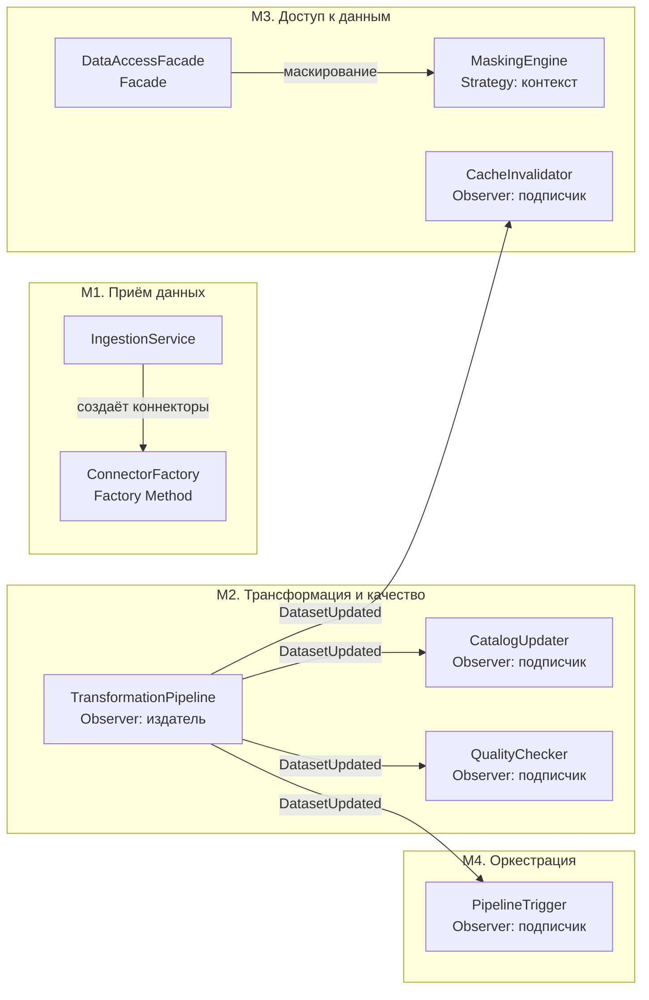
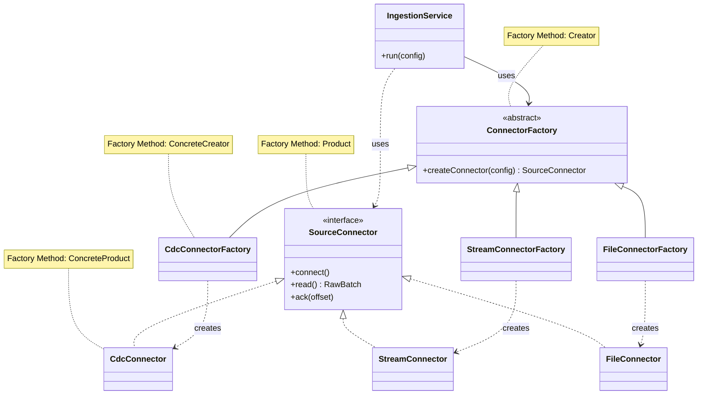
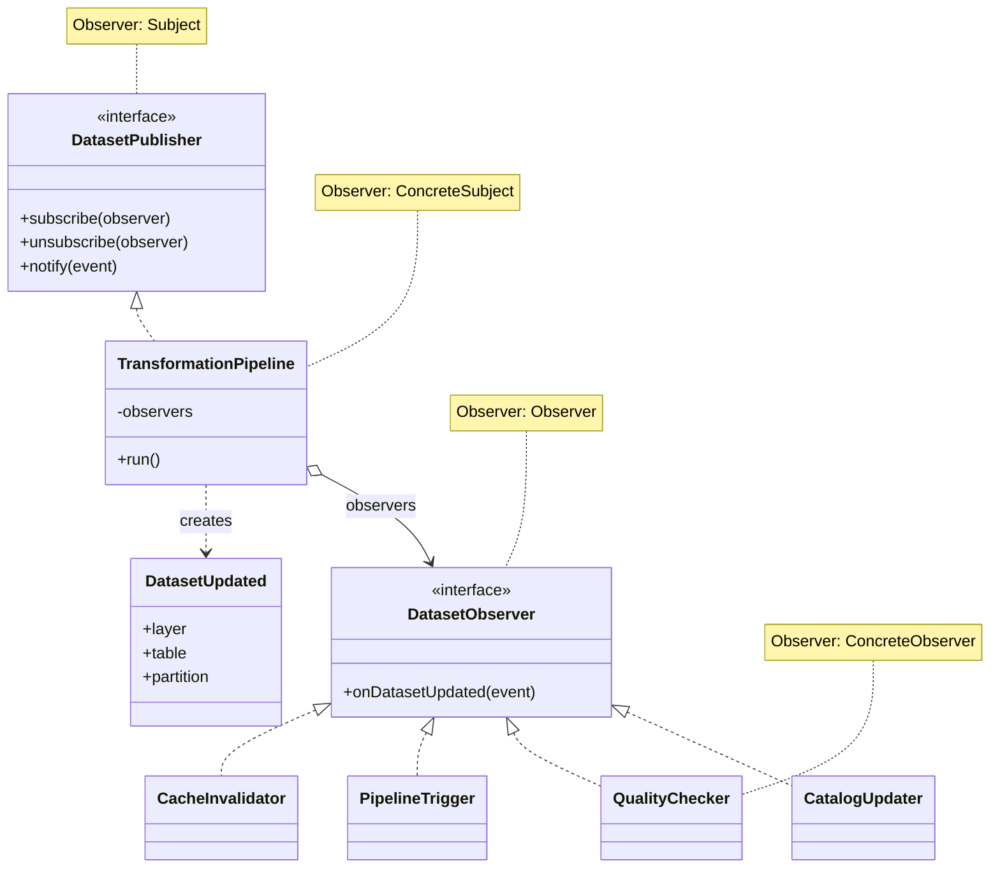
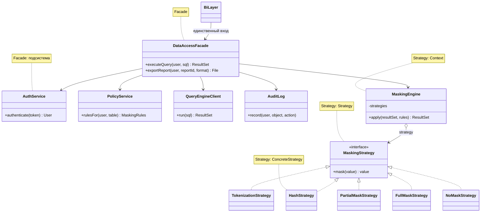
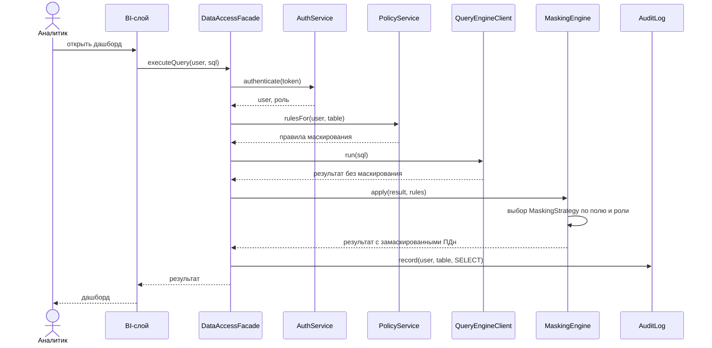
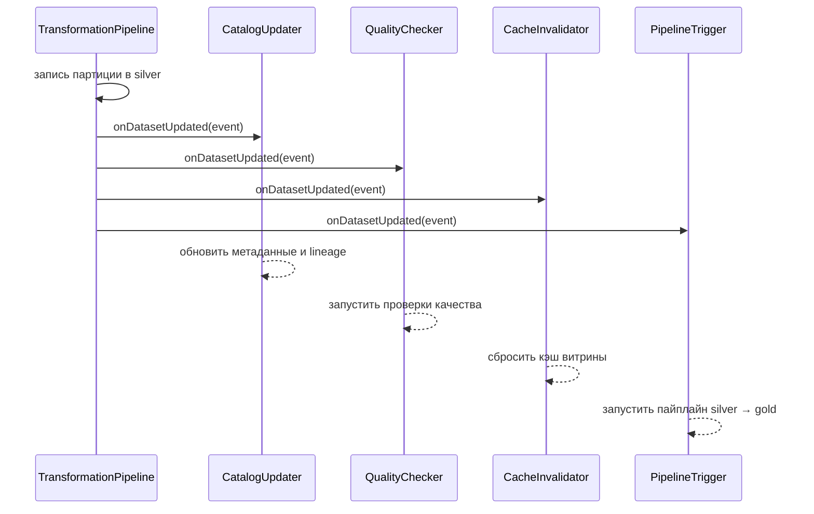

# Практическая работа №3. Шаблоны проектирования в архитектуре платформы данных

**Цель работы:** научиться видеть архитектурные проблемы в проектируемой системе и подбирать шаблоны проектирования, аргументируя выбор.

Платформа данных из практик №1–2 содержит четыре независимых модуля. В них найдено четыре проблемы проектирования, для каждой выбран шаблон GoF: Factory Method, Observer, Strategy и Facade.

---

## 1. Система

Система — платформа данных финтех-компании в закрытом контуре: она принимает данные из микросервисов, CRM, мобильного приложения и внешних API, хранит их по слоям raw → silver → gold и отдаёт аналитикам через BI. Элементы Э1–Э8 из практики №2 сгруппированы в четыре модуля, которые развиваются и разворачиваются независимо.

| Модуль | Элементы из ПР №2 | Назначение |
| --- | --- | --- |
| М1. Приём данных | Э1 | Подключение к источникам (CDC, потоки, файлы), валидация, запись в raw |
| М2. Трансформация и качество | Э3, Э6 | Пайплайны raw → silver → gold, проверки качества, каталог данных |
| М3. Доступ к данным | Э4, Э5, Э7 | MPP-движок, BI, роли, маскирование ПДн, аудит |
| М4. Оркестрация и мониторинг | Э8 | Расписание пайплайнов, контроль состояния, алерты |

Хранилище Э2 — общая инфраструктура для М1–М3 и в шаблонах отдельно не рассматривается.

---

## 2. Архитектурные проблемы

| № | Проблема | Модуль | Почему это проблема |
| --- | --- | --- | --- |
| П1 | Источники разные (журнал БД, поток событий, файлы), и появляются новые: код приёма должен создавать нужный коннектор, не зная конкретных классов | М1 | Без решения в коде приёма растёт цепочка `if/else` по типам источников, а каждый новый источник требует правки старого кода |
| П2 | Когда в слое готова новая партиция данных, об этом должны узнать несколько модулей: каталог, проверки качества, оркестратор, кэш BI | М2, М3, М4 | Если модуль трансформации вызывает их напрямую, он знает обо всех и зависит от каждого |
| П3 | ПДн нужно скрывать по-разному в зависимости от поля и роли: токенизация, хэш, частичное скрытие, полное скрытие | М3 | Правила маскирования меняются чаще остального кода; зашитые в запрос, они дублируются и расходятся |
| П4 | BI должен получить данные, пройдя через проверку прав, маскирование, MPP-движок, аудит и каталог — это пять подсистем с разными интерфейсами | М3 | Если BI знает все пять интерфейсов, обход любого шага ломает требование КА-2 «каждое обращение к ПДн попадает в аудит» |

---

## 3. Выбор шаблонов

### П1 → Factory Method

**Решение.** Интерфейс `SourceConnector` с реализациями для CDC, потока и файлов; абстрактный создатель `ConnectorFactory` с методом `createConnector(config)`, который переопределяют фабрики конкретных типов. Сервис приёма работает только с интерфейсом.

**Почему этот шаблон.** Задача — создавать объекты разных типов без привязки к конкретным классам (строка из таблицы соответствия «проблема → шаблон» в конспекте). Новый источник добавляется новым классом коннектора и новой фабрикой, а существующий код не меняется.

| Альтернатива | Почему хуже |
| --- | --- |
| `if/else` или `switch` по типу источника в сервисе приёма | Каждый новый источник правит рабочий код; растёт связанность и риск регрессий |
| Abstract Factory | Нужна, когда создаётся семейство связанных объектов (коннектор + парсер + валидатор). Сейчас создаётся один объект; шаблон избыточен, но к нему можно перейти, если для каждого источника понадобится семейство |
| Singleton-реестр коннекторов | Скрывает зависимость в глобальном состоянии, усложняет тесты |

### П2 → Observer

**Решение.** Модуль трансформации публикует событие `DatasetUpdated(layer, table, partition)`; подписчики — `CatalogUpdater`, `QualityChecker`, `PipelineTrigger` (запуск следующего пайплайна), `CacheInvalidator` (сброс кэша результатов в MPP-движке). Издатель знает только интерфейс `Observer`.

**Почему этот шаблон.** Нужно уведомлять несколько компонентов о событии — прямое назначение Observer. Подписчиков можно добавлять и убирать без правки издателя. В распределённой платформе роль издателя играет брокер сообщений, но структура шаблона та же.

| Альтернатива | Почему хуже |
| --- | --- |
| Прямые вызовы подписчиков из пайплайна | Подробно разобрано в разделе 5 |
| Mediator | Централизует взаимодействие, но сам становится «божественным объектом»; здесь не нужна двусторонняя координация, достаточно оповещения |
| Опрос (polling) каталога каждым потребителем | Задержка реакции и лишняя нагрузка на каталог |

### П3 → Strategy

**Решение.** Интерфейс `MaskingStrategy` с методом `mask(value)` и реализациями `TokenizationStrategy`, `HashStrategy`, `PartialMaskStrategy`, `FullMaskStrategy`, `NoMaskStrategy`. Контекст `MaskingEngine` выбирает стратегию по правилу «поле + роль» из хранилища политик.

**Почему этот шаблон.** Один и тот же шаг («замаскировать значение») выполняется разными алгоритмами; стратегию можно менять без правки движка и добавлять новые алгоритмы. Правила хранятся данными, а не кодом.

| Альтернатива | Почему хуже |
| --- | --- |
| Условия `if role == …` в MaskingEngine | Каждое новое правило правит движок; сложно проверить, что для каждой пары «поле + роль» есть правило |
| Decorator (слои масок друг на друга) | Подходит для наложения нескольких преобразований; здесь для поля нужен ровно один алгоритм |
| Маскирование в SQL-представлениях | Правила размазаны по базе, дублируются между витринами |

### П4 → Facade

**Решение.** Класс `DataAccessFacade` с методами `executeQuery(user, sql)` и `exportReport(user, reportId, format)`. Внутри он по порядку обращается к `AuthService`, `PolicyService`, `QueryEngineClient`, `MaskingEngine`, `AuditLog` и каталогу. BI-слой знает только фасад.

**Почему этот шаблон.** Проблема — сложный интерфейс к группе подсистем; Facade даёт единую точку входа. Это же программная реализация решения «единая точка доступа» из ADD в практике №2: обойти аудит нельзя, потому что другого входа нет.

| Альтернатива | Почему хуже |
| --- | --- |
| BI напрямую вызывает пять подсистем | Порядок шагов и обязательный аудит зависят от дисциплины каждого клиента; риск нарушить КА-2 |
| Proxy перед MPP-движком | Подходит для контроля доступа к одному объекту, но не скрывает остальные подсистемы (каталог, аудит, маскирование) |
| Mediator между подсистемами | Нужен при взаимной координации; здесь поток однонаправленный |

### Связь шаблонов

Шаблоны работают вместе: Facade вызывает MaskingEngine со Strategy; результат работы М1 и М2 порождает события для Observer; Factory Method создаёт коннекторы, которые запускает оркестратор.

---

## 4. Архитектурные схемы

### 4.1. Модули и шаблоны (обзор)



### 4.2. Диаграмма классов: Factory Method (П1)



### 4.3. Диаграмма классов: Observer (П2)



### 4.4. Диаграмма классов: Strategy и Facade (П3, П4)



### 4.5. Диаграмма взаимодействия: запрос аналитика (Facade + Strategy)



### 4.6. Диаграмма взаимодействия: готовая партиция данных (Observer)



### 4.7. Какие элементы к какому шаблону относятся

| Шаблон | Роль в шаблоне | Класс или компонент |
| --- | --- | --- |
| Factory Method | Product | `SourceConnector` |
| | ConcreteProduct | `CdcConnector`, `StreamConnector`, `FileConnector` |
| | Creator | `ConnectorFactory` |
| | ConcreteCreator | `CdcConnectorFactory`, `StreamConnectorFactory`, `FileConnectorFactory` |
| Observer | Subject | `DatasetPublisher` |
| | ConcreteSubject | `TransformationPipeline` |
| | Observer | `DatasetObserver` |
| | ConcreteObserver | `CatalogUpdater`, `QualityChecker`, `PipelineTrigger`, `CacheInvalidator` |
| Strategy | Context | `MaskingEngine` |
| | Strategy | `MaskingStrategy` |
| | ConcreteStrategy | `TokenizationStrategy`, `HashStrategy`, `PartialMaskStrategy`, `FullMaskStrategy`, `NoMaskStrategy` |
| Facade | Facade | `DataAccessFacade` |
| | Подсистемы | `AuthService`, `PolicyService`, `QueryEngineClient`, `MaskingEngine`, `AuditLog` |

---

## 5. Сравнение альтернатив: Observer и прямые вызовы

Задача: после записи партиции в silver уведомить каталог, проверки качества, оркестратор и кэш BI.

**Вариант А — прямые вызовы.**

```python
class TransformationPipeline:
    def __init__(self, catalog, quality, trigger, cache):
        self.catalog, self.quality = catalog, quality
        self.trigger, self.cache = trigger, cache

    def run(self):
        partition = self.write_silver()
        self.catalog.update(partition)
        self.quality.check(partition)
        self.trigger.start_next(partition)
        self.cache.invalidate(partition)
```

**Вариант Б — Observer.**

```python
class TransformationPipeline:
    def __init__(self):
        self.observers = []

    def subscribe(self, observer):
        self.observers.append(observer)

    def run(self):
        partition = self.write_silver()
        event = DatasetUpdated("silver", "payments", partition)
        for observer in self.observers:
            observer.on_dataset_updated(event)
```

| Критерий | Прямые вызовы | Observer |
| --- | --- | --- |
| Зависимости издателя | Знает четыре модуля и их методы | Знает один интерфейс `DatasetObserver` |
| Добавление пятого получателя | Правка конструктора и метода `run` | Новый класс и подписка, код пайплайна не меняется |
| Простота понимания | Вся последовательность видна в одном методе | Последовательность вытекает из набора подписчиков, её труднее проследить |
| Порядок и гарантии | Порядок задан кодом; ошибка сразу видна | Порядок не гарантирован; сбой подписчика нужно обрабатывать отдельно; события могут теряться без брокера |
| Тестирование | Нужны заглушки всех четырёх зависимостей | Издатель тестируется с одним подписчиком-заглушкой |
| Подходит, когда | Получателей один-два, набор фиксирован | Получателей несколько, набор меняется |

**Вывод.** В платформе получателей четыре и они растут (например, добавится передача метрик в мониторинг), поэтому выбран Observer. Если бы получатель был один (только каталог), прямой вызов был бы проще и надёжнее — Observer стал бы оверинжинирингом.

---

## 6. Выводы

**Преимущества интеграции шаблонов:**

1. **Расширяемость.** Новый источник данных — новый класс и фабрика (Factory Method); новое правило маскирования — новая стратегия; новый получатель события — новый подписчик. Существующий код не правится.
2. **Низкая связанность модулей.** Модуль трансформации не знает о каталоге, качестве и кэше; BI не знает о пяти подсистемах доступа. Модули М1–М4 можно развивать и разворачивать независимо.
3. **Безопасность по построению.** Facade — единственный вход к данным, поэтому проверка прав, маскирование и аудит нельзя пропустить; это напрямую поддерживает КА-2.
4. **Общий словарь.** Термины «фабрика коннекторов», «подписчик», «стратегия маскирования», «шлюз доступа» понятны и архитекторам, и разработчикам.

**Новые риски и сложности:**

1. **Рост числа классов.** Для трёх коннекторов появляются семь классов (продукты и фабрики); для маленькой команды из пяти человек это дополнительная работа и обязательная документация.
2. **Неявный поток управления в Observer.** Трудно отследить, кто отреагирует на событие; нужны логирование, идентификатор события и мониторинг очереди. Возможны потеря и дублирование уведомлений, поэтому подписчики должны быть идемпотентными.
3. **Facade как единая точка отказа и узкое место.** Он должен быть резервирован так же, как MPP-движок (КА-1), и не накапливать лишнюю логику, чтобы не превратиться в «божественный объект».
4. **Риск неверной стратегии маскирования.** Ошибка в правиле «поле + роль» откроет ПДн; нужны тесты на полноту правил и контроль изменений политик.
5. **Оверинжиниринг.** Шаблон оправдан только там, где есть изменчивость: для источника, у которого точно не будет аналогов, достаточно обычной функции.
