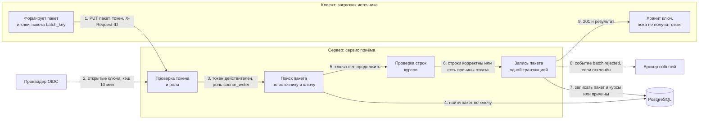
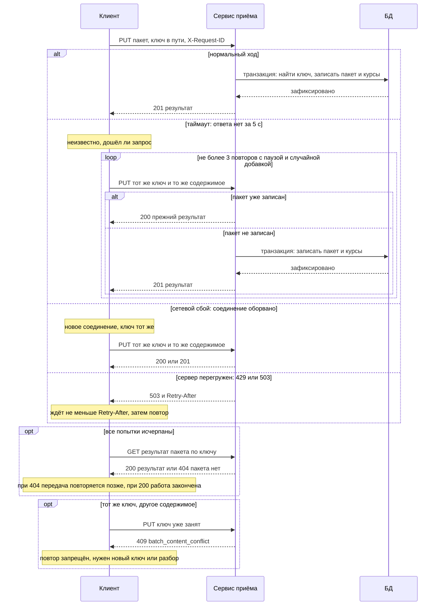
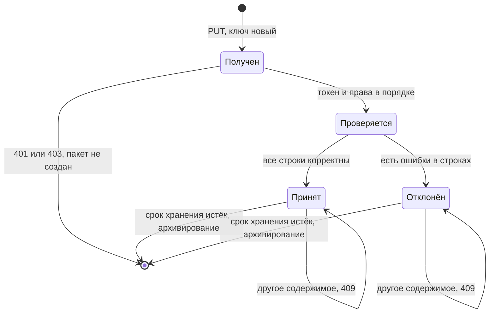
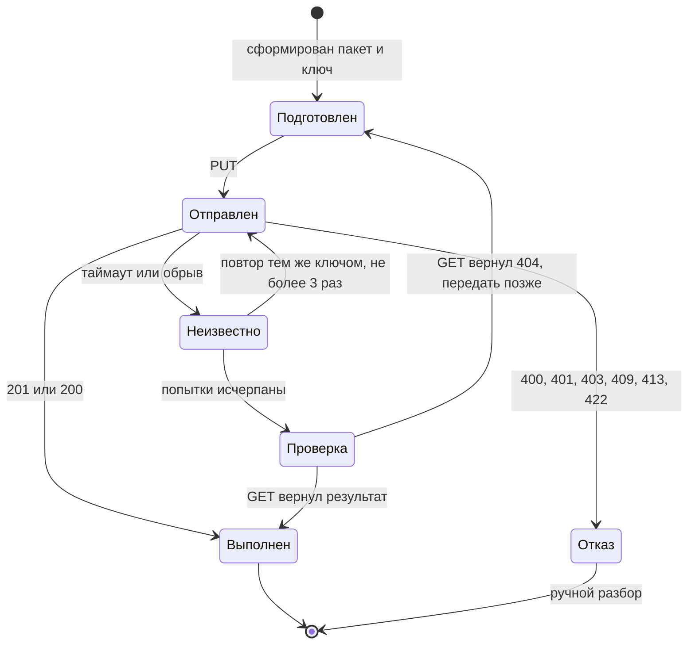
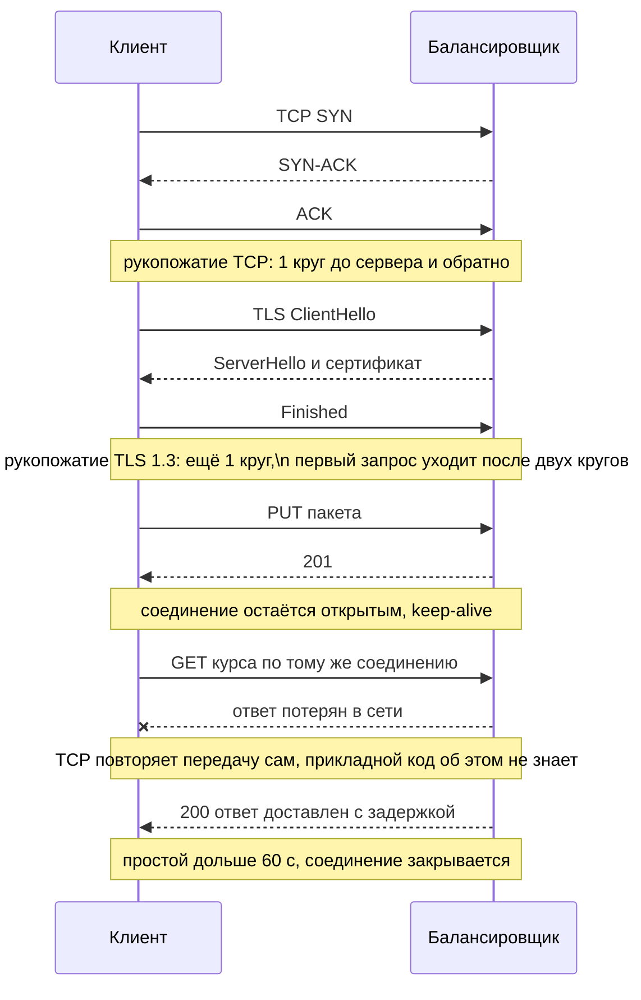
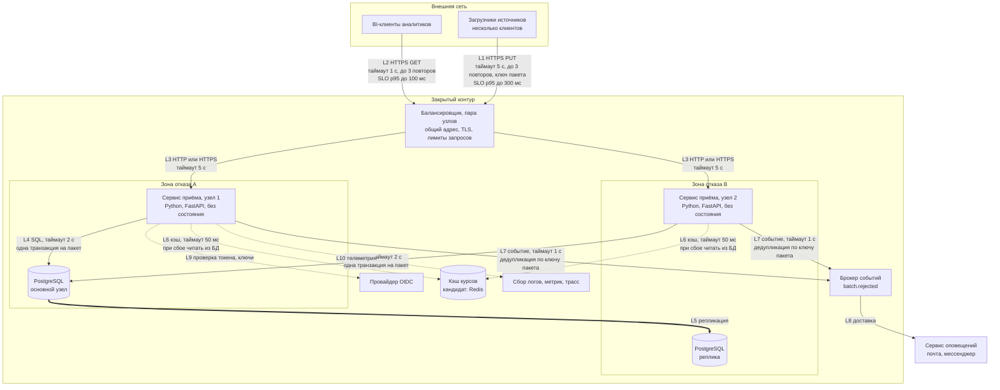
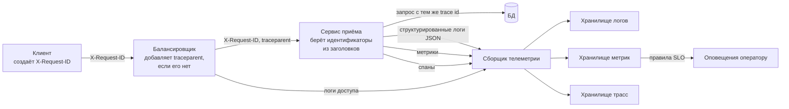
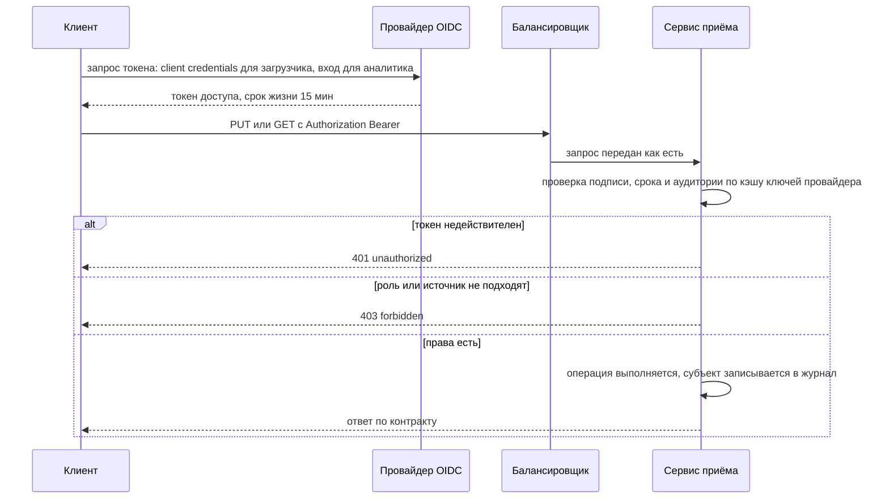
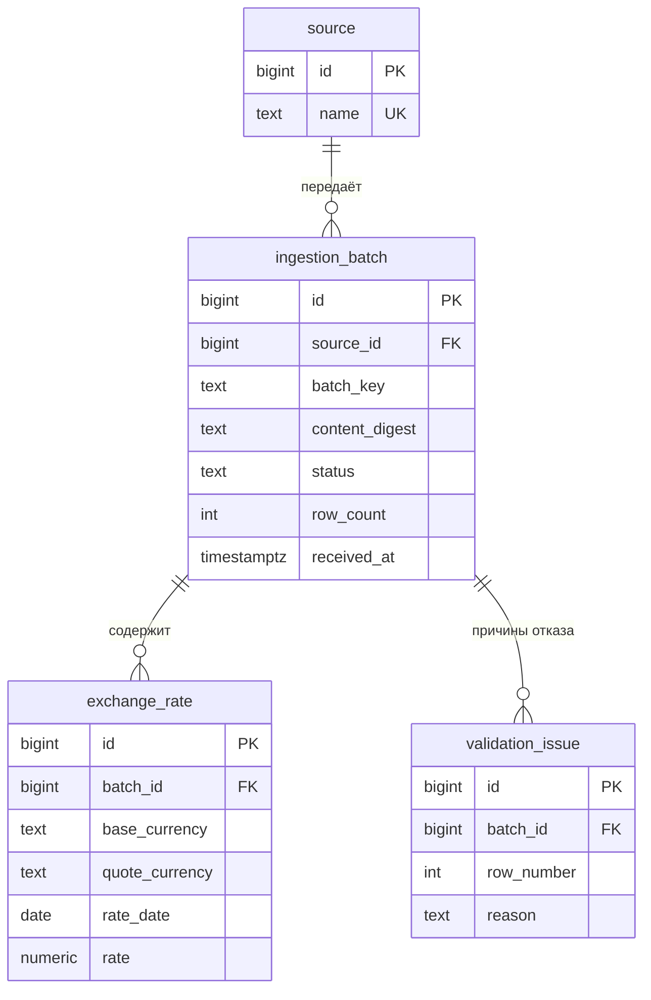
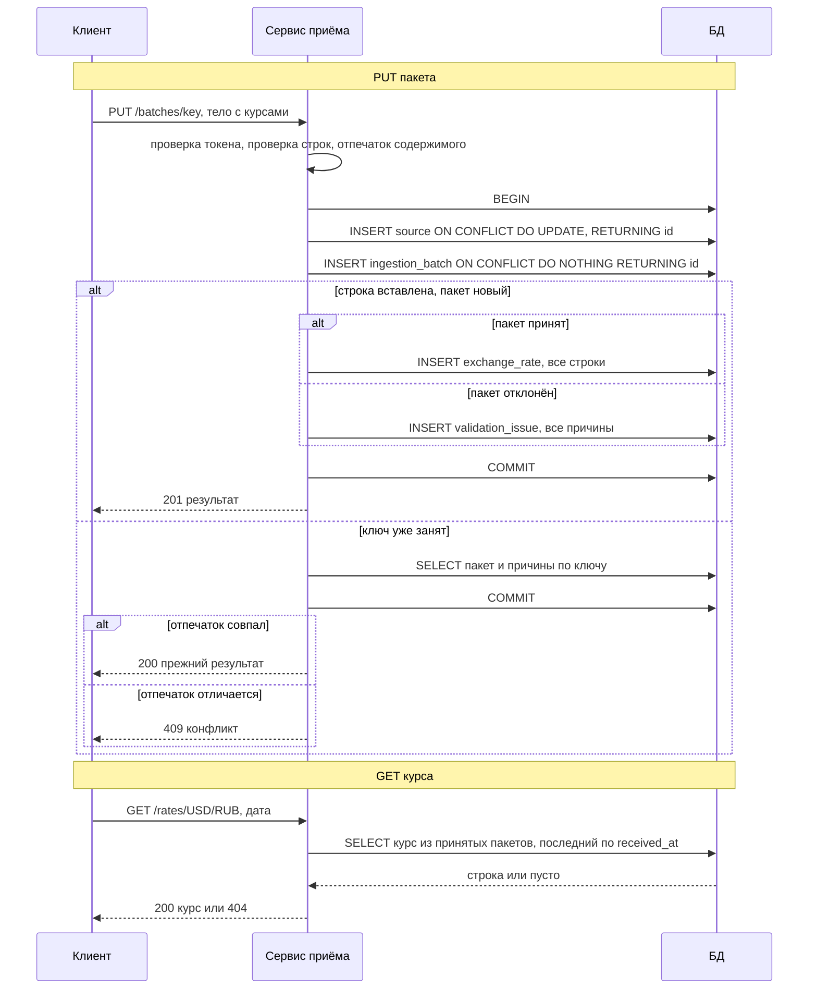

# Практическая работа №5. Моделирование клиент–серверной системы

**Цель работы:** собрать целостную модель клиент–серверной системы: поведение, контракт взаимодействия, топологию и политику надёжности.

Работа продолжает тему практик №1–4: подсистема приёма курсов валют платформы данных. Основной сценарий — **загрузка пакета курсов** (тот же срез, что в ПР №4), расширяющий — **запрос курса аналитиком из BI**. Все числовые значения, которых нет в предыдущих практиках, помечены «допущение»: они не измерялись и подлежат уточнению нагрузочным тестом.

Связь с ПР №4: контракт здесь — развитие `gen/openapi.yaml` (версия 1.0.0 → 1.1.0); отличия перечислены в разделе 3.5. Реализация из ПР №4 в этой работе не меняется — по заданию нужны только модели и спецификации.

---

## 1. Сюжет, два сценария и желаемые качества

**Сюжет.** Платформа данных принимает от внешних источников пакеты курсов валют и отдаёт курсы аналитикам. Источник — программа-загрузчик (клиент), которая работает по расписанию и не имеет человека рядом; аналитик работает через BI.

| Сценарий | Роль | Что происходит | Зачем в работе |
| --- | --- | --- | --- |
| **С1 (основной).** Загрузка пакета курсов | Загрузчик источника «cbr» | Передаёт пакет «2026-10-29» с курсами; получает результат: принят или отклонён с причинами; при сбое связи безопасно повторяет передачу | На нём построены все артефакты работы |
| **С2 (расширяющий).** Запрос курса | Аналитик через BI | Запрашивает курс USD/RUB на дату; в утренние часы дашборды обновляются массово | Показывает масштабирование чтения и кэширование |

**Желаемые качества в человеческих метриках:**

| Качество | Цель | Сценарий | Основание |
| --- | --- | --- | --- |
| Время ответа на загрузку | p95 ≤ 300 мс для пакета до 1000 строк (допущение) | С1 | ПР №4, раздел 4 |
| Время ответа на запрос курса | p95 ≤ 100 мс (допущение) | С2 | Дашборд не должен ждать; ужесточает цель 300 мс из ПР №4 для запроса курса |
| Число шагов до результата | 1 вызов: источник сразу узнаёт, принят пакет или отклонён и почему | С1 | Не нужно опрашивать статус |
| Повтор после сбоя | 0 дублей курсов при любом числе повторов | С1 | INV-7 из ПР №4 |
| Оповещение об отклонённом пакете | доставка оператору ≤ 60 с (допущение) | С1 | Оператор видит проблему до утреннего отчёта |
| Доступность приёма | 99,999% (простой не более 5,26 мин в год) | С1, С2 | КА-1 из ПР №2 |

---

## 2. Поведение глазами клиента и сервера

### 2.1. Динамическая диаграмма (в стиле C4 Dynamic) — сценарий С1



**Карточка диаграммы.** Предпосылки: у клиента есть действующий токен роли `source_writer`, ключ пакета стабилен для одного и того же содержимого. Инварианты: у источника не бывает двух пакетов с одним ключом (INV-1); пакет принимается или отклоняется целиком (INV-6). Операция в контракте: `PUT /v1/sources/{source}/batches/{batch_key}` (раздел 3).

### 2.2. Кто чего ждёт от кого

| | Клиент (загрузчик) | Сервер (сервис приёма) |
| --- | --- | --- |
| Что считается успехом | Получен ответ 201 или 200 с итоговым статусом пакета (`accepted` или `rejected`); пакет с отказом — тоже успех протокола, дальше решает оператор | Пакет записан одной транзакцией ровно один раз; ответ клиенту отправлен; для отклонённого пакета событие передано в брокер |
| Что обязан сделать | Хранить ключ пакета до получения ответа; повторять передачу только тем же ключом и тем же содержимым; задавать конечные таймауты | Проверять токен и права; не создавать дублей при повторе; не отдавать 5xx на ошибки данных внутри пакета |
| Чего ждёт от другой стороны | Ответа в пределах таймаута; одинакового результата при повторе | Корректного, повторяемого запроса; ключ не меняется, пока пакет не подтверждён |

Клиент и сервер договариваются о трёх вещах. Во-первых, сервер отвечает за целостность: он один решает, принят пакет или нет, и фиксирует решение в базе вместе с данными. Во-вторых, клиент отвечает за повторы: если ответ потерян, клиент не гадает, дошёл ли пакет, а передаёт его снова с тем же ключом — это безопасно по контракту. В-третьих, «отклонённый» пакет не является ошибкой транспорта: сервер штатно сообщает причины, и повторять такой пакет без исправления бессмысленно.

Граница ответственности проходит по ключу пакета. Всё, что до ответа сервера (формирование, хранение ключа, повторы), принадлежит клиенту; всё, что после получения запроса (проверка, запись, оповещение), — серверу. Благодаря этому сбой на любом шаге не требует ручного разбора: клиент повторяет, сервер возвращает прежний результат.

---

## 3. Контракт взаимодействия (без реализации)

**Версия контракта:** 1.1.0. **Базовый путь:** `/v1`. Изменения, ломающие совместимость, выходят как `/v2`; добавление необязательных полей и новых операций — в рамках `/v1`.

### 3.1. Ресурсы и операции

| Ресурс | Операция | Успех | Ошибки | Заголовки и аутентификация |
| --- | --- | --- | --- | --- |
| `/v1/sources/{source}/batches/{batch_key}` | **PUT** — передать пакет (идемпотентно по ключу в пути) | 201 пакет принят впервые (статус `accepted` или `rejected`); 200 повтор: тот же ключ и содержимое | 400 некорректный JSON; 401 нет или неверный токен; 403 роль или источник не совпадает с токеном; 409 тот же ключ, другое содержимое; 413 тело больше 5 МБ (допущение); 422 тело не соответствует схеме; 429 превышен лимит; 503 сервис недоступен | `Authorization: Bearer <токен>` (обязательно), роль `source_writer`, источник в токене должен совпадать с `{source}`; `X-Request-ID` (необязательно, сервер создаёт при отсутствии); `Content-Type: application/json` |
| `/v1/sources/{source}/batches/{batch_key}` | **GET** — узнать результат пакета (новая операция в 1.1.0) | 200 результат пакета | 401; 403; 404 пакета нет; 429; 503 | `Authorization` (обязательно), роль `source_writer` для своего источника или `operator` для любого |
| `/v1/rates/{base_currency}/{quote_currency}?rate_date=…` | **GET** — получить курс на дату | 200 курс найден; 304 не изменился (при `If-None-Match`) | 401; 403; 404 курса нет; 422 параметры не соответствуют схеме; 429; 503 | `Authorization` (обязательно), роль `analyst_reader` или `operator`; `If-None-Match` (необязательно); в ответе `ETag`, `Cache-Control: max-age=60` (допущение) |

Идемпотентность и безопасность: GET безопасен и идемпотентен; PUT идемпотентен по ключу `(source, batch_key)`; других изменяющих операций в версии 1.1.0 нет. Если появится POST, он обязан принимать заголовок `Idempotency-Key`.

### 3.2. Схемы полезной нагрузки

**Запрос PUT (тело).** Обязательные поля отмечены «да».

| Поле | Тип | Обязательно | Описание и инварианты |
| --- | --- | --- | --- |
| `rates` | массив `RateRow` | да | От 1 до 1000 строк (допущение); порядок значения не имеет |
| `rates[].base_currency` | строка | да | Три заглавные латинские буквы (INV-5) |
| `rates[].quote_currency` | строка | да | Три заглавные латинские буквы (INV-5); не равна базовой (INV-3) |
| `rates[].rate_date` | дата `YYYY-MM-DD` | да | Дата курса |
| `rates[].rate` | строка с десятичным числом | да | Строго положительное (INV-2), не более 8 знаков после запятой и меньше 10^10 (INV-8); в паре с датой уникально внутри пакета (INV-4) |

Параметры пути: `source` и `batch_key` — непустые строки; вместе они образуют ключ идемпотентности (INV-1).

**Ответ 200/201 (`BatchResult`).**

| Поле | Тип | Обязательно | Описание |
| --- | --- | --- | --- |
| `batch_key` | строка | да | Ключ пакета |
| `status` | `accepted` или `rejected` | да | Итог проверки пакета целиком (INV-6) |
| `row_count` | целое | да | Число строк в пакете |
| `issues` | массив `{row_number, reason}` | да | Пустой для принятого пакета; для отклонённого — причины |
| `received_at` | дата-время | нет (с 1.1.0) | Момент получения; нужен для сопоставления с журналами |

**Ответ GET курса (`Rate`).** Поля: `base_currency`, `quote_currency`, `rate_date`, `rate`, `source` — все обязательные.

**Единый формат ошибки (`Error`, с 1.1.0).**

| Поле | Тип | Обязательно | Описание |
| --- | --- | --- | --- |
| `code` | строка | да | Машиночитаемый код: `unauthorized`, `forbidden`, `batch_content_conflict`, `invalid_request`, `rate_limited`, `unavailable`, `not_found` |
| `message` | строка | да | Описание для человека |
| `details` | массив | нет | Ошибки по полям при 422 |
| `request_id` | строка | да | Корреляционный идентификатор запроса |
| `retry_after_seconds` | целое | нет | Для 429 и 503; дублирует заголовок `Retry-After` |

### 3.3. Пример обмена

```
PUT /v1/sources/cbr/batches/2026-10-29
Authorization: Bearer <токен>
X-Request-ID: 7f3c9a1e-5b2d-4e8f-9a41-0c6d2b7e1f55
Content-Type: application/json

{"rates": [{"base_currency": "USD", "quote_currency": "RUB",
            "rate_date": "2026-10-29", "rate": "95.5"}]}

201 Created
X-Request-ID: 7f3c9a1e-5b2d-4e8f-9a41-0c6d2b7e1f55
{"batch_key": "2026-10-29", "status": "accepted", "row_count": 1, "issues": []}
```

### 3.4. Версионирование и совместимость

| Правило | Содержание |
| --- | --- |
| Номер контракта | `MAJOR.MINOR.PATCH`; `MAJOR` совпадает с `/v1` в пути |
| Совместимое изменение | Новое необязательное поле в ответе, новая операция, новый код ошибки — `MINOR` |
| Несовместимое изменение | Удаление поля, смена типа или смысла, новое обязательное поле запроса — новый `/v2`; `/v1` поддерживается ещё не менее двух выпусков (допущение) |
| Клиент | Игнорирует неизвестные поля ответа; не опирается на порядок полей |

### 3.5. Отличия от реализации ПР №4

Контракт 1.1.0 — целевой; реализация ПР №4 соответствует версии 1.0.0 и расходится с ним так:

| Что | В реализации ПР №4 (1.0.0) | В контракте 1.1.0 |
| --- | --- | --- |
| Формат ошибки | Стандартный формат FastAPI с полем `detail` | Единый `Error` с `code`, `request_id` |
| Аутентификация | Нет | Bearer-токен, роли |
| `GET` результата пакета | Нет | Есть |
| `received_at` в ответе | Нет | Необязательное поле |
| Коды 401, 403, 429, 503 | Нет | Есть |
| Лимиты: 1000 строк, тело до 5 МБ (413) | Не проверяются | Есть |
| Некорректный JSON | 422 | 400 |
| `ETag`, `Cache-Control`, ответ 304 | Нет | Есть для GET курса |
| Заголовок `X-Request-ID` | Не обрабатывается | Принимается и возвращается |

---

## 4. Надёжность взаимодействий

### 4.1. Диаграмма последовательностей: основной сценарий с отказами

Параметры политики (допущения): общий таймаут вызова 5 с; не более 3 повторов; пауза между повторами 0,2 с, затем 0,4 с, затем 0,8 с плюс случайная добавка до 50%; общий срок на операцию — 30 с: 4 попытки по 5 с дают 20 с, паузы между ними в сумме не больше 2,1 с.



**Карточка диаграммы.** Предпосылка: клиент не меняет ключ и содержимое при повторе. Инварианты: повтор не создаёт дублей (INV-7); пакет записывается атомарно (INV-6). Операции контракта: PUT и GET пакета (раздел 3.1).

### 4.2. Политика идемпотентности

| Вопрос | Решение |
| --- | --- |
| Где используется ключ | Ключ пакета `(source, batch_key)` передаётся в пути PUT; отдельный заголовок `Idempotency-Key` для PUT не нужен — ключ уже часть адреса |
| Кто создаёт ключ | Клиент; ключ детерминирован по содержимому (например, дата пакета), а не случайен, поэтому после перезапуска загрузчика он получит тот же ключ |
| Как сервер распознаёт повтор | Уникальный индекс на `(source, batch_key)` и отпечаток содержимого `content_digest` (ADR-1 из ПР №4) |
| Тот же запрос подан повторно | 200 и прежний результат (`accepted` или `rejected` с теми же причинами); данные не меняются |
| Тот же ключ, другое содержимое | 409, код `batch_content_conflict`; данные не меняются |
| Два одинаковых запроса одновременно | Один создаёт пакет (201), остальные получают 200; гонку решает уникальный индекс |
| Сколько живёт ключ | Пока хранится пакет; клиент обязан хранить ключ до получения подтверждения |
| Будущие операции POST | Обязательный заголовок `Idempotency-Key` и уникальное ограничение на стороне сервера |

### 4.3. Правила повторов

| Операция | Автоматический повтор | Условие |
| --- | --- | --- |
| GET (чтение) | Да, по умолчанию | Таймаут, обрыв соединения, 502, 503, 504, 429; до 3 раз с экспоненциальной паузой и случайной добавкой |
| PUT (изменение) | Только с ключом | Ключ есть всегда; повтор тем же ключом и тем же содержимым; те же коды, что для GET |
| Любая операция | Нет | 400, 401, 403, 404, 409, 413, 422 — повтор без изменения запроса не поможет |
| Любая операция | С учётом сервера | При `Retry-After` клиент ждёт не меньше указанного |
| Защита от лавины | Выключатель (circuit breaker) на клиенте | После 5 подряд неудачных вызовов (допущение) вызовы прекращаются на 30 с (допущение); затем пробный вызов |

### 4.4. Диаграммы состояний

**Жизненный цикл пакета на сервере (ресурс).**



**Жизненный цикл запроса у клиента.**



---

## 5. Транспорт и ограничения канала

HTTP работает поверх надёжного транспорта: TCP доставляет байты по порядку и без потерь, а TLS шифрует канал. Ниже — где это проявляется в нашем сценарии.



| Вопрос | Решение (допущения) |
| --- | --- |
| Рукопожатие | TCP + TLS 1.3 выполняются один раз при открытии соединения; затем запросы идут по нему без повторного рукопожатия |
| Keep-alive | Клиент держит соединение открытым и использует для следующих запросов; сервер закрывает соединение после 60 с простоя |
| Клиент → балансировщик | HTTP/2: несколько запросов по одному соединению; балансировщик → сервис приёма: HTTP/1.1 |
| Одновременные соединения | Клиент-загрузчик: пул до 4 соединений; балансировщик: до 10 000 одновременных соединений; сервис приёма: до 20 соединений с БД на экземпляр |
| Размер запроса | Тело не больше 5 МБ, иначе 413; пакет в 1000 строк занимает порядка 100 КБ |
| Потеря пакетов | Короткая потеря скрывает TCP (повторная передача, небольшая задержка); длинная потеря приводит к таймауту клиента — тогда действует политика повторов из раздела 4 на новом соединении |
| Что TCP не гарантирует | Что запрос дошёл до приложения и выполнился: обрыв после отправки оставляет клиента в состоянии «неизвестно» — поэтому нужна идемпотентность |

---

## 6. Топология развёртывания



Балансировщик тоже резервируется парой узлов с общим адресом: иначе он остаётся единой точкой отказа в цепочке L1 → L3 → L4, для которой заявлена доступность 99,999%.

**Где масштабируется.** Сервис приёма не хранит состояние — добавляются узлы за балансировщиком (горизонтально). БД масштабируется вертикально и репликами чтения; кэш и брокер — отдельными кластерами. **Границы отказов:** зона A и зона B; потеря зоны оставляет работающими другой узел сервиса и реплику БД, которая становится основной после переключения.

### 6.1. Политики и цели качества по связям

| Связь | Что передаётся | Таймаут и повторы | Идемпотентность | SLI → SLO (допущения) |
| --- | --- | --- | --- | --- |
| L1 источник → балансировщик | PUT пакета | 5 с, до 3 повторов с паузой и случайной добавкой, выключатель | Ключ пакета в пути | Доля успешных ответов (2xx или 409) ≥ 99,9% за 30 дней; p95 ≤ 300 мс |
| L2 BI → балансировщик | GET курса | 1 с, до 3 повторов | GET идемпотентен | p95 ≤ 100 мс; доля успешных ответов ≥ 99,9% |
| L3 балансировщик → сервис | HTTP или HTTPS (решает ИБ: токен передаётся дальше балансировщика) | 5 с; отказавший узел исключается из пула за 10 с | — | Доля ответов без 5xx ≥ 99,9% |
| L4 сервис → БД | SQL | 2 с на запрос; одна транзакция на пакет; повтор транзакции при сбое соединения | Уникальный индекс `(source, batch_key)` | p95 запроса ≤ 50 мс (допущение) |
| L5 основной узел → реплика | Репликация | — | — | Запись подтверждается после получения репликой (синхронная репликация); задержка применения на реплике ≤ 1 с (допущение) — важна для чтения с реплики |
| L6 сервис → кэш | Курс по ключу | 50 мс; при сбое — чтение из БД | GET идемпотентен | Доля попаданий ≥ 80% в часы пик (допущение) |
| L7 сервис → брокер | Событие об отказе | 1 с, до 3 повторов | Событие содержит ключ пакета, потребитель отбрасывает дубли | Потеря событий — 0 |
| L8 брокер → оповещения | Доставка оператору | Повторы с паузой | Дедупликация по ключу пакета | Доставка ≤ 60 с (допущение) |
| L9 сервис → провайдер OIDC | Ключи для проверки токенов | 2 с; кэш ключей 10 мин (допущение) | — | Сбой провайдера не останавливает приём, пока ключи в кэше |
| L10 сервис → сборщик телеметрии | Логи, метрики, спаны | Отправка не блокирует запрос: буфер с отбрасыванием при переполнении | — | Потеря телеметрии ≤ 0,1% (допущение); сбой сборщика не влияет на ответы |

Доступность 99,999% (КА-1) относится к цепочке L1 → L3 → L4: она достижима только при двух узлах сервиса, реплике БД с автоматическим переключением и клиентской политике повторов.

---

## 7. Наблюдаемость и безопасность

### 7.1. Потоки логов, метрик и трассировки



**Откуда берутся идентификаторы.** `X-Request-ID` создаёт клиент один раз на логическую операцию (все повторы одной передачи несут один идентификатор); если его нет, его создаёт балансировщик. `traceparent` (идентификатор трассы и спана) создаёт балансировщик или первый сервис цепочки; сервис приёма передаёт его в БД и в брокер. Идентификатор попадает в каждую запись журнала и в тело ошибки (`request_id`), поэтому оператор находит весь путь запроса по одному значению.

**Журналируемые события** (структурированные записи JSON, без ПДн и токенов):

| Событие | Поля |
| --- | --- |
| Получен запрос | `request_id`, `trace_id`, источник, операция, размер тела |
| Пакет принят | `request_id`, источник, `batch_key`, число строк, длительность |
| Пакет отклонён | `request_id`, источник, `batch_key`, число причин, длительность |
| Повтор распознан | `request_id`, источник, `batch_key`, результат: повтор или конфликт |
| Отказ в доступе | `request_id`, субъект из токена, операция, причина (401 или 403) |
| Ошибка сервера | `request_id`, тип ошибки, место |

**Базовые метрики:**

| Метрика | Тип | Что показывает |
| --- | --- | --- |
| `http_requests_total{operation,status}` | счётчик | Трафик и ошибки по операциям |
| `http_request_duration_seconds{operation}` | гистограмма | p95 и p99 времени ответа |
| `batches_total{status}` | счётчик | Принятые и отклонённые пакеты |
| `batch_rows` | гистограмма | Размеры пакетов |
| `idempotent_replays_total` | счётчик | Сколько повторов и конфликтов обработано |
| `db_pool_in_use` | gauge | Насыщение пула соединений с БД |
| `cache_hits_total`, `cache_misses_total` | счётчики | Доля попаданий в кэш |

Золотые сигналы покрыты: задержка, трафик, ошибки, насыщение. Оповещение при превышении SLO: p95 > 300 мс в течение 5 минут (допущение) или доля ошибок > 1% (допущение).

### 7.2. Аутентификация и авторизация



| Вопрос | Решение |
| --- | --- |
| Провайдер | Внутренний провайдер OIDC компании (кандидат — Keycloak, выбор уточняется) |
| Где проверяется токен | В сервисе приёма локально, по кэшу открытых ключей провайдера; провайдер на каждый запрос не вызывается |
| Шифрование канала | TLS 1.3 на участке клиент → балансировщик; токен передаётся и дальше, поэтому TLS (по возможности взаимный) рекомендуется и между балансировщиком и сервисом — решение за ИБ |
| Срок токена | 15 минут (допущение); загрузчик получает новый токен до истечения |

| Роль | Что разрешено |
| --- | --- |
| `source_writer` | PUT и GET пакетов только своего источника: имя источника в пути должно совпадать с утверждением в токене |
| `analyst_reader` | GET курса |
| `operator` | GET пакетов любого источника и их причин отказа; GET курса |

Роль влияет на сценарий С1 так: загрузчик «cbr» не может передать пакет от имени другого источника — запрос получит 403, и пакет не будет создан.

---

## 8. Структура данных и взаимодействие с БД

### 8.1. ER-диаграмма

Модель данных соответствует схеме PSM из ПР №4 (`gen/migrations/001_init.sql`).



| Таблица | Ограничения целостности |
| --- | --- |
| `source` | PK `id`; `name` уникально |
| `ingestion_batch` | PK `id`; FK `source_id` → `source`; уникально `(source_id, batch_key)` (INV-1); `status` только `accepted` или `rejected`; все поля обязательные |
| `exchange_rate` | PK `id`; FK `batch_id` → `ingestion_batch`; `rate > 0` (INV-2); `base_currency <> quote_currency` (INV-3); уникально `(batch_id, base_currency, quote_currency, rate_date)` (INV-4); коды валют по шаблону `^[A-Z]{3}$` (INV-5) |
| `validation_issue` | PK `id`; FK `batch_id` → `ingestion_batch`; все поля обязательные |

Индексы: по каждому внешнему ключу и составной индекс `(base_currency, quote_currency, rate_date)` для запроса курса.

### 8.2. Операции API и действия над БД

| Операция API | Действия над БД |
| --- | --- |
| PUT пакета, ключ новый | `INSERT` источника, если его нет; `INSERT` пакета; `INSERT` курсов (принят) или причин отказа (отклонён) — одной транзакцией |
| PUT пакета, ключ уже есть | `INSERT … ON CONFLICT DO NOTHING` не создаёт строку; `SELECT` прежнего пакета и его причин; изменений нет |
| GET результата пакета | `SELECT` пакета по `(source, batch_key)` и его причин отказа |
| GET курса | `SELECT` курса из принятых пакетов с сортировкой по `received_at` — берётся последний |
| Изменение и удаление | Через API не выполняются: данные неизменяемы (ADR-2 из ПР №4); `DELETE` — только фоновое архивирование по сроку хранения |

Замечание о порядке: «последний принятый пакет» определяется по `received_at`, а это момент начала транзакции, а не её фиксации. Для пакетов раз в час разницы нет, но при одновременных транзакциях порядок может не совпасть с порядком фиксации; если это станет важно, порядок нужно задавать явным номером версии пакета от источника.

### 8.3. Последовательность: клиент, сервер, БД



---

## 9. Предполагаемая нагрузка и повышение производительности

### 9.1. Предположения о нагрузке

Все значения — допущения для планирования; в ПР №1 объёмы не заданы, замеров нет.

| Параметр | Значение | Как получено |
| --- | --- | --- |
| Источники курсов | 10 | Допущение: ЦБ, биржи, платёжные системы, партнёры |
| Частота передачи | 1 пакет в час от источника, 24 в сутки | Допущение |
| Размер пакета | 200 строк, максимум 1000 | Допущение |
| Пакетов в сутки | 10 × 24 = 240 | Расчёт |
| Строк в сутки | 240 × 200 = 48 000 | Расчёт |
| Строк в год | 48 000 × 365 ≈ 17,5 млн | Расчёт |
| Размер данных | около 0,25 КБ на строку с индексами: ≈ 4,4 ГБ в год, ≈ 22 ГБ за 5 лет | Порядок величины |
| Пользователи BI | 50, одновременно в пик до 20 | Допущение |
| Запросов курса в обычное время | около 1 в секунду | 20 пользователей, один запрос в 20 секунд |
| Пик утреннего обновления дашбордов | до 2000 запросов за 60 с ≈ 33 запроса в секунду | Допущение: регламентная отчётность в 08:00 |
| Пик записи | один пакет в 1000 строк за раз; одновременно не более 3–4 пакетов | Допущение |

Запись создаёт малую нагрузку (один пакет раз в несколько минут); основная нагрузка — **чтение курсов в утренний пик**.

### 9.2. Потенциальные узкие места

| № | Узкое место | Почему возникает | Оценка |
| --- | --- | --- | --- |
| У1 | Соединение с БД на каждый запрос | В реализации ПР №4 каждое обращение открывает новое соединение; при 33 запросах в секунду это 33 открытия соединений в секунду и лишняя задержка в каждом запросе | Реальное ограничение текущей реализации |
| У2 | Вставка пакета построчно | Для 1000 строк — 1000 вставок в одной транзакции; растёт время ответа PUT | Риск для p95 ≤ 300 мс |
| У3 | Запрос курса с соединением трёх таблиц и сортировкой | При росте данных до десятков миллионов строк стоимость запроса растёт; в пик 33 запроса в секунду одинаковых курсов | Риск для p95 ≤ 100 мс |
| У4 | Единый основной узел БД | Запись и чтение идут на один узел; потеря узла прерывает запись до переключения | Риск для доступности |
| У5 | Большие пакеты в синхронном вызове | Пакет в сотни тысяч строк заблокирует вызов дольше таймаута 5 с | Риск при росте лимита 1000 строк |
| У6 | Утренний пик одновременных запросов | Одни и те же 20–50 курсов запрашиваются тысячи раз | Чтение повторяется, данные не меняются |
| У7 | Строка источника обновляется при каждом PUT | В ПР №4 вставка источника выполнена как `ON CONFLICT DO UPDATE`: одновременные пакеты одного источника ждут друг друга до фиксации | Низкая: пакеты одного источника редко идут параллельно |

### 9.3. Способы повышения производительности

| Решение | Какое узкое место снимает | Нужно ли сейчас | Обоснование |
| --- | --- | --- | --- |
| Пул соединений с БД (в приложении или отдельный прокси) | У1 | **Да, в MVP** | Дешёвое исправление реального дефекта текущей реализации; повторное открытие соединения — основной вклад в задержку при 33 запросах в секунду |
| Массовая вставка курсов одной командой (COPY или пакетная вставка) | У2 | **Да, в MVP** | Сокращает число обращений к БД с 1000 до одного; решает риск для p95 записи |
| Кэширование курса (ETag, `Cache-Control: max-age=60`, кэш в памяти или Redis) с сбросом по событию о новом пакете | У3, У6 | **Желательно к пику** | Данные неизменяемы в пределах пакета, а утренний запрос повторяет одни и те же курсы; сброс по событию «пакет принят» (Observer из ПР №3) не даёт отдать устаревшее значение дольше минуты |
| Таблица «текущий курс» (последний принятый курс на пару и дату), обновляемая при приёме пакета | У3 | Позже | Убирает соединение и сортировку на чтении; нужна, когда замеры покажут рост p95 запроса курса; усложняет запись |
| Чтение с реплики БД | У3, У4 | Позже | Разгружает основной узел; допустимо отставание до 1 с для курсов |
| Асинхронная обработка больших пакетов: 202 и опрос статуса | У5 | Только если лимит строк вырастет | Снимает ограничение таймаута; усложняет контракт и клиента; сейчас пакеты малы |
| Горизонтальное масштабирование сервиса приёма (2 узла и больше) | У4, доступность | **Да — для доступности, не для пропускной способности** | Один узел справляется с 33 запросами в секунду (допущение, нужен замер), второй узел нужен ради 99,999% |
| Вставка источника без обновления строки (`DO NOTHING` и затем `SELECT`, либо кэш идентификаторов источников) | У7 | Позже | Убирает ожидание на строке источника; важно, только если появятся параллельные пакеты одного источника |
| Ограничение скорости по источнику и по роли | У6 | **Да** | Защищает от лавины повторов и неисправного клиента |

Вывод по нагрузке: при принятых допущениях пропускная способность одного узла достаточна; масштабирование нужно прежде всего для **доступности**, а производительность обеспечивают пул соединений и пакетная вставка. Кэш и таблица «текущий курс» вводятся по результатам нагрузочного теста (задача 8.2 из ПР №1), чтобы не усложнять систему заранее.

---

## 10. Выводы

1. **Контракт и надёжность связаны.** Ключ пакета в пути и уникальный индекс позволяют клиенту повторять передачу без анализа причин сбоя; это сделало диаграмму последовательностей с таймаутом, обрывом и перегрузкой короткой.
2. **Транспорт не заменяет идемпотентность.** TCP гарантирует доставку байтов, но не выполнение запроса; обрыв после отправки оставляет клиента в состоянии «неизвестно», поэтому добавлена операция GET результата пакета.
3. **Качества привязаны к связям.** Таблица 6.1 даёт каждой связи таймаут, политику повторов и измеримую цель — так проще проверять каждую из них отдельно.
4. **Нагрузка определяет приоритеты.** По оценке узкое место — чтение в утренний пик и открытие соединений с БД, а не запись; пул соединений и пакетная вставка важнее кэша и асинхронной обработки.
