# Практическая работа №6. Предметно-ориентированное проектирование (DDD)

**Цель работы:** выделить в платформе данных поддомены и ограниченные контексты, связать их картой контекстов, зафиксировать единый язык, а затем спроектировать внутренности одного контекста: порты и адаптеры, агрегаты, доменные события.

Работа продолжает практики №1–5. Стратегическая часть (часть A) охватывает всю платформу данных; тактическая (часть B) детализирует контекст **«Курсы валют»**, потому что для него уже есть модель, инварианты и контракты из ПР №4 и №5.

**Важная оговорка.** Event Storming в разделе 1 выполнен как кабинетная реконструкция по материалам ПР №1–5, а не как сеанс с экспертами предметной области. Для реального проекта события, команды и узкие места нужно подтвердить на сеансе с участием аналитиков, финансистов и службы безопасности. Значения SLA, имена владельцев и сроки — допущения, они помечены.

**О нотации диаграмм.** Нотация C4 (системы, контейнеры, компоненты, подписи на связях, легенда) выражена обычными диаграммами mermaid: встроенный синтаксис C4 в mermaid плохо раскладывает стрелки и при числе связей больше 5–6 схема становится нечитаемой. Поэтому крупные схемы разбиты на несколько видов с небольшим числом связей, а полный перечень связей дан таблицами.

---

# Часть A. Доменная аналитика и карта контекстов

## 1. Event Storming

### 1.1. Акторы

| Актор | Кто это | Что делает в процессе |
| --- | --- | --- |
| Источник курсов | Внешний провайдер курсов или загрузчик, который работает по расписанию | Передаёт пакеты курсов |
| Дата-инженер | Разработчик и оператор платформы | Подключает источники, чинит отклонённые пакеты |
| Аналитик | Пользователь BI | Запрашивает данные и метрики |
| Офицер ИБ | Служба информационной безопасности | Управляет политиками доступа к ПДн, проверяет журнал |
| Владелец метрики | Представитель бизнеса (финансы, риски) | Определяет бизнес-метрики и их формулы |

### 1.2. События, команды, агрегаты, политики

События названы глаголом в прошедшем времени; команды — глаголом; политика — «когда произошло X, нужно сделать Y».

| Фаза | Команда (кто вызывает) | Агрегат | Событие | Политика после события |
| --- | --- | --- | --- | --- |
| Подключение | ЗарегистрироватьИсточник (дата-инженер) | ИсточникКурсов | ИсточникЗарегистрирован | Когда зарегистрирован — выдать источнику роль на запись |
| Приём курсов | ПередатьПакетКурсов (источник курсов) | ПакетКурсов | ПакетКурсовПринят | Когда принят — пересчитать затронутые витрины |
| Приём курсов | ПередатьПакетКурсов (источник курсов) | ПакетКурсов | ПакетКурсовОтклонён | Когда отклонён — оповестить оператора |
| Оповещение | ОповеститьОператора (политика) | Оповещение | ОператорОповещён | — |
| Расчёт | ПересчитатьВитрину (политика) | Витрина | ВитринаОбновлена | Когда обновлена — проверить качество данных |
| Контроль | ПроверитьКачество (политика) | НаборДанных | КачествоПодтверждено | Когда подтверждено — опубликовать витрину для BI |
| Контроль | ПроверитьКачество (политика) | НаборДанных | КачествоНарушено | Когда нарушено — оповестить владельца набора и задержать публикацию |
| Метрики | ОпределитьМетрику (владелец метрики) | Метрика | МетрикаОпределена | Когда определена — пересчитать витрины, где она используется |
| Доступ | ЗапроситьДанные (аналитик) | ПолитикаДоступа | ДоступПредоставлен или ДоступОтклонён | Когда принято решение — записать обращение в журнал |
| Аудит | ЗаписатьОбращение (политика) | ЖурналОбращений | ОбращениеЗафиксировано | — |
| Безопасность | ИзменитьПолитикуДоступа (офицер ИБ) | ПолитикаДоступа | ПолитикаДоступаИзменена | Когда изменена — сбросить кэш прав |
| Приоритеты | ИзменитьПриоритетИсточников (дата-инженер) | ПолитикаВыбораКурса | ПолитикаВыбораИзменена | Когда изменена — пересчитать витрины |
| Отключение | ОтключитьИсточник (дата-инженер) | ИсточникКурсов | ИсточникОтключён | Когда отключён — отозвать роль источника и исключить его из политики выбора |

### 1.3. Доска Event Storming: приём курсов и расчёт витрин

Цвета как на стикерах: оранжевый — событие, голубой — команда, жёлтый — агрегат, светло-жёлтый — актор, сиреневый — политика, красный — узкое место.

**Доска 1.3а. Приём пакета: принят или отклонён**

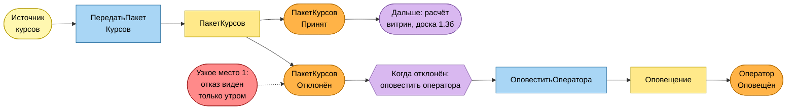

**Доска 1.3б. Расчёт витрин и контроль качества**

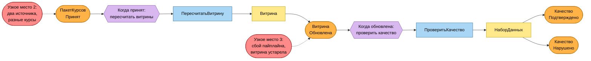

### 1.4. Доска Event Storming: доступ к данным и аудит

**Доска 1.4а. Запрос данных и аудит**

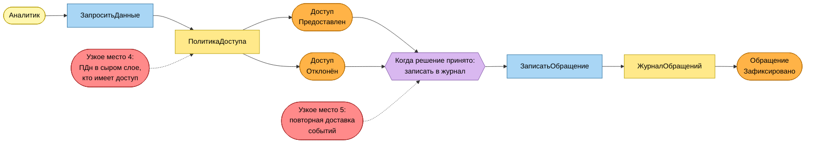

**Доска 1.4б. Изменение политики доступа**

### 1.5. Узкие места

| № | Узкое место | Где проявляется | Что с ним делать |
| --- | --- | --- | --- |
| 1 | Отклонённый пакет замечают только утром, когда отчёт уже построен | Событие ПакетКурсовОтклонён | Оповещение оператора по политике; цель — доставка ≤ 60 с (ПР №5) |
| 2 | Два источника присылают разные курсы на одну пару и дату; сейчас побеждает последний принятый пакет (ADR-2, ПР №4) | Событие ПакетКурсовПринят | Агрегат ПолитикаВыбораКурса с приоритетом источников (раздел 6) |
| 3 | Сбой пайплайна оставляет витрину устаревшей, а аналитик об этом не знает | Событие ВитринаОбновлена не наступило | Контроль свежести в контексте «Качество и каталог», сигнал при нарушении SLA |
| 4 | Персональные данные лежат в сыром слое; неясно, кто и зачем их читает | Агрегат ПолитикаДоступа | Узкая роль на сырой слой, обязательная запись обращений |
| 5 | События могут прийти повторно или не по порядку | Все подписчики | Идемпотентные подписчики, ключ упорядочения, outbox (раздел 7) |
| 6 | Слово «метрика» понимают по-разному: бизнес-показатель и технический счётчик | Агрегат Метрика | Разделение терминов в едином языке (раздел 4) |

---

## 2. Поддомены

### 2.1. Способности и их группировка

Из ПР №1–2 выписаны способности платформы и сгруппированы по смыслу и по экспертизе: если для способности нужны одни и те же эксперты и один словарь, она попадает в один контекст.

| Группа способностей | Поддомен | Тип | Граница в одной фразе | Владелец (допущение) |
| --- | --- | --- | --- | --- |
| Единые определения бизнес-метрик; витрины «платежи», «клиенты»; пересчёт по курсам; свежесть витрин | **Бизнес-метрики и витрины** | **Core** | Всё, что делает цифры платформы единственной проверяемой версией правды для бизнеса | Команда «Данные-продукты» (дата-инженеры + аналитики) |
| Приём из микросервисов (CDC), потоков и файлов; валидация и фильтрация на входе | **Приём данных** | Supporting | Получение данных из источников и доведение их до сырого слоя | Команда «Приём» (дата-инженеры) |
| Приём и хранение курсов валют; выбор актуального курса; пакеты и их статусы | **Курсы валют** | Supporting | Единый справочник курсов с понятным происхождением каждого значения | Команда «Приём» (дата-инженеры) |
| Каталог наборов данных; происхождение (lineage); правила и проверки качества; контроль свежести | **Качество данных и каталог** | Supporting | Знание о том, что за данные у нас есть и можно ли им доверять | Команда «Качество и каталог» |
| Политики доступа к данным; маскирование ПДн; журнал обращений | **Доступ и аудит** | Supporting | Кто, что и в каком виде имеет право видеть, и доказательство этого | Команда «Безопасность данных» (ИБ + дата-инженер) |
| Аутентификация и выдача токенов | IAM (провайдер OIDC) | Generic | Готовый провайдер идентификации | Команда платформы |
| Запуск пайплайнов по расписанию | Оркестрация | Generic | Готовый оркестратор задач | Команда платформы |
| Дашборды и регламентные отчёты | BI-слой (Superset) | Generic | Готовый инструмент визуализации | Команда BI |
| Отправка уведомлений | Оповещения | Generic | Готовый сервис уведомлений | Команда платформы |
| Объектное хранилище и табличный формат | Lakehouse-хранилище | Generic | Инфраструктура хранения | Команда платформы |

**Почему Core именно «Бизнес-метрики и витрины».** Главная цель платформы из ПР №1 — одна версия бизнес-метрик вместо расхождений между отчётами разных команд. Остальное — сбор, контроль и защита данных — необходимо, но конкурентного преимущества не даёт: это можно делать готовыми компонентами или типовыми решениями. В Core вкладываются лучшие ресурсы: в нём должны работать самые опытные дата-инженеры и владельцы метрик.

**Правило владения.** Один контекст — одна команда и один репозиторий; одна команда может владеть несколькими контекстами, но несколько команд не могут владеть одним. Для MVP из пяти человек (ПР №1) это означает: команды «Приём» и «Безопасность данных» на старте — одни и те же люди в разных ролях, а контексты остаются раздельными как модули.

### 2.2. C4 System Landscape: поддомены, типы и владельцы

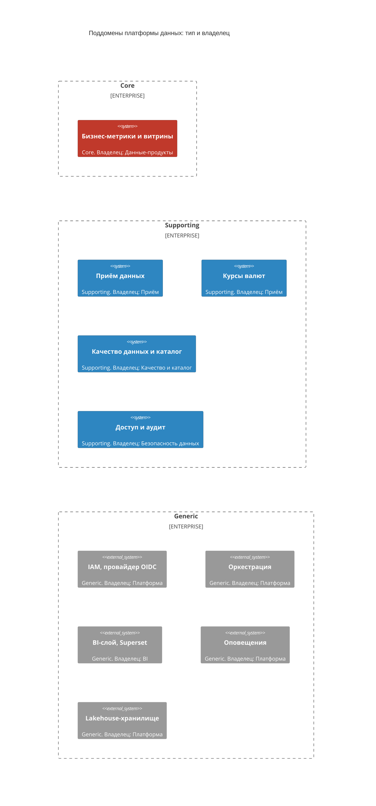

**Легенда.** Красный — Core; синий — Supporting; серый — Generic (покупное или готовое). Каждый узел — отдельный ограниченный контекст; под названием указан тип и владелец.

---

## 3. Карта контекстов

### 3.1. Связи между контекстами

Направление записано как «вышестоящий → нижестоящий» (в лекции — U и D).

| № | Вышестоящий → нижестоящий | Тип связи | Протокол и контракт | SLA и частота изменений |
| --- | --- | --- | --- | --- |
| R1 | Внешние поставщики курсов → Приём данных | **ACL** на стороне Приёма | Файл по HTTP или SFTP в формате поставщика | SLA задаёт поставщик, мы его не контролируем; формат меняется редко, но без предупреждения |
| R2 | Курсы валют → Приём данных | **Customer–Supplier + OHS и Published Language** | REST `/v1`, OpenAPI 1.1.0 (ПР №5) | PUT: p95 ≤ 300 мс, доступность 99,999%; изменения версионируются, совместимые — как `MINOR` |
| R3 | Курсы валют ↔ Бизнес-метрики и витрины | **Shared Kernel + Published Language** | Общая маленькая библиотека (КодВалюты, ПараВалют) и события `rates.batch.accepted` | Событие публикуется ≤ 5 с после фиксации (допущение); ядро меняется очень редко |
| R4 | Приём данных → Бизнес-метрики и витрины | **ACL** на стороне Метрик | События `ingestion.run.completed` | Событие ≤ 60 с после загрузки (допущение); схема версионируется |
| R5 | Курсы валют → Качество данных и каталог | **Conformist** | Те же события, что в R3 | Качество следует за моделью Курсов без права её менять |
| R6 | Бизнес-метрики и витрины ↔ Качество данных и каталог | **Partnership** | События `marts.mart.refreshed` и REST-проверка качества | Витрина публикуется после проверки ≤ 5 мин (допущение); частота изменений высокая на старте |
| R7 | Доступ и аудит → Курсы валют, Метрики, BI | **OHS + Published Language** | Решение о доступе по REST или gRPC; роли в токене OIDC | p95 решения ≤ 20 мс (допущение), клиенты кэшируют решение ≤ 60 с |
| R8 | IAM → Доступ и аудит | **Conformist** | OIDC и OAuth 2.0 | Определяется провайдером |
| R9 | Бизнес-метрики и витрины → BI-слой | **Published Language (витрины как контракт данных); BI — Conformist** | SQL-представления, описание схем витрин | Свежесть по SLA каждой витрины; схемы — по версиям |
| R10 | Оркестрация → Бизнес-метрики и витрины | **Conformist** | API оркестратора, модель графа задач | Определяется продуктом оркестратора |
| R11 | Курсы валют → Оповещения | **ACL** (адаптер на нашей стороне) | Событие `rates.batch.rejected` → API уведомлений | Доставка оператору ≤ 60 с (ПР №5) |
| R12 | Оркестрация ↔ Курсы валют | **Separate Ways** | Интеграции нет: источники сами присылают пакеты | — |
| R13 | Приём данных ↔ Доступ и аудит | **Separate Ways** | Интеграции нет: приём работает по сервисным токенам IAM напрямую | — |

### 3.2. Карта контекстов (нотация C4 System Landscape)

Из-за числа связей карта показана тремя видами: на каждом не больше пяти связей; полный перечень — таблица 3.1.

**Вид A. Путь данных: от поставщика до BI**

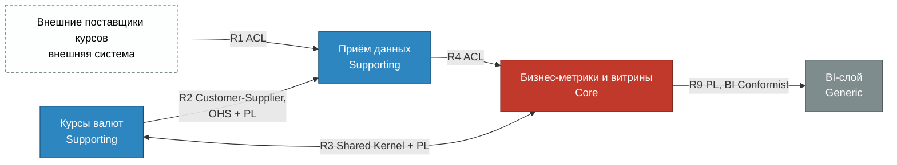

**Вид B. Контроль качества, оркестрация и оповещения**

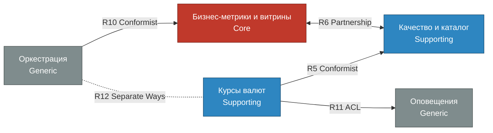

**Вид C. Доступ и безопасность**

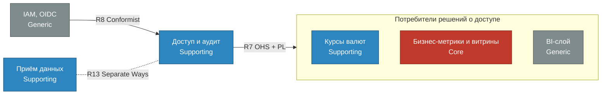

**Легенда.** Цвет узла: красный — Core, синий — Supporting, серый — Generic, белый пунктирный — внешняя система. Подпись на связи: номер из таблицы 3.1 и тип отношения. Сплошная стрелка идёт от вышестоящего контекста к нижестоящему; стрелка в обе стороны — Partnership и Shared Kernel; пунктир без стрелки — Separate Ways (интеграции нет). Сокращения: ACL — предохранительный уровень, OHS — служба с открытым протоколом, PL — общедоступный язык.

### 3.3. Ответственность, риски и правила эволюции

| № | Кто отвечает за контракт | Главный риск | Правило эволюции |
| --- | --- | --- | --- |
| R1 | Приём данных (адаптер) | Поставщик сменил формат файла — пакет отклоняется | Изменения формата поставщика обрабатываются только в ACL и не проникают внутрь; контрактные тесты на образцах файлов |
| R2 | Курсы валют | Несовместимое изменение останавливает загрузку | `/v1` поддерживается не менее двух выпусков (допущение); несовместимое изменение — только как `/v2`; контрактные тесты со стороны клиента |
| R3 | Обе команды вместе | Изменение ядра ломает оба контекста сразу | В ядре не больше трёх типов; изменение — только по согласию обеих команд через общий репозиторий библиотеки; новые понятия идут в события, а не в ядро |
| R4 | Метрики (ACL) | Дрейф схем событий | Метрики держат собственную модель и переводят события на входе; несовместимое изменение события — новая версия темы |
| R5 | Курсы валют (источник модели) | Изменение событий ломает проверки качества | Курсы уведомляют Качество не менее чем за два выпуска (допущение) |
| R6 | Обе команды вместе | Взаимные ожидания блокируют релизы; Partnership тяжёл в долгую | Общий план релизов; после двух итераций стабилизации перейти на Customer–Supplier с Метриками как поставщиком |
| R7 | Доступ и аудит | Недоступность сервиса решений блокирует чтение | Клиенты кэшируют решение ≤ 60 с; при недоступности доступ закрывается (fail-closed, ПР №5); политики версионируются |
| R8 | Провайдер IAM | Смена провайдера | Контекст зависит только от стандарта OIDC, не от продукта |
| R9 | Метрики (контракт данных) | Изменение схемы витрины ломает дашборды | Схема витрины версионируется; старая версия живёт один цикл после выпуска новой |
| R10 | Платформа | Смена оркестратора ломает расписания | Определения задач хранятся в виде кода в репозитории Метрик |
| R11 | Курсы валют (адаптер) | Потеря оповещения | Событие читается повторно до подтверждения доставки; идемпотентность по ключу пакета |
| R12, R13 | — | Появление скрытой зависимости | Если интеграция понадобится, связь оформляется явно с типом и владельцем; без пересмотра карты не добавляется |

**Правила изменения карты.** Любая новая связь добавляется в таблицу 3.1 с типом, протоколом, SLA и владельцем. Тип связи пересматривается раз в итерацию: Partnership и Shared Kernel не должны жить долго без причины.

---

## 4. Единый язык (Ubiquitous Language)

Единый язык действует внутри контекста; одно и то же слово в разных контекстах может значить разное — это не ошибка, пока контексты разделены. Ниже — словарь, омонимы и правила синхронизации имён.

### 4.1. Словарь терминов

| Термин | Имя в коде | Контекст | Определение | Границы значения | Источник истины |
| --- | --- | --- | --- | --- | --- |
| Пакет курсов | RateBatch | Курсы валют | Набор курсов, переданный источником за одну передачу под одним ключом | Не «загрузка» и не файл | Агрегат ПакетКурсов |
| Ключ пакета | BatchKey | Курсы валют | Идентификатор пакета у источника; вместе с источником курсов задаёт идемпотентность | Не ключ шифрования | Уникальность в БД курсов |
| Источник курсов | RateProvider | Курсы валют | Зарегистрированный поставщик, от имени которого передаются пакеты | Не «источник данных» из Приёма | Агрегат ИсточникКурсов |
| Курс на дату | DailyRate | Курсы валют | Значение курса одной пары валют на дату; значение-объект | Не «текущий курс» | Содержимое принятого пакета |
| Принят | Accepted | Курсы валют | Все строки пакета корректны, пакет сохранён целиком | Не «загружен в сырой слой» | Статус пакета |
| Отклонён | Rejected | Курсы валют | Хотя бы одна строка некорректна, пакет не сохранён, причины записаны | Не «доступ отклонён» | Статус пакета |
| Причина отказа | RejectionReason | Курсы валют | Номер строки и текст ошибки | — | Агрегат ПакетКурсов |
| Политика выбора курса | RateSelectionPolicy | Курсы валют | Порядок приоритета источников для пары валют | Не «политика доступа» | Агрегат ПолитикаВыбораКурса |
| Источник данных | DataSource | Приём данных | Подключаемая система: БД микросервиса, поток, файловое хранилище | Не «источник курсов» | Реестр подключений Приёма |
| Загрузка | IngestionRun | Приём данных | Один запуск получения данных из источника данных | Не «пакет курсов» | Журнал загрузок Приёма |
| Бизнес-метрика | BusinessMetric | Бизнес-метрики и витрины | Именованный показатель с единой формулой, например «объём платежей в рублях» | Не техническая метрика мониторинга | Агрегат Метрика |
| Витрина | DataMart | Бизнес-метрики и витрины | Опубликованная таблица или представление для аналитиков с версией и сроком свежести | Не дашборд | Агрегат Витрина |
| Набор данных | Dataset | Качество и каталог | Описанная в каталоге таблица с владельцем и происхождением | Не витрина (витрина — частный случай) | Каталог |
| Правило качества | QualityRule | Качество и каталог | Проверяемое условие над набором данных | Не «правило проверки пакета» внутри Курсов | Агрегат НаборДанных |
| Политика доступа | AccessPolicy | Доступ и аудит | Связь «роль — набор данных — способ маскирования» | Не «политика выбора курса» | Агрегат ПолитикаДоступа |
| Доменное событие | DomainEvent | Все | Факт, произошедший в модели; имя в прошедшем времени | Не запись журнала | Outbox и брокер |

### 4.2. Убранные омонимы

| Слово | Было (где путалось) | Стало |
| --- | --- | --- |
| Пакет | «Пакет курсов», «пакет загрузки», «пакет задач пайплайна» | **Пакет курсов** (Курсы валют) и **Загрузка** (Приём данных); для задач пайплайна — «запуск» |
| Источник | Поставщик курсов и подключаемая система | **Источник курсов** и **Источник данных** |
| Метрика | Бизнес-показатель и технический счётчик (rps, p95) | **Бизнес-метрика** (Метрики) и **метрика мониторинга** (наблюдаемость) |
| Статус | Статус пакета и состояние запуска пайплайна | **Статус пакета** (Принят, Отклонён) и **состояние запуска** (Оркестрация) |
| Качество | Качество данных и «атрибуты качества» архитектуры | **Качество данных** (контекст Качество) и **атрибут качества** (в архитектурных документах) |
| Отклонён | Пакет и запрос на доступ | **Пакет отклонён** и **доступ отклонён** — разные события разных контекстов |
| Правило и политика | Все называлось «правило» | **Правило** — проверяемое условие (качество, проверка строки); **политика** — решение о доступе или выборе источника |
| Ключ | Ключ пакета и ключ шифрования | **Ключ пакета** и **ключ шифрования** всегда с уточнением |
| Событие | Доменное событие и запись в журнале | **Доменное событие** и **запись журнала** |

### 4.3. Синхронизация имён: сущности, команды, события

| Понятие | Единый язык | Модель (ПР №4) | БД и API (ПР №4–5) | Что менять |
| --- | --- | --- | --- | --- |
| Агрегат пакета | ПакетКурсов, `RateBatch` | `IngestionBatch` | `ingestion_batch`, `/batches/{batch_key}` | Переименовать в `RateBatch` / `rate_batch`: слово Ingestion занято контекстом «Приём данных» (омоним) |
| Источник | ИсточникКурсов, `RateProvider` | `Source` | `source`, `/sources/{source}` | Переименовать в `RateProvider`; путь API оставить для совместимости `/v1` |
| Команда передачи | ПередатьПакетКурсов, `SubmitRateBatch` | `submitBatch` | `PUT /batches/...` | Имя операции привести к единому языку в `/v2` |
| Запрос курса | ПолучитьКурс, `GetRate` | `getRate` | `GET /rates/...` | Совпадает |
| Результат | Принят, Отклонён | `accepted`, `rejected` | поле `status` | Совпадает |
| Событие | ПакетКурсовПринят, `RateBatchAccepted` | не было | тема `rates.batch.accepted` | Добавить в модель и в публикацию (раздел 7) |

**Правило синхронизации.** Любое новое имя сначала появляется в словаре 4.1 и только потом в коде, схеме БД и API. Слово из словаря нельзя использовать в другом значении в том же контексте; на границе контекстов перевод делает ACL.

---

# Часть B. Технический дизайн контекста «Курсы валют»

## 5. Порты и адаптеры

### 5.1. Слои

| Слой | Что в нём | Ограничение |
| --- | --- | --- |
| Входные адаптеры | REST-контроллеры; проверка токена; преобразование JSON в команды | Нет бизнес-правил |
| Сервис приложения | Обработчики команд и запросов; транзакция; проверка идемпотентности; публикация событий в outbox | Не содержит бизнес-логики (иначе «скрытая анемия») |
| Домен | Агрегаты, значения-объекты, политики, доменные события | Не знает про HTTP, SQL, брокер |
| Выходные адаптеры | Репозитории на PostgreSQL; outbox; кэш; проверка токена; часы | Реализуют порты, объявленные доменом и сервисом приложения |

### 5.2. Порты и контракты

| Порт | Вид | Контракт | Адаптер (сейчас) | Точка расширения |
| --- | --- | --- | --- | --- |
| `SubmitRateBatch` | Входной | `PUT /v1/sources/{source}/batches/{batch_key}`, тело `rates[]`; ответы 201, 200, 409, 422 (ПР №5) | REST-контроллер FastAPI | Второй адаптер (файл в папке, gRPC) без изменения домена |
| `GetRate` | Входной | `GET /v1/rates/{base}/{quote}?rate_date=`; ответы 200, 404 | REST-контроллер | Тот же порт для потребителей по другому протоколу |
| `RegisterRateProvider`, `DisableRateProvider` | Входной | Команды администрирования; идентификатор источника | REST (внутренний) | Консольная команда оператора |
| `RateBatchRepository` | Выходной | `find(source_id, batch_key)`, `save(batch)`; уникальность ключа обеспечивает хранилище | Репозиторий PostgreSQL | Хранилище другой СУБД |
| `RateProviderRepository`, `RateSelectionPolicyRepository` | Выходной | `find`, `save` | Репозитории PostgreSQL | — |
| `EventPublisher` | Выходной | `publish(event)` записывает событие в outbox той же транзакции | Таблица outbox + релей | Другой брокер сообщений |
| `TokenVerifier` | Выходной | `verify(token)` возвращает субъекта и роли | Проверка JWT по ключам провайдера OIDC | Другой провайдер идентификации |
| `RateCache` | Выходной | `get`, `put`, `invalidate` | Кэш курсов | Отключение кэша без изменения домена |
| `Clock` | Выходной | `now()` | Системные часы | Подмена в тестах |

### 5.3. Контейнеры контекста «Курсы валют» (нотация C4 Container)

Нотация C4 Container в двух видах: синхронные порты и публикация событий.

**Вид 1. Синхронный путь: порты и адаптеры**

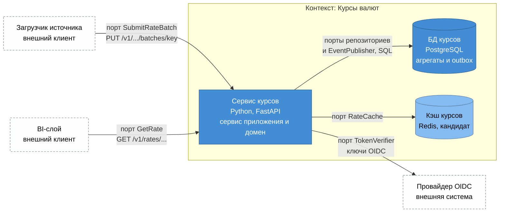

**Вид 2. Публикация и подписка: брокер и темы**

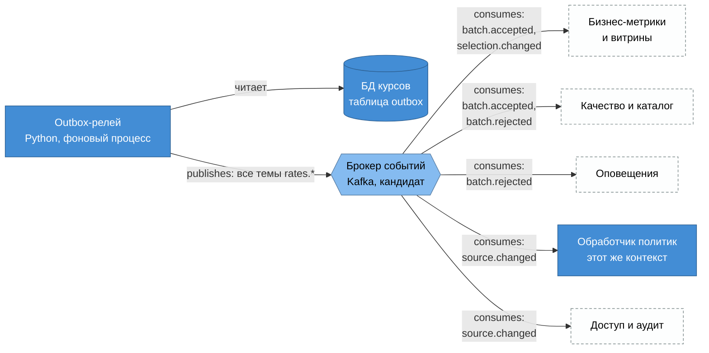

**Подписи портов.** На виде 1 входные порты (`SubmitRateBatch`, `GetRate`) стоят на связях от клиентов, выходные (`RateBatchRepository`, `EventPublisher`, `TokenVerifier`, `RateCache`) — на связях от сервиса. На виде 2 публикация и подписка отмечены словами publishes и consumes, названия тем сокращены до последних двух частей (полные имена — в таблице 5.4).

### 5.4. Темы событий

| Тема | Ключ упорядочения | Издатель | Подписчики | Содержимое |
| --- | --- | --- | --- | --- |
| `rates.batch.accepted` | Источник и ключ пакета | Релей Курсов | Метрики и витрины, Качество и каталог | Событие ПакетКурсовПринят |
| `rates.batch.rejected` | Источник и ключ пакета | Релей Курсов | Оповещения, Качество и каталог | Событие ПакетКурсовОтклонён |
| `rates.source.changed` | Идентификатор источника | Релей Курсов | Обработчик политик (этот же контекст), Доступ и аудит | События ИсточникЗарегистрирован, ИсточникОтключён |
| `rates.selection.changed` | Пара валют | Релей Курсов | Метрики и витрины | Событие ПолитикаВыбораИзменена |

В ПР №5 тема называлась `batch.rejected`; здесь добавлено пространство имён `rates.`, потому что в брокере будут события нескольких контекстов.

---

## 6. Агрегаты

### 6.1. Кандидаты и решение по атомарности

Агрегат — это граница транзакции: в одной транзакции меняется только один агрегат; остальное согласуется событиями.

| Кандидат | Что должно быть согласовано одновременно | Решение |
| --- | --- | --- |
| Пакет и его строки курсов и причины отказа | Принят или отклонён целиком; нет дублей пары и даты; значения допустимы (INV-2…INV-8, ПР №4) | **Один агрегат ПакетКурсов**: строки и причины нельзя менять отдельно от пакета |
| Пакет и источник | Источник должен быть активным, когда пакет принимается | **Два агрегата**: пакет ссылается на источник по идентификатору; статус источника читается, но не меняется в той же транзакции |
| Все пакеты одного источника | Уникальность ключа у источника | **Не агрегат**: правило между экземплярами обеспечивает репозиторий (уникальный индекс, ADR-1 из ПР №4) |
| Курс на дату и «актуальный курс» | Выбор лучшего из нескольких принятых | **Не агрегат**: это запрос по модели чтения; решение о приоритете хранит ПолитикаВыбораКурса |
| Приоритеты источников для пары | Ранги уникальны и идут без пропусков | **Отдельный агрегат ПолитикаВыбораКурса**: меняется редко и независимо от пакетов |

### 6.2. Описание агрегатов

**Агрегат ПакетКурсов (реализован в ПР №4 под именем IngestionBatch).**

| Элемент | Состав |
| --- | --- |
| Корень | ПакетКурсов: идентификатор, КлючПакета, ссылка на источник по идентификатору, статус, момент получения, отпечаток содержимого |
| Сущности внутри | Нет; все вложенные части — значения-объекты |
| Значения-объекты | КлючПакета; КодВалюты; ПараВалют; КурсНаДату (пара, дата, значение); ПричинаОтказа (номер строки, текст); Статус |
| Инварианты | Курс строго положителен (INV-2); пары различны (INV-3); в пакете нет дублей пары и даты (INV-4); код валюты — три заглавные латинские буквы (INV-5), поэтому неверный КодВалюты создать нельзя; пакет принят или отклонён целиком: у отклонённого нет курсов, у принятого нет причин (INV-6); не более 8 знаков после запятой, меньше 10^10 (INV-8) |
| Доступ | Только через корень: курсы и причины не изменяются снаружи; после решения пакет неизменяем |
| Связи | С источником — по идентификатору |
| Команды | ПринятьПакетКурсов (из ПередатьПакетКурсов) |
| События | ПакетКурсовПринят, ПакетКурсовОтклонён |

Уникальность `(источник, ключ пакета)` (INV-1) и повтор с тем же содержимым (INV-7) агрегат не защищает сам: это делает репозиторий вместе с сервисом приложения (уникальный индекс и сравнение отпечатка).

**Агрегат ИсточникКурсов (в ПР №4 — таблица `source`, создаётся неявно при первом PUT).**

| Элемент | Состав |
| --- | --- |
| Корень | ИсточникКурсов: идентификатор, имя, статус (активен, отключён) |
| Значения-объекты | ИмяИсточника, КонтактОтветственного |
| Инварианты | Имя уникально среди источников (обеспечивает репозиторий); отключённый источник не может передавать пакеты; отключить можно только активный источник |
| Команды | ЗарегистрироватьИсточник, ОтключитьИсточник |
| События | ИсточникЗарегистрирован, ИсточникОтключён |

**Агрегат ПолитикаВыбораКурса (новый, кандидат; решает узкое место 2).**

| Элемент | Состав |
| --- | --- |
| Корень | ПолитикаВыбораКурса: идентификатор |
| Сущности внутри | ПравилоДляПары (идентифицируется парой валют) |
| Значения-объекты | ПараВалют; ПриоритетИсточника (идентификатор источника, ранг) |
| Инварианты | Для пары ранги уникальны и идут с единицы без пропусков; один источник встречается в правиле пары не более одного раза |
| Связи | С источниками — по идентификатору |
| Команды | ИзменитьПриоритетИсточников |
| События | ПолитикаВыбораИзменена |

Пока политика не задана, действует правило из ПР №4: побеждает последний принятый пакет.

### 6.3. Компоненты домена «Курсы валют» (нотация C4 Component)

Нотация C4 Component в двух видах: структура домена и связи агрегатов.

**Вид 1. Агрегаты, политика и репозитории**

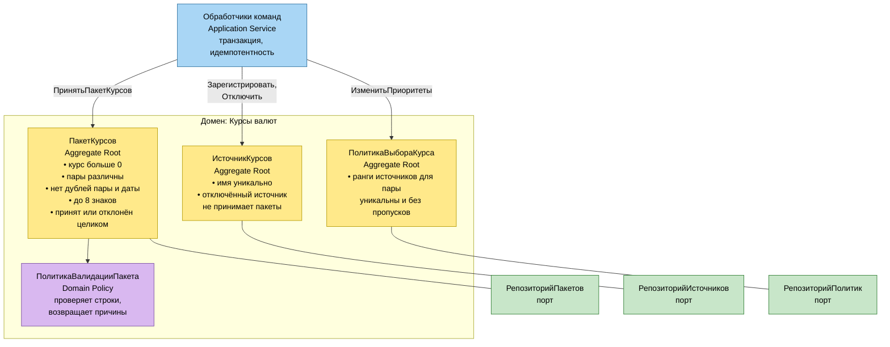

**Вид 2. События и ссылки между агрегатами**

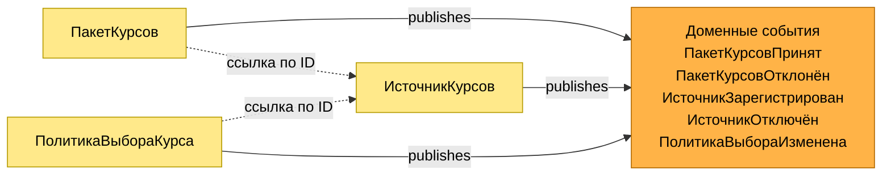

**Аннотации инвариантов** вынесены в текст агрегатов на виде 1 (маркеры). Обработчик команды изменяет один агрегат за транзакцию; репозитории — порты, их реализации лежат во внешнем слое (раздел 5). Связи между агрегатами только по идентификатору (вид 2).

### 6.4. Анемичная модель: чего избегаем

В ПР №4 проверка строк пакета лежала в сервисном слое (`validate()` в `app/service.py`). По правилам DDD это «скрытая анемия»: бизнес-логика вне модели. В тактическом дизайне она переносится в ПакетКурсов и ПолитикаВалидацииПакета; сервис приложения только вызывает команду агрегата и сохраняет результат.

---

## 7. Доменные события и причинные цепочки

### 7.1. Минимальный интерфейс события

Все события реализуют общий интерфейс `DomainEvent` с полями: `eventId` (уникален, по нему подписчики отбрасывают дубли), `eventType`, `eventVersion`, `occurredOn`. Имена событий — утверждение о произошедшем, глагол в прошедшем времени. Поле арендатора (`tenantId`) не вводится: система обслуживает одну организацию.

### 7.2. Каталог событий

| Событие | Атрибуты | Издатель | Подписчики | Последствия |
| --- | --- | --- | --- | --- |
| ПакетКурсовПринят | ключ пакета, идентификатор источника, число строк, затронутые пары и интервал дат, момент получения | ПакетКурсов | Метрики и витрины; Качество и каталог; проектор модели чтения Курсов | Пересчёт затронутых витрин; обновление происхождения и свежести; сброс кэша курса |
| ПакетКурсовОтклонён | ключ пакета, идентификатор источника, число причин, первые причины, момент получения | ПакетКурсов | Оповещения; Качество и каталог | Оператору уходит сообщение ≤ 60 с; счётчик отказов растёт |
| ИсточникЗарегистрирован | идентификатор и имя источника | ИсточникКурсов | Доступ и аудит; Качество и каталог | Источнику выдаётся роль на запись; он попадает в каталог |
| ИсточникОтключён | идентификатор источника, причина | ИсточникКурсов | Обработчик политик Курсов; Доступ и аудит; Оповещения | Источник исключается из политик выбора; роль отзывается |
| ПолитикаВыбораИзменена | пара валют, новый порядок источников, момент вступления в силу | ПолитикаВыбораКурса | Метрики и витрины | Пересчёт витрин по новому приоритету |
| ВитринаОбновлена (контекст Метрик) | идентификатор витрины, версия, момент обновления | Витрина | Качество и каталог; BI | Проверка качества; сброс кэша BI |

### 7.3. Причинные цепочки

| Цепочка | Последовательность |
| --- | --- |
| Ц1. Принят пакет | ПередатьПакетКурсов → ПакетКурсовПринят → ПересчитатьВитрину → ВитринаОбновлена → ПроверитьКачество → КачествоПодтверждено |
| Ц2. Отклонён пакет | ПередатьПакетКурсов → ПакетКурсовОтклонён → ОповеститьОператора → ОператорОповещён |
| Ц3. Отключён источник | ОтключитьИсточник → ИсточникОтключён → ИзменитьПриоритетИсточников (политика) → ПолитикаВыбораИзменена → ПересчитатьВитрину → ВитринаОбновлена |

**Причинный порядок.** ВитринаОбновлена не может наступить раньше ПакетКурсовПринят, который её вызвал; для двух пакетов с одной парой валют порядок событий должен сохраниться у каждого подписчика. Для этого событиям задаётся ключ упорядочения (пара валют или источник и ключ пакета), а подписчики обрабатывают события одного ключа последовательно.

### 7.4. Границы согласованности и требования к доставке

| Вопрос | Решение |
| --- | --- |
| Сильная согласованность | Только внутри агрегата: пакет, его строки и запись события в outbox фиксируются одной транзакцией |
| Итоговая согласованность | Между агрегатами и контекстами: витрина отстаёт от принятого пакета на время доставки и пересчёта (цель ≤ 15 мин, допущение) |
| Публикация | Через таблицу outbox: исключает ситуацию «пакет принят, а событие потеряно» (запись в БД и в брокер нельзя сделать одной транзакцией); релей читает outbox и публикует событие |
| Гарантия доставки | Не менее одного раза; подписчики идемпотентны и отбрасывают дубли по `eventId` |
| Порядок | Сохраняется в пределах ключа упорядочения; между разными ключами не гарантируется |
| Задержка публикации | ≤ 5 с после фиксации (допущение) |
| Повторы и ошибки | До 5 повторов с нарастающей паузой, затем очередь недоставленных сообщений и оповещение (допущение) |
| Хранение событий | 7 суток в брокере для повторной обработки (допущение) |
| Согласованность внутри контекста | Подписчик, меняющий другой агрегат (например, политику после отключения источника), делает это в своей транзакции, а не в транзакции издателя |

**Нотация.** Динамические диаграммы C4 — это нумерованные взаимодействия между контейнерами. Здесь они нарисованы как нумерованные диаграммы последовательностей: те же участники (контейнеры раздела 5.3), тот же порядок шагов, но стрелки не накладываются друг на друга. Номер шага — в автонумерации; публикация и подписка отмечены словами publishes и consumes.

### 7.5. Динамическая диаграмма, сценарий 1: принят пакет, обновлена витрина

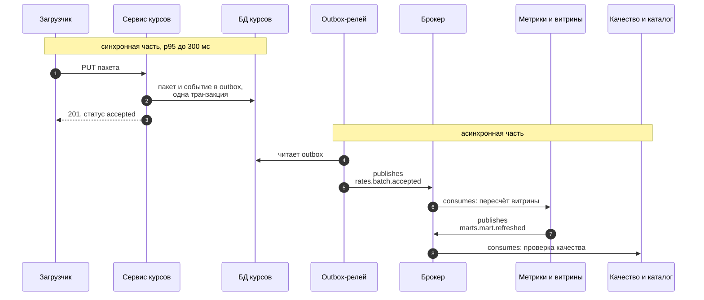

**Требования:** шаги 1–3 синхронны, p95 ≤ 300 мс (ПР №5); шаги 4–8 асинхронны, итоговая согласованность ≤ 15 мин (допущение).

### 7.6. Динамическая диаграмма, сценарий 2: пакет отклонён, оператор оповещён

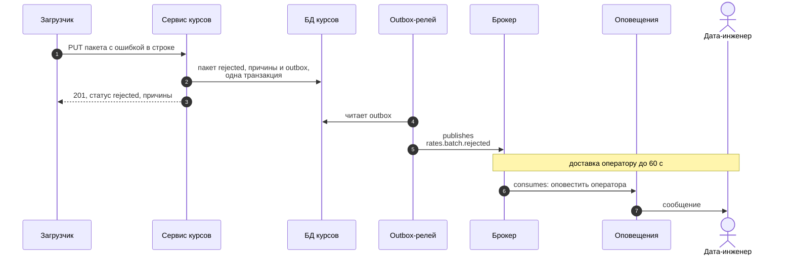

**Требования:** доставка оператору ≤ 60 с от шага 5 до шага 7 (ПР №5); оповещение идемпотентно по ключу пакета, чтобы повторная доставка события не рассылала сообщение дважды.

### 7.7. Динамическая диаграмма, сценарий 3: отключён источник, пересчитаны витрины

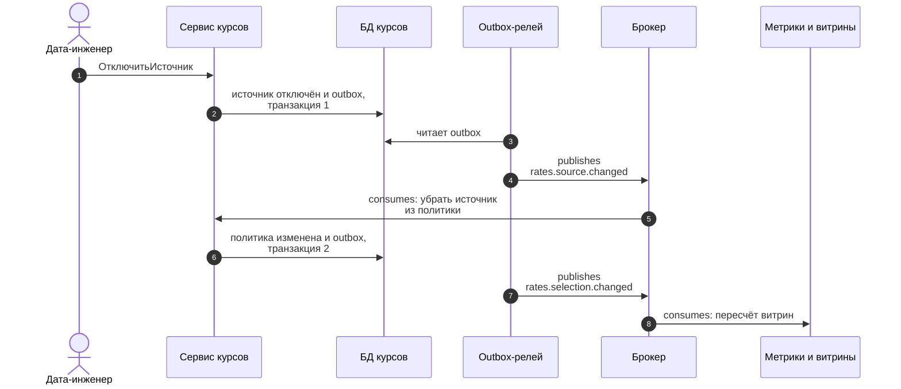

**Требования:** шаги 2 и 5 — две разные транзакции, по одному агрегату в каждой (правило лекции); между ними допустима итоговая согласованность, поэтому на короткое время отключённый источник может ещё числиться в политике. Чтобы пакет отключённого источника всё равно не прошёл, обработчик команды при приёме пакета читает статус источника (раздел 6.1); сам агрегат ПакетКурсов другие агрегаты не читает.

---

## 8. Расхождения с ПР №4 и №5 и выводы

### 8.1. Что DDD-модель меняет в уже сделанном

| Что | В ПР №4–5 | В DDD-модели |
| --- | --- | --- |
| Имя агрегата пакета | `IngestionBatch` | `RateBatch`: слово Ingestion принадлежит другому контексту |
| Источник | Создаётся неявно при первом PUT | Отдельный агрегат ИсточникКурсов с командой регистрации |
| Проверка строк | В сервисном слое (`validate()`) | В агрегате и политике валидации |
| События | Только `batch.rejected` в схеме ПР №5, в коде нет | Каталог событий и outbox |
| Выбор курса | Последний принятый пакет | Политика выбора курса с приоритетами; до её задания действует прежнее правило |
| Тема отказа | `batch.rejected` | `rates.batch.rejected` |

### 8.2. Выводы

1. **Core определён по цели платформы.** «Бизнес-метрики и витрины» — единственный контекст, где платформа создаёт конкурентное преимущество; остальное вспомогательное или покупное, что определяет, куда вкладывать лучшие ресурсы.
2. **Карта контекстов делает зависимости явными.** Для каждой связи названы тип, протокол, SLA и владелец контракта; два случая Separate Ways зафиксированы как осознанное отсутствие интеграции.
3. **Единый язык нашёл реальные омонимы**, в том числе в собственных предыдущих работах: слово Ingestion в имени агрегата пакета конфликтует с контекстом «Приём данных».
4. **Агрегаты малы и защищают инварианты.** ПакетКурсов объединяет только то, что должно быть согласовано одновременно; остальное связано идентификаторами и событиями.
5. **Outbox закрывает главный риск событийной связи** — потерю события после фиксации данных.

### 8.3. Риски и ограничения

- **Размер команды.** Пять контекстов и пять агрегатов при MVP из пяти человек — много; на старте разумно реализовать контексты как модули одного приложения с чёткими границами и разделить на сервисы позже.
- **Итоговая согласованность усложняет отладку.** Нужны корреляционные идентификаторы в событиях и наблюдаемость цепочек (ПР №5, раздел 7).
- **Event Storming не проводился с экспертами.** Все события, политики и узкие места нужно подтвердить на сеансе с бизнесом.
- **Допущения.** SLA, сроки хранения, задержки и владельцы — допущения без замеров и согласований.
- **Не реализовано.** Модель описана, код ПР №4 не менялся: переименование, события, outbox и агрегат ПолитикаВыбораКурса остаются задачами следующей итерации.
