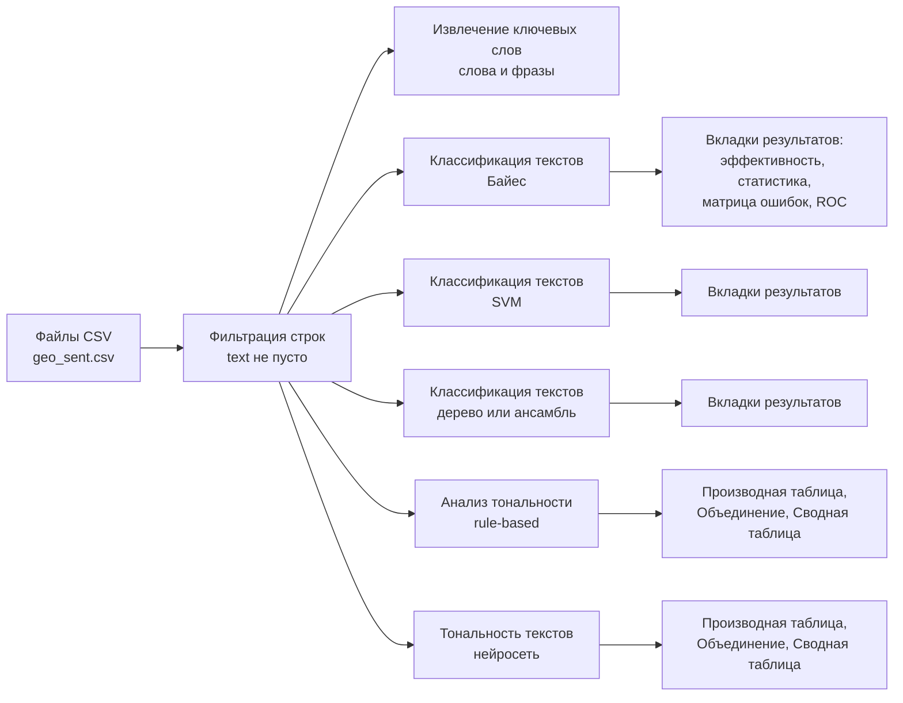

# ПР4. Классификация и анализ тональности текстов в PolyAnalyst
## Пошаговая инструкция без тестовой выборки (датасет Яндекс Карт, `d0rj/geo-reviews-dataset-2023`)

> **Что изменилось.** Тестовую выборку и узел «Применение моделей» исключили. Все метрики (accuracy, precision, recall, F-мера, матрица ошибок) берутся прямо из результатов узла «Классификация текстов». Ничего считать вручную не нужно.
>
> **Одно предупреждение, которое важно для отчёта.** Метрики на данных, на которых модель обучалась, обычно получаются выше, чем были бы на новых отзывах (особенно у SVM и ансамблей). Поэтому в инструкции есть недорогой способ показать честное качество, не заводя тестовую таблицу: **k-кратная перекрёстная проверка** внутри самого узла (шаг 6). Если она не запустится, приведите метрики на обучении и явно напишите об этом ограничении (готовый абзац есть в шаблоне отчёта).
>
> **Допущение:** в условии ПР4 «данные те же», что в ПР3, поэтому берём тот же датасет. Тональность получаем из рейтинга: 1–2 звезды отрицательные, 3 нейтральные, 4–5 положительные.
>
> Названия узлов и настроек даны по русской справке PolyAnalyst. Английские названия я пока не подтвердил, ищите по смыслу.

---

## 0. Что нужно получить

1. Обучающая выборка.
2. Признаки: мешок слов и ключевые фразы.
3. Классификатор на три класса (положительные, отрицательные, нейтральные).
4. Метрики: accuracy, precision, recall.
5. Наиболее значимые слова.
6. *(Дополнительно)* Сравнение rule-based подхода и машинного обучения.

---

## 1. Узлы, которые понадобятся (по руководству)

| Узел | Для чего | Ключевые факты |
|---|---|---|
| **Файлы CSV** | Импорт | Один файл `geo_sent.csv` |
| **Фильтрация строк** | Убрать пустые тексты | Режим «Базовый», `text` — «Не пусто» |
| **Извлечение ключевых слов** (с. 1470 и далее) | Мешок слов и ключевые фразы | Значимость 0–100; поиск фраз; пороги по поддержке |
| **Классификация текстов** (с. 1855–1877) | Обучение классификатора **и все метрики** | Методы: байесовский, k-ближайших, SVM, дерево решений и ансамбли, нейросеть. Байес быстрее, SVM, как правило, точнее. 7 вкладок результатов |
| **Анализ тональности** (с. 1639 и далее) | Rule-based подход (доп. задание) | Правила XPDL и словари, домен задаёт правила |
| **Тональность текстов** (с. 1983–1991) | Готовая нейросеть (доп. задание) | Колонка «Тональность документа» |
| **Сводная таблица** (с. 1070–1077) | Только в доп. задании: матрица «факт × тональность» | Строки, колонки, значение, агрегирование «Количество» |

---

## 2. Схема проекта



Узлы «Классификация текстов» обучаются на одной и той же таблице, поэтому методы сравнимы между собой.

---

## 3. Шаг 0. Подготовка данных (Python)

`pip install datasets pandas`. Скрипт проверен на искусственных данных; для первого запуска на настоящем датасете поставьте `N = 500`.

```python
import pandas as pd
from datasets import load_dataset

df = load_dataset("d0rj/geo-reviews-dataset-2023", split="train").to_pandas()
print(len(df), df["rating"].value_counts().sort_index().to_dict())

# 1. Только оценки 1-5 (рейтинг 0 исключаем) и непустой текст
df = df[df["rating"].between(1, 5) & df["text"].notna()].copy()

# 2. Тональность из рейтинга
df["label"] = df["rating"].map({1: "negative", 2: "negative", 3: "neutral",
                                4: "positive", 5: "positive"})

# 3. Чистка: пробелы и «утёкшие» оценки в тексте
leak = r"\b\d{1,2}\s*(?:/|из)\s*(?:5|10)\b|\b\d{1,2}\s*(?:баллов?|звёзд\w*|звезд\w*)\b|\b\d\s*\*"
df["text"] = (df["text"].str.replace(leak, " ", regex=True)
                        .str.replace(r"\s+", " ", regex=True)
                        .str.strip().str.slice(0, 1000))
df = df[df["text"].str.len() >= 20]

# 4. Точные дубли (без регистра, знаков и пробелов)
key = df["text"].str.lower().str.replace(r"[^\w]+", "", regex=True)
df = df[~key.duplicated()]

# 5. Баланс классов: одинаковое число отзывов на класс, случайный отбор
N = 2000   # для пробного запуска поставьте 500
n = min(N, df["label"].value_counts().min())
sample = (df.groupby("label").sample(n=n, random_state=42)
            .sample(frac=1, random_state=1))

cols = ["name_ru", "rubrics", "rating", "text", "label"]
sample[cols].to_csv("geo_sent.csv", index=False, encoding="utf-8")
print(sample["label"].value_counts().to_dict())
```

Результат: один файл `geo_sent.csv`, по `N` отзывов на класс (при `N = 2000` это 6000 строк).

| Шаг | Обоснование (для отчёта) |
|---|---|
| Оценки 1–5, исключён 0 | Значение 0 не соответствует классам (проверьте по `value_counts`) |
| Класс из рейтинга | Разметка автором отзыва, а не нашими правилами |
| Удаление «утёкших» оценок | В тексте бывают «5 из 5», «10/10», «5 звёзд»: почти прямая подсказка класса |
| Дедупликация | Копии отзыва в разных подвыборках перекрёстной проверки завышают метрики (вывод ПР3 и руководства, с. 1234) |
| Баланс классов | Оценок 5 большинство; без выравнивания модель выигрывает, предсказывая «positive» |
| Обрезка до 1000 символов | Отзывы бывают до 20 тысяч символов; для тональности достаточно начала, обучение быстрее |

**Скриншоты:** С1 (распределение рейтингов), С2 (число отзывов по классам).

---

## 4. Шаг 1. Импорт

1. Новый проект `ПР4_Тональность`.
2. Узел **Файлы CSV**: `geo_sent.csv` (UTF-8, разделитель «запятая», первая строка заголовки).
3. Типы: `text` текстовый, `label` строковый, `rating` числовой.
4. Узел **Фильтрация строк** (режим «Базовый», `text` — «Не пусто»).
5. Выполните, проверьте число строк.

**Скриншоты:** С3 (настройки импорта), С4 (таблица).

---

## 5. Шаг 2. Признаки: мешок слов и ключевые фразы

Подключите **Извлечение ключевых слов** к очищенной таблице (колонка `text`).

**Мешок слов:** отдельные слова (леммы); «Минимальная поддержка» (число записей со словом) 3–5; «Минимальная длина слова» 3. В отчёте сортируйте по значимости (шкала 0–100: слово «аномально» частое в одних текстах и редкое в других) и по частоте (с. 1471).

**Ключевые фразы:** включите «Найти несловарные фразы» (и при желании «Найти словарные фразы»), «Максимальная длина фразы» 3, для списка только фраз включите «Показать только фразы».

**Скриншоты:** С5 (настройки), С6 (слова), С7 (фразы).

**Что написать:** мешок слов не учитывает порядок («не понравилось» распадается на «не» и «понравилось»); фразы возвращают часть контекста, но признаков больше и они реже; почему выбраны ваши пороги.

---

## 6. Шаг 3. Обучение классификатора

Добавьте от очищенной таблицы узлы **«Классификация текстов»** (минимум два метода, лучше три).

### 6.1. Общие настройки

| Параметр | Значение | Зачем |
|---|---|---|
| Зависимая переменная | `label` | Целевой класс |
| Независимая переменная | `text` | Текст отзыва |
| Количество назначаемых категорий | **3** | Указывается вручную (с. 1862) |
| Предикторы | **лексемы** | Морфологический анализ объединяет формы слова |
| Ограничение числа независимых переменных | 10 000 (по умолчанию) | При низкой точности увеличьте до 20 000, при медленной работе уменьшите (с. 1863) |
| Минимальная поддержка предиктора | 3 | Отсекает редкие слова |
| Шаблон названия модели | `TC_bayes`, `TC_svm`, `TC_tree` | Уникальное имя для каждой модели |

### 6.2. Методы

| Узел | Метод | Комментарий |
|---|---|---|
| 1 | **Байесовский классификатор** | Быстрый; базовый вариант |
| 2 | **Метод опорных векторов (SVM)** | По руководству, как правило, точнее Байеса, но медленнее |
| 3 | **Дерево решений** или ансамбль (Случайный лес, градиентный бустинг, LightGBM, XGBoost, CatBoost) | Задайте число деревьев и максимальную глубину |

### 6.3. K-кратная перекрёстная проверка (честная оценка без тестовой таблицы)

Опция в общих настройках узла: «Использовать k-кратную перекрёстную проверку». Данные делятся на k подгрупп; каждая по очереди используется как проверочная, а модель обучается на остальных. По справке, цель проверки состоит в оценке способности модели предсказывать на данных, не участвовавших в обучении, и выявлении переобучения (с. 1862).

Рекомендуемый порядок для **каждого метода**:

1. **Запуск А:** проверка выключена. Запишите метрики со всех вкладок (шаг 7).
2. **Запуск Б:** проверка включена, **k = 5**. Запишите метрики ещё раз.
3. Сравните А и Б. Если accuracy в Б заметно ниже, то в А результат завышен переобучением, и в отчёте стоит опираться на Б.

**Предупреждение.** В песочнице запуск SVM и бустинга с проверкой может падать с ошибкой `[WinError 3] ... foldK ...` (не найден временный каталог на сервере). Это сервер, не ваши данные. Тогда запускайте проверку на Байесе и дереве (если работают), а для остальных методов оставьте только запуск А и честно опишите в отчёте, что для них метрики получены без перекрёстной проверки.

Справка также отмечает, что график калибровки достовернее при включённой проверке (с. 1875). Что именно узел считает по подгруппам, прямо не сказано, поэтому проверяйте разницу между запусками А и Б, как описано выше.

**Скриншоты:** С8 (настройки Байес), С9 (настройки SVM), С10 (настройки дерево/ансамбль).

---

## 7. Шаг 4. Метрики из узла «Классификация текстов»

Результаты узла: 7 вкладок (с. 1867–1877). Всё нужное по заданию лежит на первых четырёх.

### 7.1. Вкладка «Эффективность классификации»

Общие показатели: **ошибка классификации**, точность классификации, эффективность классификации, **F-мера** (взвешенная, микро, макро), **точность (взвешенная)**, **полнота (взвешенная)**, ROC AUC (взвешенная, макро), метод, число строк и предикторов, время обучения.

**Ловушка в названиях.** В этом списке «точность классификации» означает долю верных ответов (accuracy), а «точность (взвешенная)» рядом с «полнотой» это precision. Не путайте их.

**Accuracy** возьмите как 100% − «ошибка классификации» и проверьте по матрице ошибок: сумма диагонали / число всех документов. Если не совпало, найдите строки «не определено» (в статистике есть колонка «Не определено, %»).

### 7.2. Вкладка «Статистика классификации» (по каждому классу)

| Колонка в узле | Что это | Куда в отчёте |
|---|---|---|
| Количество записей | Число текстов класса | Размер класса |
| Доля, % | Доля класса в данных | |
| Ошибка, % | Как часто модель ошибалась на этом классе | |
| **Точность, %** | TP / (TP + FP) · 100% | **Precision** |
| **Полнота, %** | TP / (TP + FN) · 100% | **Recall** |
| **F-мера, %** | 2 · P · R / (P + R) | F-мера |
| Ложноотрицательные, % и Ложноположительные, % | FN и FP | |
| Не определено, % | Не удалось классифицировать | |

Macro-precision и macro-recall: среднее значений «Точность, %» и «Полнота, %» по трём классам. Так как классы сбалансированы, они почти совпадут со взвешенными значениями со вкладки «Эффективность».

### 7.3. Вкладка «Матрица ошибок»

Факт против предсказания; можно переключать между количеством и процентами. Зелёные ячейки на диагонали: верные предсказания. Скопируйте матрицу в отчёт.

### 7.4. Вкладка «Классификация текстов»

Список классов с TP, FP, FN и F-мерой; тексты, подсвеченные цветом (зелёные верные, красные ошибочные); **внизу слева список лексем, на которых строилась классификация**: он пригодится в шаге 5.

### 7.5. Вкладки «ROC-кривая» и «Кривая калибровки»

По желанию: показывают качество при разных порогах. Достаточно одного скриншота для лучшего метода.

### 7.6. Таблица сравнения методов

| Метод | Проверка | Accuracy | Macro-P | Macro-R | Macro-F | Время обучения |
|---|---|---|---|---|---|---|
| Байес | без (на обучении) | | | | | |
| Байес | k = 5 | | | | | |
| SVM | без (на обучении) | | | | | |
| SVM | k = 5 (если запустилась) | | | | | |
| Дерево / ансамбль | без | | | | | |
| Дерево / ансамбль | k = 5 (если запустилась) | | | | | |

**Скриншоты:** С11 («Эффективность классификации», Байес), С12 («Статистика классификации»), С13 («Матрица ошибок»), С14 (ROC, по желанию), С15 (те же вкладки для лучшего метода или сводная таблица).

**Что ожидать.** Нейтральный класс (3★) самый слабый: нейтральные отзывы часто содержат и плюсы, и минусы. Если accuracy около 0,33, модель не обучилась (уровень угадывания для трёх сбалансированных классов): проверьте целевую и независимую колонки. Если на обучении SVM показывает почти 100%, а с проверкой заметно меньше, это переобучение, а не успех.

---

## 8. Шаг 5. Наиболее значимые слова

1. **Из классификатора.** Вкладка «Классификация текстов», список лексем внизу слева (с. 1871). Выпишите топ-10–20 для каждого класса.
2. **По классам через «Извлечение ключевых слов».** Три «Фильтрации строк» по `label` (positive, neutral, negative), к каждой «Извлечение ключевых слов». Берите топ по **значимости**. Слова, высокозначимые в одном классе и отсутствующие в других, самые показательные.

**Что описать:** по 10 слов на класс; логично ли («отлично», «спасибо» для позитива; «ужас», «хамство», «не рекомендую» для негатива); есть ли неожиданные (названия организаций, имена); почему у neutral значимых слов мало.

**Скриншоты:** С16 (лексемы классификатора), С17 (значимые слова по классам).

---

## 9. Шаг 6 (дополнительно). Rule-based против машинного обучения

| Подход | Узел | Природа |
|---|---|---|
| Rule-based | **Анализ тональности** | Правила XPDL и словари; домен задаёт правила |
| Готовая нейросеть | **Тональность текстов** | Нейросетевые модели под тональность |
| Ваша модель | **Классификация текстов** | Обучена на вашей выборке |

**Корректность сравнения.** Узлы «Анализ тональности» и «Тональность текстов» не обучаются на ваших метках, поэтому оценивать их на всей таблице честно. Для обученной модели берите числа запуска Б (с перекрёстной проверкой), а если его нет, то запуска А с оговоркой об оптимистичности.

### 9.1. «Анализ тональности»

1. Вход: очищенная таблица (при больших объёмах возьмите подвыборку 1000–2000 отзывов: узел может быть медленным).
2. Вкладка «Тональности»: домен. Доступны General, Finance, Insurance, Restaurants, Technology, Hospitality, Development, Medicine, Airlines. Для смешанных организаций логичен **General**.
3. Узел создаёт отчёт; для таблицы подключите **«Производная таблица»**, затем соедините её с исходной узлом **«Объединение»** (внешнее объединение «многие-ко-многим» по колонке `text`, с. 1641).
4. Выберите колонку, из которой получаете класс, и **явно запишите правило** сопоставления (например, нет найденных тональностей: neutral; преобладают положительные: positive; преобладают отрицательные: negative).

### 9.2. «Тональность текстов»

1. Вход: та же таблица. «Рабочий элемент»: «Документ». Домен: General.
2. Результат: колонка **«Тональность документа»**. Подключите «Производную таблицу» и «Объединение», как выше.
3. **Проверьте на 20 отзывах**, что русский язык обрабатывается разумно: в руководстве для этого узла языки не указаны.

### 9.3. Матрица и точность для rule-based узлов

Подключите **«Сводную таблицу»**: Строки = `label`, Колонки = колонка с классом, который определил узел, Значение = любая непустая колонка (например, `text`), Агрегирование = «Количество». Получится матрица 3 × 3. Accuracy = сумма диагонали / сумма всех ячеек: для этого достаточно калькулятора (три сложения и одно деление). Precision и recall по классам считайте так же из строк и столбцов (формулы в разделе 7.2).

### 9.4. Сводная таблица сравнения

| Подход | Accuracy | Macro-P | Macro-R | Нужна разметка | Нужно обучение |
|---|---|---|---|---|---|
| Анализ тональности (rules) | | | | нет | нет |
| Тональность текстов (нейросеть) | | | | нет | нет |
| Классификация текстов, [метод], k = 5 | | | | да | да |

**Что обсудить:** rule-based прозрачен и не требует разметки, но зависит от домена (в справке пример: «мало» может быть плюсом и минусом) и слабее на сарказме и смешанных оценках; обученная модель подстраивается под лексику ваших отзывов, но требует разметки и может переобучиться; какой класс сложнее всем (скорее всего, neutral).

**Скриншоты:** С18 (настройки «Анализ тональности»), С19 (результат), С20 (настройки «Тональность текстов»), С21 (результат), С22 (сводная таблица сравнения).

---

## 10. Чек-лист скриншотов

| № | Что показать |
|---|---|
| С1 | Распределение рейтингов |
| С2 | Число отзывов по классам |
| С3 | Настройки импорта |
| С4 | Таблица после импорта |
| С5 | Настройки «Извлечение ключевых слов» |
| С6 | Список слов |
| С7 | Список ключевых фраз |
| С8 | Настройки классификации: Байес |
| С9 | Настройки классификации: SVM |
| С10 | Настройки классификации: дерево / ансамбль |
| С11 | «Эффективность классификации» (Байес) |
| С12 | «Статистика классификации» |
| С13 | «Матрица ошибок» |
| С14 | ROC-кривая (по желанию) |
| С15 | Эти вкладки для лучшего метода / сводная таблица методов |
| С16 | Лексемы, использованные классификатором |
| С17 | Значимые слова по классам |
| С18 | Настройки «Анализ тональности» |
| С19 | Результат «Анализ тональности» |
| С20 | Настройки «Тональность текстов» |
| С21 | Результат «Тональность текстов» |
| С22 | Сводная таблица сравнения подходов |
| С23 | Общий вид проекта (все узлы) |

---

## 11. Если что-то не получается

- **`[WinError 3] ... foldK ...` у SVM и бустинга.** Серверная ошибка песочницы, по имени папки связана с перекрёстной проверкой. Отключите проверку для этих методов, запускайте модели по одной, сохраните проект. Если не помогает, напишите администратору песочницы или преподавателю с полным текстом ошибки и опишите ограничение в отчёте.
- **Песочница тормозит.** Уменьшите `N` до 500, начните с Байеса. SVM и нейросеть самые медленные.
- **Нет узла «Анализ тональности» или «Тональность текстов».** У них пометка «доступен, только если включён в лицензии». Тогда доп. задание выполните частично и напишите об ограничении.
- **Accuracy около 0,33.** Модель не обучилась: проверьте целевую колонку (`label`), число категорий (3) и баланс классов.
- **Кракозябры при импорте.** Пересохраните CSV с `encoding="utf-8-sig"`.
- **Отзывы с ФИО сотрудников на скриншотах.** Закрывайте или выбирайте нейтральные примеры.
