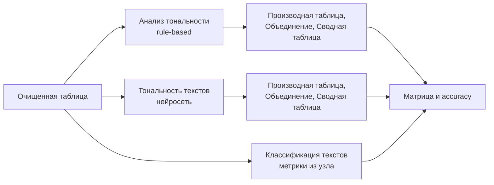

## 1. ЦЕЛЬ РАБОТЫ

Цель — освоить методы текстового анализа и определения тональности текстов.

**Этапы:** подготовка обучающей выборки; извлечение признаков (мешок слов, ключевые фразы); обучение классификатора; оценка качества модели.

**Задачи:**

1. Построить модель классификации отзывов на положительные, отрицательные и нейтральные.
2. Рассчитать accuracy, precision, recall.
3. Найти наиболее значимые слова для классификации.
4. *(Дополнительно)* Сравнить rule-based подход и машинное обучение.

---

## 2. ИСХОДНЫЕ ДАННЫЕ

### 2.1. Набор данных

Согласно условию, данные те же, что в практической работе № 3. Использован открытый набор **Geo Reviews Dataset 2023**, опубликованный Яндексом: отзывы об организациях России, оставленные на Яндекс Картах.

| Параметр | Значение |
|---|---|
| Объём | 500 000 отзывов |
| Период публикации | январь – июль 2023 |
| Язык | русский |
| Поля | адрес (`address`), название организации (`name_ru`), рубрики (`rubrics`), оценка 0–5 (`rating`), текст (`text`) |
| Особенности | по описанию авторов, отзывы очищены от персональных данных, односложных отзывов в наборе нет |
| Лицензия | MIT; набор предназначен для научных и исследовательских целей |

### 2.2. Источник разметки тональности

Для обучения с учителем нужна разметка. В наборе её нет в явном виде, но у каждого отзыва есть оценка автора. Тональность определена по ней:

| Оценка | Класс |
|---|---|
| 1–2 | отрицательный (`negative`) |
| 3 | нейтральный (`neutral`) |
| 4–5 | положительный (`positive`) |
| 0 | исключена |

*Обоснование.* Оценка поставлена самим автором отзыва, поэтому класс получен независимо от исследователя и от моделей: разметка не подгоняется под результат. Деление 1–2 / 3 / 4–5 общепринято для пятибалльной шкалы. Оценка 0 не соответствует ни одному из трёх классов [подтвердите по распределению оценок: …].

*Ограничения.* Оценка отражает общее впечатление автора, а не тональность текста: возможны отзывы, где текст нейтральный или противоречивый, а оценка крайняя. Нейтральный класс (3★) особенно шумный: такие отзывы часто содержат и достоинства, и недостатки. Ожидаемо, что именно этот класс будет определяться хуже всего.

### 2.3. Распределение оценок

| Оценка | 0 | 1 | 2 | 3 | 4 | 5 |
|---|---|---|---|---|---|---|
| Число отзывов | [  ] | [  ] | [  ] | [  ] | [  ] | [  ] |

Преобладание оценок 5 [подтвердите] потребовало выравнивания классов (раздел 3).

> **Тут вставь скриншот С1:** распределение оценок (вывод скрипта).

---

## 3. ПОДГОТОВКА ОБУЧАЮЩЕЙ ВЫБОРКИ

Подготовка выполнена скриптом на Python (приложение А).

| № | Операция | Обоснование |
|---|---|---|
| 1 | Оставлены отзывы с оценкой 1–5 и непустым текстом | Оценка 0 не соответствует классам; пустой текст не классифицируется |
| 2 | Класс получен из оценки (таблица в разделе 2.2) | Разметка автором отзыва |
| 3 | Из текста удалены упоминания оценок (шаблоны вида «5 из 5», «10/10», «5 звёзд», «9 баллов», «5*») | Числовая оценка в тексте почти прямо выдаёт класс; модель училась бы читать цифры, а не оценивать тональность |
| 4 | Лишние пробелы и переносы строк заменены одним пробелом; текст обрезан до 1000 символов | Отзывы достигают 20 тысяч символов; начала достаточно для тональности, обучение ускоряется |
| 5 | Удалены отзывы короче 20 символов | Слишком мало информации |
| 6 | Удалены точные дубликаты (без учёта регистра, знаков препинания и пробелов) | Копии одного отзыва в разных подвыборках перекрёстной проверки завышают метрики (вывод практической работы № 3; по руководству PolyAnalyst дубли искажают статистику терминов [1, с. 1234]) |
| 7 | Классы выровнены: по [2000] отзывов на класс, случайный отбор (`random_state = 42`) | Оценки 5 составляют большинство; без выравнивания модель выигрывает, предсказывая «positive» всегда; при трёх равных классах уровень случайного угадывания равен 0,33 |

**Итоговая выборка:** [  ] отзывов ([  ] positive, [  ] neutral, [  ] negative).

Отдельная тестовая выборка не выделялась (см. раздел 7.6).

> **Тут вставь скриншот С2:** число отзывов по классам.

---

## 4. ИМПОРТ И ОЧИСТКА

Выборка загружена в PolyAnalyst узлом «Файлы CSV». Параметры: кодировка UTF-8, разделитель «запятая», первая строка — заголовки. Тип колонки `text` — текстовый, `label` — строковый. Загружено [  ] строк. К таблице применён узел «Фильтрация строк» (режим «Базовый»): исключены записи с пустым значением `text`. [Осталось [  ] строк.]

Морфологический анализ внутри текстовых узлов приводит слова к лексемам, поэтому формы одного слова («понравился», «понравилось») считаются одним признаком [1, с. 1865].

> **Тут вставь скриншот С3:** настройки узла импорта.

> **Тут вставь скриншот С4:** таблица после импорта (без отзывов с ФИО сотрудников).

---

## 5. ИЗВЛЕЧЕНИЕ ПРИЗНАКОВ

### 5.1. Мешок слов

Выполнено «Извлечение ключевых слов». Параметры: отдельные слова (леммы); минимальная поддержка — [  ] записей; минимальная длина слова — [  ] символа. Получено [  ] слов.

*Обоснование.* Мешок слов представляет документ набором слов с частотами без учёта порядка. Порог поддержки отсекает опечатки и редкие слова, которые не обобщаются. Для ранжирования использована **значимость** (шкала 0–100): она показывает, насколько слово «аномально» часто встречается в одних текстах и редко в остальных, поэтому информативнее простой частоты, на которую влияют слова, частые в любом тексте [1, с. 1471].

*Ограничение.* Порядок слов теряется: «не понравилось» распадается на «не» и «понравилось».

> **Тут вставь скриншот С5:** настройки «Извлечение ключевых слов».

> **Тут вставь скриншот С6:** список слов со значимостью и частотой.

### 5.2. Ключевые фразы

Поиск фраз включён [«Найти несловарные фразы», «Найти словарные фразы»]; максимальная длина фразы — [3] слова. Получено [  ] фраз. Примеры частых фраз: [  ].

*Обоснование.* Фразы частично возвращают контекст, которого нет у отдельных слов («не рекомендую», «очень вкусно», «ждали час»). Платой становится большее число признаков, каждый из которых встречается реже.

> **Тут вставь скриншот С7:** список ключевых фраз.

### 5.3. Сравнение

[3–4 предложения: какие признаки оказались полезнее; какие слова и фразы наиболее характерны для отзывов.]

---

## 6. ОБУЧЕНИЕ КЛАССИФИКАТОРА

### 6.1. Узел «Классификация текстов»

Узел разрабатывает модель классификации структурированного атрибута по признакам, извлечённым из независимой текстовой колонки; модель основана на частоте и распределении слов [1, с. 1855]. Это алгоритм обучения с учителем. Результаты узла содержат вкладки: эффективность классификации, классификация текстов, статистика классификации, матрица ошибок, ROC-кривая, кривая калибровки, настройки [1, с. 1867].

### 6.2. Настройки

| Параметр | Значение | Обоснование |
|---|---|---|
| Зависимая переменная | `label` | Целевой класс |
| Независимая переменная | `text` | Текст отзыва |
| Количество назначаемых категорий | 3 | positive, neutral, negative |
| Предикторы | лексемы | Морфологический анализ объединяет формы слова |
| Ограничение числа независимых переменных | [10 000] | Значение по умолчанию; [изменяли ли?] |
| Минимальная поддержка предиктора | [3] | Отсекает редкие слова |
| Перекрёстная проверка | [без проверки / k = 5] | См. раздел 6.4 |

### 6.3. Выбранные методы

| Узел | Метод | Обоснование выбора |
|---|---|---|
| 1 | Байесовский классификатор | Быстрый и масштабируемый; базовый вариант [1, с. 1855] |
| 2 | Метод опорных векторов (SVM) | По руководству, как правило, точнее байесовского, но медленнее [1, с. 1855] |
| 3 | [Дерево решений / Случайный лес / LightGBM] | Читаемая структура; параметры: деревьев — [  ], глубина — [  ] |

> **Тут вставь скриншот С8:** настройки классификации (Байес).

> **Тут вставь скриншот С9:** настройки классификации (SVM).

> **Тут вставь скриншот С10:** настройки классификации (дерево / ансамбль).

### 6.4. Перекрёстная проверка

Для оценки способности модели предсказывать на данных, не участвовавших в обучении, в узле предусмотрена k-кратная перекрёстная проверка: данные делятся на k подгрупп, каждая по очереди используется как проверочная, а модель обучается на остальных [1, с. 1862]. Каждый метод запускался дважды: без проверки и с проверкой (k = [5]). [Для методов [  ] запуск с перекрёстной проверкой завершился ошибкой сервера `[WinError 3]` при обращении к временному каталогу, поэтому для них приведены только метрики без проверки.]

---

## 7. ОЦЕНКА КАЧЕСТВА МОДЕЛИ

### 7.1. Источник метрик

Метрики получены средствами узла «Классификация текстов» (вкладки «Эффективность классификации», «Статистика классификации», «Матрица ошибок») [1, с. 1867–1873]. Расчёт не дублировался вручную; соответствие проверено по матрице ошибок: accuracy равна сумме диагонали матрицы, делённой на число документов [результат проверки: …].

### 7.2. Формулы

Для класса *c* (TP — верно найденные, FP — ложно отнесённые к классу, FN — пропущенные):

- **Accuracy** = (число верных предсказаний) / (число всех документов);
- **Precision(c)** = TP(c) / (TP(c) + FP(c)); в узле эта величина показана как «Точность, %» в таблице по классам;
- **Recall(c)** = TP(c) / (TP(c) + FN(c)); в узле — «Полнота, %»;
- **F-мера(c)** = 2 · Precision · Recall / (Precision + Recall);
- **Macro-усреднение** — среднее по трём классам (классы равноправны); **weighted** — с весами по числу записей.

*Замечание о терминах.* В общем списке показателей узла «точность классификации» обозначает долю верных ответов (accuracy), а «точность» рядом с «полнотой» — precision.

*Обоснование выбора метрик.* При трёх классах одной accuracy недостаточно: она скрывает, какие классы модель различает хуже. Precision и recall по классам показывают, где и в какую сторону ошибается модель. Так как классы сбалансированы, macro- и weighted-усреднения практически совпадают. Нижняя планка — случайное угадывание: accuracy около 0,33.

### 7.3. Общие показатели

Лучший метод — [  ]. Показатели вкладки «Эффективность классификации»:

| Показатель | Значение |
|---|---|
| Ошибка классификации | [  ] |
| Accuracy | [  ] |
| F-мера (взвешенная / микро / макро) | [  ] / [  ] / [  ] |
| Precision (взвешенная) | [  ] |
| Recall (взвешенная) | [  ] |
| ROC AUC (взвешенная / макро) | [  ] |
| Число строк / предикторов | [  ] / [  ] |
| Время обучения | [  ] |

> **Тут вставь скриншот С11:** вкладка «Эффективность классификации».

### 7.4. Показатели по классам

Вкладка «Статистика классификации» ([метод], [проверка]):

| Класс | Записей | Precision, % | Recall, % | F-мера, % |
|---|---|---|---|---|
| positive | [  ] | [  ] | [  ] | [  ] |
| neutral | [  ] | [  ] | [  ] | [  ] |
| negative | [  ] | [  ] | [  ] | [  ] |
| **macro** | | [  ] | [  ] | [  ] |

> **Тут вставь скриншот С12:** вкладка «Статистика классификации».

### 7.5. Матрица ошибок

| факт \ предсказано | positive | neutral | negative | Всего |
|---|---|---|---|---|
| **positive** | [  ] | [  ] | [  ] | [  ] |
| **neutral** | [  ] | [  ] | [  ] | [  ] |
| **negative** | [  ] | [  ] | [  ] | [  ] |

> **Тут вставь скриншот С13:** вкладка «Матрица ошибок».

> **Тут вставь скриншот С14:** ROC-кривая (по желанию).

### 7.6. Сравнение методов и ограничения оценки

| Метод | Проверка | Accuracy | Macro-P | Macro-R | Macro-F | Время обучения |
|---|---|---|---|---|---|---|
| Байес | без (на обучении) | [  ] | [  ] | [  ] | [  ] | [  ] |
| Байес | k = [5] | [  ] | [  ] | [  ] | [  ] | [  ] |
| SVM | без (на обучении) | [  ] | [  ] | [  ] | [  ] | [  ] |
| SVM | k = [5] / не запускалась | [  ] | [  ] | [  ] | [  ] | [  ] |
| [Дерево / ансамбль] | без | [  ] | [  ] | [  ] | [  ] | [  ] |
| [Дерево / ансамбль] | k = [5] / не запускалась | [  ] | [  ] | [  ] | [  ] | [  ] |

> **Тут вставь скриншот С15:** те же вкладки для лучшего метода или сводная таблица методов.

**Ограничения оценки.** Независимая тестовая выборка в работе не выделялась. Метрики без перекрёстной проверки получены на тех же данных, на которых обучалась модель, поэтому, как правило, завышены; особенно это заметно у методов с высокой ёмкостью (SVM, ансамбли, деревья). [Для сравнения приведены метрики с k-кратной перекрёстной проверкой, которые оценивают качество на данных, не участвовавших в обучении соответствующей подгруппы; разрыв между запусками составил [  ] п. п., что [указывает / не указывает] на переобучение.] [Для методов [  ], где проверка не запустилась, приведены только метрики на обучении; выводы о способности этих моделей обобщаться носят предварительный характер.] Кроме того, подгруппы проверки формируются случайно по отзывам, а не по организациям, поэтому названия организаций и имена сотрудников могут присутствовать и в обучающей, и в проверочной частях.

### 7.7. Анализ результатов

- [Какой метод лучше по accuracy и F-мере, и какой ценой по времени.]
- [Какой класс определяется лучше всего (обычно negative: яркая лексика) и почему.]
- [Какой хуже всего (скорее всего, neutral): смешанные оценки, шум в разметке из рейтинга.]
- [Между какими классами чаще всего путаница (по матрице ошибок).]
- [Разрыв между запусками без проверки и с проверкой.]

---

## 8. НАИБОЛЕЕ ЗНАЧИМЫЕ СЛОВА

*Способ определения.* [Опишите: (1) список лексем, использованных классификатором (вкладка «Классификация текстов» [1, с. 1871]); (2) «Извлечение ключевых слов» отдельно по каждому классу с ранжированием по значимости.]

| Класс | Наиболее значимые слова / фразы (топ-10) |
|---|---|
| positive | [  ] |
| neutral | [  ] |
| negative | [  ] |

*Интерпретация.* [3–5 предложений: какие слова логичны для класса («отлично», «спасибо» — позитив; «ужас», «хамство», «не рекомендую» — негатив); есть ли неожиданные (названия организаций, имена мастеров) и о чём это говорит; почему у neutral значимых слов мало.]

> **Тут вставь скриншот С16:** лексемы, использованные классификатором.

> **Тут вставь скриншот С17:** значимые слова по классам.

---

## 9. ДОПОЛНИТЕЛЬНОЕ ЗАДАНИЕ: RULE-BASED ПОДХОД И МАШИННОЕ ОБУЧЕНИЕ

В PolyAnalyst для определения тональности есть принципиально разные подходы. Сравнены три:

| Подход | Узел | Природа |
|---|---|---|
| Rule-based | «Анализ тональности» | Правила на языке XPDL и словари; тематическая область (домен) определяет набор правил [1, с. 1639] |
| Готовая нейросеть | «Тональность текстов» | Нейросетевые модели, переобученные под задачу тональности [1, с. 1983] |
| Обученная модель | «Классификация текстов» | Модель, обученная на выборке из раздела 3 |

*Корректность сравнения.* Узлы «Анализ тональности» и «Тональность текстов» не обучаются на метках выборки, поэтому их оценка на всей таблице не содержит утечки. Для обученной модели использованы метрики [с k-кратной проверкой / на обучении с оговоркой об оптимистичности].



### 9.1. Rule-based: «Анализ тональности»

Узел определяет субъект речи, объект оценки и характер оценки с помощью правил XPDL и словарей; правила зависят от домена, так как одно и то же слово в разных областях оценочно по-разному («мало бекона в сэндвиче» — минус, «принтер использует мало чернил» — плюс) [1, с. 1639–1640]. Выбран домен [General]. [Причина выбора.] Результат преобразован в таблицу узлом «Производная таблица» и соединён с исходной узлом «Объединение» (внешнее объединение «многие-ко-многим» по тексту) [1, с. 1641]. Правило сопоставления с классами: [нет найденных тональностей → neutral; преобладают положительные → positive; преобладают отрицательные → negative].

> **Тут вставь скриншот С18:** настройки «Анализ тональности».

> **Тут вставь скриншот С19:** результат «Анализ тональности».

### 9.2. Готовая нейросеть: «Тональность текстов»

Узел определяет эмоциональную окраску текстов, абзацев или предложений на нейросетях; это повышает полноту классификации с некоторым уменьшением точности [1, с. 1983]. Единица анализа — «Документ»; домен — [  ]. Класс отзыва получен из колонки «Тональность документа». [Результат проверки на нескольких отзывах: корректно ли обрабатывается русский язык.]

> **Тут вставь скриншот С20:** настройки «Тональность текстов».

> **Тут вставь скриншот С21:** результат «Тональность текстов».

### 9.3. Результаты сравнения

Для rule-based подходов построена матрица «факт × тональность» узлом «Сводная таблица» (строки — `label`, колонки — определённый класс, агрегирование «Количество») [1, с. 1070–1076]; accuracy рассчитана как сумма диагонали, делённая на сумму всех ячеек.

| Подход | Accuracy | Macro-P | Macro-R | Нужна разметка | Нужно обучение |
|---|---|---|---|---|---|
| Анализ тональности (rule-based) | [  ] | [  ] | [  ] | нет | нет |
| Тональность текстов (нейросеть) | [  ] | [  ] | [  ] | нет | нет |
| Классификация текстов ([метод], [проверка]) | [  ] | [  ] | [  ] | да | да |

> **Тут вставь скриншот С22:** сводная таблица сравнения.

### 9.4. Обсуждение

- *Rule-based:* не требует размеченной выборки, прозрачен (видно, какое правило сработало), но зависит от домена и слабее на сарказме, разговорной лексике и смешанных оценках; нейтральный класс определяет хуже.
- *Готовая нейросеть:* не требует обучения на своих данных, но её поведение трудно объяснить и она может быть не адаптирована под лексику отзывов об организациях.
- *Обученная модель:* подстраивается под лексику выборки и обычно точнее на «своих» данных, но требует разметки и может переобучиться; хуже переносится на другие домены.
- [Какой подход лучше для этих данных и по каким метрикам; какой класс сложнее всем.]

---

## 10. ВЫВОДЫ

1. Подготовлена сбалансированная выборка из [  ] отзывов набора Geo Reviews Dataset 2023; класс определён по оценке автора, дубли удалены, упоминания оценок вычищены из текста.
2. В PolyAnalyst извлечены признаки: мешок слов ([  ] слов) и ключевые фразы ([  ] фраз).
3. Обучены классификаторы [Байес, SVM, …]; лучший — [  ]: accuracy = [  ], macro-precision = [  ], macro-recall = [  ] ([без проверки / с k-кратной проверкой]).
4. Лучше всего определяется класс [  ], хуже всего [  ] (причины: [  ]).
5. Наиболее значимые слова: positive — [  ], negative — [  ], neutral — [  ].
6. Сравнение подходов показало: [rule-based / нейросеть / обученная модель] лучше по [  ], потому что [  ].
7. **Ограничения работы:** независимая тестовая выборка не использовалась, метрики получены средствами узла (на обучающих данных и/или с перекрёстной проверкой), поэтому оценка обобщающей способности приблизительна; тональность взята из оценки автора, а не размечена экспертами; нейтральный класс шумный; выборка ограничена [N] отзывами на класс; данные охватывают только 2023 год.
8. **Возможные улучшения:** выделить независимую тестовую выборку по организациям; увеличить объём данных; учитывать отрицания (n-граммы); подобрать гиперпараметры (оптимизация в узле).

> **Тут вставь скриншот С23:** общий вид проекта со всеми узлами.


## ПРИЛОЖЕНИЕ А. Скрипт подготовки выборки

```python
import pandas as pd
from datasets import load_dataset

df = load_dataset("d0rj/geo-reviews-dataset-2023", split="train").to_pandas()
print(len(df), df["rating"].value_counts().sort_index().to_dict())

# 1. Только оценки 1-5 (рейтинг 0 исключаем) и непустой текст
df = df[df["rating"].between(1, 5) & df["text"].notna()].copy()

# 2. Тональность из рейтинга
df["label"] = df["rating"].map({1: "negative", 2: "negative", 3: "neutral",
                                4: "positive", 5: "positive"})

# 3. Чистка: пробелы и «утёкшие» оценки в тексте
leak = r"\b\d{1,2}\s*(?:/|из)\s*(?:5|10)\b|\b\d{1,2}\s*(?:баллов?|звёзд\w*|звезд\w*)\b|\b\d\s*\*"
df["text"] = (df["text"].str.replace(leak, " ", regex=True)
                        .str.replace(r"\s+", " ", regex=True)
                        .str.strip().str.slice(0, 1000))
df = df[df["text"].str.len() >= 20]

# 4. Точные дубли (без регистра, знаков и пробелов)
key = df["text"].str.lower().str.replace(r"[^\w]+", "", regex=True)
df = df[~key.duplicated()]

# 5. Баланс классов: одинаковое число отзывов на класс, случайный отбор
N = 2000
n = min(N, df["label"].value_counts().min())
sample = (df.groupby("label").sample(n=n, random_state=42)
            .sample(frac=1, random_state=1))

cols = ["name_ru", "rubrics", "rating", "text", "label"]
sample[cols].to_csv("geo_sent.csv", index=False, encoding="utf-8")
print(sample["label"].value_counts().to_dict())
```
