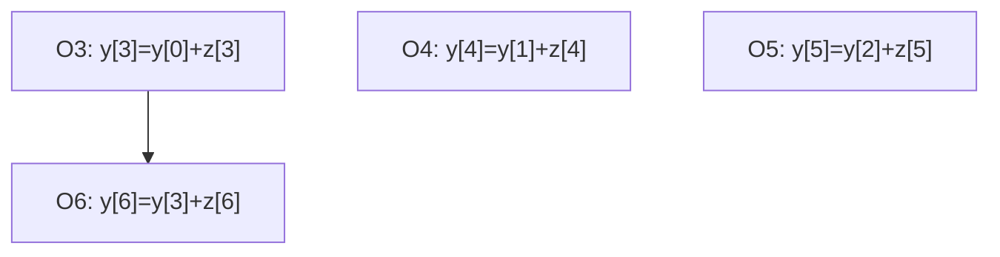
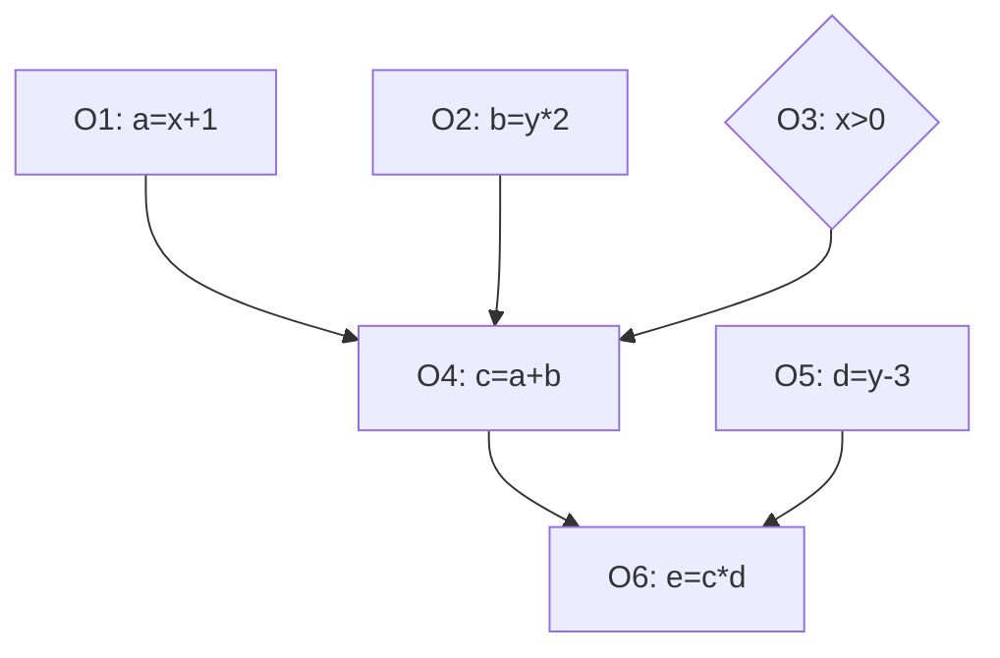
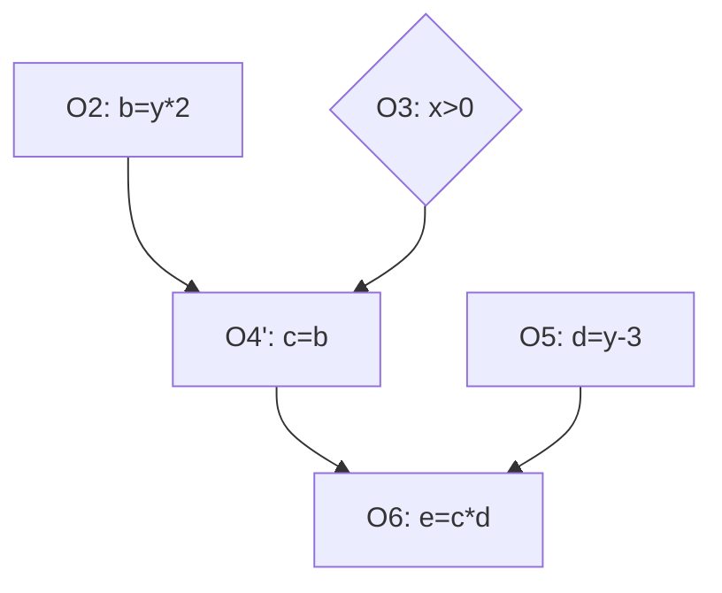
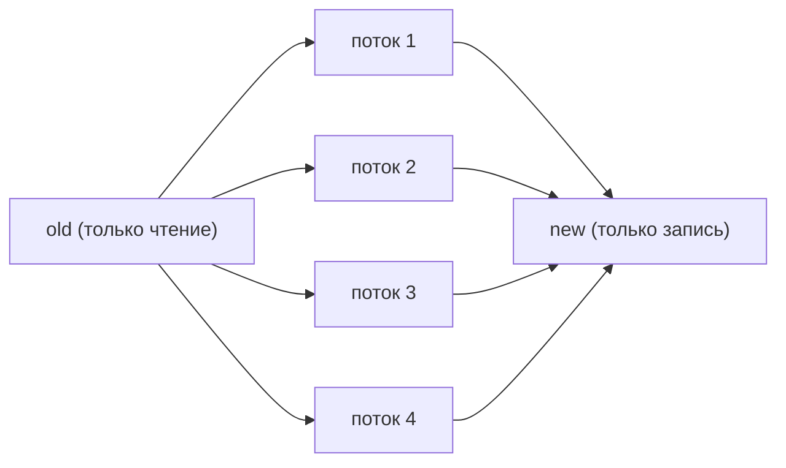
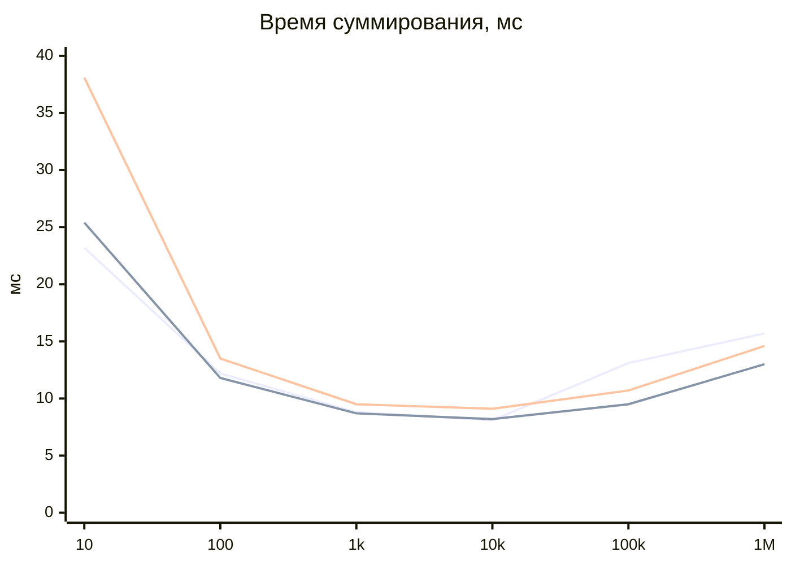

# ПР3. Графы зависимостей, ЯПФ, эквивалентные преобразования

Код: `pr3.py`. Запуск: `python pr3.py`.

## Часть 1

### Задание 1. `y[i] = y[i-3] + z[i]`, i = 3..6

Развёртка:

```
O3: y[3] = y[0] + z[3]
O4: y[4] = y[1] + z[4]
O5: y[5] = y[2] + z[5]
O6: y[6] = y[3] + z[6]
```

Единственная зависимость: O3 → O6 (RAW по `y[3]`).



ЯПФ:

| Ярус | Операции |
|---|---|
| 1 | O3, O4, O5 |
| 2 | O6 |

Высота 2, ширина 3, операций 4, теоретическое ускорение 4/2 = 2.
**Вывод:** цикл можно распараллелить: шаг зависимости 3 > 1, поэтому три итерации независимы.

### Задание 2. `d[i] = a[i] * b[i] + c[i]`, n = 1 000 000, 4 потока

Все итерации независимы, весь цикл образует один ярус. Массив делится на 4 блока, по потоку на блок. Мьютекс не нужен, так как блоки не пересекаются.

| Версия | Время, с |
|---|---|
| Последовательная | 0.080 |
| 4 потока | 0.080 |

Результаты совпадают. Ускорения нет: в CPython из-за GIL потоки не ускоряют вычисления на чистом Python, а тестовая машина имела 1 ядро. Для реального ускорения нужен `multiprocessing` или NumPy.

### Задание 3. Свой алгоритм с `if`

```python
a = x + 1
b = y * 2
if x > 0:
    c = a + b
else:
    c = b
d = y - 3
e = c * d
```

Операции: O1 `a`, O2 `b`, O3 условие, O4 `c`, O5 `d`, O6 `e`.

Граф при `x > 0`:



Граф при `x <= 0` (O1 не нужна):



| Ярус | `x > 0` | `x <= 0` |
|---|---|---|
| 1 | O1, O2, O3, O5 | O2, O3, O5 |
| 2 | O4 | O4' |
| 3 | O6 | O6 |

Высота 3 в обоих случаях, ширина 4 и 3.
**Вывод:** параллелизм есть (ярус 1), но структура графа зависит от данных. Ветка добавляет управляющую зависимость: O4 не может начаться, пока не вычислено условие O3.

## Часть 2

### Задание 1. Сдваивание: `a[i] = a[i-2]*2 + a[i-1]*0.5`

Читаем из `old`, пишем в `new`, цикл делится на 4 блока.



Проверка в коде показала, что результат **не совпадает** с последовательным (`False`). Причина: здесь настоящая зависимость RAW (`a[i]` нужен новый `a[i-1]`), а сдваивание даёт каждому элементу значения предыдущего шага. Метод сохраняет результат только там, где последовательный код не должен читать свежезаписанные значения (как в размытии).

### Задание 2. Красно-чёрное упорядочение, размытие 400×400, 4 потока

Клетка красная при `(i+j) % 2 == 0`, чёрная при `== 1`. Соседи клетки всегда другого цвета, поэтому внутри одного прохода клетки независимы.


Каждый поток берёт свой диапазон строк. Результат совпадает с последовательным красно-чёрным проходом (`True`).

### Задание 3. Размер блока при суммировании 1 000 000 элементов

Блоки раздаются потокам по кругу, каждый поток считает частичную сумму, затем суммы складываются. Результат везде верный.

Время, мс (1 ядро, Python 3.12):

| Размер блока | 2 потока | 4 потока | 8 потоков |
|---|---|---|---|
| 10 | 23.2 | 25.4 | 38.1 |
| 100 | 12.2 | 11.8 | 13.5 |
| 1 000 | 8.8 | 8.7 | 9.5 |
| 10 000 | 8.1 | 8.2 | 9.1 |
| 100 000 | 13.1 | 9.5 | 10.7 |
| 1 000 000 | 15.7 | 13.0 | 14.6 |



Линии сверху вниз на правом краю: 2, 4, 8 потоков (порядок на графике условный, см. таблицу).

**Выводы:**
- Оптимум: блок 1 000–10 000.
- Мелкие блоки (10) дают большие накладные расходы, особенно при 8 потоках.
- Крупные блоки (1M) дают неравномерную нагрузку: всё считает один поток.
- Рост числа потоков не ускоряет: GIL и 1 ядро. Замеры стоит повторить на своей машине.
