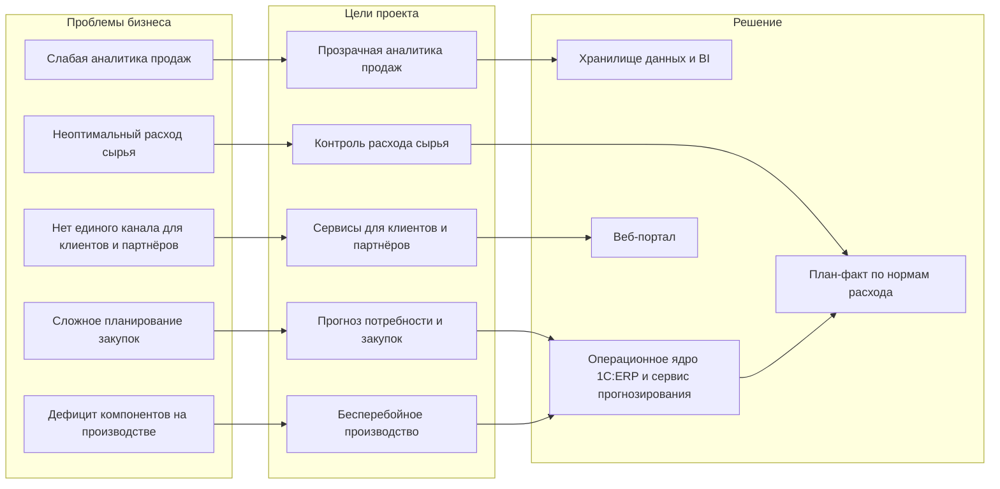
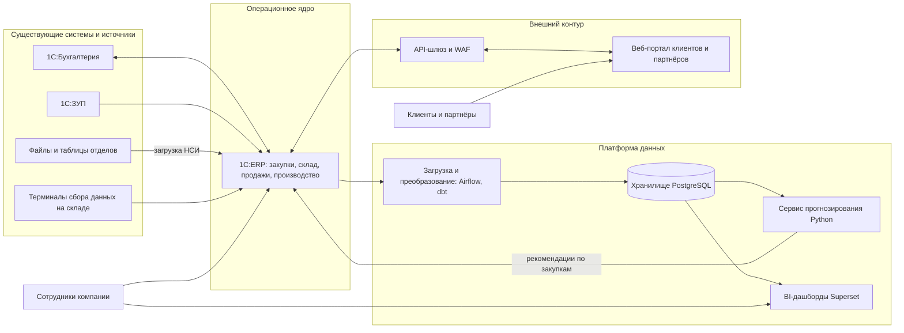
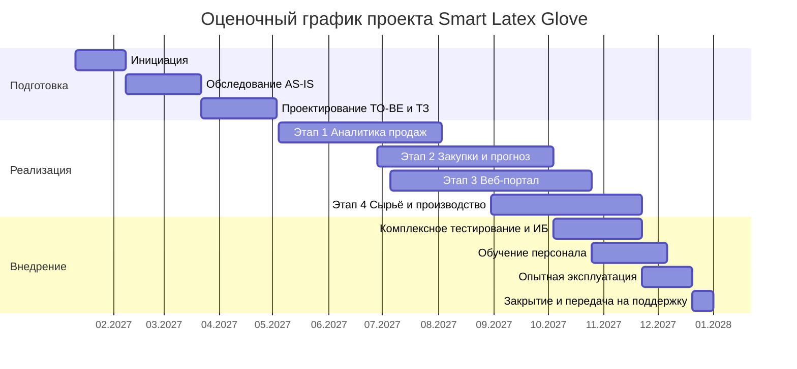

# Практическая работа №2. Предпроектный этап

**Дисциплина:** Управление информационно-технологическими проектами
**Вариант:** 10
**Заказчик:** ООО «Latex Glove»
**Проект:** «Smart Latex Glove»

---

## Часть 1. Структурирование информации по заявке

Заявка заказчика не является ИТ-документом: в ней смешаны история компании, бытовые детали и описание идеи проекта. Перед написанием Концепции информация разобрана на значимую, второстепенную и противоречивую.

### 1.1 Значимые факты

**О компании**
- Производство резиновых перчаток, Краснодарский край, г. Геленджик; компания работает около 30 лет.
- Конкурентное преимущество: запатентованный состав резины «AntiRipTheSkin».
- Численность: около 150 человек (≈100 сотрудников производства и ≈50 сотрудников отделов).
- Руководство: председатель совета директоров, генеральный директор, директора по производству, по маркетингу и продажам, по финансово-хозяйственной деятельности; начальники отделов разработки, логистики и набора кадров.
- Площадки: производственное здание (3000), административное (800), хранилище (1500); в заявке единицы указаны как «м», вероятно, имеются в виду м².

**О текущей ИТ-среде**
- Используются «1С:Бухгалтерия» (финансовый учёт) и «1С:Зарплата и кадры» (персонал и расчёт зарплаты).
- Сведений о системах для продаж, закупок, склада, производства и логистики в заявке нет.

**О бизнес-проблемах**
- Проблемы с аналитикой продаж.
- Сложности с планированием закупок; частый дефицит компонентов, необходимых для бесперебойного производства.

**О целях бизнеса**
- Расширение бизнеса в странах СНГ.
- Повышение эффективности производства и рост прибыли.

**О желаемом проекте**
- Интегрированная информационная система «Smart Latex Glove».
- Цели: оптимизация производства, улучшение управления логистикой, повышение эффективности аналитики продаж, упрощение планирования закупок.
- Модернизируемые процессы: производство (использование сырья), аналитика продаж (автоматизация сбора и обработки данных), планирование закупок (прогнозирование потребности в материалах).
- Затронуто около 150 сотрудников, плюс клиенты и партнёры через веб-портал.
- Требования: совместимость с существующей инфраструктурой, интеграция с имеющимися системами, особое внимание безопасности данных, обучение сотрудников.

### 1.2 Информация, не влияющая на проект

Исключено из дальнейшего анализа: история создания компании (кредит 300 долларов), эпизод с ОПГ «Слейвс», последствия дефолта 1998 года, спортзал и премия «Босс Качалки» (322 доллара). Это справочный контекст, он не формирует требований к системе. Единственная «производная» связь: дефолт и девальвация подтверждают чувствительность бизнеса к закупкам и валютным рискам, поэтому прогнозирование закупок включено в приоритеты.

### 1.3 Неточности и противоречия в заявке

Эти пункты вынесены в вопросы к первой встрече (Часть 3).

1. «12 подразделений» не совпадает с описанной структурой: перечислены 3 директора, 3 начальника отделов и 2 группы сотрудников.
2. Цель «улучшение управления логистикой» заявлена, но в перечне модернизируемых процессов логистика не названа (названы производство, продажи, закупки).
3. «Полная совместимость с существующей инфраструктурой» заявлена, но описаны только две системы 1С; о серверах, сети, версиях и доработках 1С ничего не известно.
4. Проблемы с аналитикой и закупками описаны в прошедшем времени (история 1990-х): неясно, насколько они актуальны сейчас и как проявляются.
5. Цели не измеримы: нет текущих значений и целевых показателей, нет бюджета и сроков.
6. Название «Smart» может подразумевать IoT и датчики на линиях, но в тексте оборудование не упоминается.
7. Расширение в СНГ заявлено как стратегия, но не ясно, что оно означает для системы (страны, языки, валюты, юридические лица, местное законодательство).
8. Единицы площади указаны как «м».

### 1.4 Логика «проблема → цель → решение»

---

## Часть 2. Концепция

### Название проекта

Разработка и внедрение интегрированной информационной системы «Smart Latex Glove» для оптимизации производства, закупок, аналитики продаж и взаимодействия с клиентами ООО «Latex Glove».

### Заказчик проекта

ООО «Latex Glove» (г. Геленджик, Краснодарский край). Представитель заказчика: Иван Темнов, председатель совета директоров.

### Цели проекта

**Главная цель.** К 31.12.2027 ввести в промышленную эксплуатацию интегрированную информационную систему «Smart Latex Glove», которая обеспечивает единый учёт и аналитику по продажам, закупкам, складу и расходу сырья и тем самым повышает эффективность производства. Проект выполняется в утверждённом бюджете (допустимое отклонение не более 10%).

**Частные цели (SMART).** Базовые значения показателей фиксируются на этапе обследования, поэтому часть целей выражена в процентах от базового уровня.

| № | Цель | Измеримый результат | Срок |
|---|------|---------------------|------|
| Ц1 | Аналитика продаж | Ежедневная автоматическая загрузка данных о продажах в хранилище; время подготовки регулярной отчётности по продажам не более 1 рабочего дня; расхождение с данными 1С не более 1% | 03.08.2027 |
| Ц2 | Планирование закупок | Прогноз потребности в материалах и компонентах на горизонт не менее 3 месяцев для позиций группы A (по ABC-анализу) с ошибкой WAPE не более 25% на ретроспективном тесте; через 6 месяцев после запуска число случаев дефицита, приводящих к простою линии, снижено не менее чем на 50% от базового уровня | 04.10.2027 (запуск), 6 месяцев после запуска (эффект) |
| Ц3 | Веб-портал | Портал для клиентов и партнёров в промышленной эксплуатации; через 6 месяцев после запуска не менее 40% заказов регулярных оптовых клиентов оформляется через портал | 25.10.2027 (запуск), 6 месяцев после запуска (эффект) |
| Ц4 | Использование сырья | Ежедневный план-фактный контроль расхода сырья и материалов по нормам; перерасход сырья снижен не менее чем на 5% от базового уровня | 22.11.2027 (запуск), 6 месяцев после запуска (эффект) |
| Ц5 | Интеграция и безопасность | Обмен с «1С:Бухгалтерия» и «1С:ЗУП» без ручной перегрузки; внешний тест на проникновение без уязвимостей критического и высокого уровня; обучено 100% пользователей системы | 22.11.2027 |

### Задачи проекта

**Подготовка**
1. Провести аудит ИТ-инфраструктуры и текущих процессов продаж, закупок, склада, логистики и производства (AS-IS); зафиксировать базовые значения показателей.
2. Спроектировать целевые процессы (TO-BE), архитектуру решения и требования безопасности; подготовить техническое задание.
3. Определить состав и качество нормативно-справочной информации (номенклатура, нормы расхода, спецификации, контрагенты) и план её очистки.

**Реализация**
4. Развернуть операционное ядро (1С:ERP) для закупок, склада, продаж и учёта производства; настроить стандартный обмен с «1С:Бухгалтерия» и «1С:ЗУП».
5. Построить платформу данных: хранилище, загрузка данных из 1С и файлов, витрины и дашборды по продажам.
6. Разработать сервис прогнозирования потребности в материалах и автоматическое формирование рекомендаций по закупкам.
7. Реализовать план-фактный контроль расхода сырья по нормам и отчёты по отклонениям.
8. Разработать веб-портал для клиентов и партнёров и подключить его к системе через защищённый API.
9. Обеспечить информационную безопасность: ролевую модель, шифрование, резервное копирование, соответствие законодательству о персональных данных.

**Внедрение**
10. Провести комплексное тестирование, нагрузочное тестирование и тест на проникновение.
11. Обучить пользователей, подготовить инструкции и провести опытную эксплуатацию.
12. Передать систему в сопровождение, закрыть проект, подготовить предложения по следующему этапу (масштабирование на страны СНГ).

### Результаты проекта

**Выходной продукт** состоит из четырёх взаимосвязанных частей:

1. **Операционное ядро** на базе 1С:ERP: закупки, склад, продажи, учёт производства и норм расхода; обмен с существующими 1С.
2. **Платформа данных и BI:** хранилище, ежедневная загрузка, дашборды по продажам, запасам, закупкам и расходу сырья.
3. **Сервис прогнозирования:** прогноз потребности в материалах и рекомендации по заявкам на закупку.
4. **Веб-портал клиентов и партнёров:** личный кабинет, каталог и остатки, оформление заказов, статусы, документы.

**Характеристики продукта**
- Рабочие места: около 60 пользователей внутри компании (уточняется на обследовании); портал рассчитан на сотни клиентов.
- Доступность в рабочее время не менее 99%; типовые отчёты и дашборды открываются не более чем за 10 секунд.
- Ролевая модель доступа, шифрование каналов (TLS 1.2 и выше), журналирование действий, двухфакторная аутентификация для администраторов и портала.
- Резервное копирование по правилу 3-2-1: потеря данных не более 24 часов (RPO), восстановление не более 8 часов (RTO).
- Архитектура допускает добавление новых организаций, валют и языков для выхода на рынки СНГ (сама локализация в проект не входит).

**Границы проекта**
- Входит: четыре этапа реализации, интеграция с существующими 1С, обучение, опытная эксплуатация, передача в сопровождение.
- Не входит: замена «1С:Бухгалтерия» и «1С:ЗУП», локализация под страны СНГ, подключение производственного оборудования (датчики, SCADA), подготовка помещений и кабельной сети, закупка рабочих станций, эксплуатация после закрытия проекта.

**Как будем работать**
- Подход гибридный: предпроектные и проектные фазы выполняются последовательно, реализация идёт четырьмя этапами с двухнедельными итерациями внутри и приёмкой после каждого этапа.
- Первым запускается этап с быстрым эффектом (аналитика продаж), затем закупки и прогноз, портал и контроль сырья.
- Управление: еженедельные статус-встречи с заказчиком, ежемесячный комитет по проекту, реестр рисков и изменений, фиксация базового плана после утверждения ТЗ.
- Выходные документы: отчёт об обследовании, ТЗ и архитектура, программная и эксплуатационная документация, протоколы испытаний, инструкции пользователей, акт приёмки.

### Предлагаемые технологии

Приоритет отдан отечественному и открытому ПО, совместимому с существующими 1С. Выбор ядра (1С:ERP или 1С:Комплексная автоматизация 2) подтверждается по итогам обследования; для оценки принята 1С:ERP.

| Слой | Решение | Обоснование |
|------|---------|-------------|
| Операционное ядро | 1С:ERP Управление предприятием 2 (альтернатива: 1С:Комплексная автоматизация 2) | Закупки, склад, продажи, производство и планирование в одной системе; стандартный обмен с «1С:Бухгалтерия» и «1С:ЗУП»; включена в реестр российского ПО |
| Интеграция | Стандартные обмены 1С, HTTP-сервисы и OData, API-шлюз | Не требует переписывания существующих систем |
| Хранилище данных | PostgreSQL | Надёжное открытое ПО, нет лицензионных затрат |
| Загрузка и преобразование данных | Apache Airflow, dbt | Оркестрация ежедневных загрузок, версионируемые преобразования |
| BI | Apache Superset (альтернативы: Yandex DataLens, Visiology) | Дашборды для руководителей без лицензионных затрат |
| Прогнозирование | Python (pandas, statsmodels, scikit-learn, LightGBM), MLflow | Гибкий выбор моделей под спрос и расход сырья; отслеживание экспериментов |
| Веб-портал | Backend: Python (Django REST Framework или FastAPI); frontend: React; PostgreSQL | Быстрая разработка, зрелая экосистема, простая интеграция с хранилищем |
| Инфраструктура | Astra Linux или РЕД ОС, Docker, GitLab CI/CD, Prometheus и Grafana | Российские ОС, автоматизация сборки и мониторинг |
| Безопасность | TLS, RBAC, двухфакторная аутентификация, WAF, межсетевой экран, EDR на серверах | Требование заказчика и 152-ФЗ |
| Управление проектом | Jira и Confluence (или Yandex Tracker) | Задачи, спринты, документация |

**Архитектура решения**

### Оценочный график проекта

**Сроки в целом:** с 11.01.2027 по 31.12.2027 (около 51 недели). Старт предполагается после согласования Концепции и подписания договора; гарантийная поддержка (3 месяца) в график не входит.

| Фаза | Начало | Длительность | Окончание |
|------|--------|--------------|-----------|
| Инициация | 11.01.2027 | 4 нед. | 05.02.2027 |
| Обследование (AS-IS) | 08.02.2027 | 6 нед. | 19.03.2027 |
| Проектирование (TO-BE, ТЗ) | 22.03.2027 | 6 нед. | 30.04.2027 |
| Этап 1. Аналитика продаж | 04.05.2027 | 13 нед. | 03.08.2027 |
| Этап 2. Планирование закупок и прогноз | 28.06.2027 | 14 нед. | 04.10.2027 |
| Этап 3. Веб-портал | 05.07.2027 | 16 нед. | 25.10.2027 |
| Этап 4. Использование сырья и производство | 30.08.2027 | 12 нед. | 22.11.2027 |
| Комплексное тестирование и ИБ | 04.10.2027 | 7 нед. | 22.11.2027 |
| Обучение персонала | 25.10.2027 | 6 нед. | 06.12.2027 |
| Опытная эксплуатация | 22.11.2027 | 4 нед. | 20.12.2027 |
| Закрытие и передача на поддержку | 20.12.2027 | 12 дн. | 31.12.2027 |

**Основные вехи**

| № | Дата | Веха |
|---|------|------|
| М1 | 05.02.2027 | Устав проекта и план утверждены |
| М2 | 19.03.2027 | Отчёт об обследовании принят заказчиком |
| М3 | 30.04.2027 | ТЗ и архитектура утверждены, зафиксирован базовый план |
| М4 | 03.08.2027 | Этап 1: аналитика продаж введена в промышленную эксплуатацию |
| М5 | 04.10.2027 | Этап 2: закупки и прогноз готовы к комплексному тестированию |
| М6 | 25.10.2027 | Этап 3: веб-портал готов к комплексному тестированию |
| М7 | 22.11.2027 | Этап 4 завершён, комплексное тестирование и тест на проникновение пройдены |
| М8 | 20.12.2027 | Опытная эксплуатация завершена |
| М9 | 31.12.2027 | Акт приёмки подписан, проект закрыт |

### Оценочные ресурсы проекта

Все суммы указаны в рублях без НДС и являются предварительной оценкой уровня Концепции. Ставки приняты как ориентир рыночных ставок и уточняются при формировании коммерческого предложения.

#### Трудозатраты

Общая трудоёмкость: **10 380 чел.-ч** (в среднем около 5 штатных единиц на протяжении проекта), стоимость: **26 374 000 руб.**

*По этапам*

| Этап | Трудозатраты, чел.-ч | Стоимость, руб. |
|------|---------------------:|----------------:|
| Инициация | 160 | 460 000 |
| Обследование (AS-IS) | 670 | 1 812 000 |
| Проектирование (TO-BE, ТЗ) | 1 110 | 2 968 000 |
| Этап 1. Аналитика продаж | 1 520 | 3 876 000 |
| Этап 2. Планирование закупок и прогноз | 1 800 | 4 684 000 |
| Этап 3. Веб-портал | 2 060 | 4 994 000 |
| Этап 4. Использование сырья и производство | 1 330 | 3 392 000 |
| Комплексное тестирование и ИБ | 760 | 1 823 000 |
| Обучение персонала | 440 | 1 024 000 |
| Опытная эксплуатация | 420 | 1 064 000 |
| Закрытие и передача на поддержку | 110 | 277 000 |
| **Итого** | **10 380** | **26 374 000** |

*По ролям*

| Роль | Трудозатраты, чел.-ч | Ставка, руб./ч | Стоимость, руб. |
|------|---------------------:|---------------:|----------------:|
| Руководитель проекта | 840 | 3 000 | 2 520 000 |
| Бизнес-аналитик | 1 000 | 2 500 | 2 500 000 |
| Системный аналитик | 820 | 2 500 | 2 050 000 |
| Архитектор решения | 300 | 3 500 | 1 050 000 |
| Консультант 1С | 1 360 | 2 600 | 3 536 000 |
| Разработчик 1С | 1 120 | 2 500 | 2 800 000 |
| Инженер данных (DWH/ETL/BI) | 960 | 2 800 | 2 688 000 |
| Аналитик данных / ML-инженер | 560 | 3 000 | 1 680 000 |
| Backend-разработчик | 620 | 2 500 | 1 550 000 |
| Frontend-разработчик / UX | 720 | 2 300 | 1 656 000 |
| Тестировщик (QA) | 980 | 1 800 | 1 764 000 |
| DevOps / специалист по ИБ | 600 | 2 800 | 1 680 000 |
| Технический писатель / тренер | 500 | 1 800 | 900 000 |
| **Итого** | **10 380** | | **26 374 000** |

#### Программное обеспечение

| Позиция | Кол-во | Цена, руб. | Сумма, руб. |
|---------|-------:|-----------:|------------:|
| 1С:ERP Управление предприятием 2, основная поставка | 1 | 700 000 | 700 000 |
| 1С:Предприятие 8, клиентская лицензия ПРОФ на 50 р.м. | 1 | 300 000 | 300 000 |
| 1С:Предприятие 8, клиентская лицензия ПРОФ на 10 р.м. | 1 | 70 000 | 70 000 |
| 1С:Предприятие 8, лицензия сервера (x86-64) | 1 | 250 000 | 250 000 |
| Подписка 1С:ИТС на 12 месяцев | 1 | 150 000 | 150 000 |
| Серверная ОС (Astra Linux или РЕД ОС), лицензии на 2 сервера | 2 | 50 000 | 100 000 |
| Средства защиты серверов (EDR, антивирус) | 1 | 150 000 | 150 000 |
| Открытое ПО (PostgreSQL, Airflow, dbt, Superset, Python, React, GitLab, Grafana) | 1 | 0 | 0 |
| **Итого ПО** | | | **1 720 000** |

Цены на лицензии 1С ориентировочные: по открытым источникам, основная поставка 1С:ERP стоит порядка 660 тыс. руб., клиентские лицензии на 50 рабочих мест — от 270 до 550 тыс. руб. (ПРОФ или КОРП); в 2026 году у 1С запланированы повышения цен. Состав и количество лицензий уточняются на обследовании вместе с партнёром 1С.

#### Оборудование

| Позиция | Кол-во | Цена, руб. | Сумма, руб. |
|---------|-------:|-----------:|------------:|
| Сервер 1С и СУБД (2U, 2 процессора, 256 ГБ ОЗУ, NVMe) | 1 | 1 500 000 | 1 500 000 |
| Сервер хранилища данных, BI и тестового контура | 1 | 1 500 000 | 1 500 000 |
| Система резервного копирования (NAS/СХД) | 1 | 600 000 | 600 000 |
| Межсетевой экран нового поколения на периметре | 1 | 700 000 | 700 000 |
| ИБП и коммутация серверной | 1 | 300 000 | 300 000 |
| Терминалы сбора данных для склада и производства | 6 | 90 000 | 540 000 |
| Принтеры этикеток | 2 | 60 000 | 120 000 |
| **Итого оборудование** | | | **5 260 000** |

Для оценки принято размещение 1С и хранилища данных на собственных серверах заказчика; вариант аренды мощностей в российском облаке рассматривается на встрече.

#### Дополнительные ресурсы

| Позиция | Сумма, руб. |
|---------|------------:|
| Российское облако (портал, стенды, внешние резервные копии), 12 мес. × 80 000 | 960 000 |
| Тест на проникновение (внешний периметр и портал) | 400 000 |
| Юридическое сопровождение (персональные данные, договоры с контрагентами портала) | 250 000 |
| Выезды команды в Геленджик (ориентир: 8 командировок) | 480 000 |
| Домен, сертификаты, сервисы рассылок, прочее | 100 000 |
| **Итого дополнительные ресурсы** | **2 190 000** |

### Оценочная стоимость проекта

| Статья | Сумма, руб. |
|--------|------------:|
| Трудозатраты | 26 374 000 |
| Программное обеспечение | 1 720 000 |
| Оборудование | 5 260 000 |
| Дополнительные ресурсы | 2 190 000 |
| **Итого без резерва** | **35 544 000** |
| Резерв на риски (15%) | 5 331 600 |
| **Всего без НДС** | **40 875 600** |
| НДС 22% | 8 992 632 |
| **Всего с НДС** | **49 868 232** |

- Точность оценки соответствует предпроектной стадии: от −25% до +50% (вилка 30 656 700 – 61 313 400 руб. без НДС). Оценка уточняется после обследования и утверждения ТЗ.
- В оценку **не входят:** эксплуатация после закрытия проекта (поддержка, ИТС, облако; ориентир 15–20% стоимости проекта в год), время сотрудников заказчика (оценочно 0,5–1 штатная единица на протяжении проекта), рабочие станции пользователей, локализация под страны СНГ.

### Риски проекта

В соответствии с шаблоном ниже разделены факты (проблемы), допущения и риски (возможные события).

#### Проблемы (факты, подтверждённые заявкой)

| № | Проблема |
|---|----------|
| П1 | В компании заявлены проблемы с аналитикой продаж и планированием закупок, дефицит компонентов |
| П2 | Из ИТ-систем названы только «1С:Бухгалтерия» и «1С:Зарплата и кадры»; систем для продаж, склада и производства в заявке нет |
| П3 | У заказчика не указаны бюджет, сроки и измеримые целевые показатели |
| П4 | Заказчик не является ИТ-специалистом, требования сформулированы в общем виде |

#### Допущения (не проверяемые до старта)

| № | Допущение | Как проверим |
|---|-----------|--------------|
| Д1 | Данные о продажах, закупках и остатках существуют в электронном виде (1С или файлы) и доступны для выгрузки | Обследование, выгрузка пробных данных |
| Д2 | Существуют нормы расхода сырья и спецификации (BOM) хотя бы по основной номенклатуре | Интервью с производством |
| Д3 | Для работы в системе потребуется около 60 рабочих мест | Обследование структуры пользователей |
| Д4 | Существующие 1С типовые или с небольшими доработками | Технический аудит баз |
| Д5 | Производство расположено на одной площадке в Геленджике | Встреча, обследование |
| Д6 | В компании есть системный администратор или внешний ИТ-партнёр для обслуживания инфраструктуры | Встреча |
| Д7 | Договор подписан и проект стартует 11.01.2027 | Согласование с заказчиком |
| Д8 | История продаж за 2–3 года достаточна для построения прогноза | Анализ данных на обследовании |

#### Риски (возможные события)

Вероятность (В) и влияние (Вл): Н — низкое, С — среднее, Вы — высокое.

| № | Риск | В | Вл | Предварительные меры |
|---|------|---|----|----------------------|
| Р1 | Низкое качество или отсутствие нормативно-справочной информации (номенклатура, нормы расхода) срывает прогноз и контроль сырья | Вы | Вы | Раннее профилирование данных на обследовании; план очистки НСИ; ответственный за НСИ со стороны заказчика |
| Р2 | Сопротивление сотрудников новым процессам (около 100 производственных сотрудников и 50 сотрудников отделов) | С | Вы | Вовлечение ключевых пользователей, обучение по ролям, спонсорство руководства, опытная эксплуатация |
| Р3 | Расширение объёма работ (СНГ, IoT, логистика) без пересмотра бюджета и сроков | Вы | Вы | Фиксация границ в ТЗ, процедура управления изменениями, поэтапный запуск |
| Р4 | Недостаточная история или низкое качество данных продаж ухудшает точность прогноза | С | С | Ретро-тест моделей до разработки, простые базовые модели как запасной вариант, ручная корректировка |
| Р5 | Недоступность ключевых сотрудников заказчика для интервью и приёмки | С | Вы | Назначить владельцев процессов в Уставе, график встреч, эскалация на спонсора |
| Р6 | Рост цен на лицензии и оборудование выше заложенных | Вы | С | Резерв 15%, раннее согласование и закупка, пересмотр состава лицензий |
| Р7 | Нарушение требований безопасности и законодательства о персональных данных при открытии портала | Н | Вы | Требования ИБ в ТЗ, тест на проникновение, юридическая экспертиза, WAF, двухфакторная аутентификация |
| Р8 | Нестандартные доработки существующих 1С усложняют обмен и обновления | С | С | Технический аудит баз на обследовании, при необходимости рефакторинг обменов |
| Р9 | Срыв сроков поставки оборудования и лицензий | С | С | Заказ на фазе проектирования, учёт сроков в графике |
| Р10 | Совпадение этапов внедрения с производственными пиками и новогодними праздниками | С | С | Согласование графика с производством, запас по времени на опытную эксплуатацию |

**Дата составления:** 30.10.2026
**Руководитель проекта:** [ФИО]

---

## Часть 3. План встречи

### Повестка первой встречи с заказчиком

Продолжительность: 90 минут. Участники от заказчика: председатель совета директоров, генеральный директор, директора по производству, по маркетингу и продажам, по финансово-хозяйственной деятельности, представитель ИТ.

| № | Вопрос повестки | Время |
|---|-----------------|-------|
| 1 | Знакомство, цели и регламент встречи | 5 мин |
| 2 | Презентация понимания задачи и предварительной Концепции (цели, решение, этапы, ориентировочные сроки и стоимость) | 20 мин |
| 3 | Обсуждение целей, приоритетов и показателей успеха | 15 мин |
| 4 | Границы проекта: что входит и не входит (логистика, СНГ, оборудование) | 10 мин |
| 5 | Бюджет, сроки, ресурсы заказчика, порядок взаимодействия | 10 мин |
| 6 | Ответы на уточняющие вопросы по текущим процессам, данным и ИТ | 20 мин |
| 7 | Риски, следующие шаги (доступ к данным, обследование), договорённости по срокам | 10 мин |

### Список вопросов к первой встрече

Вопросы сгруппированы по темам; отмеченные «(!)» критичны для фазы инициации.

**A. Цели и ожидания**
1. (!) Какая проблема сейчас самая болезненная для бизнеса и в каком порядке вы хотели бы получать результаты (аналитика, закупки, портал, сырьё)?
2. (!) Какие измеримые результаты вы ожидаете и какие сейчас значения (число простоев из-за дефицита, оборачиваемость запасов, время подготовки отчётов, перерасход сырья)?
3. (!) Кто спонсор проекта и кто принимает решения и подписывает приёмку? Кто владеет процессами продаж, закупок, склада и производства?
4. (!) Есть ли бюджетные рамки и жёсткие сроки (например, связанные с выходом в СНГ)?

**B. Организация и процессы**
5. Как устроена организационная структура: перечень «12 подразделений» и их численность?
6. (!) Как сейчас организованы продажи, закупки, склад и учёт производства: в каких системах, таблицах или на бумаге, кто ведёт?
7. (!) Что входит в «улучшение управления логистикой»: склад (1500), собственный транспорт, перевозчики? Входит ли это в первую очередь проекта?
8. Сколько производственных линий и смен, какой ассортимент (число типов перчаток), как учитывается брак и расход сырья?
9. (!) Что подразумевается под словом «Smart»: нужно ли подключение оборудования, датчиков, терминалов склада?

**C. Данные**
10. (!) Сколько позиций номенклатуры, поставщиков, клиентов и заказов в месяц? Какова глубина и качество истории продаж и закупок?
11. (!) Существуют ли спецификации и нормы расхода сырья на единицу продукции, кто за них отвечает?
12. Есть ли выраженная сезонность, акции, крупные контракты и внешние факторы (цены на сырьё, курс валют), влияющие на спрос и закупки?

**D. ИТ-инфраструктура**
13. (!) Какие редакции и версии «1С:Бухгалтерия» и «1С:ЗУП» используются, типовые они или доработанные, кто их сопровождает?
14. (!) Какая ИТ-инфраструктура есть: серверная, сеть, виртуализация, резервное копирование, каналы связи, число ИТ-специалистов?
15. Допустимо ли размещение части сервисов (портал, тестовые стенды) в российском облаке или требуется только собственная инфраструктура?
16. Сколько сотрудников будут работать в системе, где расположены их рабочие места (офис, склад, цех), есть ли там компьютеры и интернет?

**E. Веб-портал и клиенты**
17. (!) Кто целевые пользователи портала (оптовые клиенты, дилеры, поставщики), сколько их, через какие каналы вы продаёте сейчас?
18. Какие функции портала важны в первую очередь: заказы, остатки, статусы, документы, оплата, обмен ЭДО? Есть ли действующий сайт?

**F. Расширение в СНГ**
19. (!) Какие страны и в какие сроки? Будут ли местные юридические лица и склады, нужны ли в этом проекте мультиязычность, мультивалютность, местные требования к документам и данным?

**G. Безопасность и ограничения**
20. (!) Какие требования к безопасности и защите данных, есть ли внутренние политики, какие данные считаются критичными (коммерческая тайна, персональные данные сотрудников и клиентов)?
21. Есть ли требования или предпочтения по технологиям: использование отечественного ПО, запреты на облака, открытое ПО?

**H. Организация проекта**
22. (!) Кого вы можете выделить в проектную команду (владельцы процессов, ключевые пользователи, ИТ) и какую долю времени они смогут уделять проекту?
23. Возможны ли выезды команды исполнителя в Геленджик и удалённый доступ к системам?
24. Есть ли ограничения по остановке производства и графику смен для обучения и запуска? Есть ли периоды пиковой нагрузки?
25. Какой опыт у компании в ИТ-проектах, рассматривали ли вы готовые решения или других подрядчиков?
26. Каковы ожидания по сопровождению после запуска: кто и как будет поддерживать систему?
27. По каким критериям вы будете принимать результаты каждого этапа?

**Дата составления:** 30.10.2026
**Руководитель проекта:** [ФИО]
