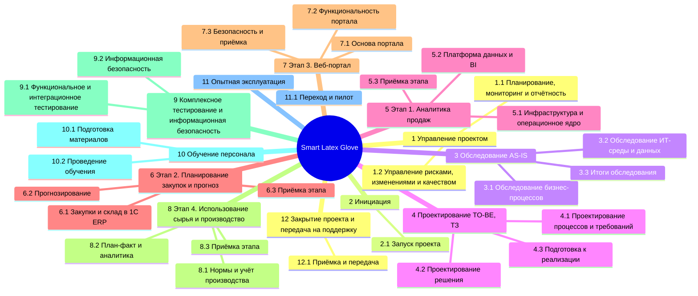
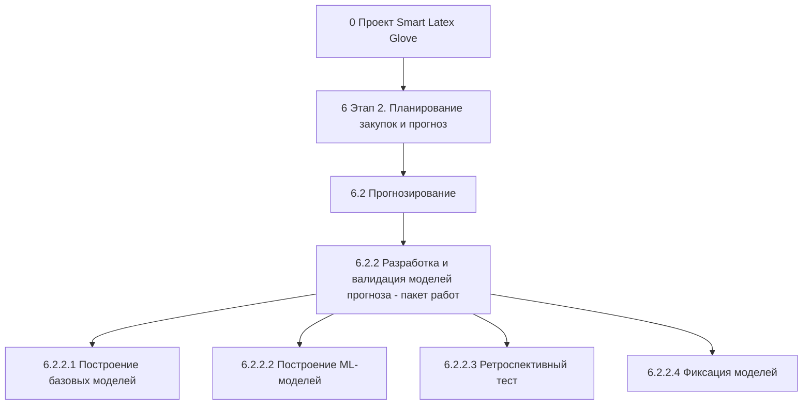

# Практическая работа №3. Определение содержания проекта

**Дисциплина:** Управление информационно-технологическими проектами
**Вариант:** 10
**Заказчик:** ООО «Latex Glove»
**Проект:** «Smart Latex Glove»

---

## Часть 1. Исходные данные и принципы построения ИСР

### 1.1 Исходные данные из Концепции (ПР2)

Иерархическая структура работ (ИСР) построена на основе утверждённой на предпроектном этапе Концепции.

- **Название проекта:** разработка и внедрение интегрированной информационной системы «Smart Latex Glove» для оптимизации производства, закупок, аналитики продаж и взаимодействия с клиентами.
- **Заказчик:** ООО «Latex Glove» (г. Геленджик).
- **Срок:** 11.01.2027 – 31.12.2027.
- **Выходной продукт:** операционное ядро на базе 1С:ERP, платформа данных и BI, сервис прогнозирования потребности, веб-портал для клиентов и партнёров.
- **Общая трудоёмкость по Концепции:** 10 380 чел.-ч.

**Границы проекта (из Концепции)**
- Входит: четыре этапа реализации, интеграция с существующими 1С, обучение, опытная эксплуатация, передача в сопровождение.
- Не входит: замена «1С:Бухгалтерия» и «1С:ЗУП», локализация под страны СНГ, подключение производственного оборудования (датчики, SCADA), подготовка помещений и кабельной сети, закупка рабочих станций, эксплуатация после закрытия проекта.

### 1.2 Уровни декомпозиции и кодирование

ИСР содержит четыре уровня под корнем (нулевой уровень — проект целиком). Код элемента отражает его место в иерархии.

| Уровень | Элемент | Пример кода | Что фиксируется |
|---------|---------|-------------|-----------------|
| 0 | Проект | — | «Smart Latex Glove» |
| 1 | Задача (этап проекта) | 6 | Крупный этап с конечным результатом |
| 2 | Подзадача | 6.2 | Логический блок работ внутри этапа |
| 3 | Пакет работ | 6.2.2 | Нижний уровень управления: назначается ответственный, оцениваются трудозатраты, срок и результат, ведётся контроль |
| 4 | Операция | 6.2.2.3 | Единица максимальной детализации, в результате которой создаётся конкретный результат |

### 1.3 Принципы декомпозиции

1. **Правило 100%.** ИСР включает всю работу, входящую в границы проекта, и не содержит работ, которые исключены из границ.
2. **Ориентация на результат.** Каждый пакет работ завершается проверяемым результатом (документ, настроенный модуль, акт приёмки).
3. **Согласованность с Концепцией.** Этапы ИСР совпадают с фазами графика Концепции; сумма трудозатрат пакетов работ равна оценке трудозатрат Концепции (см. часть 4).
4. **Управление выделено отдельно.** Сквозные работы руководителя проекта вынесены в задачу 1, поэтому в остальных задачах указаны трудозатраты без управления.
5. **Единая схема приёмки.** Каждый этап реализации заканчивается пакетом «Тестирование и ввод в эксплуатацию» с критериями из Концепции.

---

## Часть 2. Иерархическая структура работ

**Название проекта:** «Smart Latex Glove» — интегрированная информационная система производства, закупок, аналитики продаж и клиентского портала.
**Заказчик проекта:** ООО «Latex Glove».

### 2.1 Структура задач и подзадач

### 2.2 Перечень задач и подзадач

| Код | Задача (этап) | Подзадача | Пакетов работ | Трудозатраты, чел.-ч |
|-----|---------------|-----------|--------------:|---------------------:|
| **1** | **Управление проектом** | | **4** | **840** |
| 1.1 | | Планирование, мониторинг и отчётность | 2 | 480 |
| 1.2 | | Управление рисками, изменениями и качеством | 2 | 360 |
| **2** | **Инициация** | | **2** | **80** |
| 2.1 | | Запуск проекта | 2 | 80 |
| **3** | **Обследование (AS-IS)** | | **5** | **580** |
| 3.1 | | Обследование бизнес-процессов | 2 | 320 |
| 3.2 | | Обследование ИТ-среды и данных | 2 | 220 |
| 3.3 | | Итоги обследования | 1 | 40 |
| **4** | **Проектирование (TO-BE, ТЗ)** | | **7** | **1 020** |
| 4.1 | | Проектирование процессов и требований | 2 | 460 |
| 4.2 | | Проектирование решения | 3 | 420 |
| 4.3 | | Подготовка к реализации | 2 | 140 |
| **5** | **Этап 1. Аналитика продаж** | | **5** | **1 420** |
| 5.1 | | Инфраструктура и операционное ядро | 2 | 580 |
| 5.2 | | Платформа данных и BI | 2 | 680 |
| 5.3 | | Приёмка этапа | 1 | 160 |
| **6** | **Этап 2. Планирование закупок и прогноз** | | **6** | **1 700** |
| 6.1 | | Закупки и склад в 1С:ERP | 2 | 780 |
| 6.2 | | Прогнозирование | 3 | 760 |
| 6.3 | | Приёмка этапа | 1 | 160 |
| **7** | **Этап 3. Веб-портал** | | **7** | **1 960** |
| 7.1 | | Основа портала | 2 | 420 |
| 7.2 | | Функциональность портала | 4 | 1 240 |
| 7.3 | | Безопасность и приёмка | 1 | 300 |
| **8** | **Этап 4. Использование сырья и производство** | | **5** | **1 240** |
| 8.1 | | Нормы и учёт производства | 2 | 620 |
| 8.2 | | План-факт и аналитика | 2 | 460 |
| 8.3 | | Приёмка этапа | 1 | 160 |
| **9** | **Комплексное тестирование и информационная безопасность** | | **4** | **690** |
| 9.1 | | Функциональное и интеграционное тестирование | 2 | 370 |
| 9.2 | | Информационная безопасность | 2 | 320 |
| **10** | **Обучение персонала** | | **3** | **400** |
| 10.1 | | Подготовка материалов | 1 | 140 |
| 10.2 | | Проведение обучения | 2 | 260 |
| **11** | **Опытная эксплуатация** | | **3** | **380** |
| 11.1 | | Переход и пилот | 3 | 380 |
| **12** | **Закрытие проекта и передача на поддержку** | | **2** | **70** |
| 12.1 | | Приёмка и передача | 2 | 70 |
| | **Итого** | **27 подзадач** | **53** | **10 380** |

### 2.3 Пример декомпозиции до операций

Ниже показана ветвь ИСР от проекта до операций на примере пакета работ 6.2.2.

---

## Часть 3. Описание пакетов работ и список операций

Для каждого пакета работ приведены описание, результат, ответственный и трудозатраты; ниже — таблица операций с кодами и описанием работ (шаблон Приложения А).

### 1. Управление проектом

**Срок:** 11.01.2027 – 31.12.2027  
**Трудозатраты по ИСР:** 840 чел.-ч

#### 1.1 Планирование, мониторинг и отчётность

##### 1.1.1 Пакет работ «Планирование проекта»

- **Описание:** Разработка и поддержка планов проекта и настройка инструментов управления.
- **Результат:** Утверждённый план управления проектом и зафиксированный базовый план (объём, сроки, бюджет).
- **Ответственный:** Руководитель проекта
- **Трудозатраты:** 140 чел.-ч

| Код операции | Операция | Описание работы |
|--------------|----------|-----------------|
| 1.1.1.1 | Разработка плана управления проектом | Описание подходов к управлению сроками, стоимостью, качеством, рисками, коммуникациями и изменениями. |
| 1.1.1.2 | Настройка инструментов управления | Создание рабочего пространства в Jira и Confluence (или Yandex Tracker): доски, роли, шаблоны документов. |
| 1.1.1.3 | Фиксация базового плана | После утверждения ТЗ — формирование и согласование с заказчиком базового плана по объёму, графику и бюджету. |

##### 1.1.2 Пакет работ «Мониторинг, коммуникации и отчётность»

- **Описание:** Контроль хода работ и взаимодействие с заинтересованными сторонами на протяжении всего проекта.
- **Результат:** Еженедельные статус-отчёты, ежемесячные отчёты для комитета, протоколы встреч.
- **Ответственный:** Руководитель проекта
- **Трудозатраты:** 340 чел.-ч

| Код операции | Операция | Описание работы |
|--------------|----------|-----------------|
| 1.1.2.1 | Еженедельные статус-встречи | Проведение встреч с заказчиком, фиксация решений и поручений в протоколе. |
| 1.1.2.2 | Ежемесячный комитет по проекту | Подготовка и проведение комитета: статус, риски, изменения, решения спонсора. |
| 1.1.2.3 | Контроль сроков и стоимости | Сравнение плановых и фактических трудозатрат, прогноз завершения, корректирующие действия. |
| 1.1.2.4 | Управление коммуникациями | Ведение реестра заинтересованных сторон и плана коммуникаций, информирование сотрудников о ходе проекта. |

#### 1.2 Управление рисками, изменениями и качеством

##### 1.2.1 Пакет работ «Управление рисками»

- **Описание:** Выявление, оценка и мониторинг рисков проекта.
- **Результат:** Актуальный реестр рисков с планами реагирования.
- **Ответственный:** Руководитель проекта
- **Трудозатраты:** 120 чел.-ч

| Код операции | Операция | Описание работы |
|--------------|----------|-----------------|
| 1.2.1.1 | Ведение реестра рисков | Внесение новых рисков, оценка вероятности и влияния, назначение владельцев. |
| 1.2.1.2 | Ежемесячный пересмотр рисков | Анализ изменения рисков, исключение закрытых, обсуждение на комитете. |
| 1.2.1.3 | Реализация мер реагирования | Контроль выполнения мер по снижению рисков и запуск резервных планов. |

##### 1.2.2 Пакет работ «Управление изменениями и качеством»

- **Описание:** Контроль соблюдения границ проекта и качества результатов.
- **Результат:** Журнал изменений и результаты контроля качества по всем этапам.
- **Ответственный:** Руководитель проекта
- **Трудозатраты:** 240 чел.-ч

| Код операции | Операция | Описание работы |
|--------------|----------|-----------------|
| 1.2.2.1 | Приём и оценка запросов на изменение | Регистрация запросов, оценка влияния на объём, сроки и бюджет. |
| 1.2.2.2 | Согласование изменений | Рассмотрение изменений на комитете, обновление базового плана. |
| 1.2.2.3 | Контроль качества результатов | Ревью документов и результатов этапов по чек-листам, проверка критериев приёмки. |

### 2. Инициация

**Срок:** 11.01.2027 – 05.02.2027  
**Трудозатраты по ИСР:** 80 чел.-ч

#### 2.1 Запуск проекта

##### 2.1.1 Пакет работ «Устав проекта»

- **Описание:** Формализация целей, границ и критериев успеха проекта.
- **Результат:** Утверждённый Устав проекта.
- **Ответственный:** Бизнес-аналитик
- **Трудозатраты:** 50 чел.-ч

| Код операции | Операция | Описание работы |
|--------------|----------|-----------------|
| 2.1.1.1 | Сбор целей и ограничений заказчика | Интервью с руководством заказчика, уточнение приоритетов, бюджета и сроков. |
| 2.1.1.2 | Разработка Устава | Описание целей, границ, критериев успеха, ключевых рисков, реестра заинтересованных сторон. |
| 2.1.1.3 | Согласование и утверждение Устава | Рассмотрение документа заказчиком и подписание. |

##### 2.1.2 Пакет работ «Формирование команды и запуск»

- **Описание:** Организация проектной команды и стартовая встреча.
- **Результат:** Сформированная команда, матрица ответственности, проведена стартовая встреча.
- **Ответственный:** Руководитель проекта
- **Трудозатраты:** 30 чел.-ч

| Код операции | Операция | Описание работы |
|--------------|----------|-----------------|
| 2.1.2.1 | Определение ролей и матрицы ответственности | Распределение ролей исполнителя и заказчика (RACI). |
| 2.1.2.2 | Назначение представителей заказчика | Определение владельцев процессов и ключевых пользователей. |
| 2.1.2.3 | Стартовая встреча | Презентация проекта, плана, правил взаимодействия, режима работы и каналов связи. |

### 3. Обследование (AS-IS)

**Срок:** 08.02.2027 – 19.03.2027  
**Трудозатраты по ИСР:** 580 чел.-ч

#### 3.1 Обследование бизнес-процессов

##### 3.1.1 Пакет работ «Обследование продаж и закупок»

- **Описание:** Изучение текущих процессов продаж и закупок, отчётности и источников данных.
- **Результат:** Описание процессов AS-IS, перечень проблем и источников данных.
- **Ответственный:** Бизнес-аналитик
- **Трудозатраты:** 150 чел.-ч

| Код операции | Операция | Описание работы |
|--------------|----------|-----------------|
| 3.1.1.1 | Интервью с директором по маркетингу и продажам и отделом закупок | Выяснение этапов процессов, ролей, используемых систем и таблиц. |
| 3.1.1.2 | Описание процессов AS-IS | Моделирование процессов в нотации BPMN. |
| 3.1.1.3 | Анализ отчётности и источников данных | Изучение существующих отчётов, форм и файлов, оценка трудоёмкости их подготовки. |
| 3.1.1.4 | Фиксация проблем и узких мест | Составление перечня проблем с оценкой влияния на бизнес. |

##### 3.1.2 Пакет работ «Обследование склада, логистики и производства»

- **Описание:** Изучение складских, логистических и производственных процессов, учёта расхода сырья.
- **Результат:** Описание процессов AS-IS, анализ причин дефицита компонентов.
- **Ответственный:** Бизнес-аналитик
- **Трудозатраты:** 170 чел.-ч

| Код операции | Операция | Описание работы |
|--------------|----------|-----------------|
| 3.1.2.1 | Обход хранилища и производства | Знакомство с площадками, организацией склада, линиями и сменами. |
| 3.1.2.2 | Интервью с директором по производству и начальником логистики | Выяснение порядка планирования производства, поставок и отгрузок. |
| 3.1.2.3 | Описание учёта расхода сырья | Изучение имеющихся норм расхода, способов учёта брака и потерь. |
| 3.1.2.4 | Анализ причин дефицита компонентов | Разбор случаев нехватки компонентов: причины, последствия, частота. |

#### 3.2 Обследование ИТ-среды и данных

##### 3.2.1 Пакет работ «Технический аудит инфраструктуры и 1С»

- **Описание:** Оценка существующей ИТ-инфраструктуры и баз 1С.
- **Результат:** Отчёт о техническом состоянии и ограничениях для интеграции.
- **Ответственный:** Системный аналитик
- **Трудозатраты:** 120 чел.-ч

| Код операции | Операция | Описание работы |
|--------------|----------|-----------------|
| 3.2.1.1 | Инвентаризация инфраструктуры | Сбор сведений о серверах, сети, рабочих местах, резервном копировании. |
| 3.2.1.2 | Аудит баз 1С:Бухгалтерия и 1С:ЗУП | Проверка версий, редакций, доработок, обменов и объёма данных. |
| 3.2.1.3 | Оценка требований безопасности | Изучение действующих политик, прав доступа и требований к защите данных. |

##### 3.2.2 Пакет работ «Профилирование данных и НСИ»

- **Описание:** Оценка качества и полноты данных для аналитики и прогноза.
- **Результат:** Отчёт о качестве данных и плане очистки НСИ.
- **Ответственный:** Инженер данных
- **Трудозатраты:** 100 чел.-ч

| Код операции | Операция | Описание работы |
|--------------|----------|-----------------|
| 3.2.2.1 | Выгрузка пробных данных | Получение примеров данных о продажах, закупках и остатках. |
| 3.2.2.2 | Оценка качества НСИ | Проверка дублей, полноты и согласованности номенклатуры, контрагентов и норм. |
| 3.2.2.3 | Оценка пригодности истории продаж | Проверка глубины и непрерывности истории для задач прогнозирования. |

#### 3.3 Итоги обследования

##### 3.3.1 Пакет работ «Отчёт об обследовании»

- **Описание:** Сведение результатов обследования в документ и фиксация базовых показателей.
- **Результат:** Принятый заказчиком отчёт об обследовании, базовые значения показателей (KPI baseline).
- **Ответственный:** Бизнес-аналитик
- **Трудозатраты:** 40 чел.-ч

| Код операции | Операция | Описание работы |
|--------------|----------|-----------------|
| 3.3.1.1 | Фиксация базовых значений показателей | Замер текущих значений: время подготовки отчётов, число простоев, перерасход сырья. |
| 3.3.1.2 | Подготовка и защита отчёта | Оформление отчёта и презентация заказчику, получение подтверждения. |

### 4. Проектирование (TO-BE, ТЗ)

**Срок:** 22.03.2027 – 30.04.2027  
**Трудозатраты по ИСР:** 1 020 чел.-ч

#### 4.1 Проектирование процессов и требований

##### 4.1.1 Пакет работ «Проектирование целевых процессов TO-BE»

- **Описание:** Разработка целевых процессов, поддерживаемых системой.
- **Результат:** Согласованные модели процессов TO-BE.
- **Ответственный:** Бизнес-аналитик
- **Трудозатраты:** 200 чел.-ч

| Код операции | Операция | Описание работы |
|--------------|----------|-----------------|
| 4.1.1.1 | Проектирование процессов продаж, закупок и склада | Описание целевых процессов, ролей и точек контроля. |
| 4.1.1.2 | Проектирование планирования потребности и прогноза | Описание процесса прогноза, формирования и согласования заявок на закупку. |
| 4.1.1.3 | Проектирование контроля расхода сырья | Описание процесса списания, учёта брака и анализа отклонений. |
| 4.1.1.4 | Согласование с владельцами процессов | Рассмотрение моделей с руководителями и фиксация замечаний. |

##### 4.1.2 Пакет работ «Требования и техническое задание»

- **Описание:** Формулирование требований и подготовка ТЗ.
- **Результат:** Утверждённое ТЗ, включающее функциональные и нефункциональные требования.
- **Ответственный:** Системный аналитик
- **Трудозатраты:** 260 чел.-ч

| Код операции | Операция | Описание работы |
|--------------|----------|-----------------|
| 4.1.2.1 | Сбор функциональных требований | Документирование требований по ядру, аналитике, прогнозу, порталу и контролю сырья. |
| 4.1.2.2 | Формулирование нефункциональных требований | Требования к производительности, доступности, ИБ, резервному копированию. |
| 4.1.2.3 | Разработка ТЗ | Подготовка технического задания по ГОСТ 34.602. |
| 4.1.2.4 | Согласование и утверждение ТЗ | Рассмотрение ТЗ заказчиком, устранение замечаний, подписание. |

#### 4.2 Проектирование решения

##### 4.2.1 Пакет работ «Архитектура решения и данных»

- **Описание:** Проектирование архитектуры, интеграций и модели данных.
- **Результат:** Утверждённая архитектура решения.
- **Ответственный:** Архитектор решения
- **Трудозатраты:** 200 чел.-ч

| Код операции | Операция | Описание работы |
|--------------|----------|-----------------|
| 4.2.1.1 | Выбор варианта ядра | Окончательный выбор между 1С:ERP и 1С:Комплексная автоматизация 2 по результатам обследования. |
| 4.2.1.2 | Проектирование интеграций и потоков данных | Описание обменов между 1С, хранилищем, сервисом прогноза и порталом. |
| 4.2.1.3 | Проектирование модели данных хранилища | Определение слоёв хранилища, витрин и справочников. |
| 4.2.1.4 | Проектирование инфраструктуры | Определение размещения серверов, облака, резервирования и сетевой схемы. |

##### 4.2.2 Пакет работ «Проект информационной безопасности»

- **Описание:** Определение мер защиты системы и данных.
- **Результат:** Утверждённый проект защиты информации.
- **Ответственный:** DevOps / специалист по ИБ
- **Трудозатраты:** 100 чел.-ч

| Код операции | Операция | Описание работы |
|--------------|----------|-----------------|
| 4.2.2.1 | Разработка модели угроз | Описание активов, угроз и требований к защите. |
| 4.2.2.2 | Проектирование ролевой модели доступа | Определение ролей, прав и правил разделения доступа. |
| 4.2.2.3 | Проектирование резервного копирования | Определение схемы резервного копирования и восстановления по правилу 3-2-1. |

##### 4.2.3 Пакет работ «Прототипы интерфейсов»

- **Описание:** Подготовка прототипов дашбордов и портала для согласования с заказчиком.
- **Результат:** Согласованные прототипы дашбордов и портала.
- **Ответственный:** Frontend-разработчик / UX
- **Трудозатраты:** 120 чел.-ч

| Код операции | Операция | Описание работы |
|--------------|----------|-----------------|
| 4.2.3.1 | Прототипирование дашбордов | Макеты экранов для руководителей и отделов. |
| 4.2.3.2 | Прототипирование портала | Макеты основных пользовательских сценариев клиентов и партнёров. |
| 4.2.3.3 | Согласование прототипов | Показ заказчику, сбор и учёт замечаний. |

#### 4.3 Подготовка к реализации

##### 4.3.1 Пакет работ «Закупка ПО и оборудования»

- **Описание:** Организация закупок лицензий и оборудования.
- **Результат:** Заказы размещены, сроки поставки согласованы.
- **Ответственный:** Руководитель проекта
- **Трудозатраты:** 100 чел.-ч

| Код операции | Операция | Описание работы |
|--------------|----------|-----------------|
| 4.3.1.1 | Подготовка спецификаций | Формирование списков лицензий и оборудования по утверждённой архитектуре. |
| 4.3.1.2 | Выбор поставщиков | Сбор коммерческих предложений и согласование выбора с заказчиком. |
| 4.3.1.3 | Заказ и контроль поставки | Размещение заказов и отслеживание сроков поставки. |

##### 4.3.2 Пакет работ «Стратегия тестирования и план внедрения»

- **Описание:** Планирование тестирования, обучения и перехода к эксплуатации.
- **Результат:** Утверждённые планы тестирования, обучения и перехода.
- **Ответственный:** Тестировщик
- **Трудозатраты:** 40 чел.-ч

| Код операции | Операция | Описание работы |
|--------------|----------|-----------------|
| 4.3.2.1 | План тестирования и критерии приёмки | Определение видов испытаний, сценариев и критериев приёмки. |
| 4.3.2.2 | План обучения и перехода | Определение групп пользователей, графика обучения и порядка запуска. |

### 5. Этап 1. Аналитика продаж

**Срок:** 04.05.2027 – 03.08.2027  
**Трудозатраты по ИСР:** 1 420 чел.-ч

#### 5.1 Инфраструктура и операционное ядро

##### 5.1.1 Пакет работ «Развёртывание инфраструктуры»

- **Описание:** Подготовка серверной и программной среды.
- **Результат:** Развёрнуты тестовый и промышленный контуры.
- **Ответственный:** DevOps / специалист по ИБ
- **Трудозатраты:** 200 чел.-ч

| Код операции | Операция | Описание работы |
|--------------|----------|-----------------|
| 5.1.1.1 | Монтаж и настройка серверов и СРК | Установка серверов, источника бесперебойного питания и системы резервного копирования. |
| 5.1.1.2 | Установка ПО | Установка ОС, СУБД и платформы 1С:Предприятие. |
| 5.1.1.3 | Настройка сети и защиты | Настройка сети, межсетевого экрана, резервного копирования, мониторинга. |
| 5.1.1.4 | Развёртывание контуров | Создание тестового и промышленного контуров. |

##### 5.1.2 Пакет работ «Внедрение ядра и обменов с 1С»

- **Описание:** Установка и базовая настройка 1С:ERP, настройка обменов с существующими системами.
- **Результат:** Работающая базовая конфигурация и обмены с 1С:Бухгалтерия и 1С:ЗУП.
- **Ответственный:** Консультант 1С
- **Трудозатраты:** 380 чел.-ч

| Код операции | Операция | Описание работы |
|--------------|----------|-----------------|
| 5.1.2.1 | Установка и первичная настройка 1С:ERP | Установка конфигурации, настройка организационной структуры и справочников. |
| 5.1.2.2 | Настройка продаж и номенклатуры | Настройка процессов продаж, цен, номенклатуры и контрагентов. |
| 5.1.2.3 | Настройка обменов с 1С:Бухгалтерия и 1С:ЗУП | Настройка стандартных обменов и проверка согласованности данных. |
| 5.1.2.4 | Настройка ролей и прав | Создание ролей пользователей по ролевой модели. |

#### 5.2 Платформа данных и BI

##### 5.2.1 Пакет работ «Хранилище и загрузка данных о продажах»

- **Описание:** Создание хранилища данных и автоматической загрузки данных о продажах.
- **Результат:** Работающее хранилище с ежедневной загрузкой.
- **Ответственный:** Инженер данных
- **Трудозатраты:** 400 чел.-ч

| Код операции | Операция | Описание работы |
|--------------|----------|-----------------|
| 5.2.1.1 | Развёртывание компонентов платформы данных | Установка PostgreSQL, Apache Airflow и dbt. |
| 5.2.1.2 | Разработка загрузок из 1С | Создание потоков ежедневной выгрузки данных о продажах из 1С. |
| 5.2.1.3 | Разработка слоёв хранилища и контроля качества | Построение слоёв данных, проверки полноты и согласованности. |
| 5.2.1.4 | Историческая загрузка | Загрузка архива продаж за прошлые периоды. |

##### 5.2.2 Пакет работ «Витрины и дашборды по продажам»

- **Описание:** Разработка аналитических витрин и дашбордов.
- **Результат:** Согласованные дашборды по продажам.
- **Ответственный:** Frontend-разработчик / UX
- **Трудозатраты:** 280 чел.-ч

| Код операции | Операция | Описание работы |
|--------------|----------|-----------------|
| 5.2.2.1 | Разработка витрин данных | Подготовка агрегатов по клиентам, ассортименту, регионам и периодам. |
| 5.2.2.2 | Разработка дашбордов | Создание дашбордов в Apache Superset: динамика, клиенты, ассортимент, маржинальность. |
| 5.2.2.3 | Настройка доступа и рассылок | Настройка прав по ролям и регулярной рассылки отчётов. |
| 5.2.2.4 | Согласование с заказчиком | Показ дашбордов руководителям, учёт замечаний. |

#### 5.3 Приёмка этапа

##### 5.3.1 Пакет работ «Тестирование и ввод в эксплуатацию»

- **Описание:** Проверка результатов этапа и запуск в эксплуатацию.
- **Результат:** Подписанный акт приёмки этапа 1, веха М4.
- **Ответственный:** Тестировщик
- **Трудозатраты:** 160 чел.-ч

| Код операции | Операция | Описание работы |
|--------------|----------|-----------------|
| 5.3.1.1 | Тестирование загрузок и сверка с 1С | Проверка, что расхождение данных с 1С не превышает 1%. |
| 5.3.1.2 | Приёмочные испытания | Проведение испытаний с участием заказчика. |
| 5.3.1.3 | Ввод в эксплуатацию | Перевод решения в промышленный контур. |
| 5.3.1.4 | Подготовка инструкций | Создание руководства пользователя по дашбордам. |

### 6. Этап 2. Планирование закупок и прогноз

**Срок:** 28.06.2027 – 04.10.2027  
**Трудозатраты по ИСР:** 1 700 чел.-ч

#### 6.1 Закупки и склад в 1С:ERP

##### 6.1.1 Пакет работ «Настройка закупок, склада и планирования потребности»

- **Описание:** Настройка закупочного цикла, складского учёта и расчёта потребности.
- **Результат:** Работающий закупочный цикл и расчёт потребности в 1С:ERP.
- **Ответственный:** Консультант 1С
- **Трудозатраты:** 520 чел.-ч

| Код операции | Операция | Описание работы |
|--------------|----------|-----------------|
| 6.1.1.1 | Настройка закупок | Настройка заказов поставщикам, согласования и контроля поставок. |
| 6.1.1.2 | Настройка складского учёта | Настройка складов, остатков, приёмки и отгрузки. |
| 6.1.1.3 | Настройка планирования потребности | Настройка расчёта потребности в материалах, точек заказа и страховых запасов. |
| 6.1.1.4 | Подключение терминалов сбора данных | Настройка работы терминалов и печати этикеток на складе. |

##### 6.1.2 Пакет работ «Загрузка и очистка НСИ»

- **Описание:** Подготовка и загрузка нормативно-справочной информации.
- **Результат:** Очищенные и загруженные справочники и остатки.
- **Ответственный:** Разработчик 1С
- **Трудозатраты:** 260 чел.-ч

| Код операции | Операция | Описание работы |
|--------------|----------|-----------------|
| 6.1.2.1 | Очистка и унификация номенклатуры | Устранение дублей и приведение наименований и единиц измерения к единому виду. |
| 6.1.2.2 | Загрузка контрагентов и условий поставок | Загрузка поставщиков, клиентов и договорных условий. |
| 6.1.2.3 | Загрузка начальных остатков | Загрузка остатков по складам после инвентаризации. |
| 6.1.2.4 | Верификация данных | Проверка загруженных данных владельцами процессов. |

#### 6.2 Прогнозирование

##### 6.2.1 Пакет работ «Подготовка данных и признаков»

- **Описание:** Формирование обучающих наборов данных.
- **Результат:** Подготовленные наборы данных и признаков.
- **Ответственный:** Инженер данных
- **Трудозатраты:** 220 чел.-ч

| Код операции | Операция | Описание работы |
|--------------|----------|-----------------|
| 6.2.1.1 | Формирование обучающей выборки | Сбор данных о продажах, закупках и расходе из хранилища. |
| 6.2.1.2 | Классификация номенклатуры | ABC/XYZ-анализ для выделения приоритетных позиций группы A. |
| 6.2.1.3 | Подготовка внешних признаков | Формирование календарных признаков, сезонности, цен на сырьё. |

##### 6.2.2 Пакет работ «Разработка и валидация моделей прогноза»

- **Описание:** Разработка моделей прогноза потребности и их проверка.
- **Результат:** Валидированные модели с точностью WAPE не более 25% для группы A.
- **Ответственный:** Аналитик данных / ML-инженер
- **Трудозатраты:** 360 чел.-ч

| Код операции | Операция | Описание работы |
|--------------|----------|-----------------|
| 6.2.2.1 | Построение базовых моделей | Создание простых моделей (сезонные, скользящее среднее) как эталона. |
| 6.2.2.2 | Построение ML-моделей | Обучение моделей на основе градиентного бустинга и статистических методов. |
| 6.2.2.3 | Ретроспективный тест | Проверка точности на исторических данных, расчёт WAPE. |
| 6.2.2.4 | Фиксация моделей | Выбор моделей и регистрация версий в MLflow. |

##### 6.2.3 Пакет работ «Интеграция прогноза с 1С»

- **Описание:** Автоматизация расчёта прогноза и передачи рекомендаций в закупки.
- **Результат:** Автоматическое формирование рекомендаций по заявкам на закупку.
- **Ответственный:** Разработчик 1С
- **Трудозатраты:** 180 чел.-ч

| Код операции | Операция | Описание работы |
|--------------|----------|-----------------|
| 6.2.3.1 | Автоматический расчёт прогноза | Настройка запуска расчётов по расписанию. |
| 6.2.3.2 | Передача рекомендаций в 1С:ERP | Формирование предложений по закупкам в 1С. |
| 6.2.3.3 | Отчёты о точности прогноза | Создание отчётов для мониторинга точности моделей. |

#### 6.3 Приёмка этапа

##### 6.3.1 Пакет работ «Тестирование и ввод в эксплуатацию»

- **Описание:** Проверка результатов этапа и запуск.
- **Результат:** Подписанный акт приёмки этапа 2, веха М5.
- **Ответственный:** Тестировщик
- **Трудозатраты:** 160 чел.-ч

| Код операции | Операция | Описание работы |
|--------------|----------|-----------------|
| 6.3.1.1 | Тестирование закупочного цикла | Проверка сценариев от прогноза до приёмки товара на склад. |
| 6.3.1.2 | Приёмочные испытания | Испытания с участием заказчика. |
| 6.3.1.3 | Подготовка к комплексному тестированию | Передача результатов в комплексное тестирование. |

### 7. Этап 3. Веб-портал

**Срок:** 05.07.2027 – 25.10.2027  
**Трудозатраты по ИСР:** 1 960 чел.-ч

#### 7.1 Основа портала

##### 7.1.1 Пакет работ «UX/UI-дизайн»

- **Описание:** Проектирование и дизайн пользовательского интерфейса.
- **Результат:** Утверждённые дизайн-макеты.
- **Ответственный:** Frontend-разработчик / UX
- **Трудозатраты:** 200 чел.-ч

| Код операции | Операция | Описание работы |
|--------------|----------|-----------------|
| 7.1.1.1 | Исследование пользовательских сценариев | Интервью с представителями клиентов и партнёров. |
| 7.1.1.2 | Разработка дизайн-макетов | Создание макетов страниц и компонентов. |
| 7.1.1.3 | Проверка юзабилити | Тестирование макетов на пользователях, доработка. |
| 7.1.1.4 | Утверждение дизайна | Согласование с заказчиком. |

##### 7.1.2 Пакет работ «Архитектура, каркас и CI/CD»

- **Описание:** Создание технического каркаса портала.
- **Результат:** Работающий каркас приложения и конвейер сборки.
- **Ответственный:** Backend-разработчик
- **Трудозатраты:** 220 чел.-ч

| Код операции | Операция | Описание работы |
|--------------|----------|-----------------|
| 7.1.2.1 | Развёртывание окружений в российском облаке | Создание тестового и промышленного окружений. |
| 7.1.2.2 | Создание каркаса backend и frontend | Разработка базовой структуры приложения. |
| 7.1.2.3 | Настройка CI/CD и автотестов | Настройка автоматической сборки, проверки и публикации. |

#### 7.2 Функциональность портала

##### 7.2.1 Пакет работ «Регистрация и личный кабинет»

- **Описание:** Разработка регистрации, ролей и кабинета.
- **Результат:** Работающая регистрация и кабинет.
- **Ответственный:** Backend-разработчик
- **Трудозатраты:** 300 чел.-ч

| Код операции | Операция | Описание работы |
|--------------|----------|-----------------|
| 7.2.1.1 | Регистрация и подтверждение | Реализация регистрации клиентов и партнёров, проверка контактов. |
| 7.2.1.2 | Профиль компании и пользователи | Реализация данных организации и сотрудников клиента. |
| 7.2.1.3 | Двухфакторная аутентификация | Реализация дополнительной проверки при входе. |
| 7.2.1.4 | Согласия на обработку персональных данных | Реализация получения и хранения согласий. |

##### 7.2.2 Пакет работ «Каталог, остатки и заказы»

- **Описание:** Разработка каталога и оформления заказов.
- **Результат:** Работающий каталог и оформление заказов.
- **Ответственный:** Backend-разработчик
- **Трудозатраты:** 420 чел.-ч

| Код операции | Операция | Описание работы |
|--------------|----------|-----------------|
| 7.2.2.1 | Каталог и цены | Реализация каталога продукции и персональных цен. |
| 7.2.2.2 | Остатки и доступность | Отображение доступных остатков в реальном времени. |
| 7.2.2.3 | Корзина и оформление заказа | Реализация сценария оформления заказа. |
| 7.2.2.4 | Передача заказов в 1С:ERP | Автоматическая передача заказов в учётную систему. |

##### 7.2.3 Пакет работ «Статусы, документы и уведомления»

- **Описание:** Разработка отслеживания заказов и документооборота.
- **Результат:** Работающие статусы, документы и уведомления.
- **Ответственный:** Backend-разработчик
- **Трудозатраты:** 260 чел.-ч

| Код операции | Операция | Описание работы |
|--------------|----------|-----------------|
| 7.2.3.1 | Статусы заказов и отгрузок | Отображение этапов выполнения заказа. |
| 7.2.3.2 | Документы | Доступ к счетам, накладным и сертификатам. |
| 7.2.3.3 | Уведомления | Рассылка уведомлений по электронной почте и СМС. |

##### 7.2.4 Пакет работ «Интеграция с 1С через API-шлюз»

- **Описание:** Разработка защищённого обмена портала с 1С.
- **Результат:** Работающий защищённый обмен данными.
- **Ответственный:** Разработчик 1С
- **Трудозатраты:** 260 чел.-ч

| Код операции | Операция | Описание работы |
|--------------|----------|-----------------|
| 7.2.4.1 | Разработка API-шлюза | Создание шлюза с аутентификацией и ограничением запросов. |
| 7.2.4.2 | Разработка HTTP-сервисов в 1С:ERP | Создание сервисов выдачи и приёма данных. |
| 7.2.4.3 | Синхронизация справочников и остатков | Настройка регулярной синхронизации. |
| 7.2.4.4 | Мониторинг интеграции | Настройка контроля ошибок и оповещений. |

#### 7.3 Безопасность и приёмка

##### 7.3.1 Пакет работ «Защита и тестирование портала»

- **Описание:** Защита портала и проверка результатов этапа.
- **Результат:** Подписанный акт приёмки этапа 3, веха М6.
- **Ответственный:** Тестировщик
- **Трудозатраты:** 300 чел.-ч

| Код операции | Операция | Описание работы |
|--------------|----------|-----------------|
| 7.3.1.1 | Настройка защиты | Настройка WAF, TLS и ограничений доступа. |
| 7.3.1.2 | Функциональное и нагрузочное тестирование | Проверка сценариев и производительности. |
| 7.3.1.3 | Приёмочные испытания | Испытания с участием заказчика. |
| 7.3.1.4 | Подготовка к запуску | Настройка мониторинга и поддержки пользователей портала. |

### 8. Этап 4. Использование сырья и производство

**Срок:** 30.08.2027 – 22.11.2027  
**Трудозатраты по ИСР:** 1 240 чел.-ч

#### 8.1 Нормы и учёт производства

##### 8.1.1 Пакет работ «Спецификации и нормы расхода»

- **Описание:** Подготовка и внесение норм расхода сырья.
- **Результат:** Утверждённые спецификации и нормы расхода.
- **Ответственный:** Консультант 1С
- **Трудозатраты:** 320 чел.-ч

| Код операции | Операция | Описание работы |
|--------------|----------|-----------------|
| 8.1.1.1 | Сбор норм расхода | Получение норм расхода сырья по основной продукции от производства. |
| 8.1.1.2 | Внесение спецификаций в 1С:ERP | Ввод спецификаций и норм расхода в систему. |
| 8.1.1.3 | Проверка на пробных партиях | Сверка норм с фактическим расходом на пробных партиях. |

##### 8.1.2 Пакет работ «Учёт выпуска и списания материалов»

- **Описание:** Настройка производственного учёта.
- **Результат:** Работающий учёт выпуска и списания.
- **Ответственный:** Консультант 1С
- **Трудозатраты:** 300 чел.-ч

| Код операции | Операция | Описание работы |
|--------------|----------|-----------------|
| 8.1.2.1 | Настройка производственных заказов | Настройка планирования выпуска и заказов на производство. |
| 8.1.2.2 | Настройка списания и учёта брака | Настройка списания материалов и учёта брака и потерь. |
| 8.1.2.3 | Настройка партионного учёта сырья | Настройка прослеживаемости партий сырья. |

#### 8.2 План-факт и аналитика

##### 8.2.1 Пакет работ «Расчёт плана и отклонений»

- **Описание:** Расчёт плановой и фактической потребности и отклонений.
- **Результат:** Работающий расчёт отклонений расхода.
- **Ответственный:** Инженер данных
- **Трудозатраты:** 260 чел.-ч

| Код операции | Операция | Описание работы |
|--------------|----------|-----------------|
| 8.2.1.1 | Расчёт плановой потребности | Расчёт потребности сырья по нормам и плану выпуска. |
| 8.2.1.2 | Расчёт фактического расхода | Формирование фактического расхода по данным учёта. |
| 8.2.1.3 | Расчёт отклонений и причин | Расчёт перерасхода и классификация причин. |

##### 8.2.2 Пакет работ «Дашборды расхода сырья»

- **Описание:** Разработка отчётов и оповещений.
- **Результат:** Согласованные дашборды и оповещения.
- **Ответственный:** Frontend-разработчик / UX
- **Трудозатраты:** 200 чел.-ч

| Код операции | Операция | Описание работы |
|--------------|----------|-----------------|
| 8.2.2.1 | Разработка дашбордов перерасхода | Создание дашбордов по участкам, видам продукции и периодам. |
| 8.2.2.2 | Настройка оповещений | Настройка уведомлений о превышении порогов. |
| 8.2.2.3 | Подготовка рекомендаций | Формирование рекомендаций по корректировке норм и закупок. |

#### 8.3 Приёмка этапа

##### 8.3.1 Пакет работ «Тестирование и ввод в эксплуатацию»

- **Описание:** Проверка результатов этапа.
- **Результат:** Подписанный акт приёмки этапа 4.
- **Ответственный:** Тестировщик
- **Трудозатраты:** 160 чел.-ч

| Код операции | Операция | Описание работы |
|--------------|----------|-----------------|
| 8.3.1.1 | Тестирование расчётов и отчётов | Проверка расчётов и совпадения с учётными данными. |
| 8.3.1.2 | Приёмочные испытания | Испытания с участием заказчика. |
| 8.3.1.3 | Подготовка к комплексному тестированию | Передача результатов этапа в опытную эксплуатацию. |

### 9. Комплексное тестирование и информационная безопасность

**Срок:** 04.10.2027 – 22.11.2027  
**Трудозатраты по ИСР:** 690 чел.-ч

#### 9.1 Функциональное и интеграционное тестирование

##### 9.1.1 Пакет работ «Сквозные сценарии и интеграции»

- **Описание:** Проверка работы системы целиком.
- **Результат:** Протокол испытаний, закрытые критические дефекты.
- **Ответственный:** Тестировщик
- **Трудозатраты:** 250 чел.-ч

| Код операции | Операция | Описание работы |
|--------------|----------|-----------------|
| 9.1.1.1 | Разработка сквозных тест-кейсов | Сценарии от продажи и закупки до производства и аналитики. |
| 9.1.1.2 | Выполнение тестов | Проведение тестов и фиксация дефектов. |
| 9.1.1.3 | Регрессионное тестирование | Повторная проверка после исправлений. |
| 9.1.1.4 | Устранение дефектов | Исправление и повторная проверка. |

##### 9.1.2 Пакет работ «Нагрузочное тестирование»

- **Описание:** Проверка производительности.
- **Результат:** Отчёт о нагрузочном тестировании.
- **Ответственный:** Тестировщик
- **Трудозатраты:** 120 чел.-ч

| Код операции | Операция | Описание работы |
|--------------|----------|-----------------|
| 9.1.2.1 | Определение профилей нагрузки | Определение числа пользователей и операций. |
| 9.1.2.2 | Проведение нагрузочных тестов | Проверка производительности 1С и портала. |
| 9.1.2.3 | Оптимизация | Устранение узких мест по результатам тестов. |

#### 9.2 Информационная безопасность

##### 9.2.1 Пакет работ «Тест на проникновение»

- **Описание:** Проверка защищённости портала и периметра.
- **Результат:** Отчёт без уязвимостей критического и высокого уровня.
- **Ответственный:** DevOps / специалист по ИБ
- **Трудозатраты:** 200 чел.-ч

| Код операции | Операция | Описание работы |
|--------------|----------|-----------------|
| 9.2.1.1 | Привлечение подрядчика | Выбор и заказ услуги тестирования. |
| 9.2.1.2 | Тестирование периметра и портала | Проведение проверки внешним специалистом. |
| 9.2.1.3 | Устранение уязвимостей | Исправление замечаний по результатам проверки. |
| 9.2.1.4 | Повторная проверка | Подтверждение закрытия уязвимостей. |

##### 9.2.2 Пакет работ «Соответствие требованиям по персональным данным»

- **Описание:** Проверка соответствия требованиям.
- **Результат:** Подтверждённое соответствие требованиям.
- **Ответственный:** DevOps / специалист по ИБ
- **Трудозатраты:** 120 чел.-ч

| Код операции | Операция | Описание работы |
|--------------|----------|-----------------|
| 9.2.2.1 | Подготовка политики обработки ПД | Разработка политики и форм согласий. |
| 9.2.2.2 | Проверка прав доступа и журналирования | Проверка настройки ролей и журналов действий. |
| 9.2.2.3 | Проверка восстановления данных | Проверка целевых показателей RPO и RTO. |

### 10. Обучение персонала

**Срок:** 25.10.2027 – 06.12.2027  
**Трудозатраты по ИСР:** 400 чел.-ч

#### 10.1 Подготовка материалов

##### 10.1.1 Пакет работ «Учебные материалы»

- **Описание:** Подготовка материалов для обучения.
- **Результат:** Комплект инструкций и обучающих материалов.
- **Ответственный:** Технический писатель / тренер
- **Трудозатраты:** 140 чел.-ч

| Код операции | Операция | Описание работы |
|--------------|----------|-----------------|
| 10.1.1.1 | Инструкции по ролям | Руководства для руководителей, отделов, склада и производства. |
| 10.1.1.2 | Обучающие курсы | Подготовка презентаций и видеоуроков. |
| 10.1.1.3 | Учебная база | Создание тестовой базы для обучения. |

#### 10.2 Проведение обучения

##### 10.2.1 Пакет работ «Обучение пользователей»

- **Описание:** Обучение сотрудников работе с системой.
- **Результат:** Обученные пользователи, подтверждённые проверкой знаний.
- **Ответственный:** Консультант 1С
- **Трудозатраты:** 200 чел.-ч

| Код операции | Операция | Описание работы |
|--------------|----------|-----------------|
| 10.2.1.1 | Обучение ключевых пользователей | Углублённое обучение владельцев процессов. |
| 10.2.1.2 | Обучение сотрудников отделов | Обучение по группам и ролям. |
| 10.2.1.3 | Обучение склада и производства | Обучение работе с терминалами и учётными операциями. |
| 10.2.1.4 | Проверка знаний | Тестирование и выдача отметок о прохождении. |

##### 10.2.2 Пакет работ «Обучение администраторов»

- **Описание:** Передача знаний специалистам заказчика.
- **Результат:** Обученные администраторы, регламенты.
- **Ответственный:** Технический писатель / тренер
- **Трудозатраты:** 60 чел.-ч

| Код операции | Операция | Описание работы |
|--------------|----------|-----------------|
| 10.2.2.1 | Передача знаний ИТ-специалистам | Обучение администрированию и мониторингу. |
| 10.2.2.2 | Регламенты администрирования | Подготовка регламентов обновления и резервного копирования. |

### 11. Опытная эксплуатация

**Срок:** 22.11.2027 – 20.12.2027  
**Трудозатраты по ИСР:** 380 чел.-ч

#### 11.1 Переход и пилот

##### 11.1.1 Пакет работ «Подготовка к переходу»

- **Описание:** Подготовка данных и плана перехода в эксплуатацию.
- **Результат:** Готовность к запуску подтверждена.
- **Ответственный:** Консультант 1С
- **Трудозатраты:** 100 чел.-ч

| Код операции | Операция | Описание работы |
|--------------|----------|-----------------|
| 11.1.1.1 | Загрузка актуальных остатков и НСИ | Обновление данных перед запуском. |
| 11.1.1.2 | План перехода и отката | Определение порядка перехода и действий при сбое. |
| 11.1.1.3 | Проверка готовности | Проверка готовности пользователей и инфраструктуры. |

##### 11.1.2 Пакет работ «Пилот и сопровождение»

- **Описание:** Работа пользователей в системе под наблюдением.
- **Результат:** Журнал замечаний и замеры показателей.
- **Ответственный:** Консультант 1С
- **Трудозатраты:** 200 чел.-ч

| Код операции | Операция | Описание работы |
|--------------|----------|-----------------|
| 11.1.2.1 | Работа пилотных групп | Работа пользователей в системе по реальным операциям. |
| 11.1.2.2 | Горячая линия | Консультации и обработка обращений. |
| 11.1.2.3 | Ежедневный разбор инцидентов | Анализ замечаний и определение приоритетов. |
| 11.1.2.4 | Замеры показателей | Замеры показателей относительно базовых значений. |

##### 11.1.3 Пакет работ «Корректировки по итогам пилота»

- **Описание:** Устранение замечаний пилота.
- **Результат:** Исправления выпущены и проверены.
- **Ответственный:** Разработчик 1С
- **Трудозатраты:** 80 чел.-ч

| Код операции | Операция | Описание работы |
|--------------|----------|-----------------|
| 11.1.3.1 | Приоритизация замечаний | Классификация замечаний по важности. |
| 11.1.3.2 | Исправления и доработки | Исправление дефектов и настроек. |
| 11.1.3.3 | Повторная приёмка | Проверка исправлений с заказчиком. |

### 12. Закрытие проекта и передача на поддержку

**Срок:** 20.12.2027 – 31.12.2027  
**Трудозатраты по ИСР:** 70 чел.-ч

#### 12.1 Приёмка и передача

##### 12.1.1 Пакет работ «Приёмка результатов»

- **Описание:** Окончательная приёмка результатов проекта.
- **Результат:** Подписанный акт приёмки (веха М9).
- **Ответственный:** Бизнес-аналитик
- **Трудозатраты:** 40 чел.-ч

| Код операции | Операция | Описание работы |
|--------------|----------|-----------------|
| 12.1.1.1 | Итоговые приёмочные испытания | Проверка выполнения требований ТЗ. |
| 12.1.1.2 | Подписание акта приёмки | Подписание акта заказчиком. |

##### 12.1.2 Пакет работ «Закрытие и передача в сопровождение»

- **Описание:** Завершение проекта и организация поддержки.
- **Результат:** Документация передана, проект закрыт.
- **Ответственный:** Руководитель проекта
- **Трудозатраты:** 30 чел.-ч

| Код операции | Операция | Описание работы |
|--------------|----------|-----------------|
| 12.1.2.1 | Передача документации и доступов | Передача эксплуатационной документации и прав доступа. |
| 12.1.2.2 | Передача в сопровождение | Согласование условий гарантийной поддержки. |
| 12.1.2.3 | Итоги проекта | Анализ уроков и подготовка предложений по масштабированию на страны СНГ. |

---

## Часть 4. Проверка полноты и согласованность с Концепцией

### 4.1 Сопоставление трудозатрат

Трудозатраты Концепции по этапам включают долю руководителя проекта; в ИСР она вынесена в задачу 1. Поэтому для проверки к трудозатратам задач ИСР добавлена доля управления по данным Концепции.

| Код | Задача ИСР | Срок | ИСР без управления, чел.-ч | Доля управления, чел.-ч | Итого, чел.-ч | По Концепции, чел.-ч |
|-----|------------|------|---------------------------:|------------------------:|--------------:|---------------------:|
| 2 | Инициация | 11.01.2027 – 05.02.2027 | 80 | 80 | 160 | 160 |
| 3 | Обследование (AS-IS) | 08.02.2027 – 19.03.2027 | 580 | 90 | 670 | 670 |
| 4 | Проектирование (TO-BE, ТЗ) | 22.03.2027 – 30.04.2027 | 1 020 | 90 | 1 110 | 1 110 |
| 5 | Этап 1. Аналитика продаж | 04.05.2027 – 03.08.2027 | 1 420 | 100 | 1 520 | 1 520 |
| 6 | Этап 2. Планирование закупок и прогноз | 28.06.2027 – 04.10.2027 | 1 700 | 100 | 1 800 | 1 800 |
| 7 | Этап 3. Веб-портал | 05.07.2027 – 25.10.2027 | 1 960 | 100 | 2 060 | 2 060 |
| 8 | Этап 4. Использование сырья и производство | 30.08.2027 – 22.11.2027 | 1 240 | 90 | 1 330 | 1 330 |
| 9 | Комплексное тестирование и информационная безопасность | 04.10.2027 – 22.11.2027 | 690 | 70 | 760 | 760 |
| 10 | Обучение персонала | 25.10.2027 – 06.12.2027 | 400 | 40 | 440 | 440 |
| 11 | Опытная эксплуатация | 22.11.2027 – 20.12.2027 | 380 | 40 | 420 | 420 |
| 12 | Закрытие проекта и передача на поддержку | 20.12.2027 – 31.12.2027 | 70 | 40 | 110 | 110 |
| 1 | Управление проектом | 11.01.2027 – 31.12.2027 | 840 | — | 840 | 840 |
| | **Итого** | | **9 540** | **840** | **10 380** | **10 380** |

Итоговая трудоёмкость ИСР совпадает с оценкой Концепции: **10 380 чел.-ч**.

### 4.2 Показатели ИСР

- Задач (этапов): 12; подзадач: 27; пакетов работ: 53; операций: 178.
- Трудоёмкость пакетов работ: от 30 до 520 чел.-ч, в среднем около 196 чел.-ч.
- В среднем на один пакет приходится около 3,4 операции.

### 4.3 Проверка по правилу 100%

| Результат проекта из Концепции | Где покрыт в ИСР |
|--------------------------------|------------------|
| Операционное ядро на базе 1С:ERP | 5.1, 6.1, 8.1 |
| Платформа данных и BI (хранилище, дашборды) | 5.2, 8.2 |
| Сервис прогнозирования потребности | 6.2 |
| Веб-портал клиентов и партнёров | 7 |
| Интеграция с 1С:Бухгалтерия и 1С:ЗУП | 5.1.2, 7.2.4 |
| Информационная безопасность и соответствие требованиям по персональным данным | 4.2.2, 7.3, 9.2 |
| Обучение пользователей и администраторов | 10 |
| Опытная эксплуатация и передача в сопровождение | 11, 12 |
| Документация (отчёт об обследовании, ТЗ, эксплуатационная документация, инструкции) | 3.3, 4.1.2, 5.3.1, 10.1 |
| Управление проектом, рисками и изменениями | 1 |

Работы, исключённые из границ проекта (замена бухгалтерии и ЗУП, локализация для СНГ, подключение производственного оборудования, рабочие станции, эксплуатация после закрытия), в ИСР не включены.

### 4.4 Соответствие вех Концепции

| Веха | Дата | Пакет работ, завершающий веху |
|------|------|-------------------------------|
| М1 | 05.02.2027 | 2.1.1 Устав проекта |
| М2 | 19.03.2027 | 3.3.1 Отчёт об обследовании |
| М3 | 30.04.2027 | 4.1.2 Требования и ТЗ |
| М4 | 03.08.2027 | 5.3.1 Тестирование и ввод в эксплуатацию |
| М5 | 04.10.2027 | 6.3.1 Тестирование и ввод в эксплуатацию |
| М6 | 25.10.2027 | 7.3.1 Защита и тестирование портала |
| М7 | 22.11.2027 | 8.3.1 и 9.1.1, 9.2.1 |
| М8 | 20.12.2027 | 11.1.3 Корректировки по итогам пилота |
| М9 | 31.12.2027 | 12.1.1 Приёмка результатов |

**Дата составления:** 30.10.2026
**Руководитель проекта:** [ФИО]
