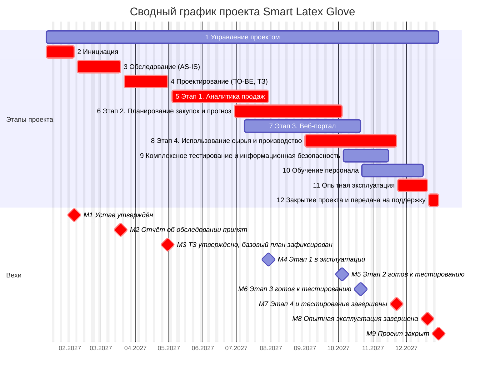
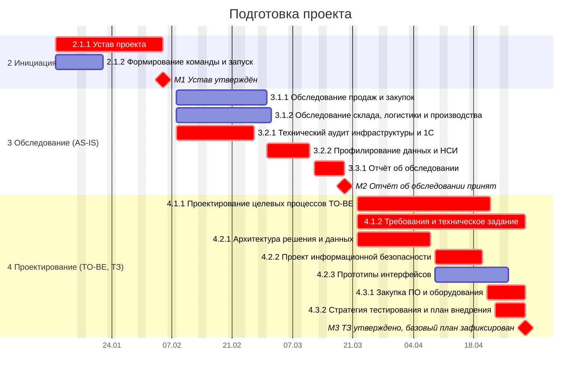
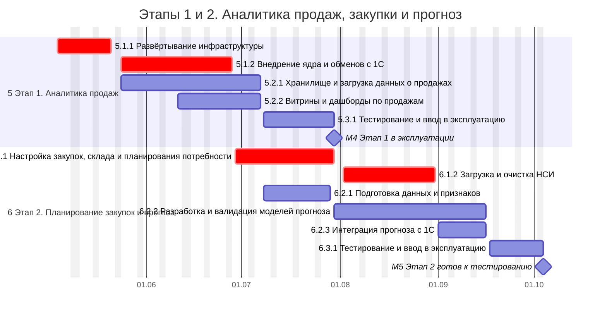
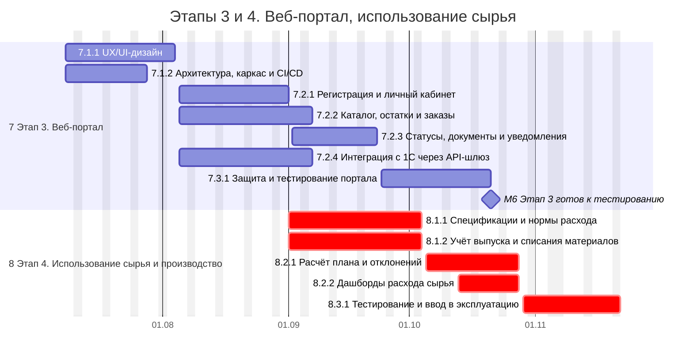
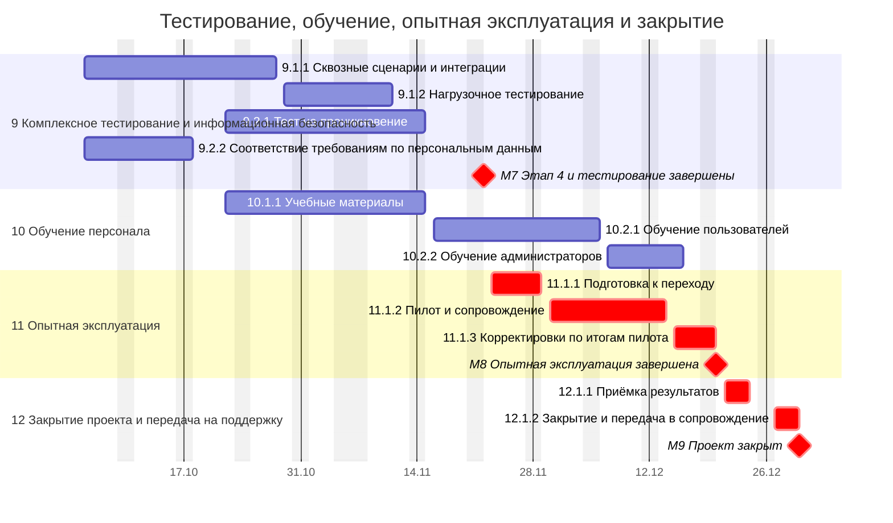

# Практическая работа №4. Определение расписания проекта

**Дисциплина:** Управление информационно-технологическими проектами
**Вариант:** 10
**Заказчик:** ООО «Latex Glove»
**Проект:** «Smart Latex Glove»

---

## Часть 1. Исходные данные и методика

### 1.1 Исходные данные

- **Основа:** иерархическая структура работ из ПР3 (12 задач, 27 подзадач, 53 пакета работ) и Концепция из ПР2 (сроки, вехи, ставки, трудозатраты).
- **Работы расписания:** все 53 пакетов работ ИСР (требование «не менее 30 работ» выполнено), 9 вех (М1–М9), 12 задач-этапов как суммарные элементы.
- **Единица планирования:** рабочий день (8 часов). Трудозатраты каждого пакета равны ИСР, суммарно **10 380 чел.-ч** и **26 374 000 руб.** (без НДС), как в Концепции.
- **Обозначения связей:** ОН — окончание-начало, НН — начало-начало, ОО — окончание-окончание. Запаздывания (лаги) не используются.

### 1.2 Календарь проекта

Рабочая неделя — понедельник-пятница. Нерабочие праздничные дни 2027 года, учтённые в расписании:

| Дата | Причина |
|------|---------|
| 22.02.2027 (пн) | Перенос выходного с субботы 20.02 (суббота 20.02 в расписании не используется как рабочая) |
| 23.02.2027 (вт) | День защитника Отечества |
| 08.03.2027 (пн) | Международный женский день |
| 03.05.2027 (пн) | Перенос с 01.05 (суббота) |
| 10.05.2027 (пн) | Перенос с 09.05 (воскресенье) |
| 14.06.2027 (пн) | День России (перенос с 12.06) |
| 04.11.2027 (чт), 05.11.2027 (пт) | День народного единства, выходные 4–7 ноября |
| 31.12.2027 (пт) | Перенос выходного с 03.01 |

Праздничные дни 22.02, 23.02, 14.06, 04.11–05.11 и 31.12 подтверждены публикациями о производственном календаре на 2027 год; переносы 03.05 и 10.05 даны по общему правилу переноса праздников с выходных. Перед фиксацией базового плана календарь следует сверить с постановлением Правительства о переносе выходных дней в 2027 году.

### 1.3 Методика

1. Длительность пакета определялась по трудозатратам и пропускной способности исполнителей (не более 8 часов в день на человека) с учётом окон этапов Концепции.
2. Связи заданы по логике работ: ядро и инфраструктура до загрузки данных, данные до прогноза, функциональность портала до его защиты и тестирования, приёмка этапа после его работ.
3. Даты и резервы рассчитаны методом критического пути: прямой проход (ранние сроки), обратный проход (поздние сроки); **резерв** = поздний срок окончания минус ранний срок окончания (в рабочих днях). Работы с нулевым резервом образуют критический путь.
4. Трудозатраты распределяются по длительности пакета равномерно; нагрузка ролей считается по дням.
5. Управление проектом (задача 1) выполняется параллельно всему проекту и в критический путь не входит.

---

## Часть 2. Ресурсы и их стоимость

Ставки приняты как в Концепции. Исполнители заданы ролями; количество людей в роли определено по пиковой загрузке (см. часть 5).

| Роль | Ставка, руб./ч | Трудозатраты, чел.-ч | Стоимость, руб. | Исполнителей в пике |
|------|---------------:|---------------------:|----------------:|--------------------:|
| Руководитель проекта | 3 000 | 840 | 2 520 000 | 1 |
| Бизнес-аналитик | 2 500 | 1 000 | 2 500 000 | 2 |
| Системный аналитик | 2 500 | 820 | 2 050 000 | 2 |
| Архитектор решения | 3 500 | 300 | 1 050 000 | 1 |
| Консультант 1С | 2 600 | 1 360 | 3 536 000 | 2 |
| Разработчик 1С | 2 500 | 1 120 | 2 800 000 | 2 |
| Инженер данных | 2 800 | 960 | 2 688 000 | 2 |
| Аналитик данных / ML-инженер | 3 000 | 560 | 1 680 000 | 2 |
| Backend-разработчик | 2 500 | 620 | 1 550 000 | 2 |
| Frontend-разработчик / UX | 2 300 | 720 | 1 656 000 | 2 |
| Тестировщик | 1 800 | 980 | 1 764 000 | 3 |
| DevOps / специалист по ИБ | 2 800 | 600 | 1 680 000 | 1 |
| Технический писатель / тренер | 1 800 | 500 | 900 000 | 2 |
| **Итого** | | **10 380** | **26 374 000** | **24** |

Сумма стоимости ресурсов равна статье «Трудозатраты» Концепции (26 374 000 руб.).

---

## Часть 3. Расписание работ

Столбец «Крит.» отмечает работы критического пути. Строки задач-этапов (полужирным) показывают суммарные даты, трудозатраты и стоимость.

| Код | Работа | Предшественники | Длит., дн | Начало | Окончание | Резерв, дн | Крит. | Трудозатраты, ч | Стоимость, руб. | Исполнители и часы |
|-----|--------|-----------------|----------:|--------|-----------|-----------:|:-----:|----------------:|----------------:|--------------------|
| **1** | **Управление проектом** | | **246** | **11.01.2027** | **30.12.2027** | | | **840** | **2 520 000** | |
| 1.1.1 | Планирование проекта | — | 77 | 11.01.2027 | 30.04.2027 | — |  | 140 | 420 000 | Руководитель проекта 140 |
| 1.1.2 | Мониторинг, коммуникации и отчётность | — | 246 | 11.01.2027 | 30.12.2027 | — |  | 340 | 1 020 000 | Руководитель проекта 340 |
| 1.2.1 | Управление рисками | — | 246 | 11.01.2027 | 30.12.2027 | — |  | 120 | 360 000 | Руководитель проекта 120 |
| 1.2.2 | Управление изменениями и качеством | — | 246 | 11.01.2027 | 30.12.2027 | — |  | 240 | 720 000 | Руководитель проекта 240 |
| **2** | **Инициация** | | **20** | **11.01.2027** | **05.02.2027** | | | **80** | **220 000** | |
| 2.1.1 | Устав проекта | — | 20 | 11.01.2027 | 05.02.2027 | 0 | да | 50 | 125 000 | Бизнес-аналитик 50 |
| 2.1.2 | Формирование команды и запуск | 2.1.1 (НН) | 10 | 11.01.2027 | 22.01.2027 | 10 |  | 30 | 95 000 | Бизнес-аналитик 10; Архитектор решения 20 |
| М1 | ◆ Устав и план проекта утверждены | 2.1.1 (ОН), 2.1.2 (ОН) | 0 | 05.02.2027 | 05.02.2027 | 0 | да | | | |
| **3** | **Обследование (AS-IS)** | | **27** | **08.02.2027** | **19.03.2027** | | | **580** | **1 542 000** | |
| 3.1.1 | Обследование продаж и закупок | М1 (ОН) | 14 | 08.02.2027 | 01.03.2027 | 7 |  | 150 | 375 000 | Бизнес-аналитик 100; Системный аналитик 50 |
| 3.1.2 | Обследование склада, логистики и производства | М1 (ОН) | 15 | 08.02.2027 | 02.03.2027 | 6 |  | 170 | 425 000 | Бизнес-аналитик 120; Системный аналитик 50 |
| 3.2.1 | Технический аудит инфраструктуры и 1С | М1 (ОН) | 13 | 08.02.2027 | 26.02.2027 | 0 | да | 120 | 356 000 | Архитектор решения 40; Консультант 1С 40; DevOps / специалист по ИБ 40 |
| 3.2.2 | Профилирование данных и НСИ | 3.2.1 (ОН) | 8 | 01.03.2027 | 11.03.2027 | 0 | да | 100 | 286 000 | Инженер данных 40; Консультант 1С 40; Архитектор решения 20 |
| 3.3.1 | Отчёт об обследовании | 3.1.1 (ОН), 3.1.2 (ОН), 3.2.2 (ОН) | 6 | 12.03.2027 | 19.03.2027 | 0 | да | 40 | 100 000 | Бизнес-аналитик 20; Системный аналитик 20 |
| М2 | ◆ Отчёт об обследовании принят | 3.3.1 (ОН) | 0 | 19.03.2027 | 19.03.2027 | 0 | да | | | |
| **4** | **Проектирование (TO-BE, ТЗ)** | | **30** | **22.03.2027** | **30.04.2027** | | | **1 020** | **2 698 000** | |
| 4.1.1 | Проектирование целевых процессов TO-BE | М2 (ОН) | 24 | 22.03.2027 | 22.04.2027 | 0 | да | 200 | 504 000 | Бизнес-аналитик 120; Системный аналитик 40; Консультант 1С 40 |
| 4.1.2 | Требования и техническое задание | 4.1.1 (НН) | 30 | 22.03.2027 | 30.04.2027 | 0 | да | 260 | 594 000 | Бизнес-аналитик 40; Системный аналитик 140; Технический писатель / тренер 80 |
| 4.2.1 | Архитектура решения и данных | М2 (ОН) | 14 | 22.03.2027 | 08.04.2027 | 0 | да | 200 | 602 000 | Архитектор решения 80; Консультант 1С 40; Инженер данных 60; Системный аналитик 20 |
| 4.2.2 | Проект информационной безопасности | 4.2.1 (ОН) | 8 | 09.04.2027 | 20.04.2027 | 0 | да | 100 | 308 000 | DevOps / специалист по ИБ 60; Архитектор решения 40 |
| 4.2.3 | Прототипы интерфейсов | 4.2.1 (ОН) | 12 | 09.04.2027 | 26.04.2027 | 4 |  | 120 | 304 000 | Frontend-разработчик / UX 80; Аналитик данных / ML-инженер 40 |
| 4.3.1 | Закупка ПО и оборудования | 4.2.2 (ОН) | 8 | 21.04.2027 | 30.04.2027 | 0 | да | 100 | 286 000 | Консультант 1С 40; Инженер данных 40; Архитектор решения 20 |
| 4.3.2 | Стратегия тестирования и план внедрения | 4.1.1 (ОН) | 6 | 23.04.2027 | 30.04.2027 | 0 | да | 40 | 100 000 | Системный аналитик 40 |
| М3 | ◆ ТЗ и архитектура утверждены, базовый план зафиксирован | 4.1.2 (ОН), 4.2.3 (ОН), 4.3.1 (ОН), 4.3.2 (ОН) | 0 | 30.04.2027 | 30.04.2027 | 0 | да | | | |
| **5** | **Этап 1. Аналитика продаж** | | **62** | **04.05.2027** | **30.07.2027** | | | **1 420** | **3 576 000** | |
| 5.1.1 | Развёртывание инфраструктуры | М3 (ОН) | 13 | 04.05.2027 | 21.05.2027 | 0 | да | 200 | 536 000 | DevOps / специалист по ИБ 100; Консультант 1С 60; Разработчик 1С 40 |
| 5.1.2 | Внедрение ядра и обменов с 1С | 5.1.1 (ОН) | 25 | 24.05.2027 | 28.06.2027 | 0 | да | 380 | 964 000 | Консультант 1С 140; Разработчик 1С 200; Системный аналитик 40 |
| 5.2.1 | Хранилище и загрузка данных о продажах | 5.1.1 (ОН) | 32 | 24.05.2027 | 07.07.2027 | 2 |  | 400 | 1 102 000 | Инженер данных 340; Системный аналитик 40; Бизнес-аналитик 20 |
| 5.2.2 | Витрины и дашборды по продажам | 5.2.1 (ОО) | 18 | 11.06.2027 | 07.07.2027 | 79 |  | 280 | 686 000 | Frontend-разработчик / UX 160; Инженер данных 60; Бизнес-аналитик 60 |
| 5.3.1 | Тестирование и ввод в эксплуатацию | 5.2.1 (ОН), 5.2.2 (ОН), 5.1.2 (ОН) | 17 | 08.07.2027 | 30.07.2027 | 79 |  | 160 | 288 000 | Тестировщик 120; Технический писатель / тренер 40 |
| М4 | ◆ Этап 1 введён в эксплуатацию | 5.3.1 (ОН) | 0 | 30.07.2027 | 30.07.2027 | 79 |  | | | |
| **6** | **Этап 2. Планирование закупок и прогноз** | | **70** | **29.06.2027** | **04.10.2027** | | | **1 700** | **4 384 000** | |
| 6.1.1 | Настройка закупок, склада и планирования потребности | 5.1.2 (ОН) | 24 | 29.06.2027 | 30.07.2027 | 0 | да | 520 | 1 342 000 | Консультант 1С 300; Разработчик 1С 120; Системный аналитик 60; DevOps / специалист по ИБ 40 |
| 6.1.2 | Загрузка и очистка НСИ | 6.1.1 (ОН) | 22 | 02.08.2027 | 31.08.2027 | 0 | да | 260 | 656 000 | Разработчик 1С 160; Консультант 1С 60; Бизнес-аналитик 40 |
| 6.2.1 | Подготовка данных и признаков | 5.2.1 (ОН) | 16 | 08.07.2027 | 29.07.2027 | 7 |  | 220 | 628 000 | Инженер данных 160; Аналитик данных / ML-инженер 60 |
| 6.2.2 | Разработка и валидация моделей прогноза | 6.2.1 (ОН) | 35 | 30.07.2027 | 16.09.2027 | 7 |  | 360 | 1 052 000 | Аналитик данных / ML-инженер 280; Инженер данных 40; Бизнес-аналитик 40 |
| 6.2.3 | Интеграция прогноза с 1С | 6.2.2 (ОО), 6.1.2 (ОН) | 12 | 01.09.2027 | 16.09.2027 | 7 |  | 180 | 418 000 | Разработчик 1С 40; Аналитик данных / ML-инженер 20; Системный аналитик 40; Бизнес-аналитик 20; Технический писатель / тренер 60 |
| 6.3.1 | Тестирование и ввод в эксплуатацию | 6.2.3 (ОН), 6.1.2 (ОН) | 12 | 17.09.2027 | 04.10.2027 | 7 |  | 160 | 288 000 | Тестировщик 160 |
| М5 | ◆ Этап 2 готов к комплексному тестированию | 6.3.1 (ОН) | 0 | 04.10.2027 | 04.10.2027 | 7 |  | | | |
| **7** | **Этап 3. Веб-портал** | | **76** | **08.07.2027** | **21.10.2027** | | | **1 960** | **4 694 000** | |
| 7.1.1 | UX/UI-дизайн | 5.2.1 (ОН) | 20 | 08.07.2027 | 04.08.2027 | 2 |  | 200 | 472 000 | Frontend-разработчик / UX 140; Бизнес-аналитик 60 |
| 7.1.2 | Архитектура, каркас и CI/CD | 7.1.1 (НН) | 15 | 08.07.2027 | 28.07.2027 | 7 |  | 220 | 614 000 | Backend-разработчик 100; Архитектор решения 40; DevOps / специалист по ИБ 80 |
| 7.2.1 | Регистрация и личный кабинет | 7.1.1 (ОН), 7.1.2 (ОН) | 20 | 05.08.2027 | 01.09.2027 | 2 |  | 300 | 726 000 | Backend-разработчик 140; Frontend-разработчик / UX 120; Системный аналитик 40 |
| 7.2.2 | Каталог, остатки и заказы | 7.2.1 (НН) | 24 | 05.08.2027 | 07.09.2027 | 14 |  | 420 | 990 000 | Backend-разработчик 180; Frontend-разработчик / UX 160; Системный аналитик 40; Тестировщик 40 |
| 7.2.3 | Статусы, документы и уведомления | 7.2.1 (ОН) | 16 | 02.09.2027 | 23.09.2027 | 2 |  | 260 | 600 000 | Backend-разработчик 120; Frontend-разработчик / UX 40; Бизнес-аналитик 40; Тестировщик 40; Технический писатель / тренер 20 |
| 7.2.4 | Интеграция с 1С через API-шлюз | 7.2.1 (НН) | 24 | 05.08.2027 | 07.09.2027 | 14 |  | 260 | 662 000 | Разработчик 1С 160; Backend-разработчик 20; Системный аналитик 40; DevOps / специалист по ИБ 40 |
| 7.3.1 | Защита и тестирование портала | 7.2.2 (ОН), 7.2.3 (ОН), 7.2.4 (ОН) | 20 | 24.09.2027 | 21.10.2027 | 2 |  | 300 | 630 000 | Тестировщик 160; DevOps / специалист по ИБ 80; Frontend-разработчик / UX 20; Технический писатель / тренер 40 |
| М6 | ◆ Этап 3 готов к комплексному тестированию | 7.3.1 (ОН) | 0 | 21.10.2027 | 21.10.2027 | 2 |  | | | |
| **8** | **Этап 4. Использование сырья и производство** | | **57** | **01.09.2027** | **22.11.2027** | | | **1 240** | **3 122 000** | |
| 8.1.1 | Спецификации и нормы расхода | 6.1.2 (ОН) | 24 | 01.09.2027 | 04.10.2027 | 0 | да | 320 | 816 000 | Консультант 1С 160; Бизнес-аналитик 80; Системный аналитик 40; Разработчик 1С 40 |
| 8.1.2 | Учёт выпуска и списания материалов | 8.1.1 (НН) | 24 | 01.09.2027 | 04.10.2027 | 0 | да | 300 | 766 000 | Консультант 1С 160; Разработчик 1С 100; Системный аналитик 40 |
| 8.2.1 | Расчёт плана и отклонений | 8.1.2 (ОН) | 18 | 05.10.2027 | 28.10.2027 | 0 | да | 260 | 730 000 | Инженер данных 100; Аналитик данных / ML-инженер 100; Разработчик 1С 60 |
| 8.2.2 | Дашборды расхода сырья | 8.2.1 (ОО) | 12 | 13.10.2027 | 28.10.2027 | 0 | да | 200 | 522 000 | Аналитик данных / ML-инженер 60; Инженер данных 20; Системный аналитик 20; Бизнес-аналитик 40; Разработчик 1С 40; Технический писатель / тренер 20 |
| 8.3.1 | Тестирование и ввод в эксплуатацию | 8.2.1 (ОН), 8.2.2 (ОН) | 15 | 29.10.2027 | 22.11.2027 | 0 | да | 160 | 288 000 | Тестировщик 120; Технический писатель / тренер 40 |
| **9** | **Комплексное тестирование и информационная безопасность** | | **28** | **05.10.2027** | **15.11.2027** | | | **690** | **1 613 000** | |
| 9.1.1 | Сквозные сценарии и интеграции | М5 (ОН) | 18 | 05.10.2027 | 28.10.2027 | 7 |  | 250 | 512 000 | Тестировщик 170; Системный аналитик 30; Разработчик 1С 30; Инженер данных 20 |
| 9.1.2 | Нагрузочное тестирование | 9.1.1 (ОН) | 8 | 29.10.2027 | 11.11.2027 | 7 |  | 120 | 256 000 | Тестировщик 80; DevOps / специалист по ИБ 20; Инженер данных 20 |
| 9.2.1 | Тест на проникновение | М6 (ОН) | 15 | 22.10.2027 | 15.11.2027 | 5 |  | 200 | 533 000 | DevOps / специалист по ИБ 80; Backend-разработчик 60; Тестировщик 30; Архитектор решения 30 |
| 9.2.2 | Соответствие требованиям по персональным данным | 9.1.1 (НН) | 10 | 05.10.2027 | 18.10.2027 | 23 |  | 120 | 312 000 | DevOps / специалист по ИБ 20; Системный аналитик 30; Разработчик 1С 50; Инженер данных 20 |
| М7 | ◆ Этап 4 завершён, комплексное тестирование и тест на проникновение пройдены | 8.3.1 (ОН), 9.1.2 (ОН), 9.2.1 (ОН), 9.2.2 (ОН), М4 (ОН) | 0 | 22.11.2027 | 22.11.2027 | 0 | да | | | |
| **10** | **Обучение персонала** | | **38** | **22.10.2027** | **16.12.2027** | | | **400** | **904 000** | |
| 10.1.1 | Учебные материалы | М6 (ОН) | 15 | 22.10.2027 | 15.11.2027 | 2 |  | 140 | 280 000 | Технический писатель / тренер 100; Бизнес-аналитик 40 |
| 10.2.1 | Обучение пользователей | 10.1.1 (ОН) | 15 | 16.11.2027 | 06.12.2027 | 2 |  | 200 | 484 000 | Консультант 1С 120; Технический писатель / тренер 40; Бизнес-аналитик 40 |
| 10.2.2 | Обучение администраторов | 10.2.1 (ОН) | 8 | 07.12.2027 | 16.12.2027 | 2 |  | 60 | 140 000 | Консультант 1С 40; Технический писатель / тренер 20 |
| **11** | **Опытная эксплуатация** | | **20** | **23.11.2027** | **20.12.2027** | | | **380** | **944 000** | |
| 11.1.1 | Подготовка к переходу | М7 (ОН) | 5 | 23.11.2027 | 29.11.2027 | 0 | да | 100 | 272 000 | Консультант 1С 40; Инженер данных 40; DevOps / специалист по ИБ 20 |
| 11.1.2 | Пилот и сопровождение | 11.1.1 (ОН) | 11 | 30.11.2027 | 14.12.2027 | 0 | да | 200 | 486 000 | Консультант 1С 80; Бизнес-аналитик 40; Тестировщик 40; DevOps / специалист по ИБ 20; Разработчик 1С 20 |
| 11.1.3 | Корректировки по итогам пилота | 11.1.2 (ОН) | 4 | 15.12.2027 | 20.12.2027 | 0 | да | 80 | 186 000 | Разработчик 1С 60; Тестировщик 20 |
| М8 | ◆ Опытная эксплуатация завершена | 11.1.3 (ОН), 10.2.1 (ОН), 10.2.2 (ОН) | 0 | 20.12.2027 | 20.12.2027 | 0 | да | | | |
| **12** | **Закрытие проекта и передача на поддержку** | | **8** | **21.12.2027** | **30.12.2027** | | | **70** | **157 000** | |
| 12.1.1 | Приёмка результатов | М8 (ОН) | 4 | 21.12.2027 | 24.12.2027 | 0 | да | 40 | 86 000 | Бизнес-аналитик 20; Технический писатель / тренер 20 |
| 12.1.2 | Закрытие и передача в сопровождение | 12.1.1 (ОН) | 4 | 27.12.2027 | 30.12.2027 | 0 | да | 30 | 71 000 | Архитектор решения 10; Технический писатель / тренер 20 |
| М9 | ◆ Акт приёмки подписан, проект закрыт | 12.1.2 (ОН) | 0 | 30.12.2027 | 30.12.2027 | 0 | да | | | |
| | **Итого** | | | **11.01.2027** | **30.12.2027** | | | **10 380** | **26 374 000** | |

Длительность проекта: **246 рабочих дней** (с 11.01.2027 по 30.12.2027).

---

## Часть 4. Диаграммы Ганта

Для читаемости расписание показано пятью диаграммами: сводной по этапам и четырьмя детальными по периодам. Красным выделены работы критического пути (на сводной диаграмме — этапы, содержащие такие работы), ромбы — вехи. Работы задачи 1 «Управление проектом» выполняются параллельно всему проекту и показаны на сводной диаграмме.

### 4.1 Сводная диаграмма по этапам

### 4.2 Подготовка проекта (январь – апрель 2027)

### 4.3 Этапы 1 и 2. Аналитика продаж, закупки и прогноз (май – октябрь 2027)

### 4.4 Этапы 3 и 4. Веб-портал, использование сырья (июль – ноябрь 2027)

### 4.5 Тестирование, обучение, опытная эксплуатация и закрытие (октябрь – декабрь 2027)

---

## Часть 5. Критический путь

Работы с нулевым резервом:

| № | Код | Работа | Длит., дн | Начало | Окончание |
|--:|-----|--------|----------:|--------|-----------|
| 1 | 2.1.1 | Устав проекта | 20 | 11.01.2027 | 05.02.2027 |
| 2 | 3.2.1 | Технический аудит инфраструктуры и 1С | 13 | 08.02.2027 | 26.02.2027 |
| 3 | 3.2.2 | Профилирование данных и НСИ | 8 | 01.03.2027 | 11.03.2027 |
| 4 | 3.3.1 | Отчёт об обследовании | 6 | 12.03.2027 | 19.03.2027 |
| 5 | 4.1.1 | Проектирование целевых процессов TO-BE | 24 | 22.03.2027 | 22.04.2027 |
| 6 | 4.1.2 | Требования и техническое задание | 30 | 22.03.2027 | 30.04.2027 |
| 7 | 4.2.1 | Архитектура решения и данных | 14 | 22.03.2027 | 08.04.2027 |
| 8 | 4.2.2 | Проект информационной безопасности | 8 | 09.04.2027 | 20.04.2027 |
| 9 | 4.3.1 | Закупка ПО и оборудования | 8 | 21.04.2027 | 30.04.2027 |
| 10 | 4.3.2 | Стратегия тестирования и план внедрения | 6 | 23.04.2027 | 30.04.2027 |
| 11 | 5.1.1 | Развёртывание инфраструктуры | 13 | 04.05.2027 | 21.05.2027 |
| 12 | 5.1.2 | Внедрение ядра и обменов с 1С | 25 | 24.05.2027 | 28.06.2027 |
| 13 | 6.1.1 | Настройка закупок, склада и планирования потребности | 24 | 29.06.2027 | 30.07.2027 |
| 14 | 6.1.2 | Загрузка и очистка НСИ | 22 | 02.08.2027 | 31.08.2027 |
| 15 | 8.1.1 | Спецификации и нормы расхода | 24 | 01.09.2027 | 04.10.2027 |
| 16 | 8.1.2 | Учёт выпуска и списания материалов | 24 | 01.09.2027 | 04.10.2027 |
| 17 | 8.2.1 | Расчёт плана и отклонений | 18 | 05.10.2027 | 28.10.2027 |
| 18 | 8.2.2 | Дашборды расхода сырья | 12 | 13.10.2027 | 28.10.2027 |
| 19 | 8.3.1 | Тестирование и ввод в эксплуатацию | 15 | 29.10.2027 | 22.11.2027 |
| 20 | 11.1.1 | Подготовка к переходу | 5 | 23.11.2027 | 29.11.2027 |
| 21 | 11.1.2 | Пилот и сопровождение | 11 | 30.11.2027 | 14.12.2027 |
| 22 | 11.1.3 | Корректировки по итогам пилота | 4 | 15.12.2027 | 20.12.2027 |
| 23 | 12.1.1 | Приёмка результатов | 4 | 21.12.2027 | 24.12.2027 |
| 24 | 12.1.2 | Закрытие и передача в сопровождение | 4 | 27.12.2027 | 30.12.2027 |

```mermaid
flowchart LR
    N2_1_1["2.1.1 Устав проекта (20 дн)"]
    NМ1{{"М1 Устав и план проекта утверждены"}}
    N3_2_1["3.2.1 Технический аудит инфраструктуры и 1С (13 дн)"]
    N3_2_2["3.2.2 Профилирование данных и НСИ (8 дн)"]
    N3_3_1["3.3.1 Отчёт об обследовании (6 дн)"]
    NМ2{{"М2 Отчёт об обследовании принят"}}
    N4_1_1["4.1.1 Проектирование целевых процессов TO-BE (24 дн)"]
    N4_1_2["4.1.2 Требования и техническое задание (30 дн)"]
    N4_2_1["4.2.1 Архитектура решения и данных (14 дн)"]
    N4_2_2["4.2.2 Проект информационной безопасности (8 дн)"]
    N4_3_1["4.3.1 Закупка ПО и оборудования (8 дн)"]
    N4_3_2["4.3.2 Стратегия тестирования и план внедрения (6 дн)"]
    NМ3{{"М3 ТЗ и архитектура утверждены, базовый план зафиксирован"}}
    N5_1_1["5.1.1 Развёртывание инфраструктуры (13 дн)"]
    N5_1_2["5.1.2 Внедрение ядра и обменов с 1С (25 дн)"]
    N6_1_1["6.1.1 Настройка закупок, склада и планирования потребности (24 дн)"]
    N6_1_2["6.1.2 Загрузка и очистка НСИ (22 дн)"]
    N8_1_1["8.1.1 Спецификации и нормы расхода (24 дн)"]
    N8_1_2["8.1.2 Учёт выпуска и списания материалов (24 дн)"]
    N8_2_1["8.2.1 Расчёт плана и отклонений (18 дн)"]
    N8_2_2["8.2.2 Дашборды расхода сырья (12 дн)"]
    N8_3_1["8.3.1 Тестирование и ввод в эксплуатацию (15 дн)"]
    NМ7{{"М7 Этап 4 завершён, комплексное тестирование и тест на проникновение пройдены"}}
    N11_1_1["11.1.1 Подготовка к переходу (5 дн)"]
    N11_1_2["11.1.2 Пилот и сопровождение (11 дн)"]
    N11_1_3["11.1.3 Корректировки по итогам пилота (4 дн)"]
    NМ8{{"М8 Опытная эксплуатация завершена"}}
    N12_1_1["12.1.1 Приёмка результатов (4 дн)"]
    N12_1_2["12.1.2 Закрытие и передача в сопровождение (4 дн)"]
    NМ9{{"М9 Акт приёмки подписан, проект закрыт"}}
    N2_1_1 --> NМ1
    NМ1 --> N3_2_1
    N3_2_1 --> N3_2_2
    N3_2_2 --> N3_3_1
    N3_3_1 --> NМ2
    NМ2 --> N4_1_1
    N4_1_1 --> N4_1_2
    NМ2 --> N4_2_1
    N4_2_1 --> N4_2_2
    N4_2_2 --> N4_3_1
    N4_1_1 --> N4_3_2
    N4_1_2 --> NМ3
    N4_3_1 --> NМ3
    N4_3_2 --> NМ3
    NМ3 --> N5_1_1
    N5_1_1 --> N5_1_2
    N5_1_2 --> N6_1_1
    N6_1_1 --> N6_1_2
    N6_1_2 --> N8_1_1
    N8_1_1 --> N8_1_2
    N8_1_2 --> N8_2_1
    N8_2_1 --> N8_2_2
    N8_2_1 --> N8_3_1
    N8_2_2 --> N8_3_1
    N8_3_1 --> NМ7
    NМ7 --> N11_1_1
    N11_1_1 --> N11_1_2
    N11_1_2 --> N11_1_3
    N11_1_3 --> NМ8
    NМ8 --> N12_1_1
    N12_1_1 --> N12_1_2
    N12_1_2 --> NМ9
```

Критический путь содержит 24 работ и проходит через обследование, проектирование, развёртывание инфраструктуры и ядра, закупки и склад, учёт сырья, приёмку этапа 4, опытную эксплуатацию и закрытие. Суммарный резерв по критическому пути равен нулю: любая задержка этих работ сдвигает дату закрытия.

Наибольшие резервы имеют: 5.2.2 (79 дн), 5.3.1 (79 дн), 9.2.2 (23 дн), 7.2.2 (14 дн), 7.2.4 (14 дн), 2.1.2 (10 дн). Резерв 79 дн у пакетов этапа 1 (5.2.2, 5.3.1) формальный: по логике связей они могли бы завершиться до конца ноября, но этап 1 выполняется как первый, чтобы получить эффект от аналитики продаж уже к вехе М4 (30.07.2027).

---

## Часть 6. Загрузка ресурсов и корректировка расписания

### 6.1 Первичный расчёт

Первичный расчёт выполнен для команды, где в каждой роли один исполнитель (8 часов в день), и логики связей без выравнивания нагрузки.

| Роль | Пик, ч/день | Дней с перегрузкой (больше 8 ч) |
|------|------------:|-------------------------------:|
| Руководитель проекта | 4.7 | 0 |
| Бизнес-аналитик | 15.1 | 25 |
| Системный аналитик | 12.0 | 11 |
| Архитектор решения | 5.7 | 0 |
| Консультант 1С | 22.2 | 61 |
| Разработчик 1С | 20.0 | 52 |
| Инженер данных | 14.0 | 66 |
| Аналитик данных / ML-инженер | 10.6 | 24 |
| Backend-разработчик | 15.8 | 24 |
| Frontend-разработчик / UX | 12.7 | 42 |
| Тестировщик | 21.3 | 40 |
| DevOps / специалист по ИБ | 7.8 | 0 |
| Технический писатель / тренер | 9.3 | 20 |

Перегрузка выявлена у 10 из 13 ролей. Наиболее напряжённые периоды: с мая по ноябрь, когда параллельно идут ядро 1С, хранилище данных, портал, прогноз и комплексное тестирование.

### 6.2 Корректировка

1. **Перепланирование.** Обучение администраторов (10.2.2) поставлено после обучения пользователей (10.2.1) вместо параллельного выполнения, а 10.2.1 растянуто с 13 до 15 дней; пилотные пакеты 11.1.2 и 11.1.3 перераспределены (11 и 4 дня вместо 12 и 3). Это убрало пики консультантов и разработчиков 1С в ноябре-декабре без изменения даты закрытия.
2. **Расширение команды.** В ролях, где пик остаётся выше 8 ч/день, добавлены исполнители (виртуальные ресурсы с той же ставкой): состав команды приведён ниже. Трудозатраты и стоимость пакетов не меняются.
3. **Контроль сроков.** Корректировки не сдвигают критический путь: дата закрытия остаётся 30.12.2027.

### 6.3 Итоговая загрузка

| Роль | Исполнителей | Пик, ч/день | Загрузка в пик, % | Дней с перегрузкой |
|------|-------------:|------------:|------------------:|-------------------:|
| Руководитель проекта | 1 | 4.7 | 58 | 0 |
| Бизнес-аналитик | 2 | 15.1 | 95 | 0 |
| Системный аналитик | 2 | 12.0 | 75 | 0 |
| Архитектор решения | 1 | 5.7 | 71 | 0 |
| Консультант 1С | 2 | 16.0 | 100 | 0 |
| Разработчик 1С | 2 | 15.8 | 99 | 0 |
| Инженер данных | 2 | 14.0 | 87 | 0 |
| Аналитик данных / ML-инженер | 2 | 10.6 | 66 | 0 |
| Backend-разработчик | 2 | 15.8 | 99 | 0 |
| Frontend-разработчик / UX | 2 | 12.7 | 79 | 0 |
| Тестировщик | 3 | 21.3 | 89 | 0 |
| DevOps / специалист по ИБ | 1 | 7.8 | 98 | 0 |
| Технический писатель / тренер | 2 | 9.3 | 58 | 0 |

### 6.4 Загрузка и расходы на персонал по месяцам

| Месяц 2027 | Рабочих дней | Трудозатраты, ч | Средняя загрузка, штатных единиц | Расходы на трудозатраты, руб. | Нарастающим итогом, руб. |
|-----------|-------------:|----------------:|---------------------------------:|------------------------------:|-------------------------:|
| январь | 15 | 137 | 1,1 | 398 617 | 398 617 |
| февраль | 18 | 503 | 3,5 | 1 355 638 | 1 754 255 |
| март | 22 | 526 | 3,0 | 1 447 657 | 3 201 912 |
| апрель | 22 | 872 | 5,0 | 2 335 405 | 5 537 317 |
| май | 19 | 420 | 2,8 | 1 136 180 | 6 673 497 |
| июнь | 21 | 857 | 5,1 | 2 242 374 | 8 915 871 |
| июль | 22 | 1 460 | 8,3 | 3 741 972 | 12 657 843 |
| август | 22 | 1 402 | 8,0 | 3 573 395 | 16 231 238 |
| сентябрь | 22 | 1 559 | 8,9 | 3 794 624 | 20 025 862 |
| октябрь | 21 | 1 355 | 8,1 | 3 284 002 | 23 309 863 |
| ноябрь | 20 | 780 | 4,9 | 1 822 447 | 25 132 310 |
| декабрь | 22 | 508 | 2,9 | 1 241 690 | 26 374 000 |
| **Итого** | **246** | **10 380** | | **26 374 000** | |

---

## Часть 7. Сопоставление с Концепцией

### 7.1 Фазы

| Код | Фаза | По Концепции | По расписанию |
|-----|------|--------------|---------------|
| 2 | Инициация | 11.01.2027 – 05.02.2027 | 11.01.2027 – 05.02.2027 |
| 3 | Обследование (AS-IS) | 08.02.2027 – 19.03.2027 | 08.02.2027 – 19.03.2027 |
| 4 | Проектирование (TO-BE, ТЗ) | 22.03.2027 – 30.04.2027 | 22.03.2027 – 30.04.2027 |
| 5 | Этап 1. Аналитика продаж | 04.05.2027 – 03.08.2027 | 04.05.2027 – 30.07.2027 |
| 6 | Этап 2. Планирование закупок и прогноз | 28.06.2027 – 04.10.2027 | 29.06.2027 – 04.10.2027 |
| 7 | Этап 3. Веб-портал | 05.07.2027 – 25.10.2027 | 08.07.2027 – 21.10.2027 |
| 8 | Этап 4. Использование сырья и производство | 30.08.2027 – 22.11.2027 | 01.09.2027 – 22.11.2027 |
| 9 | Комплексное тестирование и информационная безопасность | 04.10.2027 – 22.11.2027 | 05.10.2027 – 15.11.2027 |
| 10 | Обучение персонала | 25.10.2027 – 06.12.2027 | 22.10.2027 – 16.12.2027 |
| 11 | Опытная эксплуатация | 22.11.2027 – 20.12.2027 | 23.11.2027 – 20.12.2027 |
| 12 | Закрытие проекта и передача на поддержку | 20.12.2027 – 31.12.2027 | 21.12.2027 – 30.12.2027 |

### 7.2 Вехи

| Веха | Содержание | По Концепции | По расписанию | Отклонение, раб. дн |
|------|-----------|--------------|---------------|--------------------:|
| М1 | Устав и план проекта утверждены | 05.02.2027 | 05.02.2027 | 0 |
| М2 | Отчёт об обследовании принят | 19.03.2027 | 19.03.2027 | 0 |
| М3 | ТЗ и архитектура утверждены, базовый план зафиксирован | 30.04.2027 | 30.04.2027 | 0 |
| М4 | Этап 1 введён в эксплуатацию | 03.08.2027 | 30.07.2027 | -2 |
| М5 | Этап 2 готов к комплексному тестированию | 04.10.2027 | 04.10.2027 | 0 |
| М6 | Этап 3 готов к комплексному тестированию | 25.10.2027 | 21.10.2027 | -2 |
| М7 | Этап 4 завершён, комплексное тестирование и тест на проникновение пройдены | 22.11.2027 | 22.11.2027 | 0 |
| М8 | Опытная эксплуатация завершена | 20.12.2027 | 20.12.2027 | 0 |
| М9 | Акт приёмки подписан, проект закрыт | 31.12.2027 | 30.12.2027 | 0 |

**Выводы**

1. Расписание укладывается в срок Концепции: закрытие проекта — **30.12.2027**. Дата 31.12.2027 из Концепции является нерабочим днём, поэтому веху М9 следует считать 30.12.2027.
2. Вехи М1, М2, М3, М5, М7, М8 совпадают с Концепцией; вехи М4 (этап 1) и М6 (портал) наступают на 2 рабочих дня раньше. Старты этапов 2–4, комплексного тестирования, опытной эксплуатации и закрытия сдвинуты на 1–3 рабочих дня из-за логических связей (например, учёт сырья начинается после загрузки НСИ в 1С).
3. Обучение (фаза 10) заканчивается 16.12.2027, а не 06.12.2027: обучение администраторов (10.2.2) выполняется во время пилота. На критический путь это не влияет (резерв 10.2.2 положителен).
4. Критический путь не имеет резерва по времени, а следом сразу идут новогодние выходные. Рекомендуется заложить управленческий резерв (ориентир 5% длительности, около 12 рабочих дней) и согласовать с заказчиком, какой частью закрытия (передача документации, гарантийная поддержка) его можно компенсировать в январе 2028.
5. Пики загрузки приходятся на июль-октябрь (в среднем 8–9 штатных единиц в месяц); для тестировщиков и консультантов 1С нужно заранее зарезервировать людей на сентябрь-ноябрь.

**Дата составления:** 30.10.2026
**Руководитель проекта:** [ФИО]

